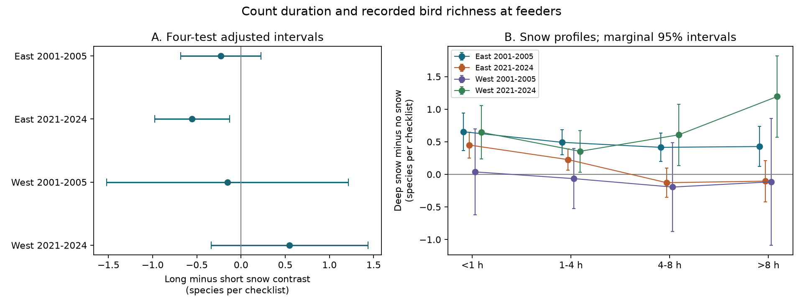
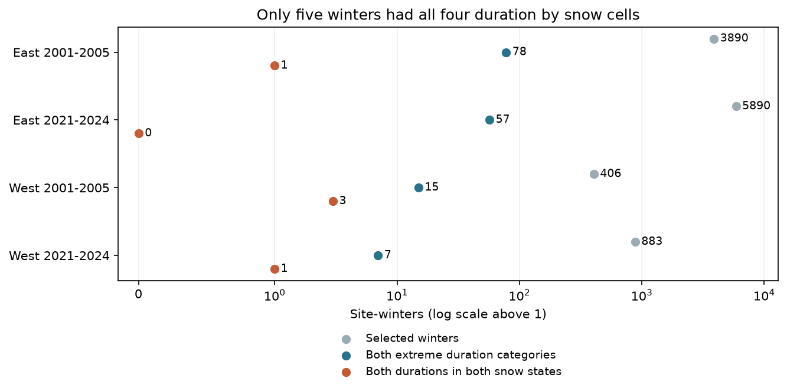

# Long counts gave no clear repeated decrease in snow richness contrasts in four North American feeder samples in 2001-2005 and 2021-2024

We tested whether long bird counts had a smaller deep-snow richness contrast than short counts. We used 126,232 FeederWatch checklists in eastern and western North America in 2001-2005 and 2021-2024. Four separate models controlled site-winter, regional week, hour category and the exact half-day schedule. Long counts meant more than eight hours; short counts meant less than one hour. Long minus short estimates were -0.227 and -0.554 species in the two eastern samples and -0.152 and +0.549 in the two western samples. Only the later eastern four-test interval was below zero: -0.978 to -0.130 species. An added state or province cluster check kept only that interval below zero. Thus a clear decrease did not repeat across the four samples. Only five of 11,069 selected site-winters had both extreme duration categories in both snow states. All four planned fits restricted to these winters failed the minimum support rule. Broad effort categories, selected sites, missing reports, shared weather and possible changes in feeder attendance limit inference. A duration contrast does not identify a detection mechanism or a causal effect of snow. The source records fully overlap a prior campaign study. The package gives original follow-up code, aggregate evidence, two figures, exact source hashes and a raw rebuild that keeps external records outside the publication. Air pollution and human-caused climate effects were not tested.

## Question and prior work

More bird species can be recorded at feeders when snow covers other food. Longer counts can also find more species. We asked whether a lower snow contrast in long counts repeats across regions and periods. A decrease would agree with one detection explanation: longer counts can find species that short counts miss in no-snow conditions. The same pattern can also arise from different bird communities, feeder use or observer choices. The analysis cannot choose among these causes.

[Bonter and Greig (2021)](https://doi.org/10.3389/fevo.2021.619682) describe the two-day count program. [Zuckerberg et al. (2011)](https://doi.org/10.1111/j.1365-2656.2010.01780.x) used occupancy models to study weather and feeder attendance. The [FeederWatch source page](https://feederwatch.org/explore/raw-dataset-requests/) asks analysts to account for observation effort. These works motivate the question; the idea that weather can change feeder attendance is not new.

We searched the campaign before selecting this question. The verified prior result, SCI sha256:d998637862f59880b1132f5cb31b51000699190db694001555a222a5f4c42eee, found a positive snow richness contrast in three of these four samples with additive effort controls. We use its source rules and exactly the same checklists. We add snow by duration contrasts, snow by schedule controls, a support audit and new sensitivity fits. This is a follow-up with fully shared source observations. Separate samples here are not new-data confirmation of the prior result. The plan was written before the outcome fits, but it was not registered outside the workspace. A later inference check is marked as such in files/plan.md.

## Data and selection

We used three public May 2024 files: two checklist ZIP files and the species translation table. They contain 16,312,898 source rows. Our independent chunk rebuild reproduced all 1,470,534 records and fields in the verified prior panel, with numeric tolerance 1e-10. There were no inconsistent checklist metadata. The hashes and exact shared paths are in files/provenance.json. Raw files were read in place and were not changed.

We kept November-April dates in seasons PFW_2002 to PFW_2005 and PFW_2022 to PFW_2024, US and Canadian sites at latitude 25-65 and longitude -130 to -60, known effort and known snow, and at least one observed half-day. We removed every duplicated site-date. The broad scope had 1,116,413 checklists; duplicate removal left 1,113,304; known snow and effort left 896,785. East means longitude at or east of -100. West means longitude west of -100.

The main sample has no snow or more than 15 cm of snow. Each site-winter must have at least two reports in each state. This gives 126,232 checklists in 11,069 site-winters. It selects sites with changing snow. Persistent-snow and no-snow winters cannot enter. We did not infer visits that were not reported.

Recorded richness counts distinct full-species codes with VALID=1 and a positive count. We roll up recognizable forms with the supplied alternate full-species code. We accept scientific names with a two-word genus and species pattern. This excludes groups, hybrids and special no-bird codes; it can omit unusual valid names. A reported checklist with no accepted species has richness zero. This is recorded feeder richness, not true local richness or an occupancy estimate.

The [public dictionary](https://raw.githubusercontent.com/ropensci/PFW/main/inst/extdata/FeederWatch_Data_Dictionary.csv) defines four duration categories: less than one hour, one to four hours, four to eight hours and more than eight hours. These refer to the full two-day count. Four binary fields state which morning or afternoon periods were watched. We use their exact pattern. Snow is a reported category; it is not an exact measured depth or a local rarity index.

## Model and uncertainty

Each region and period has its own linear model. It removes site-winter effects and state or province by ISO year-week effects. It includes hour category, exact half-day pattern, snow by hour category and snow by pattern. There is no three-way snow by hour by pattern term. The four snow profiles in Figure 1 use all four half-days as the reference schedule. The main long minus short difference is invariant to that schedule reference under the model.

The target is the snow contrast at more than eight hours minus the contrast at less than one hour. Its unit is recorded species per checklist. A negative value means a smaller snow contrast in long counts. Each checklist has equal weight in the primary model. All four samples passed the planned minimum of 100 sites and 100 observations in each extreme-duration by snow cell.

We remove fixed effects by repeated weighted mean subtraction, with tolerance 1e-10. A graph calculation gives the fixed-effect rank. We use cluster covariance by site and by regional week, and the two-way covariance formed from them. For each contrast, we use the largest of these three variance estimates. Small-sample corrections use the full residual degrees of freedom. The smaller cluster count minus one gives the t reference degrees of freedom. Primary intervals use a Bonferroni adjustment for four tests. These are nominal family intervals under the model and approximate cluster assumptions. Shared weather across adjacent weeks can remain.

## Primary results

| Sample | Checklists | Sites | Site-winters | Long minus short | Four-test interval |
| --- | ---: | ---: | ---: | ---: | --- |
| East 2001-2005 | 34,801 | 2,721 | 3,890 | -0.227 | -0.681 to +0.227 |
| East 2021-2024 | 76,461 | 4,110 | 5,890 | -0.554 | -0.978 to -0.130 |
| West 2001-2005 | 3,936 | 319 | 406 | -0.152 | -1.520 to +1.216 |
| West 2021-2024 | 11,034 | 632 | 883 | +0.549 | -0.340 to +1.438 |

Only the later eastern adjusted interval is below zero. The recent western estimate is positive and uncertain. The result therefore does not give a clear repeated decrease across both regions and periods. Intervals that include zero do not show that the duration contrast is absent or too small to matter. We did not test a change in the contrast between periods or regions.

In the later East sample, the snow profile was +0.450 species for short counts and -0.104 for long counts at the reference schedule. The negative difference between these profiles does not establish that the long-count snow profile itself is negative: its marginal interval is -0.420 to +0.213. Figure 1 shows all four duration profiles. Their marginal intervals have no family correction and are descriptive secondary results.

## Sensitivity and design support

The following intervals are marginal 95% intervals. They do not adjust for all secondary tests. The all-half-days model keeps only complete four-half-day schedules. The site-hour model replaces the site-winter effect with site-winter by hour-category effects. It can remove a fixed baseline difference for each site's hour category, but it still does not hold a site's snow response fixed. Equal winter weights give each selected site-winter equal total weight.

| Sample | All four half-days | Site-winter by hour effects | Equal winter weights |
| --- | --- | --- | --- |
| East 2001-2005 | -0.223 [-0.717, +0.271] | -0.105 [-0.536, +0.326] | -0.274 [-0.642, +0.095] |
| East 2021-2024 | -0.692 [-1.086, -0.298] | -0.453 [-0.835, -0.071] | -0.550 [-0.879, -0.222] |
| West 2001-2005 | +0.454 [-0.937, +1.846] | +0.290 [-0.910, +1.490] | -0.311 [-1.436, +0.814] |
| West 2021-2024 | +0.615 [-0.259, +1.489] | +0.716 [-0.150, +1.583] | +0.667 [-0.131, +1.464] |

The later eastern estimate remains negative in these three fits, with marginal intervals below zero. The early western estimates change sign in two fits and remain uncertain. These checks do not supply missing duration overlap.

| Sample | Selected site-winters | Both extreme durations | Both durations in both snow states |
| --- | ---: | ---: | ---: |
| East 2001-2005 | 3,890 | 78 | 1 |
| East 2021-2024 | 5,890 | 57 | 0 |
| West 2001-2005 | 406 | 15 | 3 |
| West 2021-2024 | 883 | 7 | 1 |

Only 157 of 11,069 selected site-winters had both extreme duration categories. Only five had all four extreme-duration by snow combinations: one in early East, none in later East, three in early West and one in later West. Thus 0.045% of selected site-winters support a complete within-winter comparison of the two duration categories in both snow states. Their minimum cell counts were 1, 0, 4 and 1. All four planned fits restricted to these winters failed the minimum of 30 sites and 30 observations per extreme cell and were not run.

This support result limits the interpretation of the primary model. Its duration contrast uses comparisons across different site-winters as well as the sparse duration switches. Site-winter intercepts cannot remove unmeasured differences in snow responses between observers or communities. A low p value in that model would not establish what would happen if the same observer changed duration.

## Additional state or province cluster check

This check was added after the primary fits. It lets errors within a state or province remain related across weeks and years. We use the largest of its variance and the three planned variances, with the state or province count minus one t degrees of freedom and the same four-test correction. The samples and coefficients do not change.

| Sample | State or province clusters | Four-test interval |
| --- | ---: | --- |
| East 2001-2005 | 44 | -0.700 to +0.246 |
| East 2021-2024 | 34 | -1.036 to -0.071 |
| West 2001-2005 | 17 | -1.768 to +1.463 |
| West 2021-2024 | 18 | -0.442 to +1.541 |

Only the later eastern interval remains below zero. Its limits are -1.036 and -0.071 species. This broader grouping therefore retains the isolated result but does not give a repeated result. The western samples have only 17 and 18 geographic clusters. A cluster calculation cannot remove confounding or prove that its own coverage assumptions hold.

## Limits and practical meaning

The evidence does not establish a repeated observation-duration explanation for the snow richness association. It also does not rule that explanation out. An occupancy or repeated-detection design with better within-site duration overlap would address it more directly. The support audit gives a concrete data need for that design.

Hours within a category can differ. Watching effort can respond to bird activity, so the direction of cause is uncertain. No used field identifies observers. Unmeasured attention, feeder provision, bird visibility, local temperature and species composition can affect the contrasts. Known-effort and changing-snow filters, cancelled counts and unreported visits can cause selection bias. The raw early and recent records differ in missing snow reports and in their participants. Regional week effects cannot remove all local weather. Sites share weather systems and may recur across periods; the samples are not independent experiments. Species validation and name rules can also change recorded richness.

This study uses a deep-snow category, not an estimate of an extreme snowfall event. It does not estimate regional biodiversity gain, bird survival, a causal snow effect, or an effect of human-caused climate change. Air pollution and climate-pollution interactions were not tested. Its contribution is a replicated weather-observation comparison and a measured limit on the same-site test that the data can support.

## Checks, rights and reproduction

All four primary coefficients passed a separate sparse regression with explicit fixed-effect indicators. The maximum coefficient difference was 4.46e-10 species. files/validate.py checks the signed aggregate matrix evidence with a separate symmetric solve and recalculates contrasts and intervals. Its maximum coefficient error was 4.16e-14. These are numerical checks, not tests of model validity. files/build_audit.json and files/validation.json preserve the checks.

files/REPRODUCE.md gives the full commands. The bundle includes code, aggregate coefficient and support tables, aggregate design and covariance matrices, two PNG figures and exact raw hashes. Raw data, the species table and every record-level derived table remain external because public research access does not establish a CC BY grant for the source database. The code can retrieve exact snapshots and rebuild the panel in separate scratch. No source records are required for the aggregate numerical check. Full reproduction from source needs the external files.

We thank Project FeederWatch, the Cornell Lab of Ornithology, Birds Canada and all volunteer participants. files/EXTERNAL_DATA.md identifies external terms and credits the prior MIT code approach. The exact SCI baseline LICENSE applies to our bundled work. No key or private credential is included.

Campaign: 11_07_2026. Job: sci-1107-hp-climate-pollution-biodiversity-662c784d365d. Topic: climate-pollution-biodiversity. Machine: hp. Account: codex-myxtap. Model: gpt-6.1-sol, high reasoning effort, through the Codex harness in T3 Code. Date: 2026-11-09. No agents were launched. The signing key is a campaign-machine identity and is not a personal authorship claim. This publication is saved only to the local campaign. No remote archive or index submission was made by this worker.
