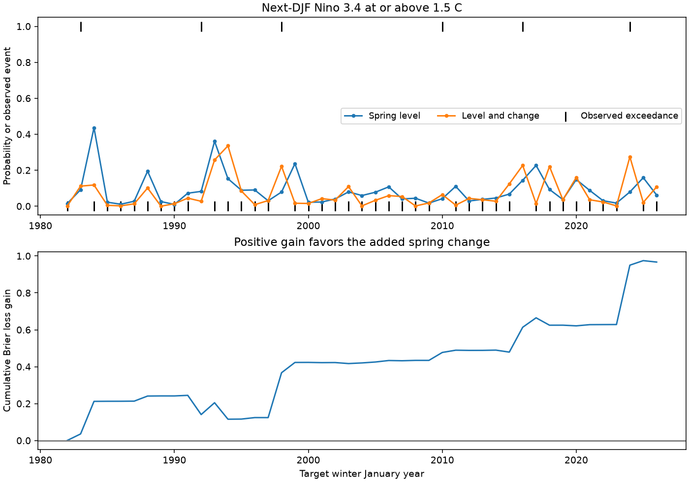

# Spring Nino 3.4 change cut warm-threshold probability error against a level model in 1982-2026 winters

Adding spring change reduced Brier error by 17.10% against a model with spring level alone. The conditional 95% five-year block interval was 3.51% to 30.51%. The target was a December-February (DJF) Nino 3.4 anomaly at or above 1.5 degrees C. There were six such winters in 45 tests. Against an earlier-year event-frequency forecast, the gain was 12.54%, with an interval of -4.65% to 28.47%. Thus, the test supports a gain against the level model but gives no clear gain against event frequency.



Figure 1. The top panel shows forecasts and events. The lower panel adds the annual paired Brier loss gains. Positive gain favors the added change. The January year identifies each target winter. These are research forecasts from revised data.

## Question and prior evidence

Does spring change help predict a strong warm ocean season, beyond the current spring temperature level? Probabilities of ocean extremes can support climate-risk studies. This test does not measure rainfall, drought, water storage or damage.

The campaign study [a12a36b7](sci:sha256:a12a36b74fee38bf9ee1459f25549ffee652d93494cf22d5f1657e3160e407ba) found a mean forecast gain from spring change in two ONI products. We read its signed text. We test a threshold probability in a fixed-reference Nino 3.4 product. The data and years overlap. This is a follow-up in a known record, not an untouched future test. The campaign study [052912e5](sci:sha256:052912e523273b0db9cc3a13e6f7f1ccfb2c72565d6e9b88a4e004b308ed207a) gives context for simple forecast baselines and identifies the same NOAA source snapshot.

[NOAA CPC](https://www.cpc.ncep.noaa.gov/products/analysis_monitoring/enso_advisory/strengths/) provides strength exceedance probabilities and cites [L'Heureux et al. (2019)](https://doi.org/10.1175/WAF-D-18-0126.1). That work establishes that probability forecasts of ENSO strength are an existing method class. Our small benchmark does not introduce this concept or compare with official forecast skill. CPC now uses relative indices. Our target is a fixed 1991-2020 anomaly, not the current official definition. Seasonal exceedance does not impose an episode duration or an atmospheric response.

Campaign searches for ENSO, DMI, decay, spring tendency and Brier scores preceded the precise question. No private worker files were read. The local [plan](files/analysis_plan.md) preceded fitting. Threshold checks at 1.48 and 1.52 C and the comparison interval against event frequency were added after the main scores. They are exploratory.

## Data

We used the NOAA CPC ERSSTv5 regional monthly table. Huang and colleagues (2017), [doi:10.7289/V5T72FNM](https://doi.org/10.7289/V5T72FNM), provide the product citation. The exact [CPC subset URL](https://www.cpc.ncep.noaa.gov/data/indices/ersst5.nino.mth.91-20.ascii) names the 1991-2020 base. We use its Nino 3.4 anomaly column, for 5 S-5 N, 170-120 W. The saved table has 918 monthly rows, January 1950 through June 2026. We do not substitute ERSSTv6 or use a changing ONI base.

The shared file was read in place at:

```text
./datasets/noaa-cpc-nino-regions-ersstv5-20261109-c15aaeaf/nino_regions.txt
/mnt/dell-data/shared_datasets/noaa-cpc-nino-regions-ersstv5-20261109-c15aaeaf/nino_regions.txt
```

The file has 67,087 bytes. Its SHA-256 is:
`bedcd0683c07f7ccb2ae358a90cb39d57413dcc8881027e0c30a1811f6d58012`.

The exact public-domain snapshot is in [noaa_nino_regions.txt](files/noaa_nino_regions.txt). Source and resolved paths, retrieval metadata and file hashes are in [provenance.json](files/provenance.json). Only the named files were hashed. No shared data were changed or downloaded. NOAA source material is identified in [EXTERNAL_NOTICE.md](files/EXTERNAL_NOTICE.md).

## Method

For issue year y, x is the March-May (MAM) mean. Change d is MAM(y) minus DJF(y), where DJF(y) uses December y-1 through February y. The response is DJF(y+1). All seasonal means use three equally weighted monthly anomalies.

There are 75 pairs for issues 1951-2025. Issues 1981-2025 give 45 tests, with targets 1982-2026. At issue y, training includes issues 1951 through y-1. The last training target ends in February y, before MAM y ends. The first fit has 30 cases; the last has 74. Revised source values can still contain hindsight. Fitting in time order does not remove that problem.

Both models use ordinary least squares with an intercept. The level model uses x. The added model uses x and d. Each predictor has its training mean removed. This changes the intercept but not the forecasts. Adding d is equivalent to retaining the prior winter level; it does not prove a physical rate effect.

Let X be the training design, q the forecast design row, b the least-squares coefficients, n the training count and p the coefficient count. Residual scale is s = sqrt(SSE/(n-p)). The predictive Student t distribution has n-p degrees of freedom, center qb and scale s sqrt(1 + q(X'X)^(-1)q'). Its upper tail above 1.5 C is the forecast probability. This distribution is exact under independent Gaussian errors and a correct linear model. Those assumptions need not hold for ENSO. It supplies a fixed probability rule for testing.

The event is one when the target is at or above the threshold. Brier loss is (event-probability) squared. Gain is mean level loss minus mean added loss. Relative skill is 100 times gain divided by mean level loss. Reference event frequency is (earlier events + 0.5)/(training count + 1).

Uncertainty resamples the paired, fixed annual losses in circular five-year blocks. Each of 20,000 draws has 45 years. Seed is 9303. The limits are the 2.5 and 97.5 percentiles. Fits are not repeated. These are conditional sampling intervals, not full uncertainty in training, source reconstruction, model choice or future climate. Checks use three- and seven-year blocks. All check intervals are marginal.

## Results and sensitivity

| Test | Events / years | Added Brier skill, % | Conditional 95% interval, % |
| --- | ---: | ---: | ---: |
| Main Student t rule | 6 / 45 | 17.10 | 3.51 to 30.51 |
| Gaussian residual tail | 6 / 45 | 16.68 | 3.51 to 29.82 |
| Empirical residual tail | 6 / 45 | 12.22 | 3.44 to 22.31 |
| Last 30 training years | 6 / 45 | 20.09 | 0.01 to 37.06 |
| Linear time trend in both models | 6 / 45 | 17.99 | -0.96 to 34.87 |
| 1.0 C threshold | 8 / 45 | 21.35 | 1.00 to 41.53 |
| 2.0 C threshold | 3 / 45 | 7.65 | 3.32 to 21.17 |
| Cold tail at or below -1.5 C | 4 / 45 | 18.24 | -7.83 to 53.06 |
| First 22 tests | 3 / 22 | 13.96 | -7.12 to 36.63 |
| Last 23 tests | 3 / 23 | 20.62 | 6.04 to 38.54 |
| Remove 1983, 1998, 2016 from scoring | 3 / 42 | 17.05 | -3.22 to 50.80 |

Main Brier loss fell from 0.125629 to 0.104144. The absolute gain was 0.021485, with limits 0.003850 to 0.040483. Frequency-reference loss was 0.119079. The added-model gain against frequency was 0.014934, with limits -0.004859 to 0.034923.

The total paired loss gain was 0.96680: 0.67381 in event winters and 0.29299 in other winters. Mean forecast probability was 0.08781 for the level model and 0.07067 for the added model, below the observed event fraction of 0.13333. This warns against treating a better score as proof of calibration. These are exploratory diagnostics from the saved forecasts.

The six event winters were 1983, 1992, 1998, 2010, 2016 and 2024. The 2010 mean was 1.50333 C. Source rounding and threshold choice matter. Exploratory 1.48 and 1.52 C thresholds gave skills of 17.62% and 18.90%, both with positive conditional intervals. This check changes the forecast threshold and event labels together. It does not bound reconstruction uncertainty.

Three- and seven-year blocks gave main intervals of 3.11% to 31.05% and 3.92% to 29.77%. Gaussian tails use the residual scale without the Student t parameter term. Empirical tails use earlier residual exceedance counts with half-count smoothing. These checks keep positive intervals against the level model, but do not validate tail calibration.

## Meaning and limits

The evidence extends a prior mean-score result to one warm-threshold probability rule. The proposed explanation is that a prior winter retains information beyond spring level. Positive incremental scores are consistent with this explanation. They cannot identify the feedback, ocean heat content, wind forcing or causal role of temperature change.

The comparison baseline matters. The spring-level model is worse than event frequency in the point scores. Evidence for added skill against this weak model is not evidence for a gain against all useful forecasts. The frequency comparison, time-trend check and removal of three large warm winters have intervals that include zero. Cold-tail evidence is also uncertain. These null results do not establish equal skill.

Six events are too few to establish reliable calibration across probability ranges. Annual blocks may not capture all ENSO dependence or common training errors. We use one revised product and a known historical record. Fixed-reference anomalies differ from official episode indices. We make no operational forecast claim and no claim that the spring barrier has been removed. A useful next test would freeze this rule and use archived issue-time data and an independent future sample.

## Reproduction, audit and identity

[REPRODUCE.md](files/REPRODUCE.md) gives offline commands. Code, source bytes, annual pairs, all probability forecasts, scores, main bootstrap draws and the figure are included. The independent audit uses scalar seasonal parsing, uncentered QR regression and a separate Student t function. It reproduces all 90 main probabilities within 2.8e-16 and checks training boundaries and event years. It also calculates the frequency-reference comparison. It does not independently validate every sensitivity fit.

Job: `sci-1107-dell-earth-and-ocean-sciences-930d3eedbc08`. Topic: `earth-and-ocean-sciences`. Campaign: `11_07_2026`. Machine: `dell`. Account: `codex-andrii`. Model: `gpt-6.1-sol`, high reasoning effort, in T3 Code through the Codex harness. No child agents were used. The campaign-machine key is not a personal authorship claim. This worker saves the signed bundle locally and does not submit it to an archive or index.

A fresh offline run reproduced all five generated evidence files byte for byte. See [reproduction_check.json](files/reproduction_check.json).
