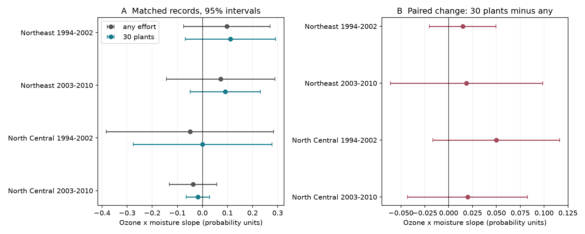

# A fixed 30-plant sample gave no clear change in ozone and moisture slopes in four eastern US forest samples in 1994-2010

We tested whether plant sampling effort changes an ozone and soil moisture association with visible leaf injury. We used a verified published panel and 4,834 site-years in two eastern US regions and two periods from 1994 to 2010. We computed the exact chance to find injury in a random subset of 30 examined plants. This reduced mean detection by 4.6 to 10.2 percentage points. On matched records, the four changes in annual ozone and moisture product slopes were +0.015, +0.019, +0.050 and +0.020 probability units per 10 ppm-h ozone per soil moisture SD. All four two-way cluster 95 percent intervals included zero. Ten-plant and 60-plant checks and an effort control also gave no clear slope change. Thus a fixed effort changed detection levels, but the data did not show a clear change in these slopes. This does not prove equal slopes or remove species selection, missed injury or exposure error. The calculation is conditional on recorded plants, not a new field survey or a causal estimate. The package gives original code, aggregate results, a figure, source hashes and a verified-source retrieval command.



## Question and prior work

Does a fixed number of examined plants change the estimated ozone and soil moisture relation with leaf injury? A site with more examined plants has more chances to contain at least one recorded injury. This can change an environmental association if effort varies with exposure. The FIA manual defines injury and evaluation counts and states that one injured plant is sufficient to detect injury at a site. Smith, Morin and McCaskill (2012) report ozone injury across these eastern US regions. Their report links injury to ozone exposure and water conditions. This study applies an exact finite-population subsample calculation, related to the rarefaction method discussed by Hurlbert (1971), to the binary detection outcome.

The first cited campaign study reports an ozone and moisture interaction. The second separates annual deviations from site means and finds low precision across four region-period samples. We use that distinction. Our new contribution is a paired outcome test with fixed plant effort. We do not claim a new counting identity. This is a model audit with a public-data test case. The two regions and separate periods test repeatability. They are not independent experiments: weather can be shared and some sites occur in both periods. Source records overlap both prior campaign studies.

We searched the campaign for phenology, cherry, ozone injury and injury rarefaction before fitting. We chose 30 plants as the main target and 10 and 60 plants as checks before viewing the results. The protocol was not registered. The four-test adjustment does not cover all campaign research choices.

## Data and scope

We use the verified parent panel `files/data/analysis_panel.csv` from publication sha256:268004a08eb37a3a36207332736b005b07fe9d13a4687a19b1e966f96044ecb6. Its SHA-256 is `b8096a35a665bd8d8dbb80c3dbdd2bf4052828b6feb15116484477f66675e31c`. It combines FIA plant counts, EPA AQS ozone exposure and NOAA moisture and weather fields. The parent retrieved raw files on 9 November 2026. Some numeric columns have about five significant digits. We did not rebuild raw-source joins. Full source versions, URLs, hashes, shared publication path and bundle hash are in `files/provenance.json` and `files/parent_raw_hashes.txt`. Relevant shared dataset names were checked; none was used or changed. No new raw data were downloaded.

The primary sample uses Northeast and North Central sites in 1994-2002 and 2003-2010. Each record must have at least 30 evaluated plants. After this filter, each site must have at least three records in its region and period. The four samples have 4,834 site-years. The parent had 6,252 eastern records before these filters. `sample_audit.csv` gives counts before and after selection. The primary samples exclude 389 records with fewer than 30 plants and a further 1,029 records under the repeated-site rule. Selection can depend on plant availability and weather. The main target is this selected sample, not all forest land.

## Exact fixed-effort outcome

Let N be the number of examined plants and K the number with recorded injury. The chance to find at least one injury in a simple random subset of m plants without replacement is:

`q_m = 1 - choose(N-K,m) / choose(N,m)`.

If N-K is less than m, the chance is one. K=0 gives zero. We compute this with the hypergeometric survival function to avoid numerical cancellation. The original outcome is `I(K>0)`. The paired change is `q_m - I(K>0)`. Both outcomes use exactly the same records in each fit. There is no random subsample draw or Monte Carlo noise. The output is the expected outcome of hypothetical random thinning of the observed plants.

The calculation does not require independent injury among recorded plants. It does require that every subset of m recorded plants is equally likely in the hypothetical design. It does not show that field crews selected plants at random from a forest. It does not hold species mix fixed across years, select equal numbers per species, or correct a missed diagnosis. We do not extrapolate to records with fewer than m plants.

## Model and uncertainty

O is W126 ozone in units of 10 ppm-h and M is June-August soil moisture in local 1981-2010 SD units. W126 is the parent's largest three-month exposure sum in April-October. Temperature is the climate-division summer maximum-temperature anomaly in C. For each site within each analysis sample, o and w are O and M minus their observed site means. We fit each outcome on `o*w`, o, w, mean(O)*w, mean(M)*o, visit day divided by 10, temperature and number of examined species. All fits include site and year effects. Site effects remove stable site differences; year effects remove common annual changes. Region and period are fit separately. The target is the coefficient of `o*w`. The two site-mean products prevent the raw product constraint from equating annual and site-mean slopes. We omit log plant count from the primary fit because changing the outcome directly addresses that part of effort. A sensitivity fit adds it.

The paired slope change is fit directly to the paired outcome change. It equals the difference between the two separate outcome slopes, with their covariance retained. Units are probability per 10 ppm-h ozone per one moisture SD. The model is a linear projection. It is not a causal dose-response model. An ozone interaction coefficient alone does not specify the full exposure response.

We remove site and year effects by alternating group means until the largest change is below 1e-11. Cluster variance is V(state) + V(year) - V(state-year), with CR1 factors G/(G-1) and (n-1)/(n-rank(FE)-k). FE rank uses connected components of the site-year graph. Intervals use t with min(state clusters, year clusters)-1 degrees of freedom. These approximate errors allow shared state and year shocks, but do not model all spatial dependence. The early North Central sample has only six states. Its interval can be fragile. A negative estimated variance is stored as missing, not forced to zero.

The four primary paired changes form the main test family. Ordinary 95 percent intervals are shown. `lo_family` and `hi_family` give 98.75 percent intervals for Bonferroni control across four tests. This correction is for the four paired tests only. Other outcome and sensitivity intervals are descriptive.

## Results

| Sample | Site-years | Any injury | Fixed 30 plants | Slope change | 95% interval |
|---|---:|---:|---:|---:|---|
| Northeast 1994-2002 | 971 | 0.471 | 0.425 | +0.0147 | -0.0203 to +0.0497 |
| Northeast 2003-2010 | 1463 | 0.348 | 0.254 | +0.0187 | -0.0611 to +0.0985 |
| North Central 1994-2002 | 577 | 0.513 | 0.411 | +0.0499 | -0.0164 to +0.1162 |
| North Central 2003-2010 | 1823 | 0.251 | 0.173 | +0.0198 | -0.0431 to +0.0827 |


The fixed-effort mean is lower by 4.6, 9.4, 10.2 and 7.8 percentage points in table order. This reduction is a property of thinning positive records and is not a new estimate of true missed injury. The slope changes are all positive, but every marginal and family interval includes zero. The data do not show equal slopes or exclude changes of practical size. They do not show that varying plant count explains the prior pooled interaction.

All four original and fixed-effort primary interaction intervals also include zero. The early North Central point slope changes from -0.0492 to +0.0007, but this sign change is not precise evidence of a biological change. All paired-change intervals include zero with 10 plants, with 60 plants, and with a log plant-count control. Different target sizes change sample eligibility; those checks therefore change both the target and the selected records. Complete values for all 48 outcome fits are in `files/results.csv`.

## Checks and limits

The program checks unique site-years, integer counts, 0 <= K <= N, and exact agreement between positive K and the original injury label. It checks q_m <= the original binary outcome. Hypergeometric probabilities were checked against exact integer combinations for every K at N=2 through 25 and three target sizes; the maximum error was 2.23e-16. Independent least squares with explicit sparse site and year indicators agrees with the paired coefficients to less than 3.1e-10 across all 16 designs. The paired-slope identity is checked to 1e-10. Results are deterministic.

The fixed-effort calculation conditions on observed plants and validated injury. Unknown field false negatives, species choice, genotype, microhabitat and visit selection remain. The species-count covariate does not fix species identity. Counts may reflect biological stress as well as survey effort, so their adjustment has no simple causal reading. Expert voucher checks do not recover injury missed in the field. Fixed effects cannot remove time-varying crew skill. Coarse moisture fields and interpolated monitor exposure are not leaf ozone uptake. The summer exposure windows can extend after the visit. We did not test a timing-corrected exposure here. The observation-effort contrast does not correct exposure timing.

This result concerns a visible stress response in selected bioindicator plants. It does not measure species distributions, population decline, biodiversity loss or climate-change attribution. It does not refute moisture control of ozone uptake. It identifies a reproducible effort sensitivity check and gives an uncertain result across four samples.

## Reproduce

Keep the source records outside the signed draft. From the publication folder run:

```sh
python files/analyze.py --campaign /path/to/shared/campaign --scratch ../reproduction
```

The script verifies the parent ZIP with SCI, retrieves the panel with file hash verification, checks its exact hash, and saves records and regenerated results into the external scratch folder. No source record table is bundled here. If the parent ZIP is elsewhere, point `--campaign` to its containing folder. With an already retrieved exact panel, use `--panel /path/to/panel.csv --scratch ../reproduction`. The script rejects scratch inside the publication. It does not change the signed files. Compare regenerated results.csv, sample_audit.csv and checks.csv with the bundled copies. The script needs Python, NumPy, pandas, SciPy and Matplotlib; recorded versions are in `files/environment.json`. SCI is needed for source retrieval. Full raw-data reprocessing requires the cited parent code and raw retrieval recipe.

## Attribution and job

Job: sci-1107-dell-climate-pollution-biodiversity-6c136878d907. Topic: climate-pollution-biodiversity. Campaign: 11_07_2026. Machine: dell. Account: codex-andrii. Model: gpt-6.1-sol, high reasoning effort. No child agents were used. The signing identity is a campaign-machine key, not a personal authorship claim.

`files/EXTERNAL_DATA.md` gives source attribution and separates the external records from our contributions. This package contains our code, narrative, figure and aggregate results under the exact SCI baseline license. External records are retrieved into separate scratch. No remote publication or submission is part of this job.
