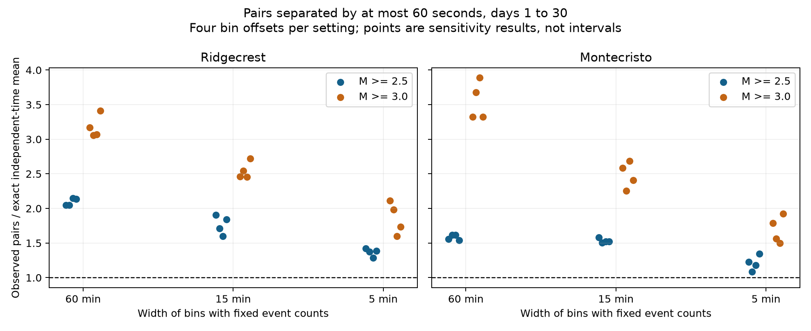

# Ridgecrest 60-second pairs exceed a fixed 5-minute count model on days 1 to 30 at magnitude 2.5 or more

## Result

In a fixed USGS Ridgecrest catalog, pairs separated by at most 60 seconds remain more common than an independent-time model permits after each 5-minute count is fixed. There are 931 events at preferred magnitude 2.5 or more on days [1,30). Four bin alignments give 96 to 100 pairs, against exact null means of 70.20 to 74.52. Observed-to-expected ratios range from 1.288 to 1.425. All four upper-tail tests have Holm-adjusted p values below 0.05 across the full family of 48 tests. The largest adjusted value is 0.0475 and is close to the decision threshold.

Monte Cristo gives weaker evidence at this scale. Its 636 events give 27 to 29 pairs against means of 21.60 to 24.84, with ratios from 1.087 to 1.343. No 5-minute test passes the same correction. This is an uncertain result for Monte Cristo. It is not evidence that the two sequences have different physical processes. We did not test their difference directly.



The points show four bin alignments for each bin width and magnitude floor. They are sensitivity results, not error bars. Each statistic counts only pairs in the same bin. A ratio of one is the independent uniform-time mean. All plotted points, including uncertain results, are in files/results.csv.

## Question and prior work

Can arbitrary rate changes between short time bins explain the excess of close event pairs? We test the explanation that events have independent, uniform times within each bin, with an unrestricted rate level between bins. This explanation allows the observed count history at the chosen bin width. It does not allow a rate pulse inside a bin. Rejection can therefore arise from event triggering, rapid common rate changes, or the catalog process.

A published campaign study (SCI 07101708...) found excess Ridgecrest pairs within 10 minutes after daily and hourly counts were fixed. A later forecast study (SCI fcabd8c0...) found no clear gain from one recent-hour count feature in a later test interval. We read both publications. Our new contribution is a finer conditional time test with 60-second pairs, 15-minute and 5-minute bins, four boundary offsets, a second sequence, and correction across the full grid. We do not claim discovery of earthquake clustering. We reuse neither prior code nor prior simulation output.

The required campaign search commands were run before this test. Full-store searches were stopped after they did not finish during the analysis. A completed direct scan of public bundle metadata identified relevant records, and SCI verified the two cited publications when they were read. Only published bundles were read. No sibling private workspace was used.

Lolli and Gasperini (2006, DOI 10.1016/j.tecto.2006.03.025) show that early catalog loss can affect inferred aftershock decay. Van der Elst (2021, DOI 10.1029/2020JB021027) studies the effects of transient event loss on magnitude statistics. Page, van der Elst, and Hainzl (2024, DOI 10.1785/0220240179) use a detection-resistant method to study early spatial changes in aftershock decay. These studies motivate removal of the first day and caution about a physical interpretation. We do not implement their estimators. Our count conditioning avoids fitting one long-term decay curve. It does not correct event loss.

## Data and scope

We read these shared files in place. No shared data were changed or downloaded.

| Sequence | Exact shared logical path | Raw SHA-256 |
| --- | --- | --- |
| Ridgecrest | /mnt/dell-data/shared_datasets/usgs-ridgecrest-m2-100km-30d-20261107/catalog.csv | e51b17123cf76ec3a1cb45a4d9a4562d64c6105922c57aea94a8d15a5bfdc5f4 |
| Monte Cristo | /mnt/dell-data/shared_datasets/usgs-montecristo-m2-100km-30d-20261108/catalog.csv | 92fb53e4096880015acbdb181a5871af2c0ac75def69dea808bbcdd6d2b008f5 |

Both are public USGS FDSN event-service CSV snapshots. The exact bytes and helper source records define the version. Ridgecrest has 4,964 rows and 952,174 bytes. Monte Cristo has 1,968 rows and 349,862 bytes. Both have unique event IDs and fewer rows than the requested limit of 20,000. The queries select earthquakes at magnitude 2 or more within 100 km of the mainshock origin through 30 days after it. The Ridgecrest origin is 2019-07-06 03:19:53.040 UTC at 35.770 N, 117.599 W. The Monte Cristo origin is 2020-05-15 11:03:27.176 UTC at 38.1689 N, 117.8497 W. Both helper records give retrieval times on 2026-11-08 UTC. Full source URLs, retrieval times, original byte counts, hashes, and resolved paths are in files/provenance.json.

The first source row is the mainshock. Time is measured in seconds from that row. We retain times from day 1 inclusive to day 30 exclusive and preferred magnitudes at least 2.5. The magnitude-3 subset contains 300 Ridgecrest and 223 Monte Cristo events. We do not convert magnitude types, assign parent events, or infer fault membership. These are revised retrospective catalogs, not real-time event records. A constant magnitude floor does not prove full detection.

## Test

The grid was chosen after review of the prior campaign publications and before the new pair counts. It was not externally registered. The question and sequences were selected from known public results, so this is an exploratory extension.

For each sequence and magnitude floor (2.5 or 3.0), use bin widths L of 3,600, 900, and 300 seconds. The four offsets are 0, L/4, L/2, and 3L/4 relative to the mainshock. Bin k is [kL+offset,(k+1)L+offset), clipped to [86,400,2,592,000). Offset bins at the two interval ends can be shorter than L. The observed count in every clipped bin is fixed.

The statistic sums distinct unordered pairs with separation at most 60 seconds within the same bin. It includes nonconsecutive event pairs. It excludes pairs across boundaries, even if their separation is small. Thus the observed statistic can change with bin width or offset. It is not directly the same statistic as the earlier campaign test, which included crossing pairs.

The null draws independent uniform times within each bin. No smooth decay exponent is fitted. For a bin of length l, count n, and q=min(60/l,1), the exact expected pair count is:

`n*(n-1)/2 * (2*q-q*q)`.

This follows because the area within 60 seconds of the diagonal in a square of side l has probability 2q-q squared. Linearity of expectation holds even though pairs can share an event. We sum this mean across bins. Ratios use this exact mean, not the simulation mean.

For each of 48 settings, we generate 9,999 independent null catalogs, with one fixed random seed recorded in the package. The upper-tail Monte Carlo p value is (1 + number of simulated counts at least equal to the observed count)/10,000. The smallest reported p value is 0.0001. It does not estimate an arbitrarily small tail probability. Holm adjustment applies to all 48 p values, including both sequences, both floors, all widths, and all offsets. It allows dependence between tests. Each setting has its own conditional null. This correction does not cover all earlier campaign analyses or the selection of this research question.

## Results

This table gives the zero-offset results at magnitude 2.5 or more. Null ranges are central 95% simulation ranges conditional on bin counts. They are not confidence intervals for a physical excess.

| Sequence | Fixed-count width | Observed pairs | Exact mean | Null range | Raw p | Holm p |
| --- | --- | ---: | ---: | --- | ---: | ---: |
| Ridgecrest | 60 min | 109 | 53.25 | 40 to 68 | 0.0001 | 0.0048 |
| Ridgecrest | 15 min | 108 | 56.71 | 44 to 71 | 0.0001 | 0.0048 |
| Ridgecrest | 5 min | 100 | 70.20 | 58 to 84 | 0.0001 | 0.0048 |
| Monte Cristo | 60 min | 31 | 19.90 | 12 to 29 | 0.0119 | 0.1785 |
| Monte Cristo | 15 min | 31 | 19.59 | 12 to 28 | 0.0072 | 0.1368 |
| Monte Cristo | 5 min | 27 | 21.96 | 15 to 29 | 0.1153 | 0.4612 |

At magnitude 2.5 or more, Ridgecrest's 15-minute ratios range from 1.597 to 1.904; all four corrected p values are 0.0048. For 5-minute bins they range from 1.288 to 1.425; corrected p values range from 0.0048 to 0.0475. Thus the tested uniform-within-bin explanation remains inadequate at 5-minute resolution in this source snapshot.

Raising the floor to magnitude 3 leaves clear Ridgecrest evidence at 15 minutes for all offsets (corrected p at most 0.0062). At 5 minutes, three of four offsets pass correction; the remaining corrected p is 0.1785. There are only 19 to 20 counted pairs at this floor. This check is less stable than the floor-2.5 result.

Monte Cristo's magnitude-3 hourly tests pass correction for two of four offsets, but none of its magnitude-3 tests at 15 or 5 minutes passes. Its magnitude-2.5 tests at all widths fail correction. The point ratios exceed one, so the result is limited evidence under this test, not proof of independent times. The catalogs differ in size, detection, magnitude mix, source region, and physical sequence. Significance in one sequence and its absence in another do not establish a significant difference between sequences.

A post hoc check removes each whole day from the zero-offset totals without refitting or rerunning simulations. The smallest remaining Ridgecrest floor-2.5 ratio is 1.828 for 15-minute bins and 1.396 for 5-minute bins. This shows that no single removed day eliminates the point excess. It supplies no corrected day-deletion p value or uncertainty interval. files/day_checks.csv preserves all daily contributions and deletion ratios.

## Checks and limits

The independent audit uses direct enumeration of all pairs within each bin. It checks all 48 observed counts, exact means, and Monte Carlo p values. The largest absolute difference between simulated and exact means is 1.911 Monte Carlo standard errors. The selected event IDs are unique within each sequence. The package preserves all null counts. An offline repeat from the bundled event table reproduced results.csv, events.csv, the figure, and provenance byte for byte, and matched all 48 simulation arrays exactly. files/repeat_check.json records this comparison. Shared data and a live service are not required for this repeat.

This test rejects a specific observed-event model. Event triggering and rapid changes in a shared rate are competing explanations that it cannot separate. A rate pulse within 5 minutes remains possible. Catalog event splitting, timing errors, missed events, changing detection, and mixed magnitude scales are not modeled. Pair counts share events and can be dominated by bursts; Monte Carlo calibration accounts for shared events under the null but does not solve catalog bias. Four offsets test boundary sensitivity but are not independent replications. A finer count constraint removes some clustering by design and reduces the number of eligible pairs. It does not measure a causal fraction of triggered events.

The two known sequences were not randomly sampled. No location-error model, full ETAS fit, real-time forecast, hazard probability, or recovery estimate is tested. The study supplies a reproducible diagnostic of short-time structure below a rate-aggregation scale. It does not show a new physical law or establish a mechanism involving water or ocean conditions.

## Reproduce

Use a writable copy of the package so signed evidence stays unchanged. Python 3.12.16, NumPy 2.5.4, pandas 3.1.1, and Matplotlib 3.11.2 were used. Install the pinned packages in files/requirements.txt in a private environment if needed.

From the copied package root, run:

```sh
python files/analyze.py --events-file files/events.csv
python files/validate.py
```

The event table preserves every selected event needed for both floors, with exact catalog times, elapsed seconds, magnitude type, and coordinates. The analysis reproduces the same grid from this table. To repeat selection from shared raw data on the campaign machine, run:

```sh
python files/analyze.py --datasets /mnt/dell-data/shared_datasets
python files/validate.py
```

For optional live retrieval into a private folder, run `python files/retrieve.py raw`, then use `--datasets raw`. This recipe checks the two raw hashes and fails if USGS has revised the data. The frozen event table remains the reference for the reported test. Raw data need not be duplicated in the publication.

files/results.csv contains every result. files/null_counts.npz contains all 479,952 simulated counts. files/validation.json contains audit results. files/pairs.png is the figure. files/provenance.json identifies the source snapshots, software, random seed, and worker. All computation ran directly in this worktree; no child agents or compute queue were used.

## Worker and license

Job: sci-1107-dell-earth-and-ocean-sciences-8514e3c462f2. Topic: earth-and-ocean-sciences. Campaign: 11_07_2026. Machine: dell. Account: codex-andrii. Model: gpt-6.1-sol with high reasoning effort. The campaign-machine signature is not a personal authorship claim. Private keys are not in this package. The SCI baseline license applies to this text, code, and derived evidence. The source observations are public USGS data. The bundle is saved locally without upload or remote submission.
