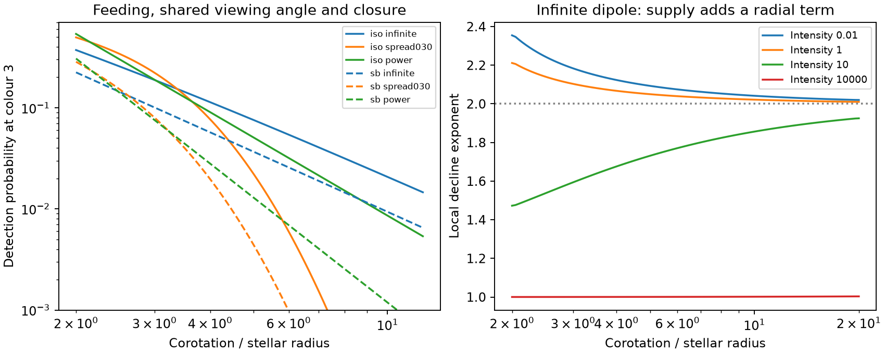

# Surface feeding and clump counts set the CPV radius law in a sparse aligned dipole model

Job: sci-1107-dell-astronomy-01ce75646816. Topic: astronomy. Campaign: 11_07_2026. Machine: dell. Account: codex-myxtap. Model: gpt-6.1-sol, high reasoning effort. Date: 2026-11-10. One automated worker did this study. The campaign-machine key is not a personal authorship claim.

## Result

In a sparse aligned-dipole model, surface feeding and a requirement for at least m visible clumps give a detection rate proportional to x^(-(m+1)) at large x. The feeding intensity per unit surface area has no radius term. Thus a steep detection rate need not follow a magnetic-pressure exponent. This is an analytic result for the stated model, not proof that CPVs use this mechanism.

We test the full probability law, outside the sparse limit, on 394 young rapid rotators with 54 CPVs. A model with one visible clump and a lognormal spread of closed-loop radii lowers AIC by 4.63 relative to the three-parameter power law. In four withheld groups it lowers total log loss by only 1.33. With photometric radii, the AIC gain over a power law is only 0.16. A model with three visible clumps and no closure limit also fits the mean rate, with AIC 296.92. The data therefore do not identify a unique closure radius or a unique magnetic-pressure law. The main new result is the derived probability model and its distinct feeding, viewing and morphology terms.



Solid curves use BHAC15 radii. Dashed curves use photometric radii. They describe different selected cohorts. The right panel shows the local decline exponent of the one-clump infinite-dipole model at fixed intensity. The x^-2 result is an asymptotic sparse limit; it is not imposed on every fitted star.

## Question

Can the surface area that feeds stable magnetic loops explain part of the fall in the complex periodic variable (CPV) rate with x = corotation radius / stellar radius? Can the end of the closed magnetic field explain the remaining shape? We derive a probability model and test it on published labels. This is a test of a specified mechanism, not a measurement of a magnetic field or a new CPV survey.

The seed survey found 126 on-target CPVs. Its age study found a strong decline at fixed period and colour. Its contraction study explained that decline with x. A later campaign result (SCI 1edfe4ec...) corrected the global rate exponent from -6.5 to -2.83, because the source mixed a base-10 predictor with a natural-log link. That study found a steeper outer tail but could not infer a magnetic-pressure law. We use its corrected event model as a comparison. Other campaign results test transit geometry, group prediction and dust heating. The search found no test of the joint surface-feeding and shared-viewing model below.

Townsend and Owocki (2005, doi:10.1111/j.1365-2966.2005.08642.x) locate accumulation sites through minima of the rotating-frame potential along rigid dipole loops. Villarreal D'Angelo et al. (2018, doi:10.1093/mnrasl/slx206) apply magnetic support and surface feeding to cool-star prominences. The general loop-feeding idea and the stability radius are prior work. Our contribution is a binary detection probability that combines the area of feeding footpoints, a finite loop limit and one viewing angle per star. We then test this model against the released CPV labels. We do not transfer a hot-star wind prescription to an M dwarf.

## Derivation

Use a rigid, centred dipole aligned with the rotation axis. A loop has apex radius L in stellar-radius units and field-line equation r = L sin²(theta). At the stellar surface define u = cos(theta). Then L = 1/(1-u²). Uniform surface area in paired north and south footpoints is uniform in u on [0,1]. Pairing avoids counting the two ends as separate loops.

In corotation units rho = r/R_cor, the effective potential in units GM/R_cor is -1/rho - rho² sin²(theta)/2. At the equatorial top of a loop of radius l = L/x, its second derivative with respect to theta is -2/l + 3l². A strict minimum requires L > c x, where c = (2/3)^(1/3) = 0.87358. This is the known aligned-dipole stability limit. It is a necessary mechanical condition, not a sufficient test for condensation, dust survival or confinement against field deformation.

Let the maximum closed-loop apex radius be A in stellar-radius units. Let potential small opaque clumps be a Poisson process with mean lambda per unit u. This is a model of a finite surface supply and a finite visible duty time. It is not a prediction of the stellar wind. Assume that clumps are compact, corotate at the equatorial loop top and can make a detectable feature when their centre crosses the stellar disc. Longitudes are sparse and clumps are distinct. Dense axisymmetric absorption would not produce CPV dips, so the model cannot interpret arbitrarily high fitted intensities literally.

For isotropic axes, mu = |cos(i)| is uniform on [0,1]. A point at equatorial radius L crosses the disc during a full rotation if mu < 1/L. At a fixed mu, the eligible footpoint fraction is

    Q(mu,x,A) = max[0, sqrt(1 - 1/min(A,1/mu)) - sqrt(1 - 1/(c x))].

A negative square-root argument contributes zero eligible area. All tests use x >= 2. The probability of at least one visible clump is

    p0(x,lambda,A) = integral_0^1 {1 - exp[-lambda Q(mu,x,A)]} dmu.

It is essential to average after forming the conditional no-clump probability. In general 1-exp[-lambda integral Q dmu] is wrong: all equatorial clumps share the same stellar inclination. Our code evaluates the inner integral with a closed antiderivative in terms of regularized incomplete gamma functions.

With A infinite and lambda small, p0 = lambda Y(x) + O(lambda²), where

    Y(x) = [u - u³/3] from sqrt(1 - 1/(c x)) to 1
         ~ 1/(4 c² x²) for large x.

Thus shrinking feeding area adds a radial factor to the usual transit factor. The resulting x^-2 limit requires no direct equality between detection rate and magnetic pressure. At fixed x and infinite intensity, p0 tends to 1/(c x), since all eligible inclinations contain a clump. Finite A removes all stable closed loops once c x >= A. These are exact limits of this model. They are not universal laws for CPVs.

We also let A differ between stars with a lognormal distribution. Its median is fitted; its natural-log standard deviation is fixed to 0.15, 0.30 or 0.60 in separate tests. We integrate the per-star probability over this distribution. The 0.30 case is a reference choice, not an external constraint. This softens the hard edge of a universal closure radius.

## Data and fit

We use the same young cohort as the corrected-exponent study: rapid rotators with age class 1-12 or 15-24 Myr, period 0.15 <= P < 1 day, Gaia BP-RP 2.4 <= colour < 3.8, x >= 2 and positive relative injection efficiency. We apply RUWE < 99 to remove nonfinite or extreme values. We test BHAC15 radii, BHAC15 with RUWE < 1.4, and photometric radii. Each radius selection can change the cohort.

For star j, the event probability is e_j times p0 averaged over A. We set ln(lambda_j) = a + b(colour_j - 3). We fit the exact binary likelihood. The infinite model has two parameters; fixed finite A and each fixed-spread model have three. The power-law comparison has three parameters. Optimization uses three starts for each model. A universal A must exceed c times the largest detected x; we impose this support condition. Parameters are bounded for numerical stability. These fits have no extra age term.

The four largest young moving groups are each withheld in full for a prediction test. We fit on the other stars and score binary log loss in the withheld group. Training sets overlap. This is internal prediction evidence, not an independent replication or a discovery p-value. The fixed spread and model variants were chosen after reading earlier results.

## Morphology sensitivity

A survey that needs several visible structures can have a different radius law. If detection requires at least m clumps, replace 1-exp(-lambda Q) by the Poisson tail Pr[N >= m | lambda Q]. The same viewing angle must still be shared. For infinite A, large x and lambda/(c x) small, Q is approximately [1/(c x) - mu]/2 over 0 <= mu <= 1/(c x). Direct integration gives

    p_m ~ lambda^m / [2^m m! (m+1) (c x)^(m+1)].

The asymptotic exponent is therefore -(m+1), even though the intensity per unit feeding surface has no radius dependence. This is a selection effect in this model. A strong dip can satisfy the source CPV label with only one structure, while three local minima can also pass its screen. We do not assert that the labels implement one fixed m. The m=2 and m=3 fits are sensitivity tests, not alternate measured cloud counts. The released efficiency curve does not calibrate these hypothetical physical models separately.

## Numerical evidence

All AIC values use the exact binary likelihood with fixed source efficiencies. Lower is better. The closure spread is a fixed natural-log standard deviation.

| Model | Free parameters | BHAC15 AIC | Photometric-radius AIC |
|---|---:|---:|---:|
| Fitted power law | 3 | 299.24 | 172.36 |
| Infinite dipole, one clump | 2 | 299.70 | 172.68 |
| Universal finite closure, one clump | 3 | 295.31 | 172.66 |
| Closure spread 0.15, one clump | 3 | 293.81 | 172.59 |
| Closure spread 0.30, one clump | 3 | 294.61 | 172.20 |
| Closure spread 0.60, one clump | 3 | 296.88 | 172.31 |
| Infinite dipole, two clumps | 2 | 297.87 | 171.44 |
| Infinite dipole, three clumps | 2 | 296.92 | 170.91 |

The BHAC15 cohort has 394 stars and 54 CPVs. The photometric-radius cohort has 263 stars and 28 CPVs. Comparing AIC between those cohorts is not valid. Within BHAC15 and RUWE < 1.4 (263 stars, 37 CPVs), the reference spread-0.30 model has AIC 197.31 and the infinite one-clump model has 201.59.

The reference model gives median A = 3.79 stellar radii with BHAC15 radii and 3.46 with photometric radii. Its fitted surface intensities at colour 3 are 21.79 and 5.65. The assumed spread matters: the BHAC15 median A is 4.06 for spread 0.15 and 3.31 for spread 0.60. These are conditional model fits, not measured field sizes. Intensities need not be in the sparse regime; all fits use the full event probability. Very large occupancy also raises the unmodelled risk of smooth ring absorption.

| Withheld-group total | Stars | CPVs | Binary log loss |
|---|---:|---:|---:|
| Fitted power law | 375 | 51 | 140.677 |
| Infinite dipole, one clump | 375 | 51 | 141.088 |
| Closure spread 0.30, one clump | 375 | 51 | 139.345 |

The finite-closure model predicts USCO worse than the power law; its gain is not uniform across groups. These modest predictive differences do not show that finite closure is the cause of the rate curve. The alternate cloud thresholds provide another mechanism for a steep slope. We do not select the best spread and then treat it as independently specified evidence. We provide all tested fits in `fits.csv` and `multiplicity.json`, fold scores in `heldout.csv` and curves in `predictions.csv`.

Independent direct quadrature agrees with the one-clump antiderivative to 1.2e-16 absolute error across 48 tests. A 300,000-star cloud simulation gives detection fractions 0.14395, 0.03858 and 0.00789 for thresholds 1, 2 and 3, compared with exact values 0.14327, 0.03870 and 0.00798. All fall within five Monte Carlo standard errors. Increasing closure-integration order from 32 to 96 changes fitted-curve probabilities by at most 3.2e-5. Tests recover the weak-intensity asymptote and the exact zero beyond a universal closure edge. These checks validate the implementation under the assumptions; they do not validate the physical model.

## Limits and proposed tests

The result is conditional on a rigid aligned dipole, compact equatorial clumps, uniform feeding per surface area, Poisson occupancy, isotropic axes and observation over a full rotation. A real dipole can tilt; field complexity, spot selection and dust physics can change both the feeding area and visibility. A fully populated aligned ring produces constant absorption rather than sharp dips. Our binary model omits this loss of modulation and does not predict a full light curve. Its intensity combines supply, survival, opacity and the label threshold. We cannot infer any of these quantities separately.

A closure radius here is a maximum dipole-loop apex radius. It is not automatically an Alfvén radius, a source-surface radius, a magnetic-pressure scale or a measured coronal edge. The lognormal spread is assumed. No independent field map or coronal measurement constrains it. We report point fits and internal prediction scores; they do not establish a field radius or its uncertainty. Fixed-spread choices are sensitivity tests, not distinct confirmations. The model family was developed after inspection of the prior survey results.

All events come from one automated visual vetter in a selected TESS target sample. Centroid checks cannot remove unresolved companions. BANYAN ages can be wrong. BHAC15 radii use assigned group ages, and photometric radii have temperature, blending and extinction errors. Efficiency uncertainty is held fixed, and source injection shapes may not follow our clump model. The fit assumes independent stars. Sparse detections at large x give poor tail information. These limits preclude a unique causal claim about contraction, material survival or magnetism.

An independent test should measure radii and inclinations, classify the number of sharp minima with a uniform duration-dependent injection test, and obtain magnetic or coronal constraints. In the aligned model, no dip is possible for |cos(i)| >= 1/(c x), regardless of intensity. At low occupancy, different morphology thresholds have different powers of x. Those joint inclination and morphology predictions offer tests beyond another fit to the overall rate. `predictions.csv` contains conditional curves at colour 3 and efficiency one; they are not full uncertainty forecasts.

## Reproduction and rights

From the unpacked publication, run:

```sh
OPENBLAS_NUM_THREADS=1 python files/reproduce.py /path/to/campaign /path/to/separate-scratch --datasets /path/to/shared_datasets
```

The campaign must contain the survey and age ZIPs listed in `files/provenance.json`. The repeat script verifies both complete bundles and their exact manifest identities, checks input entry hashes, retrieves or reuses the BHAC15 and Mamajek files with exact hash checks, rebuilds the radius table, fits the models and runs numerical tests. All external records and derived record tables stay in separate scratch. The script refuses scratch inside or enclosing its code directory. Do not put scratch inside the signed publication. Requirements and source-code attribution are included. No raw observation or record-level database is bundled.

The exact shared dataset names are `bhac15-tracks-structure-20180417-b95474c5/BHAC15_tracks_structure.txt` and `mamajek-dwarf-sequence-20220416-1de2edee/EEM_dwarf_UBVIJHK_colors_Teff.txt` under `./datasets` (the shared path `/mnt/dell-data/shared_datasets`). The manifest IDs specify the SCI source versions. `provenance.json` records exact paths, source URLs and SHA-256 values for the files used, including the rebuilt external radius table. We did not download new raw data. The model tracks and colour table have no license that we can grant under the SCI baseline, and Gaia-derived record tables remain outside this publication. `EXTERNAL_DATA.md` identifies external terms and gives attribution. The bundle contains code under MIT terms and text, figures and aggregate model outputs under CC BY 4.0, as specified by the exact SCI baseline license.
