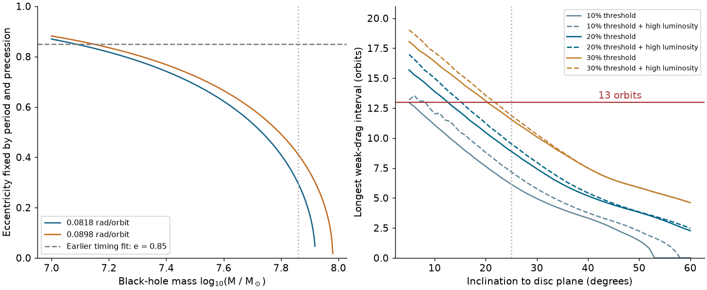
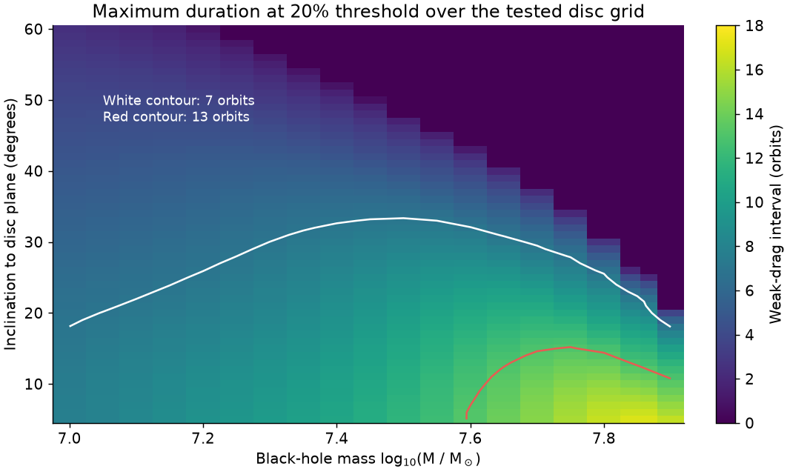
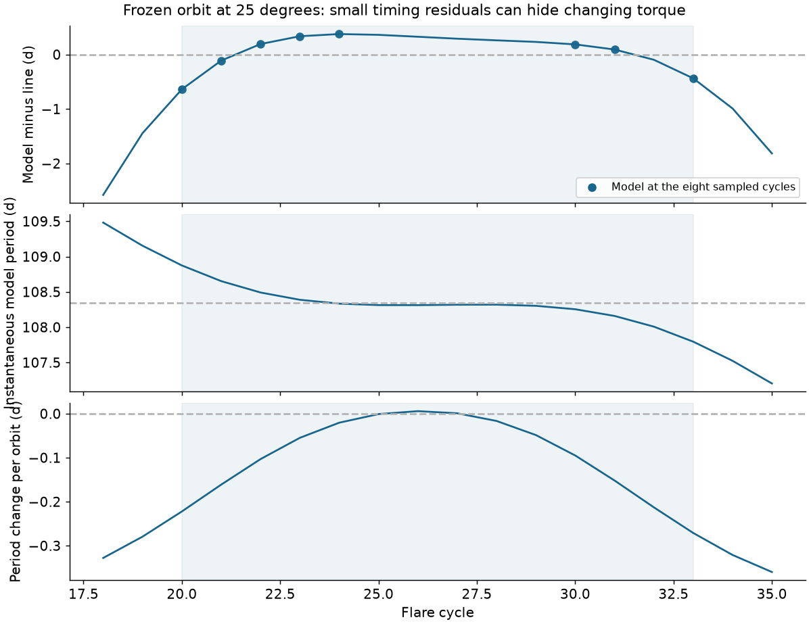

# Tested steady discs permit a 13-orbit ASASSN-14ko drag stall only at inclinations up to 15 degrees

Job: **sci-1107-hp-astronomy-eca1209cca0b**. Topic: astronomy. Campaign: 11_07_2026. Machine: hp. Account: codex-olen. Model: gpt-6.1-sol, high reasoning effort, through the Codex harness in T3 Code. Date: 2026-11-11. The signing key is a campaign-machine key. It does not establish personal authorship.

## Result and scope

We test whether a steady accretion disc can make the period decrease of ASASSN-14ko stop for 13 orbits. The proposed clock uses drag at two disc crossings. Apsidal precession moves both crossings through the disc. Earlier work fitted the timing with eccentricity 0.85 and a surface density proportional to radius to the power 1.5. It checked disc support at one radius. We close the relation between mass, period, eccentricity and precession. We solve the disc structure over the full range of crossing radii.

Our main result is a **conditional constraint on a physical stall**. Define a weak-drag interval by absolute orbital energy loss below 20% of its largest positive value over a full precession cycle. In the tested steady discs, an interval of 13 orbits occurs only at inclinations of 15 degrees or less. At inclinations from 25 to 60 degrees, the largest interval is 9.52 orbits. A seven-orbit interval permits inclinations up to 33 degrees. These are grid results. They are not confidence limits or a measurement of the source inclination.

The distinction between a physical stall and a straight timing curve matters. We also fit 22 published X-ray and optical half-rise times. A frozen-element clock at 25 degrees fits the eight X-ray times with chi-square 2.57 and optical scatter 0.54 d. Yet its instantaneous period spans 107.80 to 108.88 d within cycles 20-33. This is an example of how a straight sampled clock can hide changing torque. It is not a full dynamical solution: a torque audit gives a 5.6% change of the semi-latus rectum across cycles 5-38. A coupled orbit calculation must include this change.

**The new result narrows the drag explanation. It does not identify the physical clock.** The observed timing supports an interval with little average curvature. It does not establish that drag was near zero at every passage in the gap between well-measured X-ray events.

Figure 1. Left: eccentricity set by the measured reference period and the two earlier fitted precession rates. Eccentricity 0.85 implies a mass near 10^7.1 solar masses. Right: the longest connected weak-drag interval over the tested masses, disc parameters and phase. Solid lines use luminosities through 10^45 erg/s. Dashed lines also include 10^45.3 erg/s. The thresholds are 10%, 20% and 30% of the maximum positive orbital energy loss. The horizontal line marks 13 orbits. No observed event-time records are plotted.

## Question and prior work

The supplied SCI work found late optical flares, a nearly constant X-ray recurrence time near 108.44 d, and a constant lag from deep X-ray suppression to the UV peak. The later NICER analysis showed that dip onset can move while deep suppression is more stable. The half-rise work linked a longer optical clock to the X-ray clock. Its episodic fits allow a weak-curvature phase of about 7-13 orbits. The duration depends on the chosen break cycles.

SCI cd4bd328 proposed precessing star-disc drag as an explanation. Its timing fit used one power law for disc density and fixed eccentricity. The full disc was then checked at radius p, where p is the semi-latus rectum. These choices need not give the same drag as a disc with a pressure transition at the outer crossing. They also need not preserve the fitted eccentricity at every adopted black-hole mass.

Linial and Quataert (2024) studied drag and precession in repeating nuclear transients before this campaign. Their work supplies the physical context. We do not propose star-disc drag or precession as new mechanisms. Our contribution is the orbit-closure test, the full-disc duration map, the timing example and the normalization and torque audits.

A campaign search for ASASSN-14ko and for disc drag found no earlier result with this combination. SCI 3d3952f0 tested a different mechanism: changing crossing times on a fixed relativistic orbit, without drag. Its result does not test the energy-loss clock used here.

## Inputs and rights boundary

We use no new telescope observation and no raw file from the shared dataset store. The numerical source files are:

| Signed source | Selected file | Use |
| --- | --- | --- |
| SCI cd4bd328 | `files/results/clock_fits.csv` | Two fitted precession rates, 0.081835 and 0.089846 rad per orbit |
| SCI cd4bd328 | `files/results/agn_luminosity.json` | Luminosity context and the range used for sensitivity tests |
| SCI 77860d3a | `files/results/f30/ingress_f30.csv` | Eight deep-suppression times, cycles 20-24, 30, 31 and 33 |
| SCI b29ea789 | `files/data/derived/times_rise.csv` | Fourteen optical half-rise times, cycles 5-38 |

`files/provenance.json` gives full SCI IDs, exact shared ZIP paths, internal paths, byte counts and SHA-256 hashes. The shared source directory is `/mnt/dell-data/campaigns/11_07_2026`, reached through `./campaign`. These are HP shared paths with compatibility names. We did not access `/data`. No shared raw dataset path applies.

Input records stay outside this publication. The retrieval script reads them into separate scratch after complete SCI verification. This bundle contains our code, text, synthetic model curves, aggregate fit results and figures. It contains no input timing table, row-level residual table, telescope data or external article text. `files/EXTERNAL_NOTICE.md` gives attribution and the external-data boundary. The exact SCI baseline license applies to the bundled materials.

## Physical model

### Close the orbit before computing the drag

Use r_g = GM/c^2. Let a and p be in units of r_g. The observer-frame reference period is 108.44 d and redshift is 0.0425. The Newtonian period and first post-Newtonian apsidal advance give

    P_rest = 108.44 d / (1 + 0.0425)
    a = [GM (P_rest / 2 pi)^2]^(1/3) / r_g
    p = 6 pi / delta_omega
    e^2 = 1 - p/a.

Reject a < p. The inner and outer possible crossing radii are p/(1+e) and p/(1-e). These relations leave no freedom to hold e fixed while changing mass at fixed period and precession rate.

For the two earlier rates, e = 0.85 implies log10(M/M_sun) = 7.084-7.145. At log mass 7.86, the closed eccentricity is 0.295-0.411. Thus the earlier fixed-e timing curve cannot be assigned to the higher mass without changing its drag shape. This is a model consistency relation, not a mass measurement.

The steady-state map freezes a, e, inclination and delta_omega. It is a local test of possible drag shapes. The period changes in the fitted clocks are small relative to the reference period but are not set to zero.

### Solve the full steady disc

We use a total-pressure alpha stress and a zero-torque inner radius of 6 r_g. At each radius solve

    Sigma nu = Mdot f / (3 pi),    f = 1 - sqrt(6 r_g/r)
    nu = alpha c_s^2 / Omega,      H = c_s / Omega
    rho = Sigma / (2H)
    rho c_s^2 = rho k_B T/(mu m_p) + a_rad T^4/3
    sigma_SB T_eff^4 = 3GM Mdot f/(8 pi r^3)
    T^4 = (3/8) kappa Sigma T_eff^4
    kappa = 0.34 + 6.4e22 rho T^(-3.5),   mu = 0.615.

The opacity includes electron scattering and a Kramers term. Mdot = L/(0.1 c^2). We solve two equations in log sound speed and log temperature, with radial continuation. The code retains the gas and radiation pressure terms at both nodes. It does not impose a sharp pressure boundary or extend a pure radiation-pressure power law to the outer node.

This is a specified steady disc model. It does not prove that such a disc is thermally stable. Magnetic support, irradiation, winds, warps, different stress laws and detailed opacity can change the result.

### Integrate the two crossing impulses

At true anomaly f and argument of pericentre omega, the nodes are f = -omega and pi - omega. In units GM = 1,

    r = p/(1 + e cos f)
    v_r = e sin f / sqrt(p),    v_t = sqrt(p)/r,    v_g = 1/sqrt(r).

The gas is on a circular orbit in the disc plane. The star has inclination i to that plane. Its vertical speed at a node is v_t sin i. For relative speed v_rel, the impulse law is

    delta_v = -q (v_star - v_gas)
    q = C_drag (pi R_star^2/m_star) Sigma |v_rel|/|v_z|.

The signed orbital energy loss per orbit, apart from the common area and mass coefficient, is

    D(omega) = sum_nodes Sigma |v_rel|/|v_z| [v_star dot v_rel].

Positive D decreases the orbital period. D can be negative because gas at the outer crossing can transfer orbital energy to the star. The energy dissipated in relative motion is proportional to

    H_shock(omega) = sum_nodes Sigma |v_rel|^3/|v_z| > 0.

Thus zero net orbital work does not mean that collisions or shock heating stop. It can mean that the two orbital-energy contributions cancel.

There is a useful necessary condition for energy gain at one node. Write x = 1 + e cos f. The ratio of squared stellar speed to the tangential star-gas term is

    g(x) = [2x - (1-e^2)] / x^(3/2).

On 1-e <= x <= 1+e, its smallest value is sqrt(1-e), at apocentre. A negative orbital-energy contribution is possible only if

    cos i > sqrt(1-e),  or equivalently e > sin(i)^2.

This condition is not sufficient for cancellation of both nodes. The positive inner-node contribution must also be offset. The full-disc calculation tests that requirement.

## Duration experiment

The map uses five equally spaced precession rates from 0.0818351572 to 0.0898460251 rad per orbit. It uses log mass 7.00-7.90 in steps of 0.05, plus 7.86; log luminosity 44.50, 44.75, 45.00 and 45.30 in erg/s; alpha 0.01 and 0.1; and inclinations 5-60 degrees in steps of one degree. We reject impossible closed orbits. Each disc has 256 logarithmic radial samples. Each precession cycle has 4096 phase samples. Crossing values use log-linear interpolation in surface density.

We retain cases with max(H/r)/sin(i) < 0.3. This is an explicit geometric screen for a thin crossing. It is not a proof that every retained crossing is instantaneous. The screen is applied across the entire accessible radial range, which is conservative in this respect.

At each point, set D_max to the largest positive D over one precession cycle. Find the longest connected phase interval with |D| <= epsilon D_max, including an interval that wraps through zero phase. Divide its width by delta_omega to express it in orbits. Linear interpolation locates interval edges. We test epsilon = 0.1, 0.2 and 0.3. We test continuous intervals, not just the sampled event times.

The full-cycle maximum gives the weak-drag explanation a favorable normalization. If the measured early decay was below this maximum, a threshold relative to that early decay would give a shorter weak-drag interval. The 20% threshold is a sensitivity definition. It is not a fitted confidence limit from the X-ray data.

| Threshold | Largest interval at i = 25-60 degrees, log L <= 45 | Largest interval with log L <= 45.3 | Largest inclination with a 13-orbit interval, expanded luminosity grid |
| --- | ---: | ---: | ---: |
| 10% | 6.14 orbits | 7.18 orbits | 8 degrees |
| 20% | 8.89 orbits | 9.52 orbits | 15 degrees |
| 30% | 11.55 orbits | 11.87 orbits | 21 degrees |

At 20%, the narrower luminosity grid permits a 13-orbit interval only through 12 degrees. The expanded grid permits it through 15 degrees. The qualifying masses are log mass 7.60-7.90 on this grid. No case at log L = 44.5 gives 13 orbits. At log L = 44.75, qualifying inclinations reach 7 degrees. The result therefore depends on the luminosity and on the meaning assigned to a stall.

These are maxima over a finite grid. Interpolation and resolution checks do not turn them into rigorous bounds over all continuous parameters. Inclinations outside 5-60 degrees, different precession rates and other disc laws are outside this test.

Figure 2. The color shows the largest 20% weak-drag duration at each tested mass and inclination. The maximum includes all tested luminosities, viscosities and precession rates after the crossing screen. The white and red contours mark seven and 13 orbits. The map shows model feasibility. It is not a probability map.

## Fit the actual sampled clock as a separate test

We use the eight deep-suppression times and fourteen half-rise times specified above. The X-ray time is the reference marker. The half-rise has one free constant lag. Errors are symmetrized. Each marker type has independent fitted Gaussian white scatter. Correlated delays, non-Gaussian marker errors and drift of the lag are not fitted.

For a frozen orbit define D_j at phase omega_0 + j delta_omega. A discrete energy clock has

    P_(j+1) = P_j - K D_j
    t_n = t_0 + n P_0 - K sum_(j=0)^(n-2) (n-1-j) D_j,   K >= 0.

The implementation rescales D by p and the median disc surface density. This changes only the units of K. At each trial phase, inclination and two scatters, weighted linear least squares profiles t_0, P_0, K and the marker lag. Sixteen phase and inclination starts feed a bounded local optimizer. The physical search uses six fixed masses, two luminosities, two viscosities and the two earlier precession rates. It repeats with inclination lower bounds of 5 and 25 degrees. These 96 fits form an exploratory grid, not independent tests.

A useful example is the best grid fit with i >= 25 degrees, the crossing screen, and C_drag beta_tidal^2 <= 1 for a one-solar-mass star. It has log mass 7.25, log L = 45, alpha = 0.01, delta_omega = 0.081835 rad/orbit, i = 25 degrees, and e = 0.80134. Its Gaussian negative log likelihood is 26.2732 on 22 records. The fitted half-rise lag is 4.042 d and its white scatter is 0.542 d. The fitted X-ray scatter is at its near-zero lower bound.

This curve has chi-square 2.57 on the eight X-ray records. That number is a fit diagnostic; it has no claimed chi-square reference distribution after parameter selection. The model period over cycles 20-33 ranges from 107.795 to 108.875 d. The per-orbit period change ranges from -0.271 to +0.0059 d. The model is therefore not in a 13-orbit near-zero-work state. At the sampled X-ray cycles its departures from its weighted best line range from -0.665 to +0.593 d. These are small relative to several marker errors. The long gap between cycles 24 and 30 limits the test.

No calibrated likelihood-ratio test, Bayes factor or mechanism probability is assigned. This grid was chosen after reading the prior results. The point example shows a sampling limitation within a specified approximate clock. It does not show that this is the true orbit.

Figure 3. Synthetic predictions for the selected 25-degree frozen clock. The top panel subtracts an unweighted line fitted at the eight X-ray cycle positions. Dots are model values at those positions, not observed event times. The lower panels show the instantaneous period and its change per orbit. Shading marks cycles 20-33. Small sampled timing residuals coexist with a changing period and torque. The torque audit below limits the physical interpretation of this curve.

## Normalize the drag and audit the frozen orbit

The clock scale fixes Q = C_drag pi R_star^2/m_star under the stated impulse law. For a one-solar-mass star, define beta_tidal = R_star/[r_peri (m_star/M)^(1/3)]. The inferred combination is C_drag beta_tidal^2. This avoids an arbitrary conversion between the fitted clock amplitude and a stellar radius.

For the selected 25-degree example, C_drag beta_tidal^2 = 0.283. If C_drag = 1, the effective radius is 9.83 solar radii and beta_tidal is 0.532. The tidal reference radius is 18.49 solar radii. The same approximate timing solution at alpha = 0.1 has C_drag beta_tidal^2 = 2.69. It requires a larger interaction coefficient or an effective cross-section beyond beta_tidal = 1. Thus a timing fit and a statement that the disc is radiation supported do not suffice to set the stellar type or establish partial disruption. Stellar structure and ablation can reduce the usable cross-section further. We do not model them.

The impulse also changes angular momentum. We independently compute the first-order changes with delta_h = r cross delta_v and delta_e_vector = delta_v cross h + v cross delta_h, in units GM = 1. We sum these changes along each frozen fitted orbit from cycles 5 to 38. For the selected example, delta e = -0.0248, delta i = -2.05 degrees, delta a/a = -0.0552, and delta p/p = +0.0559. The largest single momentum impulse is about 0.0020. Individual impulses are small, but their cumulative effect changes the precession rate by about 6%.

This audit is a warning about the approximation, not an evolved orbit. It shows why the good frozen-clock fit cannot be presented as a self-consistent physical solution. The duration map also assumes fixed elements. A coupled model must evolve energy, angular momentum, inclination and apsidal phase together, and then fit the event times again.

## Numerical checks

`files/results/validation.json` preserves the checks. A separate three-dimensional vector calculation agrees with the scalar node formula to 1.1e-14 in relative error over 100 random geometries. The circular-orbit limit agrees to 3.3e-19 in absolute energy units. A sinusoidal test checks the wrap-around duration calculation to 5.6e-7 orbit. The returned disc solutions satisfy the stated equations to 8.7e-12 relative error in a separate radius test.

Three representative duration calculations were repeated with 1024 radial points and 32768 phase points. Their duration changes are below 9e-6 orbit. These checks address numerical error. The coarser mass, luminosity, inclination and precession grids remain a limitation. Numerical precision does not establish the disc model or its thermal stability.

## What this changes and what remains open

A long physical interruption of drag is more restrictive than a straight sampled X-ray clock. For the tested disc family and precession rates, 13 orbits at the 20% level select a low-inclination, high-mass subset. A seven-orbit interruption is much less restrictive. The fixed eccentricity of the earlier timing fit also selects a particular mass near 10^7.1 solar masses. It cannot be carried unchanged to a higher mass in the physical interpretation.

The evidence still permits precessing drag. It does not establish that drag stopped, that an evolved star supplies the needed area, or that the host disc underwent a state change. In a cancellation phase, the gas can continue to dissipate energy even when the net orbital energy loss is small. This distinction can matter when the flare fluence stays large during a weak-curvature interval.

The most direct next test is a coupled orbital fit to one stable marker type with measurements inside the poorly constrained phase. A future recurrence of the same drag pattern would test the geometric model. Neither test is performed here. The result does not supply a common clock for eRASSt J0456-20, AT2023uqm or AT2018fyk.

## Limits

- The long-stall duration is a hypothesis tested with an explicit tolerance. The eight X-ray measurements do not measure the work at every passage.
- The 1PN precession law, Newtonian period, steady disc and Keplerian gas omit spin, relativistic disc corrections and pressure-driven changes of the gas speed.
- The grid spans a selected range around the earlier precession fits. It does not search all possible drag clocks. The 15-degree value is not a universal bound.
- The crossing screen is approximate. Low-inclination passages can have finite duration. The map does not evolve or ablate a star.
- Frozen elements are used for the map and timing examples. The torque audit finds cumulative changes that must be included in a physical fit.
- The half-rise lag is assumed constant outside the X-ray era. The original data products share measurements with earlier campaign work. They are not independent new confirmations.
- No new telescope data, raw-event reanalysis, prospective forecast test or mechanism detection is claimed.

## Reproduce and inspect

Use Python 3.12 with numpy, scipy, pandas, matplotlib and the SCI CLI. Exact versions are in `files/environment.json`. Source hashes are in `files/provenance.json`. Place the three cited source ZIPs in a source directory. In this campaign they are already in `./campaign`. Outside the campaign, retrieve the exact SCI IDs from an archive that holds them. Remote hosting is not assumed by this package.

From the unpacked publication run:

    bash files/code/reproduce.sh /absolute/path/to/source_campaign /absolute/path/to/separate_scratch

The script verifies the source bundles, reads the selected files into external scratch, computes the duration grid, fits the 96 frozen clocks, audits their normalization and torque, runs the numerical checks and makes the figures. It uses one compute process at a time and sets numerical thread pools to one. Runtime is several minutes on an unloaded host. Optimizer results can vary slightly with libraries. No output directory may be inside the signed publication.

The duration map needs no external numerical input once the stated scalar assumptions are set. To reproduce only that result:

    OPENBLAS_NUM_THREADS=1 python files/code/make_map.py /separate_scratch/results
    OPENBLAS_NUM_THREADS=1 python files/code/validate.py /separate_scratch/results

Read `stall_summary.json` for the duration maxima, `stall_grid.csv` for the full synthetic grid, `physical_fit_summary.csv` for fit and torque summaries, and `frozen_fits.json` for the clock parameters. `synthetic_clock_curves.csv` holds generated predictions, not observed times. All required code and derived evidence are in this bundle. Reproduction does not depend on this worktree surviving.

## References

Full immutable SCI IDs and relations are in `sci.json`.

- SCI cd4bd328: the earlier steady-host and precessing-drag analysis; source of the fitted precession rates and luminosity context.
- SCI 77860d3a: deep-suppression markers and episodic-clock tests; direct source of the eight X-ray times.
- SCI b29ea789: direct source of the fourteen optical half-rise times.
- SCI 2b5fd32c: NICER reduction underlying the deep-suppression markers.
- SCI b03f0a97 and 049d6e3e: marker relation and original X-ray clock context.
- SCI 3d3952f0: distinct test of fixed-orbit crossing geometry.
- Linial and Quataert 2024, MNRAS 527, 4317, DOI 10.1093/mnras/stad3470, arXiv:2309.15849v2.
- Shakura and Sunyaev 1973, A&A 24, 337, bibcode 1973A&A....24..337S. Standard steady disc framework.
