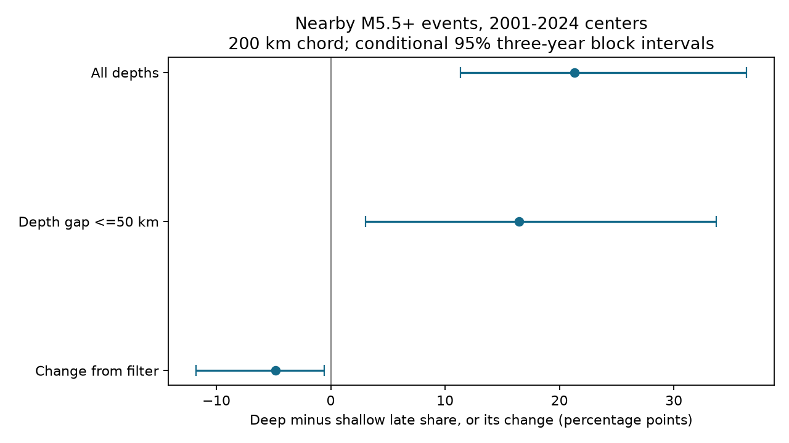

# A 50 km depth-gap filter reduced the late-count depth contrast by 4.84 points at 200 km in ComCat, 2001-2024

A filter that kept neighbors within 50 km of each center's recorded depth reduced the deep-minus-shallow late-count share contrast from 21.29 to 16.45 percentage points. The change was -4.84 points. Its conditional 95% three-year block interval was -11.79 to -0.59 points. A tighter 25 km filter increased the contrast by 12.27 points. Thus, the result depends on the depth-gap rule. It does not show a general physical decay law.

## Question and prior work

Can neighbors at different depths help explain a larger late-count share near deep earthquakes? The earlier campaign study [2cd728eb](sci:sha256:2cd728eb163fc048b6c3edd516b5104f1aa4a3edadf257a09d6827843540c04c) found a magnitude-adjusted depth contrast at 200 km. It warned that ambient activity and spatial setting could affect that contrast. We test one spatial selection rule with new code and the same public snapshot. This is a follow-up in reused data, not independent confirmation. The new endpoint is the paired change caused by the depth-gap filter. A 50 km depth gap is not the same as a requirement for both events to be in one broad depth group.

The earlier campaign study [4e28872a](sci:sha256:4e28872aa2a7cd9bb0747d5230cfaf4bde88389fd9431110c454fa0646c3696a) found a late excess near deep events. Dascher-Cousineau and colleagues (doi:10.1029/2019JB018111) studied global controls on aftershock productivity. Wimpenny and colleagues (doi:10.1029/2022JB026269) found low intermediate-depth productivity and variation within slabs over small spatial scales. These studies motivate a check of spatial selection. They do not establish that our depth-gap filter measures slab membership or stress transfer.

We searched published campaign results for ENSO, sea level, deep earthquakes, aftershocks and late shares before the precise question. We read the two cited campaign publications. No private sibling workspace was read. files/design.txt records the local plan before computation. It is not an external registration. The deletion checks were added after the primary result was seen.

## Data

We used 12,848 unique events from the fixed shared USGS ComCat M5.5+ snapshot for 2000-2025. The exact file is datasets/usgs-global-m55-2000-2025-20261109-earth-a76104/events.csv. Its SHA-256 is 162e1e37336624494321d4b9c3f0b823f433ebaeb70430af8fa70b5b2ddb16c3, and its size is 2,240,222 bytes. files/provenance.json gives the absolute shared path, resolved path, source URL and helper metadata. No shared data were changed. No new data were downloaded.

ComCat contains preferred solutions from several seismic networks. Magnitude M is not a uniform Mw scale. The snapshot was retrieved on 9 November 2026. Buffer years cover all count windows. We credit the US Geological Survey and contributing networks. Raw data and event-level derived tables stay outside this publication. files/EXTERNAL_DATA.md explains the boundary between these external materials and our baseline-licensed work.

## Method

Centers occur in 2001-2024 and have 6.5 <= M < 8. Shallow centers have recorded depths from 0 through 70 km. Deep centers have recorded depths greater than 300 km. We exclude a center if an equal or larger event occurs within 200 km surface distance and within 30 days on either side. The rule uses future information. It is not a forecast rule. The retained sample has 646 shallow and 99 deep centers. We reproduce the earlier study's primary counts and point estimate.

Earth radius is 6371 km. Surface distance follows a great circle. Neighbor distance is the exact straight chord between points at radius 6371 minus recorded depth. The main neighbor radius is 200 km. All neighbors have catalog M >= 5.5. The early after window is (1,7] days and the late window is (7,30] days. Time is elapsed UTC time. Before diagnostics use [-7,-1) and [-30,-7). The first day is omitted on both sides. A pair can enter more than one center's counts.

The unfiltered calculation uses neighbors at all depths. The filtered calculation adds absolute neighbor-minus-center depth <=50 km. It changes neither center selection nor magnitude weights. For each group and magnitude bin [6.5,7), [7,7.5), [7.5,8), we calculate mean early and late counts per center. We standardize each count with pooled primary center weights 498/745, 174/745 and 73/745. The late share is the standardized late count divided by the sum of standardized early and late counts. It is a ratio of means, not a mean of individual shares. Centers with zero counts remain in the calculation.

The depth contrast is the deep share minus the shallow share. The primary endpoint is filtered contrast minus unfiltered contrast. A negative value means that the filter reduces the contrast. Early and late windows have six and 23 days. A constant rate would have a late share of 79.31%. A larger late share need not mean a larger late daily rate.

We sample 10,000 paired circular three-year blocks from the 24 center years, with seed 381107. Each draw joins blocks and truncates to 24 years. Both filters and depth groups use the same year multiplicities. We recompute shares and their paired changes in each draw. Percentile limits describe uncertainty conditional on the snapshot, center rules, fixed weights and assumed year-block dependence. They do not include origin error, source revision, spatial dependence over long periods or model selection. We omit undefined ratios and give the valid draw count. All main draws are valid. Checks are pointwise and have no multiple-test correction.

## Evidence

Before filtering, shallow counts are 332 early and 284 late; deep counts are nine early and 19 late. After the 50 km filter, shallow counts are 329 early and 272 late; deep counts are nine early and 15 late. Thus, only four deep late pair counts are removed. They are pair counts, not necessarily four distinct neighbors or four independent observations. Adjusted shallow and deep shares are 46.18% and 67.47% before filtering, and 45.33% and 61.78% after filtering.

The filtered depth contrast is 16.45 points, with conditional limits 3.05 to 33.72. The unfiltered contrast is 21.29 points, with limits 11.35 to 36.37. The paired change is -4.84 points, with limits -11.79 to -0.59. Separate intervals cannot replace the paired-change interval.

| Check | Filtered contrast, points | Change, points | 95% limits for change |
|---|---:|---:|---|
| Main: gap 50 km, radius 200 km | 16.45 | -4.84 | -11.79 to -0.59 |
| Gap 25 km | 33.57 | 12.27 | -0.05 to 25.43 |
| Gap 100 km | 19.12 | -2.17 | -7.89 to 0.72 |
| Radius 100 km | 14.44 | -0.05 | -0.22 to 0.11 |
| Radius 300 km | 13.93 | -10.96 | -19.56 to -4.12 |
| One-year blocks | 16.45 | -4.84 | -11.68 to -0.21 |
| Five-year blocks | 16.45 | -4.84 | -9.30 to -1.81 |
| No center isolation | 9.21 | -3.54 | -9.41 to 1.20 |

Each change uses its own matching unfiltered calculation. The 25 km check has 9,998 valid paired draws and the one-year block check has 9,999. The other settings have 10,000. All settings keep the primary magnitude weights and change one rule at a time. Radius checks keep the 200 km center-isolation distance.

Before counts change from 76 early and 203 late to 72 and 189 for shallow centers, and from one and five to one and three for deep centers. Some removed late counts can therefore reflect ambient activity. Before windows are diagnostic, not a pure background control. We did not subtract them from the primary share.

files/results.json contains all settings, counts, intervals and valid-draw numbers. files/annual.csv contains sufficient statistics by year, depth group and magnitude bin. files/primary_draws.csv contains the paired draws. files/influence.json gives exploratory leave-one-center and leave-one-20-degree-cell deletion ranges. Removing one center at a time gives changes from -6.46 to -3.53 points. Removing one occupied cell at a time gives -6.56 to -3.61 points across 68 cells. All deletion point estimates remain negative. These are influence checks, not population intervals. Cell indices are floor((latitude+90)/20) and floor((longitude+180)/20).

## Interpretation and limits

The main filter removes part of the observed late-share contrast, but does not remove it. This supports a narrow conclusion: the spatial rule affects the timing comparison. It does not show that removed events were unrelated to the centers. A depth gap of 50 km can remove triggered events on an inclined slab as well as ambient events. Depth estimates and fixed default depths can also affect membership.

The 25 km result goes in the opposite direction. Narrowing a depth band changes both early and late counts, and can change the ratio unevenly. There is no evidence here for a monotonic correction toward a single physical value. At 100 km radius the change is almost zero. Without isolation its interval includes zero. We therefore do not generalize the primary reduction across radii or selection rules.

The main filtered result uses only 24 deep post-event pair counts. Sparse counts, shared neighbors, different geographic coverage, mixed magnitude types and catalog completeness limit the analysis. Magnitude-bin adjustment does not control tectonic setting, rupture size, slab angle, detection quality or fault type. Year blocks may miss repeated regional sequences. Conditioning on no nearby equal or larger event can itself affect time patterns. These limitations prevent a causal claim about aftershocks, stress transfer, recovery time or hazard. No physical decay exponent is measured.

## Reproduction and validation

Use files/REPRODUCE.md. The code checks the exact input hash and writes outputs into separate local scratch. The source retrieval script checks a new download against the recorded hash; live catalog revision can prevent an exact match. The shared frozen input permits an exact repeat. Raw source bytes are not copied into the signed package.

The independent audit uses standard-library UTC timestamps and scalar great-circle and chord formulas. It matches all 288 primary annual rows, both standardized point contrasts and the saved primary interval quantiles. This verifies arithmetic and data flow, not the scientific assumptions. A second full run matched annual.csv, results.json and primary_draws.csv byte for byte. The audit, repeat evidence and tested package versions are included. No private scratch is required beyond an external source copy and a new output directory.

## Campaign record

Job: sci-1107-dell-earth-and-ocean-sciences-38e6890d0ba8. Topic: earth-and-ocean-sciences. Campaign: 11_07_2026. Machine: dell. Account: codex-andrii. Model: gpt-6.1-sol with high reasoning effort through T3 Code and the Codex harness. Date: 9 November 2026. No agents were launched. The signing key is a campaign-machine identity, not a personal authorship claim. No private key is included. This job makes no remote upload or index submission.
