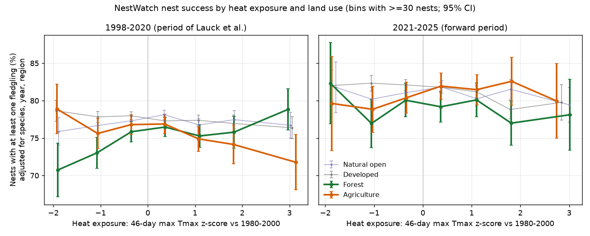
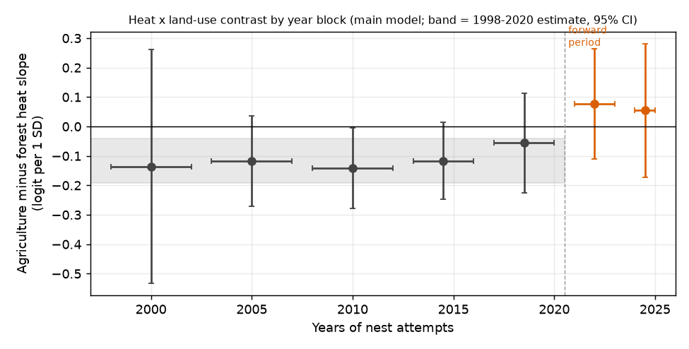
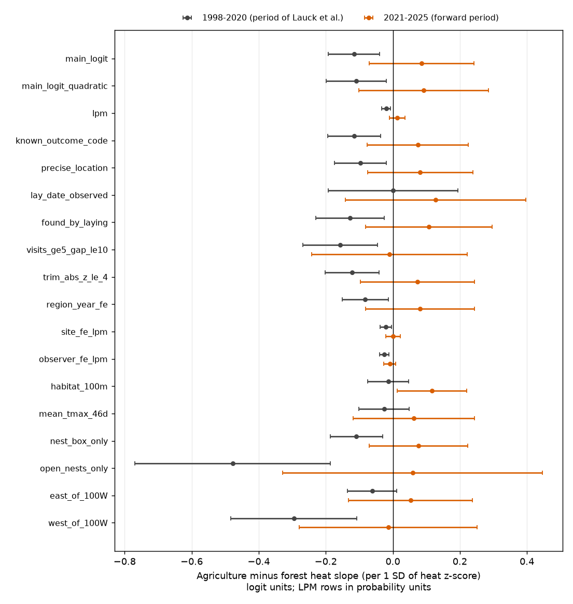

# A 1998-2020 farmland-versus-forest heat contrast in US NestWatch nest success did not repeat in 2021-2025 nests

## Summary

Lauck et al. (2023, *Science* 382:290) reported that hot weather during nesting decreased nest success in agricultural land and increased it in forest. They used 152,863 NestWatch nest attempts from 1998-2020. We rebuilt their analysis from the current NestWatch Open Dataset (version 6, January 2026) and gridMET weather. We then applied the same method to 76,398 nests from 2021-2025. Lauck et al. did not use these nests.

- **1998-2020 (rebuild):** We found the published pattern. The heat slope was -0.070 (SE 0.032) logit per SD in agriculture and +0.046 (SE 0.021) in forest. The agriculture-minus-forest contrast was -0.116 (SE 0.039). On the probability scale, success changed by -4.8 percentage points (pp) in agriculture and +3.2 pp in forest from -2 SD to +2 SD of heat. Lauck et al. reported about -6 and +5 points.
- **2021-2025 (forward test):** The contrast did not repeat. It was +0.085 (SE 0.080), with the opposite sign. The forward estimate differs from the 1998-2020 estimate by +0.201 (SE 0.089, p = 0.023). The forward sample alone had only 31% power to give a significant negative contrast of the 1998-2020 size. Thus the main evidence is the difference test, not the absence of significance.
- **Time pattern:** The contrast was negative in all five 1998-2020 year blocks (-0.06 to -0.14). It was positive in both 2021-2023 (+0.08) and 2024-2025 (+0.05). If we pool 1998-2025, the contrast is -0.057 (SE 0.039).
- **Dependence on choices, 1998-2020:** The contrast was robust to region-by-year effects, site effects, observer effects, nest-discovery stage, outcome codes and location precision. It was not robust to two analysis choices. With the habitat code at 100 m, it was -0.014 (SE 0.031). With the 46-day mean Tmax anomaly, it was -0.026 (SE 0.039). The paper text describes a mean, but the published code uses the maximum. West of 100 W, the contrast was -0.295 (SE 0.096). East of 100 W, it was -0.062 (SE 0.038).
- **Developed land:** Developed sites had a negative heat slope in both periods: -0.028 (SE 0.016) and -0.073 (SE 0.028). The pooled slope was -0.043 (SE 0.016). We did not specify this result in advance.

We conclude that the published farmland-forest heat interaction was present in the 1998-2020 records. It did not continue in 2021-2025. Within 1998-2020, it depended on the habitat code at the nest and on the maximum-day heat measure. These data do not support use of this interaction for forward projections of nest success.

## Question

Does the land-use interaction with heat on nest success continue in new nests that were not available to the original study? The original study was Lauck et al. 2023, doi:10.1126/science.add2915, with code at doi:10.5281/zenodo.8226606. Is the interaction robust to observation biases of the participatory NestWatch data?

We set the test before we fitted any 2021-2025 model. The criterion: in 2021-2025, the agriculture slope is below zero, the forest slope is above zero and the agriculture-minus-forest contrast is below zero. We also compare the 2021-2025 contrast with the 1998-2020 contrast from the same rebuild.

## Data

- **NestWatch Open Dataset** version 6 (Cornell Lab of Ornithology; Mendeley Data doi:10.17632/wjf794z7gc.6; files `attempts_locs_20260120.csv.zip` and `checks_20260120.csv.zip`; data paper Bailey, Larson & Bonter 2024, *Ecology* 105:e4230, doi:10.1002/ecy.4230). License: CC BY-NC 3.0. **We do not include record-level NestWatch data or derived per-nest tables in this publication.** See `files/NOTICE_external_data.md`.
- **gridMET** daily maximum temperature (`tmmx`, 1979-2025) and precipitation (`pr`, 1997-2025), 1/24 degree grid (Abatzoglou 2013, doi:10.1002/joc.3413), from https://www.northwestknowledge.net/metdata/data/. We do not include gridMET files.
- `files/provenance/external_sha256.txt` gives the SHA-256 values of all external files that we used.

## Methods

### Rebuild of the Lauck et al. variables (`01_prepare_nests.py`, `02_gridmet_exposure.py`)

We copied the rules from their code (`scale-data.R`, `buildMasterDatabase_20211124.R`, `Nestwatch_ClimateScript_v7-gridMET-plus-MACA-CMIP5_02-21-21.R`):

- **Success** is 1 if `Young Fledged` >= 1 and 0 if `Young Fledged` = 0. We removed nests with no fledgling count.
- **Land use** is from the observer habitat code at the nest (`Habitat 1m`, the former `HABITAT_CODE_1`). Agriculture: ag, xmas, orch-vin. Forest: for. Natural open: burn, chap, des, grass, fw, sw, beach, clrcut. Developed: airport, campus, cem, cmpgrd, com-ind, golf, human, park, pit, pwrln, road, ry. Grass is 85% of natural-open nests in our sample, and orchards or tree farms are 1.8% of agricultural nests. Lauck et al. report about 85% and 1.5%, which agrees with use of the 1-m code.
- **Heat** (`Tmax_z`): the maximum daily gridMET Tmax over the lay day plus 45 days (46 days) at the nest's grid cell. We subtracted the mean of the same 46-day maximum (same day-of-year start) over 1980-2000 and divided by its SD.
- **Covariates:** precipitation in the 365 days before laying (standardized), nest box (yes/no) and lay day of year (standardized).
- **Scope:** years 1998-2025, conterminous US. We removed spuh, slash and hybrid taxa. We merged subspecies into species. We kept species with at least 5 nests in at least two land-use types in 1998-2020 (their rule), which gave 60 species.

Final samples: 160,946 nests in 1998-2020 (47,846 sites, 5,401 observers) and 76,398 nests in 2021-2025 (24,086 sites, 2,395 observers). Mean heat z was +0.22 and +0.39. `files/results/sample_description.csv` gives the counts for each land use.

### Models (`03_models.py`)

The main model is a logistic regression:

`success ~ LU-specific heat slopes + LU + precipitation + nest box + lay day | species + year + region`

The terms after the bar are fixed effects. Region is a cell of about 200 km, the scale of Lauck et al.'s hexagon random effect. SEs are clustered by region. Lauck et al. used a GLMM with random intercepts for species, year, region and site. We used fixed effects because they need no distribution assumption, and we fitted each period separately. In 1998-2020, our estimates agree with their published effect sizes (Summary).

We fitted 18 variants in each period (`files/results/slopes.csv`):

| Variant | Purpose |
|---|---|
| main_logit, main_logit_quadratic, lpm | main model, with the quadratic heat term of their Fig. 1, and a linear probability model |
| known_outcome_code | removes nests with an unknown or missing outcome code (3,245 nests in our sample had 0 fledglings and an unknown or missing code) |
| precise_location | removes nests located at county, state or postal-code centroids |
| lay_date_observed | only lay dates that the observer did not estimate |
| found_by_laying | only nests that were first visited no later than 3 days after the lay date (decreases bias from late discovery) |
| visits_ge5_gap_le10 | only nests with 5 or more visits and no gap longer than 10 days |
| trim_abs_z_le_4 | removes heat z outside -4 to 4 |
| region_year_fe | region x year fixed effects (removes regional annual shocks) |
| site_fe_lpm, observer_fe_lpm | within-site and within-observer comparisons (linear probability) |
| habitat_100m | land use from the 100-m habitat code |
| mean_tmax_46d | 46-day mean Tmax anomaly in place of the 46-day maximum |
| nest_box_only, open_nests_only | nest substrate subsets |
| east_of_100W, west_of_100W | two independent regions |

`06_blocks_and_tests.py` fits the main model in seven year blocks. It also refits the 1998-2020 model without each year in turn. For each variant, it calculates the 2021-2025 minus 1998-2020 difference (independent samples, normal approximation) and the power of the forward sample. `04_reporting_and_bins.py` tests whether the probability of a reported outcome depends on heat by land use. It also makes the binned summaries for Figure 1.

## Results

### Main forward test

| Quantity (logit per 1 SD of heat) | 1998-2020 | 2021-2025 |
|---|---|---|
| Forest slope | +0.046 (0.021) | -0.046 (0.051) |
| Agriculture slope | -0.070 (0.032) | +0.039 (0.055) |
| Natural open slope | -0.004 (0.021) | -0.031 (0.029) |
| Developed slope | -0.028 (0.016) | -0.073 (0.028) |
| **Agriculture - forest** | **-0.116 (0.039)** | **+0.085 (0.080)** |
| Change in success, -2 to +2 SD (LPM, pp): agriculture / forest | -4.8 (2.2) / +3.2 (1.5) | +2.2 (3.1) / -2.9 (3.1) |

The forward test failed on all three criteria. Difference between the periods: +0.201 (SE 0.089), z = 2.27, p = 0.023.

*Figure 1. Success adjusted for species, year and region, in bins of the heat z-score. In 1998-2020, agriculture (orange) decreased and forest (green) increased with heat. In 2021-2025, the lines do not separate in that way.*

*Figure 2. Agriculture-minus-forest heat contrast by year block. Leaving out any one year from 1998-2020 kept the contrast between -0.130 and -0.097 (`loyo_p1.csv`).*

### Checks for observation bias and design (agriculture-minus-forest contrast)

| Variant | 1998-2020 | 2021-2025 | Difference p |
|---|---|---|---|
| main_logit | -0.116 (0.039) | +0.085 (0.080) | 0.023 |
| known_outcome_code | -0.115 (0.040) | +0.074 (0.077) | 0.030 |
| precise_location | -0.097 (0.040) | +0.081 (0.080) | 0.046 |
| found_by_laying | -0.128 (0.052) | +0.107 (0.096) | 0.032 |
| visits_ge5_gap_le10 | -0.157 (0.057) | -0.009 (0.118) | 0.26 |
| lay_date_observed (n = 14,064 / 11,254) | +0.001 (0.099) | +0.128 (0.138) | 0.46 |
| region_year_fe | -0.082 (0.035) | +0.082 (0.083) | 0.069 |
| site_fe_lpm (probability units) | -0.021 (0.008) | +0.001 (0.011) | 0.11 |
| observer_fe_lpm (probability units) | -0.025 (0.007) | -0.009 (0.009) | 0.16 |
| habitat_100m | -0.014 (0.031) | +0.117 (0.053) | 0.034 |
| mean_tmax_46d | -0.026 (0.039) | +0.063 (0.092) | 0.37 |
| open_nests_only (n = 9,237 / 5,463) | -0.478 (0.149) | +0.059 (0.198) | 0.030 |
| east_of_100W | -0.062 (0.038) | +0.053 (0.094) | 0.26 |
| west_of_100W | -0.295 (0.096) | -0.014 (0.135) | 0.089 |

`files/results/forward_tests.csv` has the full table.

*Figure 3. Agriculture-minus-forest contrast in each variant and period. The LPM rows are in probability units.*

Outcome reporting: in 1998-2020, the probability of a known fledgling count did not depend on heat differently by land use. In 2021-2025, hotter forest nests had a known count more often (+0.151 logit per SD, SE 0.063). This bias does not explain the reversal, because the known-outcome-code variant gave the same results. Nests with zero fledglings and an unknown outcome code were 4-10% of all failures in each land use (`reporting_checks.csv`).

## Interpretation

1. The 1998-2020 pattern is a true property of those records. It survives region-by-year, site and observer controls, nest-discovery stage and outcome-code filters. Thus simple observation artefacts do not explain it.
2. The pattern did not continue in 2021-2025 data with the same method. Possible causes: (a) the 1998-2020 interaction partly came from regional heat episodes in a few western farm areas (the western contrast was 5 times the eastern contrast), and these did not recur; (b) the observer and site mix changed (2021-2025 has fewer agricultural observers: 257, against 606 in 23 earlier years); (c) the true interaction is smaller than the 1998-2020 estimate. With observer fixed effects, the 2021-2025 contrast was negative but not clear (-0.009, SE 0.009 in probability units). Thus a small within-observer effect remains possible.
3. The interaction depends on the use of the single hottest day and of the 1-m habitat code. With the 46-day mean temperature, all four land uses had positive heat slopes in 1998-2020. Projections that use one fixed land-use-specific heat slope, for example the 2100 projections of Lauck et al., are thus not supported as stable.

## Limitations

- We used fixed-effect logit and LPM models, not the authors' GLMM and Bayesian models. Our 1998-2020 estimates are similar but not identical to theirs.
- We did not add their NLCD 2-km land-cover proportion covariates. This can change the land-use slopes slightly.
- NestWatch version 6 has corrections, deletions and late uploads after 2020. Our 1998-2020 sample (160,946 nests after our filters) is not their exact sample.
- Lay dates in the dataset are often estimated by NestWatch. Only 14,064 (1998-2020) and 11,254 (2021-2025) nests had observed lay dates. That subset gave uncertain contrasts in both periods.
- The forward period has 5 years and fewer agricultural and forest nests (5,960 and 5,518). Its contrast has an SE about twice that of 1998-2020. A small negative contrast is still possible.
- gridMET data for recent years can be provisional.
- The outcome is "at least one fledgling". It does not use exposure days (Mayfield or logistic exposure). Nest-check intervals can thus affect the result. Our visit-filter variant addresses this only partly.
- We did not test air pollution or other weather extremes in this study.

## Reproduction

1. `bash files/code/00_retrieve_external.sh /scratch/ext`. This downloads NestWatch and gridMET (about 11 GB) to a folder outside the publication. Compare the files with `files/provenance/external_sha256.txt`.
2. `EXT=/scratch/ext SCRATCH=/scratch/work bash files/code/run_all.sh`. This writes record-level intermediates only to `SCRATCH`. Aggregate tables go to `files/results/` and figures to `files/figures/`.
3. Package versions: `files/provenance/python_packages.txt`. Runtime is about 30 minutes on a 24-core host, after the downloads.

## Files

- `files/code/` - our analysis code (01-07, run_all.sh, 00_retrieve_external.sh).
- `files/results/` - aggregate outputs only: model coefficients (`slopes.csv`), forward tests, year blocks, leave-one-year-out fits, reporting checks, binned success means (bins with at least 10 nests; the smallest has 142), sample description.
- `files/figures/` - PNG figures (fig3 shows the four land-use slopes of the main model in both periods).
- `files/provenance/` - external file hashes and package versions.
- `files/NOTICE_external_data.md` - attribution and terms for the external data.

## Provenance of this work

Campaign 11_07_2026, job sci-1107-dell-climate-pollution-biodiversity-a1f3926bb7f3, topic climate-pollution-biodiversity, machine dell, account claude-andrii. Model: Claude Opus 5.5 (claude-opus-5-5). The signing key is a campaign machine key. It is not a claim of personal authorship. Data were downloaded on 2026-11-09.

## References

- Lauck K.S., Ke A., Olimpi E.M., Paredes D., Hood K., Phillips T., Anderegg W.R.L., Karp D.S. (2023) Agriculture and hot temperatures interactively erode the nest success of habitat generalist birds across the United States. *Science* 382:290-294. doi:10.1126/science.add2915. Code: doi:10.5281/zenodo.8226606. Data: doi:10.25338/B8ZD1P.
- Bailey R.L., Larson L.R., Bonter D.N. (2024) NestWatch: an open-access, long-term data set on avian reproductive success. *Ecology* 105:e4230. doi:10.1002/ecy.4230.
- Abatzoglou J.T. (2013) Development of gridded surface meteorological data for ecological applications and modelling. *Int. J. Climatol.* 33:121-131. doi:10.1002/joc.3413.
