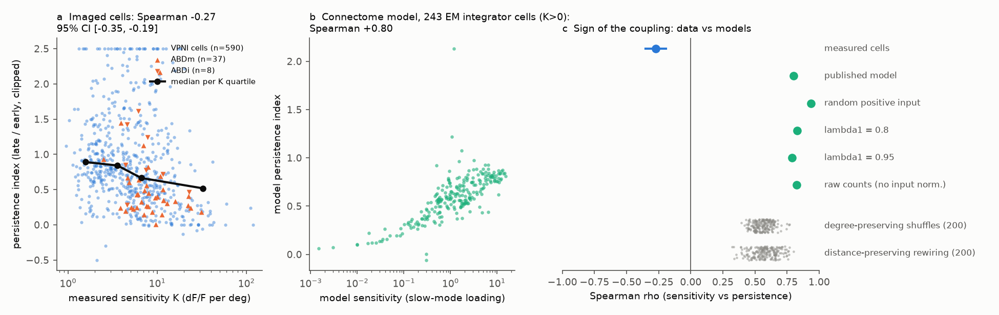
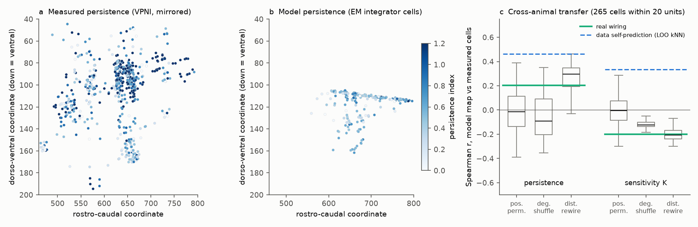
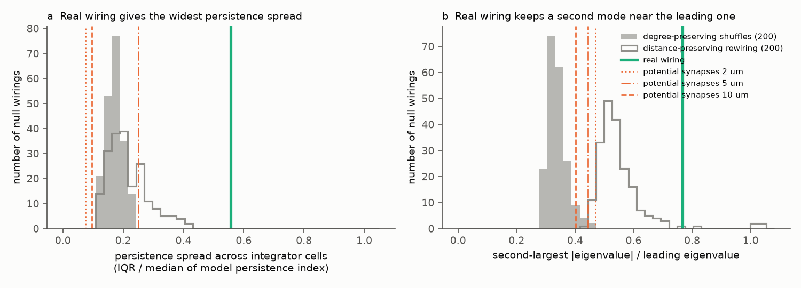

# In 590 imaged zebrafish integrator cells, higher eye-position sensitivity came with less persistence; the hindbrain connectome model and 400 rewired models gave the opposite sign

## Summary

The larval zebrafish hindbrain holds the velocity-to-position neural integrator (VPNI) for horizontal eye position. Vishwanathan et al. (2024) reconstructed a wiring diagram of this region from serial-section electron microscopy (EM) of one larva. They made a linear rate model from synapse counts and compared it with calcium imaging of other larvae. They compared the populations as distributions, not cell by cell and not by position.

We used the published model data and the published imaging table. We asked two questions:

1. Does the model give the correct relation between the eye-position sensitivity (K) of a cell and the persistence of its activity after a saccade?
2. Does the model give the correct spatial map of K and persistence when we put the EM cells and the imaged cells in the shared anatomical frame?

Main results:

- **Data.** In 590 imaged VPNI cells (pooled from about 20 larvae), cells with a higher K had less persistent post-saccadic activity. Spearman rho = -0.27 (cell bootstrap 95% CI -0.35 to -0.19). The median persistence index fell from 0.89 in the lowest K quartile to 0.52 in the highest K quartile. The sign stayed negative for four persistence measures (rho -0.23 to -0.32), for cells with high signal-to-noise ratio (-0.31 to -0.33), after we removed a quadratic function of 3D position (partial rho -0.22 to -0.32), and on each side of the brain (-0.43 and -0.18).
- **Model.** The published connectome model gave the opposite sign: rho = +0.80 over the EM integrator cells. All model variants gave a positive sign (+0.79 to +0.94: leading eigenvalue 0.8 or 0.95, random positive saccade input, raw synapse counts without input normalisation). All 200 degree-preserving shuffles (+0.40 to +0.77) and all 200 distance-preserving rewirings (+0.32 to +0.80) also gave a positive sign. Thus the sign conflict is a property of this model class (one dominant slow mode that sets both K and persistence), not of the specific wiring.
- **A wiring-specific property.** The real wiring gave a much wider spread of persistence across cells (IQR/median 0.56) than all 400 null wirings (0.11 to 0.41). The reason is a second mode near the leading one (|lambda2|/lambda1 = 0.77; degree-preserving shuffles 0.28 to 0.46; 5 of 200 distance-preserving rewirings at or above 0.77). This agrees with the multi-dimensional persistence that Miri et al. (2011) reported. The measured spread is larger (IQR/median 1.03, which includes measurement noise).
- **Spatial maps.** When we mapped model values from EM cells onto 265 imaged cells within 20 frame units of an EM integrator soma (k = 10 nearest EM cells), the model persistence map correlated +0.20 with measured persistence. This value is inside the position-permutation null (one-sided p = 0.125) and inside the range of the shuffled wirings. The model K map correlated -0.20 with measured K, which is the wrong sign (two-sided permutation p = 0.049). The measured data predict themselves much better (leave-one-out kNN r = 0.46 for persistence, 0.34 for K). The model K decreases toward lateral and ventral positions; the measured K increases toward lateral and ventral positions.

Conclusion: synapse counts in this reconstruction support heterogeneous, multi-dimensional persistence. But a linear model that uses only these counts makes the most sensitive cells the most persistent. In the imaged animals, the most sensitive cells (like abducens motoneurons, median K 7.8, persistence 0.35) are the least persistent. A model must add a mechanism that gives sensitive cells more fast activity. Possible mechanisms are direct saccadic burst input (the burst neurons are outside the EM volume), cell-intrinsic leak, or feed-forward position in the circuit. We did not test these mechanisms.







## Provenance

- Job: sci-1107-dell-neural-structure-and-computation-a2c0b19778bc; topic: neural-structure-and-computation; machine: dell; model: Claude Opus 5.5 (claude-opus-5-5). The signing key is a campaign-machine key. It is not a personal authorship claim.
- Date: 2026-11-12.
- Prior campaign record: a search of the campaign (queries "zebrafish oculomotor integrator connectome", "persistent activity integrator", "persistent activity eigenvalue connectome", "eye position") found no earlier publication on this circuit. Related campaign work on zebrafish timescales and wiring is at the region level (sci:sha256:23ce83bd3f3aae5699c5346e9304d6e62342f951ac55a44b06de91e7815bf193, sci:sha256:7a4063e456cac2ca403bb7c568f8835a3defad1335986b0de2b55fa474a1f8fc). This study is at the cell level, in one identified circuit.

## Data (external; not in this bundle)

| Input | Source and version | Use |
| --- | --- | --- |
| Synapse-count matrix of 609 center/periphery neurons, total input counts, cell types, Louvain blocks, potential-synapse matrices (2, 5, 10 um) | GitHub goldman-lab/Connectome-Model, commit cb7eb5c9c70d18de295e07ce9b5984e53b150114 (2024-12-23), folder data/ | Model weights, nulls |
| Calcium imaging summary of 635 cells: position, K, threshold, saccade-triggered averages (file STA_EMCA.mat) | Same repository, data/STA_EMCA.mat (data of Ramirez and Aksay 2021, as distributed with the model code) | Measured K and persistence |
| EM soma positions in the Z-brain-like frame | GitHub ashwinvish/Zfish_recon, commit 97d9cbeb65ab21205e5500970d0ea74fbc74c00f, matFiles/soma_loc_zbrainSpace_MatOrder_CO_top500_2blocks_gamma038_08062020.mat | Spatial transfer |

Neither repository states a license for its data. For this reason we do not include their files or any record-level table derived from them (for example, per-cell model values). The SHA-256 of each input file is in `files/results/input_sha256.txt`. `files/code/fetch_data.sh` downloads the exact versions into a scratch folder that you choose and prints the hashes. See also `files/NOTICE.md`.

## Methods

**Model (as published).** W_ij = N_ij / (total input synapses of cell i), with N the synapse count from cell j to cell i (`load.py`, a copy of the steps in the published notebook). Inputs from vestibular (DO) cells are negative. Outputs of abducens (ABD), vSPN and IBN cells are zero. The axial module is removed. W is scaled so that its leading eigenvalue is 0.9 (also 0.8 and 0.95). The time constant is 1 s for all cells, as in the published notebook.

**Model K.** The leading right eigenvector loading of each cell, scaled to a mean of 2.574 over integrator cells (the published `get_scaled_slopes`).

**Model persistence.** We gave a brief pulse along the published saccade input (the real parts of eigenvectors 1 to 3 plus 10% random positive input; 50 random draws). We computed r(t) exactly with matrix exponentials. Persistence index = mean rate 5.33 to 6.0 s after the pulse divided by mean rate 2.33 to 3.0 s after the pulse. This is the same window as the published comparison with the imaging data. A variant used random positive input only.

**Measured K and persistence.** K and threshold come from the published table. For the saccade-triggered average (STA) we used the published rule: use the direction with the larger response at 2.33 s, and subtract the mean from -5 to -3.67 s. The persistence index has the same definition as for the model. Other measures: log-linear decay time over 2.33 to 6 s, slow-component fraction of a two-exponential fit with fixed 10 s and 4 s time constants (as in the published Fig. 5g), and the linear slope divided by the mean level. VPNI cells are cells that are not ABD or DO (590 cells).

**Shared frame.** The imaged-cell coordinates in the table (columns RC, ML, DV) are in the same frame as the EM soma positions: the ABD motoneuron clusters agree to within 7 units in all three axes. The imaged cells come from both sides of the brain. We mirrored them about the midline at ML = 250. This value is the gap in the ML histogram and the midpoint of the left and right ABD clusters. The EM volume is on one side only.

**Null wirings.** (1) Degree-preserving shuffles (200): in each block pair of the oculomotor module (integrator and vestibular cells), we redistributed the synapses and kept each cell's block-specific input and output synapse counts. This is the published `shuffle_synapses_iodp_exact` null, done by stub matching. (2) Distance-preserving rewiring (200): we moved each connection, with its full synapse count, to a new target of the same type at a soma distance in the same decile. This keeps output counts and the edge-length distribution. (3) Position permutation (2000): we permuted model values among EM integrator cells before the spatial mapping.

**Spatial transfer.** For each imaged VPNI cell within 12 or 20 frame units of an EM integrator soma, we took the inverse-distance-weighted mean of the model values of the 10 nearest EM integrator cells. Then we computed the Spearman correlation with the measured value. We tried 8, 12 and 20 units before we fixed 20 as the main value. The 12-unit results are in `real_model.json`.

## Results in detail

Files: `files/results/functional_summary.json`, `coupling_checks.json`, `real_model.json`, `null_iodp.csv`, `null_distance.csv`, `null_position_permutation.csv`.

| Quantity | Measured | Real-wiring model | Degree-preserving null (200) | Distance-preserving null (200) |
| --- | --- | --- | --- | --- |
| Spearman K vs persistence | -0.27 [-0.35, -0.19] | +0.80 | +0.40 to +0.77 (all > 0) | +0.32 to +0.80 (all > 0) |
| Persistence IQR / median | 1.03 (with noise) | 0.56 | 0.11 to 0.24 | 0.11 to 0.41 |
| abs(lambda2) / lambda1 | - | 0.77 | 0.28 to 0.46 | 0.44 to 1.03 (5 of 200 >= 0.77) |
| Transfer r, persistence (20 units, n = 265) | LOO self 0.46 | +0.20 | 95%: -0.30 to +0.28 | 95%: -0.15 to +0.43 |
| Transfer r, K (20 units, n = 265) | LOO self 0.34 | -0.20 | 95%: -0.16 to -0.05 | 95%: -0.28 to -0.08 |

Spatial gradients (Spearman with the coordinate; ML is distance from the midline; larger DV is more ventral, toward the abducens nucleus):

| | RC | ML | DV |
| --- | --- | --- | --- |
| Measured K (590 cells) | +0.17 | +0.11 | +0.09 |
| Model K (124 EM cells inside the imaged region) | +0.02 | -0.22 | -0.18 |
| Measured persistence | +0.11 | -0.25 | -0.28 |
| Model persistence | +0.07 | -0.17 | -0.10 |

Potential-synapse connectomes (contacts within 2, 5 or 10 um, from the published data) make persistence almost uniform (IQR/median 0.08 to 0.25), because nearly all activity at 2 to 6 s is in the leading mode. Their K-persistence correlations (-0.13, +0.76, -0.56) come from very small differences and have no clear meaning.

Structural proxies: the recurrent input fraction (row sum of W) correlates +0.88 with model K. Output synapses onto ABD motoneurons gave transfer correlations with the measured data in the direction of the data (K +0.16, persistence -0.23), but these values are inside the permutation null.

## Limitations

- The imaging table has no larva identity. Cells from one larva are not independent. The bootstrap CI resamples cells, so it is too narrow. We could not do a leave-one-larva-out test.
- The EM and imaging animals are different, and their ages are different (6 dpf against 7 to 8 dpf). The spatial transfer depends on the published registration. A registration error of 10 to 20 units can hide a true map.
- The imaged region extends more rostrally and ventrally than the EM integrator cells. Only 265 imaged cells are within 20 units of an EM integrator soma.
- Measured K is in dF/F per degree. Calcium indicator kinetics and saturation affect K and persistence. Saturation would make the correlation more positive, not more negative. Noise in the early response would push the ratio up, not down. The sign was the same for all four persistence measures and in high-SNR cells.
- We used the published linear model with one time constant for all cells. The published Methods also mention 100 ms time constants for ABD and Ve2 cells; the published notebook uses 1 s, and we followed the notebook.
- We did not test a model with burst input, intrinsic leak differences or other mechanisms that could reverse the sign.

## Open questions for the next study

1. Which added mechanism (direct saccadic burst input to sensitive cells, intrinsic leak heterogeneity, feed-forward depth) makes the connectome model give a negative K-persistence relation and keep the wide persistence spread? A test: fit one extra parameter per mechanism and require both properties.
2. Does the second mode of the real wiring (a complex pair; the published paper reports weakly coupled three-block cycles) explain the spatial gradient of persistence in imaging data with larva identity?
3. Does the full synapse table (df_cleaned.mat, only on the authors' Google Drive) with synapse sizes change the result?

## Reproduce

```bash
bash files/code/fetch_data.sh /path/to/scratch/ext        # downloads about 17 MB, prints SHA-256
export ZF_EXT=/path/to/scratch/ext ZF_OUT=/path/to/scratch/out OMP_NUM_THREADS=1
python -I files/code/analysis.py 200     # about 50 min on 1 CPU; resumable nulls
python -I files/code/extra.py            # coupling robustness checks
python -I files/code/figures.py          # figures
```

Python 3.12 with numpy, scipy, pandas, matplotlib. A test run with 2 shuffles in a clean folder gave a `real_model.json` and `coupling_checks.json` identical to the published files, and identical first null rows.

## References

- Vishwanathan A, Sood A, Wu J, et al. Predicting modular functions and neural coding of behavior from a synaptic wiring diagram. Nat Neurosci 27, 2443-2454 (2024). doi:10.1038/s41593-024-01784-3
- Ramirez AD, Aksay ERF. Nat Commun 12, 4145 (2021). doi:10.1038/s41467-021-24336-w (source of the imaging data, reference 50 of Vishwanathan et al. 2024)
- Miri A, Daie K, Arrenberg AB, Baier H, Aksay E, Tank DW. Spatial gradients and multidimensional dynamics in a neural integrator circuit. Nat Neurosci 14, 1150-1159 (2011). doi:10.1038/nn.2888
