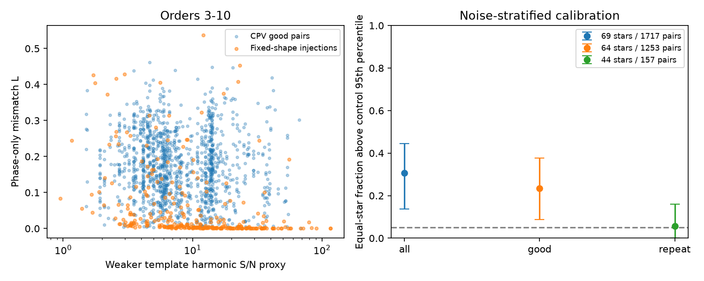

# Fourier phase mismatch exceeds fixed-shape controls in selected TESS CPV sector pairs

Job: sci-1107-dell-astronomy-c006386060c6. Topic: astronomy. Campaign: 11_07_2026. Machine: dell. Account: codex-olen. Model: gpt-6.1-sol, high reasoning effort. Date: 2026-11-11. One worker did this study. No agents were used. The campaign-machine signing key is not a personal authorship claim.

## Question

Can changes in the sharp dip pattern of complex periodic variables (CPVs) be described by one phase shift? A common shift is necessary if the measured pattern tracks one material longitude. It is not sufficient to prove that interpretation. We test this condition without a starspot phase reference. We also allow each Fourier harmonic to change amplitude. This removes a source of mismatch that does not require phase change.

The source study (SCI b48ce9da) reports loss of dip phase memory relative to spots. Later studies show that spot changes dominate short-sector relative residuals (SCI 75404ca3), that resets fit sector shifts as well as diffusion (SCI dd056d09), and that many sector shifts do not define consistent scalar phase histories (SCI ebcb9230). The last study already reports separate spot and dip closure failures. We do not claim those results as new. SCI cede8f8a tests the order dependence of short-window complex harmonic changes. Our contribution is a different diagnostic on sector templates: a spot-free phase compatibility score, tested against the source's real-light-curve injections. It also works when a star has only two epochs, where triangle closure cannot be tested.

Fourier template timing and its sensitivity to shape changes have a long history in pulsar timing. For example, Lentati et al. (2017), "Wide-band profile domain pulsar timing analysis", describes joint shape and timing inference. The Fourier shift theorem used here is not new mathematics. The application, control calibration, and comparison of CPV quality selections are the contribution.

## Data

We use three tables from the verified SCI publication sha256:b48ce9dae32069c8fe40342da4e7bf85c6d4f68c68ed5f7a9fc1d9449dd5fa34:

- `files/data/measured_units.csv.gz`: sector dip Fourier coefficients and residual noise proxies.
- `files/data/injection_units.csv.gz`: coefficients from synthetic dips in real control light curves.
- `files/data/anchor_pairs.csv.gz`: pair identifiers, time gaps and source quality scores.

The source derived these products from TESS SPOC two-minute data, sectors 1-107 (2018-2026), for 126 selected on-target CPVs and 300 non-CPV control rotators. It separates low-order spot modulation from a 25-harmonic dip residual. We retain single-sector CPV units only. We do not refit light curves, periods, masks, labels or pixels. The dip residual is still conditional on the source spot subtraction, even though our test uses no spot phase reference.

The control is the source's H injection: the same donor dip template is placed in two halves of a control light curve, at different known phases, and measured by the source pipeline. There are 300 independent control stars. This includes actual light-curve noise and spot residuals. It is not a new raw-cadence injection campaign. The control templates have fixed shape and phase changes that our score should remove.

Exact source paths and member SHA-256 values are in `files/provenance.json`. No shared raw dataset or new download is used. Source records are not bundled. See `files/EXTERNAL_DATA.md` for attribution and external terms.

## Diagnostic

For sector j and harmonic k, let c_jk be the cosine coefficient minus i times the sine coefficient. For sectors a and b set z_k = c_bk conjugate(c_ak). For a band K define

    L = 1 - max_s Re sum_K [z_k exp(2 pi i k s)] / sum_K |z_k|.

The phase s is in rotation cycles. We use a 2,000-point grid and refine the best grid maximum locally. The denominator is the largest cross power possible if each harmonic could choose its own phase. Thus L measures the loss from requiring one common shift. It is not the fraction of occulting mass or flux that changes. It is also not a material displacement.

If c_bk = A_k c_ak exp(-2 pi i k s0), for any nonnegative A_k, all terms align at s0 and L = 0. This permits separate changes of every harmonic amplitude. Any separate change in epoch phase origin also leaves L unchanged. Neither an arbitrary catalogue ephemeris nor motion of the spot reference can create L. For nonzero coefficients, exact L = 0 implies that the retained harmonic phases admit one common shift. It does not constrain other harmonics or resolve aliases outside the band.

We use orders 3-10 as the main band. Orders 3-6 and 7-15 are sensitivity tests, not independent replications. Orders 1-2 are excluded to reduce direct use of the smooth spot model. Small coefficients receive low cross-power weight.

We calibrate L using the weaker epoch's proxy

    S = sqrt(sum_K |c_jk|^2) / noise_bin_j,

then take the minimum S of the two epochs. This is a signal proxy, not a formal uncertainty for each coefficient. The fixed bins are 0-2, 2-5, 5-10, 10-20, 20-50 and above 50. We keep a bin only if it has at least 20 controls. The 95th percentile of control L in that bin is the threshold. We count CPV pairs above this threshold. We do not treat this as a calibrated 5% per-pair hypothesis test: the source donor shape mix and noise proxy can differ from the CPV mix.

We use three source selections: all pairs; good pairs (dip correlation > 0.5 and spot signal/noise > 10); and repeated-shape pairs (dip correlation > 0.8 and spot correlation > 0.95). The last selection follows the source and does not also impose the good-pair cuts. Selections use the source correlations, not our L. The repeated-shape rule does select for similar profiles and can favor compatibility.

Each retained star has equal weight. A star contributes its fraction of retained pairs above threshold. Intervals resample control stars within signal bins to refit thresholds and resample CPV stars, 2,000 times. This preserves dependence of pairs within a CPV star and includes finite control threshold uncertainty. It conditions on the source pipeline, donor mix, bins, quality selections and signal proxies. It does not include all errors from period fits or spot subtraction.

## Results

The main-band calibration retains four signal bins (2-5, 5-10, 10-20 and 20-50), with 279 controls in total. Other pairs are outside supported bins and are excluded. Percentages below average pair fractions within each star first. They are not the fraction of stars with material motion.

| Band | Selection | Pairs | Stars | Above control threshold, 95% interval |
|---|---|---:|---:|---|
| 3-10 | all | 1717 | 69 | 30.7% (13.7-44.5%) |
| 3-10 | good | 1253 | 64 | 23.3% (8.8-37.6%) |
| 3-10 | repeat | 157 | 44 | 5.7% (0.0-16.0%) |
| 3-6 | all | 1700 | 68 | 30.0% (19.2-45.4%) |
| 3-6 | good | 1248 | 63 | 25.6% (14.8-42.6%) |
| 3-6 | repeat | 155 | 43 | 3.4% (0.0-23.0%) |
| 7-15 | all | 1742 | 69 | 26.0% (13.7-38.1%) |
| 7-15 | good | 1275 | 64 | 27.2% (14.6-38.2%) |
| 7-15 | repeat | 161 | 44 | 14.1% (3.1-25.0%) |

In the main good-pair sample, 354 of 1,253 pairs exceed their threshold. The equal-star fraction is 23.3% (8.8-37.6%). A common shift plus separate harmonic amplitude changes does not describe these measured phases as well as it describes the calibrated fixed-template controls. This is a conditional empirical excess, not a count of physically moving clouds.

The strict repeated-shape sample has only 3 flagged pairs out of 157, from 44 stars. Its equal-star fraction is 5.7% (0.0-16.0%). Orders 3-6 give the same broad result. Orders 7-15 give 14.1% (3.1-25.0%) in the strict sample, so compatibility in the main band does not establish compatibility at every angular scale. The strict screen keeps only about one eighth of the calibrated good-pair count and favors stable shapes.

For good pairs in the main band, the above-threshold fraction is 6.5% (1.1-15.7%) below 60 days, 24.8% (2.7-54.4%) at 60-400 days, and 40.4% (14.8-59.9%) at 400-4,000 days. The star sets and signal distributions change across these bins. These are descriptive gap comparisons, not an estimate of an evolution time or a within-star causal effect.

The fixed-centre, variable-depth synthetic control has median L = 0.131 and a 5th-95th percentile range of 0.015-0.330. Thus a phase-only mismatch can occur with no clump motion. The main invariant-control maximum L is 6.2e-15. An independent 20,000-point grid check on 100 random profiles agrees with the refined search within 1e-5 in L (`files/numerical_checks.json`).

Left: the main-band diagnostic against the weaker template signal proxy. Fixed-shape injections and CPV good pairs are shown. Right: the fraction above signal-bin control thresholds, with equal weights per star. Intervals resample both calibration controls and CPV stars. The dashed 0.05 line is a reference, not an asserted false-positive rate for real CPVs.

## Checks and meaning

A synthetic check applies arbitrary common translations and separate positive harmonic amplitude factors. Its maximum L is below 1e-9. Independent harmonic phase perturbations give positive L. A separate fixed-centre control has four Gaussian dips at phases 0, 0.16, 0.41 and 0.67, width 0.018 cycles, and independent lognormal depth changes with log standard deviation 0.8 at two epochs. It has no phase motion. It can still give positive L because changing individual dip depths changes the phases of the summed Fourier coefficients. Values are in `files/results.json`. This is an illustration, not a fitted model of the stars.

The test therefore distinguishes a common translation of the measured profile from more general evolution. It does not distinguish moving individual clumps from fixed clumps whose depths change, new dips, disappearing dips or source subtraction errors. It supplies no lower bound on material diffusion, no material lifetime and no dust/gas identification. It also cannot establish that all pairs below threshold track material: low signal, broad thresholds and untested harmonic orders can hide change.

The strict shape selection is useful as a screen for further transport measurements, but its near-control result is not proof of rigid motion. The source templates are averaged across a whole sector and can hide faster motion. The control halves have different baselines from CPV sectors. Signal bins are coarse, some controls reuse donor shapes, and the source has no full coefficient error covariance. We do not use the real-time gap as an injection baseline. The same stars and templates underlie all bands and selections.

A stronger follow-up would inject evolving, fixed-centre multi-dip profiles into raw cadence data, refit both the spot component and dip component, and test independent spectral line phases. The current test provides an inspectable control-based screen before a template phase shift is read as material transport.

## Reproduction

The package includes original code, aggregate results, figures and exact provenance. Per-pair and per-control results remain external and are regenerated into scratch. Requirements are Python 3.12, NumPy, pandas, SciPy, matplotlib and the SCI CLI; exact versions are in `files/results.json`.

Run from the extracted publication with the source ZIP available locally:

    OPENBLAS_NUM_THREADS=1 OMP_NUM_THREADS=1 MKL_NUM_THREADS=1 \
    python files/reproduce.py /path/to/campaign/b48ce9dae32069c8fe40342da4e7bf85c6d4f68c68ed5f7a9fc1d9449dd5fa34.zip /path/to/separate-scratch

The script verifies the full source ZIP and its identity, reads the three exact members, computes the diagnostics, recalibrates controls, bootstraps stars, runs synthetic checks and makes the figure. It refuses output inside the publication. It writes record-level diagnostic tables only to separate scratch. No original private workspace or shared raw-data cache is needed. The run uses one numerical thread and takes a few minutes on this host. `files/provenance.json` fixes input identity and hashes; the ZIP can be moved without changing the result.

The publication was signed only into the local campaign folder. No upload or remote index submission was made.

## References

- SCI b48ce9dae32069c8fe40342da4e7bf85c6d4f68c68ed5f7a9fc1d9449dd5fa34: source measurements and injections.
- SCI dd056d09b6ac9e658d0d4fabc00ea8fc9a0bfcab4b19ab8d83b68f229befb293: reset comparison.
- SCI ebcb9230ba461424dc73c9fc1e91a16ecde24069f8a771e05646d3b700c716a9: phase closure and correction bounds.
- SCI cede8f8ad02163f7a6f3426457fd4b1f43da2faf8cc4081cd06beaff8b701a2c: short-window harmonic changes.
- SCI 75404ca3bd7ab82cbb6125f862322d0bea963e49c25dfef4b73f89394404af36: spot contribution to short-sector residuals.
- Bouma et al. 2024, AJ 167, 38, doi:10.3847/1538-3881/ad0c4c.
- Bouma et al. 2026, Conspicuous Gas, Cryptic Dust, https://arxiv.org/abs/2609.00136.
- Lentati et al. 2017, Wide-band profile domain pulsar timing analysis, https://academic.oup.com/mnras/article/466/3/3706/2738742.
