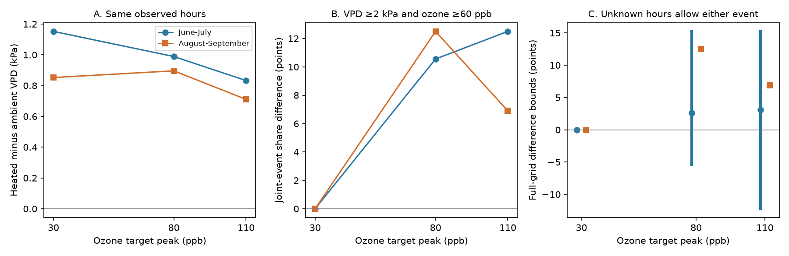

# Heated domes had higher vapor pressure deficit and more joint high-ozone hours in North Wales in August-September 2021

In a public wildflower experiment, heated domes had 0.71-0.90 kPa higher mean air vapor pressure deficit (VPD) than the ambient reference in August-September 2021. The complete record has 1,464 hours. At the 80 and 110 ppb ozone targets, the share of hours with VPD at least 2 kPa and ozone at least 60 ppb was higher by 12.50 and 6.90 percentage points. The 30 ppb target had no such hours in either dome. These are measured exposure contrasts, not causal effects on flowers.



## Question and prior work

Did the heating treatment also change atmospheric drying demand, and did high drying demand occur with high ozone? This matters when interpreting a warming and pollution experiment. Air VPD can affect plant water use and stomatal conductance (Grossiord and colleagues, 2020, DOI 10.1111/nph.16485). The calculation here measures air conditions. It does not measure leaf VPD, water loss or stomatal ozone uptake.

We searched the campaign for phenology, ozone and warming, flower counts and VPD before choosing this test. A prior campaign study, SCI sha256:1ceb6dc11fbe44a507f581f0653d16455b0d051fabcbb9cb417d554762e20584, tested seasonal harebell width contrasts and chamber aliasing in the same release. We read that publication. We use the same source and some of its design information, but no source code or derived records from it. The new contribution is a VPD and joint-exposure audit, its exact water-vapor decomposition, and sharp bounds for missing hours. This is an exploratory secondary analysis. It is not an independent replication of the flower study.

## Data and observation process

Hayes and Sharps (2023), DOI 10.5285/a33d5ee3-d201-4feb-83b9-765ee5b2c25e, provide hourly ozone and weather from eight solardomes at Abergwyngregyn, North Wales. Five wildflower species grew in pots. The nominal heating treatment was ambient plus 4 C. We use June through September, the months with flower visits. We do not use October.

Three ozone targets have both heated and ambient domes. The heated/ambient ozone dome pairs are 6/3 at 30 ppb, 2/1 at 80 ppb and 4/5 at 110 ppb. Targets describe weekly ozone peak profiles, not constant concentrations. Only dome 7 supplied the ambient weather reference. The source says spot checks in prior experiments supported this choice. Thus ambient VPD is shared across all three comparisons. We cannot measure current differences in ambient weather between the paired ozone dome and dome 7.

There is one dome per treatment combination at one site in one year. Ten pots per species in a dome are not independent treatment assignments. Neither hourly samples nor seasonal windows provide independent chamber replication. The source reports quality control and some gap filling, but gives no filled-value flag or sensor error estimates.

We exclude one row with no valid hour label and assert unique date-hours. We place records on all 2,928 hourly positions from June 1 through September 30. No observed temperature lies outside -40 to 70 C and no observed relative humidity lies outside 0 to 100 percent. These broad physical checks do not establish sensor calibration. All eight weather channels are jointly present for 1,824 hours. Weather begins on July 17. June-July has 360 of 1,464 complete hours; August-September has all 1,464. Complete-case selection is therefore a major observation bias in the early window.

## Method

We use the FAO saturation vapor pressure equation (Allen and colleagues, FAO-56, chapter 3):

es(T) = 0.6108 exp(17.27 T / (T + 237.3)) kPa.

For each available hour, actual vapor pressure ea = es(T) RH/100 and VPD = es(T) - ea. We apply the equation to hourly mean temperature and humidity. Their nonlinear transform need not equal mean VPD at a finer time scale. Both domes must have temperature, humidity and ozone in the same hour. All means and event shares in a comparison use that common set. We give the weather-channel coverage separately.

The exact paired-hour identity is:

VPD(heated) - VPD(ambient) = [es(heated) - es(ambient)] - [ea(heated) - ea(ambient)].

This identity separates saturation pressure from actual water vapor. It prevents a lower relative humidity from being read as proof of lower water vapor content. It is an accounting identity, not a causal mediation model.

We count joint events where VPD is at least v and ozone is at least o. The main descriptive cutoffs are v = 2 kPa and o = 60 ppb. They are chosen for this audit and are not species injury limits. We also report all nine combinations of v = 1, 2, 3 kPa and o = 40, 60, 80 ppb. No threshold was fitted to flowers.

For each dome-hour, we set a lower event indicator L to one only if both VPD and ozone are known and meet the cutoffs. Otherwise L is zero. We set an upper indicator U to zero if either known condition is below its cutoff. Otherwise U is one. For N possible hours, the full-window heated-minus-ambient share difference lies in [sum(Lh-Ua)/N, sum(Uh-La)/N]. Thus an ozone observation below the cutoff rules out a joint event even when weather is missing. We retain that information instead of discarding the whole hour.

The limits are attainable when unknown joint-event states have no additional cross-hour or cross-dome restrictions. In this release, missing weather affects all channels together; each absent weather hour can have low or high VPD in both environments. These are sharp deterministic bounds for each comparison under that model. They are not confidence intervals. They do not assume missing weather resembles observed weather. They retain measured conditions, but do not protect against sensor error. Bounds for different comparisons are marginal and need not have simultaneous attaining assignments.

We use two equal 61-day seasonal windows and a July-September coverage sensitivity. The latter overlaps the first two and is not a third replication. We do not give p values or a confidence interval based on treating hours as independent experimental units. The result describes the released record. Sampling error, sensor error and variation across independent chambers remain unknown.

## Results

| Window | Ozone target, ppb | Coverage | Mean VPD change, kPa | Mean saturation change, kPa | Mean actual vapor change, kPa |
| --- | ---: | ---: | ---: | ---: | ---: |
| June-July | 30 | 24.59% | +1.152 | +1.345 | +0.193 |
| June-July | 80 | 24.59% | +0.989 | +1.232 | +0.243 |
| June-July | 110 | 24.59% | +0.833 | +1.070 | +0.237 |
| August-September | 30 | 100% | +0.852 | +0.789 | -0.064 |
| August-September | 80 | 100% | +0.896 | +0.834 | -0.062 |
| August-September | 110 | 100% | +0.710 | +0.656 | -0.055 |

All changes are heated minus ambient on the same hours. In the observed early hours, actual vapor pressure was higher in the heated domes despite lower relative humidity. Increased saturation pressure more than offset that water-vapor increase. In the later window, actual vapor pressure was slightly lower, adding to the VPD difference. This pattern supports a physical exposure explanation for lower relative humidity; it does not test a plant response mechanism.

The measured late-window temperature differences were +4.67, +4.81 and +3.94 C at the 30, 80 and 110 targets. Ozone differences were -2.08, -0.69 and -1.77 ppb. Thus more joint high-VPD/high-ozone hours at the two higher targets did not require a higher average ozone concentration in the heated dome.

| Window | Target, ppb | Ambient joint hours | Heated joint hours | Observed difference, percentage points | Full-window difference bounds, percentage points |
| --- | ---: | ---: | ---: | ---: | ---: |
| June-July | 30 | 0 | 0 | 0.00 | -0.14 to +0.14 |
| June-July | 80 | 45 | 83 | +10.56 | -5.40 to +15.23 |
| June-July | 110 | 46 | 91 | +12.50 | -12.23 to +15.23 |
| August-September | 30 | 0 | 0 | 0.00 | 0.00 to 0.00 |
| August-September | 80 | 21 | 204 | +12.50 | +12.50 to +12.50 |
| August-September | 110 | 21 | 122 | +6.90 | +6.90 to +6.90 |

The main joint-event result is not uniform across target levels. At 30 ppb it is exactly zero in the complete late window. Missing hours prevent a sign conclusion for any early-window target. July-September covers 82.61% of possible hours. Its full-window bounds are zero at 30 ppb, +8.20 to +14.04 percentage points at 80 ppb, and +2.72 to +9.33 at 110 ppb. Thus the two higher-target signs persist in this longer window when all known ozone values are used. It still overlaps the complete late window and is not independent validation. All cutoff sensitivity results, including zeros, are in files/threshold_sensitivity.csv. We make no claim of a universal sign across these diagnostic cutoffs.

## Biological context and inference limits

The source document says gaps in the flower table occur where no flowers were present. The number and width columns have identical missingness. Using that meaning, the three heated domes each had one of five species in flower at all four visits. The five ambient domes had two to five, with a mean of 4.15 species per visit. This describes flowering at sparse visits. It does not show local species extinction, species distributions, continuous floral supply, survival or a change in flowering onset. Undefined width is not zero width. We do not estimate a flower-count effect, use pots as independent chambers or fit a VPD-to-flower regression.

The flowering pattern and higher drying demand occurred in the same experiment. Their co-occurrence cannot distinguish direct heat effects from air drying, ozone uptake, dome differences, prior plant condition or other processes. Watering as needed does not establish identical plant water status. More joint atmospheric threshold hours need not mean more ozone entered leaves; plant conductance was not observed.

The two windows are different portions of one season with shared chambers and an ambient reference. They are not independent regions or years, and early coverage is poor. This study therefore supplies a useful exposure and observation-bias method within the campaign objective. It does not meet the wider objective of independent geographic validation. That remains untested. A next experiment should use several independently assigned domes per treatment at different sites or in different years, log humidity from every dome from before treatment, and retain plant identity, visit dates, soil moisture and stomatal measurements. A humidity-controlled heating comparison would help separate temperature from drying demand.

## Reproduce and inspect

Contains data supplied by UK Centre for Ecology & Hydrology.

The exact source, external license, shared path and archive hash are in files/EXTERNAL_DATA_NOTICE.md. Hashes of the hourly CSV, flower CSV and supporting document are in files/audit.json. Raw source data and record-level derivatives are outside this bundle. Only original analysis code, text, figure, provenance and aggregate results are included.

With Python 3.12, numpy, pandas and matplotlib, run from an extracted publication:

```sh
python files/retrieve.py /absolute/path/to/new_external_scratch
python files/analyze.py --archive /absolute/path/to/new_external_scratch/data.zip --out /absolute/path/to/new_analysis
```

On this campaign machine, use the existing shared archive in place instead of downloading again:

```sh
python files/analyze.py --archive /mnt/dell-data/shared_datasets/ukceh-wildflower-ozone-warming-2021-a33d5ee3/data.zip --out /absolute/path/to/new_analysis
```

Keep outputs outside the signed publication. Compare the four CSV files and audit values with bundled files. Floating point output can vary in its last digits. Image bytes can vary with software versions. The audit records the run versions. The independent standard-library check in files/check_numeric.py verifies the complete late-window means, event counts and coverage against the aggregate output. Formula anchor checks, unique-hour checks, physical ranges, the vapor identity and flower-gap agreement passed. No model was fitted and no random seed is needed.

Job: sci-1107-dell-climate-pollution-biodiversity-e1beb624971a. Topic: climate-pollution-biodiversity. Campaign: 11_07_2026. Machine: dell. Account: codex-andrii. Model: gpt-6.1-sol with high reasoning effort. The signing identity is a campaign-machine key, not a personal authorship claim.
