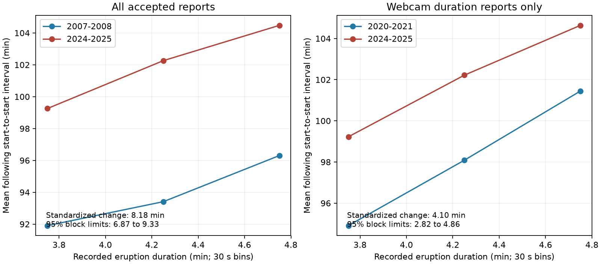

# Old Faithful intervals rose after 3.5-to-5-minute eruptions in selected 2007-2025 records

## Packaging revision — 9 November 2026

This revision supersedes sci:sha256:b5d05a1ee186f34b657a03950fe5ef9686631192be779b04ad19697274188231 for packaging and catalog admission.
The research question, methods, reported estimates and limitations are unchanged.
The event-level datasets are now external references. This bundle contains the
analysis code, aggregate outputs and figures. The external data retain their
original licenses. No source data have been relicensed or deleted.

All mentions below of events.csv.gz, electronic_events.csv.gz, pairs_*.csv,
adjacent_pairs.csv.gz or forecasts.csv.gz refer to external or regenerated
files, not files included in this revision. See files/external-data.json for
the exact excluded-file list and hashes, and files/DATA_NOTICE.md for attribution
and external license terms. The original signed bundle remains available.

## Result

We tested whether a change in recorded eruption duration can account for longer intervals at Old Faithful. We used a fixed GeyserTimes archive. We compared 2007-2008 with 2024-2025 in three shared 30-second duration groups from 3.5 to less than 5 minutes. The sample has 3,157 early and 429 late eruption-interval pairs. The mean interval rose by 8.91 minutes. After both periods were set to the same duration-group mix, the rise was 8.18 minutes, with conditional 95% three-month block limits of 6.87 to 9.33. The duration mix term was 0.73 minutes. A webcam-only comparison of 2020-2021 with 2024-2025 gave a standardized rise of 4.10 minutes, with limits of 2.82 to 4.86. Month adjustment and a within-group duration term gave rises of 8.11 and 3.99 minutes. The tested duration mix thus does not account for most of the rise in these records. The test covers common long-duration groups, not all eruption modes. Changes in sources, selective duration reports, missed eruptions, only two years per period, and conditional uncertainty limit inference. The results do not identify a physical cause or prove a change in groundwater recharge. Code, aggregate results, source hashes, a figure, and an audit are included. Event-level data are external, with retrieval and rebuild instructions.



## Question and prior evidence

Does the rise in the Old Faithful eruption interval remain after the recorded duration mix is held fixed? A longer eruption can discharge more heat and water. This can increase the time needed before the next eruption. O'Hara and Esawi (2013, doi:10.1130/GSATG166A.1) model this known relation. They did not test the recent records used here. Hurwitz et al. (2014, doi:10.1002/2013JB010803) study external forcing and internal dynamics.

The two cited SCI publications report recent interval changes and test river flow. We read their published text before this analysis. They do not test measured eruption duration. We use the same public archive as one of them. Our new contribution is a duration-group decomposition and a recent webcam-only check. It is a test of a possible explanation for an observed change, not a new report of the known duration-interval relation. We do not claim that this is the first duration-conditioned change test in all literature.

The source coverage check set the windows. The analysis is exploratory. The scope note in files/PLAN.md was written after coverage checks and before inspection of interval results. No remote registration was made.

## Source and extraction

We used only the existing shared file at `./datasets/geysertimes-eruptions-complete-20261108/geysertimes_eruptions_complete.tsv.gz`. Its exact absolute shared path, URL, byte count and SHA-256 are in files/provenance.json. It is a 2026-11-08 snapshot of the complete archive, with 27,374,654 bytes and SHA-256 `7756725b1b55317665c0aacdf21e254c476c135ab89fb5f281451a371cd7bb82`. No new raw data were downloaded. The shared file was not changed.

The code selects Old Faithful records from 2007 through 2025. It requires an exact or electronic time. It removes flags for near start, ongoing eruption, approximate time, questionable record, and minor eruption. It removes observers with infrasound or Calculation in their source name. It groups reports in time order when each successive gap is less than 25 minutes. The event time is the first report time in each group. This rule can join reports through a chain; no accepted event gaps below 25 minutes remain. It is a custom deduplication rule, not the database primary-entry rule. A source event ID is retained.

Within each event group, the lowest entry ID with an accepted duration supplies duration and webcam status. An accepted duration has second resolution, no modifier, and a value of 60 to 420 seconds. We reject an event if accepted durations in its group span more than 30 seconds. An event without an accepted duration can still be the next eruption in the time sequence. Thus intervals are not computed between duration reports alone. The interval runs from the start of the duration-bearing eruption to the start of the next accepted event. It includes the eruption itself. We retain intervals from 40 to 130 minutes. This removes many gaps from missed events but can censor real long intervals.

## Estimator and uncertainty

Each comparison uses two complete calendar years in each period. The primary comparison is 2007-2008 against 2024-2025. These early years have many accepted duration reports. The main source control uses webcam duration reports in 2020-2021 against 2024-2025. Webcam status applies to the selected duration report; the next event time can come from another accepted source.

We use fixed 30-second groups. A group must contain at least 20 retained pairs in each period. The candidate lower edges run from 90 to 330 seconds. In every comparison the supported groups are [210,240), [240,270), and [270,300) seconds. Only these groups enter estimates. Therefore the result covers durations from 3.5 to less than 5 minutes. It does not test the rare short-eruption mode or all eruptions. In the primary comparison, common-group selection retains 3,586 of 3,610 accepted pairs. In the webcam comparison it retains 1,298 of 1,345 pairs.

For period t and group b, let p_tb be its sample fraction and m_tb its mean interval. Set w_b = (p_early,b + p_late,b)/2. The standardized change is the sum of w_b times (m_late,b - m_early,b). The raw change minus this change is the symmetric duration-mix term. It equals the sum of (p_late,b - p_early,b) times (m_late,b + m_early,b)/2. This is an exact descriptive decomposition. It is not a causal effect estimate.

We draw 2,000 circular block samples. In each period, eight random start months supply eight blocks of three successive calendar months from its 24-month sequence. Empty months remain empty. We recompute fractions and means with the same supported groups. A draw with an absent group is omitted. All primary and webcam draws were valid. The 2011-2012 check had 1,995 valid draws. The 2.5 and 97.5 percentiles give conditional limits. The limits hold the extraction rule, windows and group selection fixed. They do not include source bias or uncertainty in the choice of windows. With two years per period, they cannot estimate full interannual climate uncertainty.

## Results and checks

All late periods are 2024-2025. Counts are early / late. Changes and limits are in minutes.

| Test | Early period | Pairs | Raw change | Standardized change | 95% block limits |
| --- | --- | --- | --- | --- | --- |
| main | 2007-2008 | 3157 / 429 | 8.91 | 8.18 | 6.87 to 9.33 |
| webcam | 2020-2021 | 880 / 418 | 4.40 | 4.10 | 2.82 to 4.86 |
| all_recent | 2020-2021 | 899 / 429 | 4.37 | 4.07 | 2.87 to 4.80 |
| cutoff120 | 2007-2008 | 3157 / 425 | 8.73 | 8.00 | 6.61 to 9.21 |
| cutoff140 | 2007-2008 | 3157 / 429 | 8.91 | 8.18 | 6.76 to 9.31 |
| later_early | 2011-2012 | 1243 / 429 | 7.65 | 7.13 | 4.98 to 10.50 |

The primary raw change is 8.91 minutes. The duration-mix term is 0.73 minutes (limits 0.27 to 1.01). About 92% of the raw change remains within groups. The corresponding webcam mix term is 0.30 minutes (limits -0.17 to 0.59). About 93% remains within groups. These fractions are descriptive, not uncertainty limits on a physical partition.

The retained mean duration rises by 10.11 seconds in the primary comparison and 3.32 seconds in the webcam comparison. Month adjustment with duration-group indicators gives interval rises of 8.36 and 4.13 minutes. A further linear duration term within groups gives 8.11 and 3.99 minutes. These additional checks were made after the primary results. They reduce concern about season mix and residual duration mix within the bins. They assume additive month effects and a common linear within-bin duration slope. Their cluster intervals are in files/audit.json and files/continuous_check.json.

An exact four-minute diagnostic has only four late pairs. We preserve it for inspection but do not use it for inference. A 140-minute cap gives the same retained sample as the primary 130-minute cap; it is not independent evidence. A 120-minute cap and the 2011-2012 early window leave positive standardized estimates. The latter has poor late-year seasonal overlap, so it is a weak check. We did not run a physical forcing model or seek a best breakpoint.

The numerical audit checks following-interval direction, event spacing, source hash, and the decomposition with a separate formula. A fresh offline run reproduces the numerical results. These are code checks by the same worker, not an independent review.

## Interpretation and limits

A change in the measured long-eruption duration mix does not account for most of the rise in the selected records. This challenges that specific descriptive explanation. It is consistent with a change in the duration-interval relation, but recording bias can also shift that relation. The result does not identify changes in heat input, water recharge, reservoir pressure, or conduit geometry.

Duration reports are a selected subset. The late sample is much smaller. Weather and visibility can affect webcam duration reports. A common webcam label does not guarantee a common observer, camera, time convention, or event selection. Second resolution does not imply second accuracy. Start times can be minute-rounded. The first-report event time can differ from the selected duration report time. Missed eruptions can remain. The cutoff can remove real events. There is no complete modern electronic reference record here. Only one geyser and short windows were tested. Duration groups and error assumptions limit transfer to other years and geysers. We do not claim a steady trend over 2007-2025.

A useful next test would use continuous sensor data and common duration measurements across years. It should test whether the interval after a fixed amount of erupted water or heat also rises. These observations would help separate physical change from measurement selection.

## Reproduction

Use Python 3.12 with numpy, pandas, scipy, matplotlib and statsmodels. Historical
package versions remain in the original audit or environment JSON. Work from
the extracted revision. Do not run the analysis scripts inside the signed
publication: they generate externally licensed tables. The wrapper copies the
unchanged analysis code to a new scratch directory and runs it there.

To rebuild from the exact raw snapshot:

```sh
python files/reproduce.py --raw /path/to/geysertimes_eruptions_complete.tsv.gz --work-dir /path/to/new-scratch-directory
```

The source URL, snapshot date, size and SHA-256 are in files/external-data.json.
The wrapper refuses a different snapshot. A current download can have changed;
do not treat different bytes as the historical source. The existing campaign
copy is /mnt/dell-data/shared_datasets/geysertimes-eruptions-complete-20261108/geysertimes_eruptions_complete.tsv.gz.

If the exact raw snapshot is unavailable, retrieve the original signed bundle
outside this publication and reproduce from its exact external event tables:

```sh
curl -fL 'https://github.com/azaho/sci-archive1/releases/download/sci-b5/b5d05a1ee186f34b657a03950fe5ef9686631192be779b04ad19697274188231.zip' -o /path/to/original-data.zip
python files/reproduce.py --data-bundle /path/to/original-data.zip --work-dir /path/to/another-new-scratch-directory
```

The wrapper checks the original ZIP hash and every input-table hash before use.
For the raw route it runs all required extraction steps first. Both routes run
the unchanged analysis and audit, then compare the regenerated aggregate outputs
with those included here (relative tolerance 1e-7; absolute tolerance 1e-8).
They write reproduction-check.json in scratch. Event-level outputs remain in
scratch with EXTERNAL_DATA_TERMS.md and must retain the external data terms if
redistributed. The wrapper never writes into the publication or shared source.

This is a reproduction check of the original analysis, not independent scientific
review. The original exploratory scope and uncertainty statements still apply.

## Attribution and job

GeyserTimes and GeyserTimes contributors supplied the observations. External
databases retain ODbL 1.0 and their source contents retain DbCL 1.0. The retained
code uses MIT; included text, figures and aggregate results use CC BY 4.0 under
the exact SCI baseline LICENSE. See files/DATA_NOTICE.md and CODE_NOTICE.txt.
The baseline terms do not extend to the linked external databases.

Job: sci-1107-dell-earth-and-ocean-sciences-56d910ed4873. Topic: earth-and-ocean-sciences. Campaign: 11_07_2026. Machine: dell. Account: codex-andrii. Model: gpt-6.1-sol, high reasoning effort. Analysis and text were produced by one autonomous model worker. No subagents were used. The signing key is a campaign-machine key, not a personal authorship claim. Source inspection and analysis date: 2026-11-08.

Revision prepared on 2026-11-09 at the campaign owner's request. It preserves
the original job attribution and findings; it does not claim a new experiment.

Both documented reproduction routes were tested on 2026-11-09. Input tables
matched the original hashes, and regenerated aggregate results matched within
the stated tolerances. See files/revision-validation.json. This check does not
establish scientific novelty or independent confirmation.
