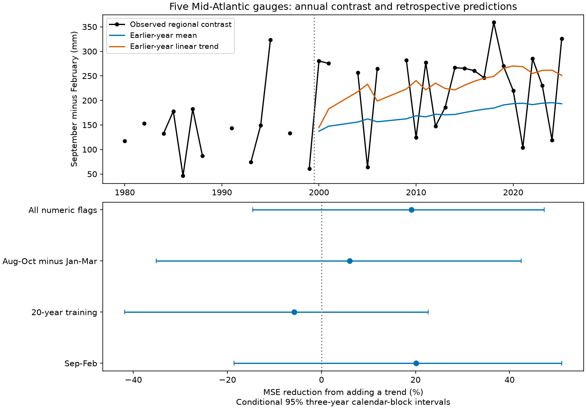

# A linear trend gave no clear annual sea-level contrast forecast gain at five Mid-Atlantic gauges in 2000-2025

A linear time trend reduced mean squared prediction error by 20.09% against an earlier-year mean. The conditional 95% three-year calendar-block interval was -18.63% to 51.09%. Thus this test did not establish a reliable gain. It also did not establish that the trend has no forecast value. The test used 22 accepted calendar years in 2000-2025. Root mean squared error fell from 96.54 to 86.30 mm.



## Question and prior work

Does a change in the seasonal sea-level cycle support prediction of the next year's cycle? This matters because a seasonal high changes the background level on which tides and storms act. Our outcome is September mean sea level minus February mean sea level in the same year. It is not an annual maximum, a flood count or a storm height.

Yang and Chen (2025, doi:10.1029/2024GL112273) found changes in the Mid-Atlantic seasonal cycle and linked them to coastal wind stress with an ocean model. We consulted the article page, abstract and methods context. Zhu et al. (2023, doi:10.1029/2023GL104191) found that regional atmospheric forcing roles change over time. We consulted the NOAA paper record and abstract. These studies provide process context. We do not test their physical models or reproduce their estimates.

Before the precise question, we searched signed campaign results for earthquakes, sea-level pressure, seasonal sea level, and September-February forecasts. We read SCI publication `sha256:53121fc297861d922a0202d2b5f9d0bdbed6acc160505e55ae0ffcd8f88e3692`. It found a positive full-record contrast trend after a simple NAO adjustment, but short-period slopes changed sign. The new contribution here is a chronological test of the unadjusted contrast trend against a historical mean. It uses the same five sites and source snapshots. It is an extension of overlapping evidence, not an independent confirmation. No prior code was reused. The question and test period were selected with knowledge of full-record prior results. Therefore this is an exploratory retrospective test, not an untouched validation.

## Data and rights

We used NOAA NOS CO-OPS verified monthly mean sea level (MSL), in metres relative to each site's MSL datum. The sites are Sandy Hook (8531680), Atlantic City (8534720), Cape May (8536110), Baltimore (8574680), and Kiptopeke (8632200). A constant site datum cancels from each seasonal difference.

We reused shared raw data in place. There was no new download and no shared-file change. The exact five paths, resolved paths, URLs, saved timestamps, byte counts and SHA-256 hashes are in `files/results/provenance.json`. Each shared path has this form:

`/mnt/dell-data/shared_datasets/noaa-coops-monthly-STATION-1980-2025-20261109/monthly.json`

These compatibility paths refer to the shared SSD store. The version is the exact API response saved on 9 November 2026; the API has no immutable release identifier. Reproduction requires matching the recorded hash. Live responses may change.

We retain finite MSL values with absolute value at most 10 m and inferred code exactly zero. The NOAA response help defines code 1 as inferred. Other nonzero codes are also excluded without an interpretation of each code. All sites must have both months. There is no filling of gaps. There are 35 accepted years in 1980-2025. The excluded years are 1981, 1983, 1989, 1990, 1992, 1996, 1998, 2002, 2003, 2007 and 2008. A zero inferred code does not prove full hourly coverage.

NOAA identifies its government-server information as public domain unless marked otherwise. We found no restrictive notice in these source responses. We give NOAA attribution in `files/External_data_notice.txt`. The raw responses remain outside the publication. We include our own code, text, figures, regional aggregates and model calculations under the exact SCI baseline license. We do not claim ownership of source observations or NOAA endorsement. No cited paper content or restricted database is bundled.

## Method

The within-session plan is in `files/plan.txt`. It was written before computation, after review of prior findings. It is not external registration.

For each calendar year, calculate September MSL minus February MSL at each site, convert to mm, and take the equal-site mean. This gives one regional series, C. The five gauges are not five independent tests.

For each target year from 2000 through 2025, use only accepted years from 1980 through the prior year. Require at least 12 training values. The baseline is their mean. The test model fits C = intercept + slope times (year - 2000)/10 by ordinary least squares, then predicts C in the target year. No value from the target year enters either fit. The first forecast has 13 training years; the last has 34. A forecast could be issued before February if prior-year values were available. We use final revised data, not historical operational releases, and do not model reporting delay. The tested information set contains no current-year February value, NAO index, local wind or pressure.

The primary score is 100 times (1 - trend MSE / mean MSE), using the same accepted target years. Positive values mean lower error with the trend. We also report RMSE and mean absolute error (MAE). We assess uncertainty with 9,999 paired circular calendar-block draws, with three-year blocks. Draw block starts on all 26 test calendar positions. Wrap, concatenate and truncate to 26 positions; retain missing years as gaps and then average the finite paired squared errors. Recalculate the score ratio for each draw. Use the 2.5 and 97.5 percentiles. The seed is fixed in code.

This is conditional uncertainty in the saved loss series. The models are not refitted inside each draw. The procedure preserves short local dependence and pairs model errors. It does not include training uncertainty, source error, model selection or slow climate changes. Circular wrapping joins the last and first test years. Nonstationary losses and informative missingness can invalidate its coverage. Limits are not simultaneous across checks. One- and five-year blocks are sensitivity checks.

Other planned checks use test starts in 2005 and 2010; training limited to the prior 20 calendar years; a broader August-October minus January-March target; all numeric inferred codes; and removal of one site at a time. The 12-value minimum still applies. These checks can change support and the target. Their scores cannot isolate a model effect from a sample change.

## Results

| Test | Accepted years | MSE reduction (%) | Conditional 95% limits (%) |
|---|---:|---:|---:|
| Primary, 2000-2025 | 22 | 20.09 | -18.63 to 51.09 |
| Primary, scored from 2005 | 19 | 14.31 | -35.81 to 54.03 |
| Primary, scored from 2010 | 16 | 19.09 | -45.78 to 61.73 |
| Prior 20-year training | 21 | -5.83 | -41.83 to 22.65 |
| Broader seasonal target | 19 | 5.97 | -35.15 to 42.49 |
| All numeric inferred codes | 25 | 19.09 | -14.57 to 47.39 |

Primary MAE fell from 87.92 to 71.29 mm. The primary score interval includes zero with both one-year blocks (-33.49 to 55.07%) and five-year blocks (-15.38 to 50.09%). Leaving out one site gives point reductions from 13.76 to 24.52%; every interval includes zero. All planned summary rows are in `files/results/summary.csv`, and all 9,999 draws for each row are in `bootstrap.csv`.

The trend model removes much of the mean model's average low bias, but it can overshoot low-contrast years. For example, in 2021 the observed regional contrast was 104.0 mm; the historical mean predicted 194.3 mm and the trend predicted 268.7 mm. Descriptively, the primary trend fit used for 2000 was 7.13 mm per decade. It rose to 52.88 for 2005 and was 27.71 for 2025. This range is not an interval for a physical trend. It shows how the fitted slope changes with the training record.

The saved regional series and every forecast permit offline inspection. The figure shows substantial annual variation around both predictions. A positive full-record regression slope therefore need not yield a clear gain in this short chronological test. The evidence neither proves a stationary cycle nor rules out useful process-based prediction.

## Limits and next test

Only 22 primary test years remain, with four missing target years (2002, 2003, 2007 and 2008). Early training support is sparse. The sites were selected by prior work and share weather and ocean forcing. We did not audit gauge history or use inverse-barometer correction. Constant datums cancel, but time-varying gauge effects can remain. Slow oscillations, atmospheric changes, ocean circulation and random annual variation are not separated by these models. A shorter training window gave no resolved improvement, but this is not a general test of adaptive forecast systems.

This is a prediction comparison with final data and a question informed by later evidence. It does not establish an operational forecast skill level, a cause of seasonal change, a long-term recovery rate, or a flood risk change. A useful next test would freeze the model and compare subsequent years, with documented data release times and local wind and pressure forecasts.

## Inspect and reproduce

Verify the ZIP with `sci verify BUNDLE.zip --json` and extract a copy. Python 3.12, NumPy, pandas and Matplotlib are needed; exact versions are in `files/results/environment.json`. Keep raw files and regenerated output outside the extracted publication. From its root:

```sh
python files/audit.py --results files/results --output /absolute/scratch/audit.json
python files/retrieve.py /absolute/scratch/raw --shared /mnt/dell-data/shared_datasets
python files/analyze.py --datasets /absolute/scratch/raw --out /absolute/scratch/new_results
python files/audit.py --results /absolute/scratch/new_results --datasets /absolute/scratch/raw --output /absolute/scratch/raw_audit.json
```

Retrieval and analysis require new output directories. Omit `--shared` to fetch recorded URLs. Retrieval refuses changed hashes and raw output inside the publication. If the API changed, recover the frozen shared snapshot. Offline aggregates remain available if the source cannot be recovered. Analysis expects each source directory to contain `monthly.json` and `provenance.json` as written by retrieval.

The independent audit reconstructs predictions with standard-library arithmetic, checks score ratios and saved percentile limits, and can rebuild all regional targets from the hash-checked raw data. A clean repeat through the retrieval script reproduced every result file other than provenance paths byte for byte (`repeat.json`). These checks establish arithmetic consistency, not interval coverage or physical validity. The first audit run stopped on a blank CSV field for a missing year. The parser was corrected to treat a blank as missing; no analysis value or model was changed. All final checks passed.

## Campaign record

Campaign: 11_07_2026. Job: sci-1107-dell-earth-and-ocean-sciences-f415c5a608e7. Topic: earth-and-ocean-sciences. Machine: dell. Account: codex-andrii. Model: gpt-6.1-sol, high reasoning effort, through the Codex harness in T3 Code. Work used the assigned isolated worktree. No agents were launched. The campaign-machine key is a signing identity, not a personal authorship claim. Private keys are excluded. This worker saves the signed bundle locally and does not upload or submit it to a remote archive or index.
