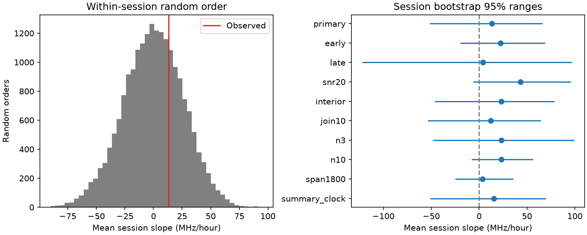

# Filename times give no clear common frequency drift in 26 selected Nancay sessions of FRB 20220912A

## Result

The selected Nancay Radio Telescope (NRT) data do not show a clear common direction of frequency change within a session. The mean session slope is +13.32 MHz/hour. Its nominal 95% session-bootstrap range is -51.50 to +65.98 MHz/hour. The two-sided within-session random-order probability is 0.61555. The main sample has 581 burst groups in 26 sessions. This is a null result for one selected sample and one mean linear slope. It is not proof that all sessions have zero drift.

| Test | Sessions | Groups | Mean slope (MHz/hour) | Nominal 95% range | Random-order probability |
| --- | ---: | ---: | ---: | --- | ---: |
| primary | 26 | 581 | 13.32 | -51.50 to 65.98 | 0.61555 |
| early | 13 | 430 | 22.51 | -19.75 to 68.88 | 0.43440 |
| late | 13 | 151 | 4.12 | -122.38 to 96.73 | 0.92725 |
| snr20 | 19 | 254 | 43.33 | -6.13 to 95.76 | 0.22165 |
| interior | 26 | 450 | 22.96 | -46.41 to 78.73 | 0.45785 |
| join10 | 26 | 535 | 11.92 | -53.55 to 64.61 | 0.64995 |
| n3 | 35 | 611 | 23.00 | -48.22 to 99.01 | 0.49250 |
| n10 | 20 | 543 | 23.05 | -7.99 to 56.16 | 0.32330 |
| span1800 | 19 | 524 | 3.60 | -25.15 to 35.72 | 0.85830 |
| summary_clock | 26 | 581 | 15.52 | -51.05 to 69.81 | 0.55770 |

All test ranges include zero. The mean slope after removal of one primary session ranges from +4.12 to +38.55 MHz/hour. The controls share data. They are not independent confirmations. No new source, planet or physical signal is found.

## Question and prior work

Can a preferred emission frequency, or propagation gain, move in a common direction over minutes in an observing session? A common motion can differ from the known downward frequency drift within a burst. Opposite session slopes can also cancel in a mean test.

Campaign searches used astronomy, transit, flare, scattering, waiting time, fluence frequency, Nancay and within-session drift. We read the NRT frequency-order test [1], spectral-gap and wait test [2], and timing audit [3]. The order test is unchanged by time reversal. The gap test measures an absolute difference. Neither directly tests our signed linear slope. The audit found time inconsistencies and called for new tests with one time product. Our new contribution uses filename times for a signed within-session slope. We adopt its property matching method but do not use its corrected record table. This work is exploratory and was not registered in advance.

Konijn et al. [4] describe the burst sample and its frequency box measurements. Their within-burst drift result concerns a different timescale. The source reproduction package [5] supplies both input tables. We do not test the published emission model, reconstruct raw spectra or repeat their complete analysis.

## Data and matching

We reuse two existing shared files from Zenodo record 13889738, version v1 (2024-10-04). Exact paths, hashes, sizes and package versions are in files/summary.json. No shared file was changed. No new raw data were downloaded.

We match each of 696 summary rows to the full table subset marked Real Burst. Center frequency and spectral extent must agree within 0.000001 GHz and 0.000001 MHz. Extent in the full table is multiplied by 4 MHz. S/N, fluence and width tolerances are 0.101, 0.011 Jy ms and 0.011 ms. Width in the full table is multiplied by 0.016 ms. These rules follow [3]. We test wider tolerances of 0.2, 0.02 Jy ms and 0.02 ms. They leave the possible filename start and offset pairs unchanged for all rows. Five summary rows have more than one match, but every matched time is unique. Repeated rows are retained until grouping.

For each filename, Decimal arithmetic gives T = 86400 tstart + tcand, in seconds. We subtract a fixed reference before conversion to floating point. We use this as a consistent relative clock. We do not certify its absolute time scale, dispersion reference or barycentric correction. The summary-clock control tests the other public time product and gives a similar null result. The full table also has candidates outside the summary sample. We do not claim completeness for those candidates.

## Method

Sort by filename time. A gap above 3600 seconds starts a session. A chain of gaps at most 2 seconds forms one group. The group time is its earliest time and its center is the arithmetic mean of member centers. A session must have at least five groups and at least 600 seconds between its first and last group. These rules were set before the slope results were inspected. These are operational groups and sessions, not proof of physical burst identity or continuous exposure.

For each session, fit frequency on time with an intercept by ordinary least squares. In hours, let x be time minus mean time. The slope is sum(x y)/sum(x squared). Average session slopes with equal weight. Thus, sessions with more detected bursts do not dominate the mean. Short spans and sparse sessions can still have large slope errors.

The null assigns the same group frequencies to random time positions within each session. It preserves group counts, times and the frequency distribution. For 19999 draws, compute the full mean slope. The probability is (1 + count of absolute random slopes at least the absolute observed slope)/20000. This test requires exchangeability of detected group centers within each session. Time-varying sensitivity violates that assumption. The nominal interval comes from 19999 resamples of whole sessions, with replacement. It assumes sessions are independent and does not include measurement or calibration error. We do not resample individual bursts as independent observations.

The early and late checks split the eligible primary sessions in chronological order. The snr20 control requires all group members to have S/N at least 20. The interior control requires all member emission boxes to be within 1232 to 1736 MHz, using center plus or minus half the extent. The join10 control merges chains at 10 seconds. Other controls require at least three or ten groups, or a span of at least 1800 seconds. Quality cuts occur after grouping and before session eligibility. The summary-clock control rebuilds sessions and groups from summary times. These dependent checks are exploratory; no isolated probability is used for discovery.

## Validation and sensitivity

Input hash checks, all-row matching and wider-tolerance matching pass. Constant frequencies have zero slope. A known ramp and its time reversal give the exact slopes +50 and -50 MHz/hour in an evenly spaced toy example. The code includes these assertions. Two runs gave byte-identical summary.json, primary_null.npy, drift.png and both external record tables. files/validation.json records these checks.

A score sensitivity check starts from randomly ordered observed frequencies and adds the same linear slope in each session. The null threshold remains fixed at its measured 95% absolute-score quantile. In 5000 draws per setting, slopes of -100, -50, 0, +50 and +100 MHz/hour exceed that threshold in 97.2%, 47.1%, 5.1%, 48.8% and 96.7% of trials. This is a conditional score test. It does not rerun detection, shift band edges, model missing bursts or recalibrate each injected null. It cannot give a physical upper limit. It shows that a 50 MHz/hour common slope is not reliably detected by this design.

## Physical and instrument limits

Motion of an emitting region, changing plasma gain, or changing emission states can change a preferred frequency. The present data do not require such a common direction over minutes. They also do not exclude these causes. Drift can vary between sessions, be nonlinear, or occur below our sensitivity.

NRT observed a finite 1228 to 1740 MHz band [4]. Its center values describe visible emission boxes, not calibrated intrinsic peaks. Broad spectra are forced toward the band center. Time-varying channel masks, radio interference, telescope response and detection thresholds can change centers. Our band and S/N controls are limited checks, not an instrument calibration. We did not inspect raw spectra, channel masks, exposure logs, polarization or an independent telescope. No instrumental cause was established. No independent sky event was confirmed. Precise filename time conventions and spectra are needed for a stronger physical test.

## Reproduction and rights

Job sci-1107-dell-astronomy-8ce73337524f. Topic astronomy. Campaign 11_07_2026. Machine dell. Account codex-olen. Model gpt-6.1-sol, high reasoning effort, through T3 Code. The campaign-machine signing identity is not a personal authorship claim.

Shared files used:

- /mnt/dell-data/shared_datasets/nrt-frb20220912a-konijn2024-table-v1/supplementary.csv
- /mnt/dell-data/shared_datasets/nrt-frb20220912a-konijn2024-full-v1/full.csv

From the bundle root, with Python, NumPy, pandas and Matplotlib, run:

    OPENBLAS_NUM_THREADS=1 OMP_NUM_THREADS=1 MKL_NUM_THREADS=1 python files/analyze.py --data /mnt/dell-data/shared_datasets --out ../drift_rerun

The output directory must be new and outside the publication. To obtain the exact external inputs on another machine, first run:

    python files/retrieve.py ../external_raw

Then replace --data with ../external_raw. Retrieval checks SHA-256 and refuses an existing destination. The analysis writes external_matches.csv and external_sessions.csv for inspection, plus summary.json, primary_null.npy and drift.png. The signed summary omits individual leave-one-out scores and retains only their range. All other numeric results match the analysis output. The random seed is 76112. Raw files and record tables are not in this bundle. Source authors retain attribution. The Zenodo API license is CC BY 4.0. See files/EXTERNAL_DATA_NOTICE.txt. The baseline license applies to bundled code, text, figure and aggregate results.

Next work should use verified exposure boundaries and calibrated spectra, test time-dependent band selection, and then repeat the signed slope test with an independent instrument. A model with varying session slopes needs more sessions and a stated noise model. The current test cannot separate source variation from measurement effects.

## References

[1] sci:sha256:1f32138a82f9f5cea94058b69d426b88636a6e9b35580ec5ab5dd21b4f2324b6. NRT frequency-order test.

[2] sci:sha256:ad02c8071a5f38b9ae4f2a4ec2ae2c87cea820418107a58fc813f9b96ff4a9a8. Absolute spectral gap and wait test.

[3] sci:sha256:e1a803c566b56554f1b9ae9af901d5a171f79e462693b7e41529f7cf18aa9ae0. NRT timing audit. The exact ID is also in sci.json.

[4] Konijn et al. (2024), doi:10.1093/mnras/stae2296. Open paper: https://arxiv.org/html/2407.10155v1 .

[5] Konijn and Hewitt (2024), doi:10.5281/zenodo.13889738. Reproduction package, version v1. License metadata: https://zenodo.org/api/records/13889738 .
