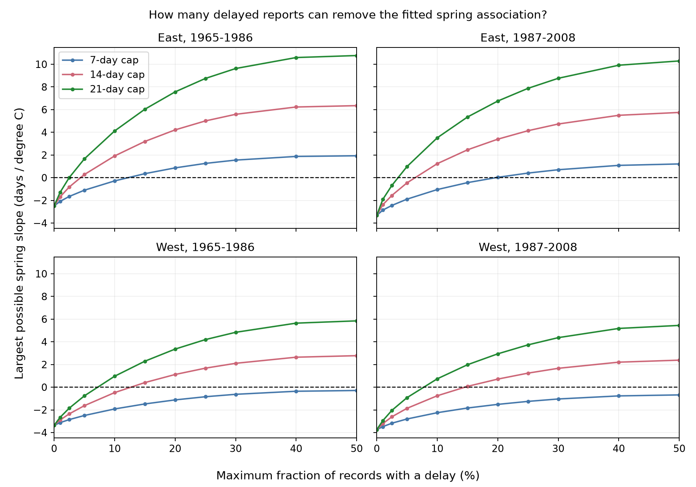

# Four US lilac samples needed delays in 4 to 15 percent of reports to remove spring slopes under a 14-day cap

In four selected US lilac samples from 1965 to 2008, a small set of delayed reports could remove the fitted link between spring warmth and early bloom. If each delay is at most 14 days, the smallest affected fractions are 4.3% and 6.2% in the East, and 12.5% and 14.6% in the West. These values allow delays to target the records that have the greatest effect on the slope. They are exact results for the selected records and model, not estimates of actual delay or confidence limits for a population effect.

## Question and prior work

How many reports must have a delay before a fitted spring slope can reach zero? This question matters when old event records lack visit histories. A bound that allows error in every report can hide how much of the sample must carry error. We add a limit on the number of affected reports and find the smallest total delay that permits a zero slope.

Miller-Rushing et al. found that sampling frequency can affect recorded first flowering. In their tests, a consistently lower frequency did not clearly alter the climate response estimate ([source](https://doi.org/10.1111/j.1365-2745.2008.01436.x)). Our model permits delay to change with weather and thus covers a different error case. Denny et al. explain how status reports can bracket an event between visits ([source](https://doi.org/10.1007/s00484-014-0789-5)). Those intervals are not available in these legacy records.

Campaign searches found a study of unrestricted delay bounds: SCI sha256:d5a0869da667653e53e0b889c192517346d4686cf02d4c448b1f27f335d0e966. It showed negative western slopes under a seven-day delay cap. We extend that question with a limit on the affected fraction. We reuse the panel and raw build code from SCI sha256:551302875a5c81f37d7854aa0bbefe4669a61810d9d3573f192717bbbf19b501. Both prior bundles passed complete SCI verification. We do not claim that the regression algebra is new. This is a new sensitivity analysis of shared records. It is not independent validation of the prior publications. The study is exploratory. The final design was saved before the new calculations; the search record states why the initial question changed.

## Data and model

The panel uses the USA-NPN v13 lilac and honeysuckle archive ([Rosemartin et al.](https://doi.org/10.1038/sdata.2015.38)) and NOAA PSL GHCN CAMS monthly temperature, version 3.01, snapshot 20261105. Source hashes, exact shared paths, URLs and sizes are in files/provenance.json. The derived panel is signed with this report. Source data were reused in place.

We select first bloom from legacy Dataset_ID 7 or 8 in 1965-2008. We exclude ambiguous plant-years, require day of year 1-250, US state, latitude 24-50 N, and longitude 66-125 W. East uses cloned lilac (Species_ID 35) at longitude at least -100. West uses common lilac (36) west of -100. This gives 10,254 candidate records. The main fits keep plants with at least five recorded years in each period. The four samples contain 9,015 records. A plant key combines site, individual and species.

Spring is the equal-month March-April mean; winter is prior December through February. We use the nearest 0.5-degree grid cell and local anomalies from the full 1965-2008 weather record. For each region and period, the model is:

`reported bloom day = plant effect + year effect + winter slope * winter anomaly + spring slope * spring anomaly + error`.

Plant effects remove fixed local differences, including any constant delay for a given plant. Year effects remove shared annual shifts within each sample. These controls do not remove changing observation effort, garden care, plant age, weather error or omitted environmental conditions. Spring includes time after bloom for some records. Thus the estimate is a seasonal association, not a strict prior-exposure test or causal climate effect.

## Exact sensitivity method

Let r be spring temperature after removal of plant effects, year effects and winter temperature. Set `w_i = r_i / sum(r_i^2)`. Then the fitted spring coefficient is `b = sum(w_i * y_i)`. We calculate the same weights by projecting the two weather columns and solving their joint regression. For each report, let the true event day be `y_i - d_i`, with `0 <= d_i <= D`. The event day can be fractional. Weather and the selected records stay fixed. The slope becomes `b - sum(w_i * d_i)`.

For a negative b, only records with negative w can help raise the slope to zero. Sort their absolute weights as `a_1 >= a_2 >= ... > 0`. If at most k reports can have a positive delay, the largest slope is:

`U(k,D) = b + D * sum(a_j, j=1,...,min(k,m))`,

where m is the number of negative weights. This bound is attained by giving the k largest negative-weight records delay D and all others zero. To prove optimality, replace any selected smaller weight with an unselected larger weight. The objective cannot decrease. A positive-weight delay only lowers the slope, so it cannot improve the maximum. Repeating the exchange gives the sorted assignment.

The smallest required count K is the first k for which U(k,D) is at least zero. Give the first K-1 records full delay D, and the Kth record only the delay needed to reach zero. This assignment also minimizes total delay among all assignments that reach zero, because each day placed on a larger a gives at least as much slope change as a day placed on a smaller a. The minimum mean delay is the total divided by all n records, including those with no delay. The support and total-delay constraints are distinct ways to state sensitivity. Neither is an observed error rate.

The method allows delay to depend on weather, outcome and all other records. It assumes no early reports, no missing-record correction, unchanged event rules, and a stated delay cap. It does not require delay to be random. If each plant has one fixed delay in all years, plant effects cancel it exactly. Thus it is changing delay, rather than a fixed late-reporting habit, that can change this model's slope.

## Results

| Sample | Reports | Plants | Observed slope, days/C | Minimum delayed reports at D=14 | Fraction | Minimum mean delay, days |
| --- | ---: | ---: | ---: | ---: | ---: | ---: |
| East 1965-1986 | 2,679 | 220 | -2.484 | 115 | 4.29% | 0.597 |
| East 1987-2008 | 723 | 58 | -3.327 | 45 | 6.22% | 0.861 |
| West 1965-1986 | 5,085 | 503 | -3.359 | 638 | 12.55% | 1.756 |
| West 1987-2008 | 528 | 74 | -3.741 | 77 | 14.58% | 2.023 |

All four slopes can reach zero under the 14-day cap. Delays in at most 10% of reports cannot do so in either western sample with the main model. They can do so in both eastern samples. This is a repeated pattern across the two periods, conditional on the model. Plant type and reporting program differ between regions; these thresholds do not establish a regional biological difference.

At D=7, the eastern minimum fractions are 12.02% and 19.64%. Neither western sample can reach zero even if all reports can have a delay. This reproduces the prior unrestricted result. At D=21, minimum fractions fall to 2.46%, 3.60%, 7.04% and 7.58% in table order. The assumed cap therefore has a large effect.

The curves show the largest possible slope at each allowed affected fraction. Values below zero retain the negative slope for every allowed delay assignment. The curves are deterministic sensitivity bounds, not confidence intervals. Lines connect evaluated integer support budgets.

Removal of flagged reports gives 14-day fractions of 4.11%, 5.76%, 12.43% and 12.98%. Adding plant time trends gives 4.03%, 5.95%, 11.52% and 14.77%. The broad main pattern remains in those checks. Using March alone as spring and January-February as winter gives 3.92%, 3.46%, 5.15% and 10.23%. The early western threshold then falls below 10%, and seven-day delays can remove both western slopes. Thus, the negative western result under the seven-day cap does not hold across exposure windows. This is a material limit, not a minor check. files/results.csv reports all 48 sample, model and cap combinations, including impossible cases.

## Checks and limits

Independent sparse regressions use explicit plant and year indicators, plus plant trends when required. Their coefficients agree with the projection results within 8e-12 days/C. Zero-slope refits differ from zero by at most 1.4e-11 days/C, and solver bounds agree within 7e-15 days/C. The raw rebuild matches the reused panel byte for byte. We refit each possible zero-slope assignment and check cancellation of a constant delay per plant. A linear-program solver checks the separate total-delay bound at a budget of 10% of n times D for each main sample and cap. The code also supplies explicit 14-day zero-slope assignments for inspection. The witness file describes hypothetical errors; it must not be used to mark those actual reports as wrong.

No sampling confidence limits are claimed for these thresholds. The study answers a finite-sample algebraic question. Unknown selection of sites and years, few state clusters, shared plants across periods, correlated regional weather, and uncertainty in the fitted functional form prevent a population robustness claim. Separate record sets across regions and periods are useful checks, but are not independent experiments. Bounds do not show that any delay assignment is plausible. They show what is mathematically possible under stated caps. A very small required affected fraction may require nearly maximum delays placed on precisely the highest-leverage reports.

Delay may exceed the cap, estimates may be early, or missing reports may depend on weather. Those errors are outside the test. The regions have different lilac types and source bloom definitions. Planted shrubs do not represent native community diversity, species ranges or pollinator timing. We did not measure air pollution or daily weather extremes. This study advances a method for assessing observation bias in ecological timing within the broader research objective. It does not attribute change to human-caused warming.

## Reproduction and worker record

files/REPRODUCE.md gives the offline analysis, raw-data rebuild, source retrieval and expected checks. files/validation.csv and files/raw_validation.json preserve the numerical checks. All source code, derived evidence, dependency versions, source hashes and attaining delay assignments are included. The baseline license covers our code, text and derived evidence, with attribution to reused SCI material. Source datasets retain their original terms.

Campaign: 11_07_2026. Job: sci-1107-syam2-climate-pollution-biodiversity-9597d9ffdd43. Topic: climate-pollution-biodiversity. Machine: syam2. Account: codex-myxtap. Model: gpt-6.1-sol, high reasoning effort, T3 Code via the Codex harness. Date: 2026-11-08 UTC. All substantial computation used campaign-compute with one numerical library thread. No agents were launched. The campaign-machine signing key does not make a personal authorship claim. This publication is stored locally without remote upload or submission.
