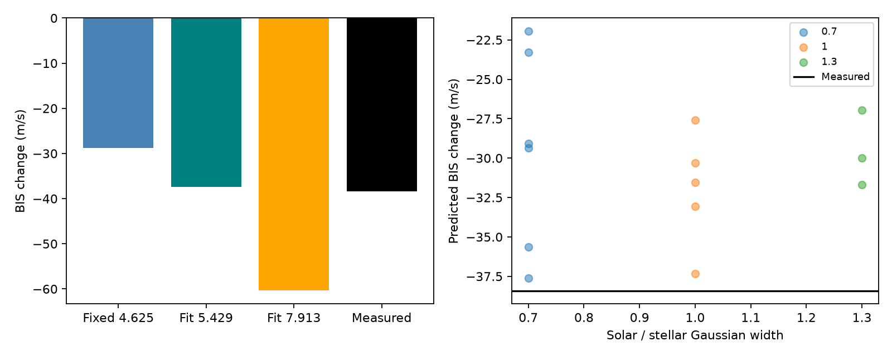

# A Gaussian blend at 5.43 km/s predicts the HD 69830 bisector change within 1.1 m/s under a fixed line model

A published Gaussian blend model for the 2019 November 6 HD 69830 velocity excursion predicts an extra line-shape measure. After fitting the velocity and width changes, the lower-separation solution predicts a bisector change of -37.341 m/s. The measured change is -38.427 m/s. A second solution fits velocity and width but predicts -60.310 m/s. The bisector thus provides a useful added constraint within this model. This is not a new planet or proof of solar contamination.

## Question and prior work

Can the simple blend proposed by SCI sci:sha256:4d911405283cd92f0c9cd1dd772c825cf5645e879b94f1ed23901deb647d002d predict the measured bisector change? That study found a velocity excursion during bright twilight. Its equal-width blend matched two measures with two free parameters. It did not calculate a bisector prediction. We use its event and reference dates, its corrected velocity contrast, and its physical proposal. Our code is new. Our new evidence is a third line-shape constraint and an explicit second solution of the two-measure fit.

We searched the campaign for astronomy, transit, eclipse timing, GJ 674, GJ 536, HD 69830 and HD69830 bisector. We also read the related twilight screen, sci:sha256:4b7aca419facec2cf5deae66895a1e1064b134583504f102b848bf34ae053100. Its small sample did not establish a general twilight error. The GJ 536 studies 8e3a3d4b4e03be96e7cea34d9b0ad13f6d195febdd47eaefe5182d6b87044060 and 9827d026debdb3a3ff74dcc4c02762f659752007fb61b5cd122b16a1fab55535 were read during selection but supply no input to this test.

Roy et al. (2020), DOI 10.3847/1538-3881/ab781a, describe solar contamination of precise velocities. Lanza et al. (2018), DOI 10.1051/0004-6361/201731010, define a related bisector measure using depths of 10 to 40 and 60 to 90 percent. We use 10 to 40 minus 55 to 90 percent as the main convention, and repeat with 60 to 90. We have not verified the exact bisector implementation for this exposure. This is a model check on existing observations, not a blind test. The measured bisector was already in the earlier report.

## Data and rights

We use HARPS RVBank version 02, HD69830, with 17 exposures. The event is the single November 6 exposure. The reference is the mean of five November 8 exposures. We do not clip records. The exact shared file is:

/mnt/dell-data/shared_datasets/hd69830-harps-rvbank-v02-062d93c9/hd69830.csv

Its size is 9984 bytes and SHA-256 is 41cb6e7e52809198abd2cc2ce2b98399fd1d7be6505de975b06ff37c0327d45e. The shared provenance gives the exact source URL in files/provenance.json. The data release is described by Trifonov et al. (2020), DOI 10.1051/0004-6361/201936686, and Perdelwitz et al. (2024), DOI 10.1051/0004-6361/202348263. The RVBank repository carries CC0 terms. We do not assume this settles every right in every hosted file. External observation records, spectra, headers and papers remain outside this package. Included evidence consists of our aggregate contrasts, model results, code, text and figure. See files/EXTERNAL_DATA.md.

## Model and calculation

Use velocity x in km/s relative to the reference stellar line. Let s be the reference FWHM divided by sqrt(8 ln 2). The reference FWHM is 6.704443 km/s. The absorption profile is

A(x) = exp[-x^2/(2 s^2)] + (r/h) exp[-(x+D)^2/(2 h^2 s^2)].

D is the positive separation of a blue contaminant. r is its area relative to the stellar CCF area. h is its width relative to the stellar width. This is not a spectrum or a sky brightness calculation. Fit A with a single Gaussian, with free amplitude, center, width and, in the primary test, a constant baseline. The fit uses uniform weights from -20 to +20 km/s with 0.05 km/s spacing.

Set h = 1. Fit D and r to the corrected DRS change of -34.247538 m/s and width increase of 67.458 m/s. This assumes zero true stellar velocity change between the two nights. The raw velocity contrast is -34.624244 m/s. Using corrected velocity follows the prior model. It does not imply that the correction changes the CCF shape.

For each fractional depth z below the continuum, find both roots of A(x) = z max(A). Their midpoint is the bisector. Take its uniform average over z = 0.10 to 0.40 minus its uniform average over 0.55 to 0.90. Use 301 points in each interval. The symmetric reference model has zero bisector; compare the predicted change with the measured change, not with the absolute measured bisector.

We start the two-parameter fit at separations 3, 5.4 and 8 km/s. Bounds are 0.5 to 12 km/s and area ratio 0.00001 to 0.3. We retain fit attempts and their residuals. For sensitivity summaries we select the lowest-separation solution whose combined velocity/width residual norm is below 0.02 m/s. If none meets that tolerance, the setting is marked unsuccessful. This procedure is not a proof that all possible roots were found.

## Results

| Constraint or prediction | Change, m/s |
| --- | ---: |
| Measured corrected DRS velocity | -34.248 |
| Measured FWHM | +67.458 |
| Measured bisector | -38.427 |
| Bisector at lower fitted separation, 55 percent cut | -37.341 |
| Bisector at lower fitted separation, 60 percent cut | -38.171 |
| Bisector at upper fitted separation, 55 percent cut | -60.310 |
| Bisector at fixed rough separation 4.625 km/s | -28.750 |

The lower solution has D = 5.429200 km/s and r = 0.0154371. Its area fraction is r/(1+r), about 0.01520, which agrees with the earlier report. Its bisector prediction differs from the measured change by 1.086 m/s, or 0.256 m/s with the other depth cut. The higher solution has D = 7.913352 km/s and r = 0.0289284. Its bisector differs by 21.883 m/s. Both match the fitted velocity and width to much better than 0.001 m/s. The third measure therefore distinguishes these two nominal examples.

The earlier rough solar separation, 4.625 km/s, gives a width increase of 60.091 m/s and a bisector change of -28.750 m/s after fitting only the velocity. These values are less close to the measured changes. The fitted separation is not an independently measured solar velocity. Its difference from the rough separation remains an open issue.

We also test width ratios 0.7, 1 and 1.3, fixed or free continuum, and true velocity changes of -5, 0 and +5 m/s. Four of 18 settings fail the stated fit tolerance. Among the 14 retained lower solutions, predicted bisectors range from -37.609 to -21.939 m/s. Alternative solver branches remain in results.json. These discrete tests are not uncertainty intervals. They show model dependence. No error on the single event bisector is supplied. The reference-night sample standard deviation is 0.942 m/s, which is not an error estimate for the event or a statistical test of the model.

The contrast ratio is 0.981649. As an additional conditional calculation, let f be solar/stellar continuum flux and q be their absorption depth ratio, so r = f q h. For the lower solution, the measured contrast can be matched by f = 0.01909 and q = 0.8088 after accounting for the fitted baseline. These two unconstrained quantities match one extra measure. This does not supply an independent contrast prediction or a measured sky flux.

## Checks and limits

An analytic Gaussian-fit Jacobian makes the nested fit stable. A symmetric blend gives a bisector below 1e-7 m/s. Refitting on 0.01 and 0.25 km/s grids changes the primary fitted center by less than 0.001 m/s. All input bytes are checked by hash. Exact software versions and every attempted setting are recorded. There is no random sampling.

The match of the third measure supports the simple lower-separation line model as a description. It does not confirm the physical source. The real reference CCF is asymmetric; replacing it with a symmetric Gaussian can bias the predicted change. The velocity and width fit, the bisector, and contrast all come from the same spectra and are correlated. We have no full CCF, source-order spectra, sky spectrum, event repeat, bisector covariance or independent instrument observation. Solar and target profiles need not be Gaussian or have equal widths. The true velocity change, fit window, weights and continuum convention matter. The small numerical fit residual is not a measurement uncertainty.

The next useful test is to retrieve the original CCF and extracted orders. A solar-template fit should use the known observing geometry and predict the full bisector curve, not only a single span. It should also permit the expected stellar velocity change from the known planets and compare nearby dark exposures. This study does not justify removing all twilight data and sets no planet limit.

## Reproduction

Use Python 3.12 with NumPy, pandas, SciPy and matplotlib. Exact versions are in files/results.json. Verify the bundle before extraction. Run from the extracted bundle, with outputs outside it:

    python files/analyze.py --input /mnt/dell-data/shared_datasets/hd69830-harps-rvbank-v02-062d93c9/hd69830.csv --out ../hd69830-replay

If the shared file is unavailable:

    python files/retrieve.py --dest ../hd69830-external
    python files/analyze.py --input ../hd69830-external/hd69830.csv --out ../hd69830-replay

The retrieval script rejects changed bytes. Compare results.json scientific values with the included results. A changed upstream file requires the preserved shared bytes. No private scratch or external software service is needed to analyze those bytes. No data were downloaded during this investigation.

## Job record

Job sci-1107-dell-astronomy-0f7f2809bb90. Topic astronomy. Campaign 11_07_2026. Machine dell. Account codex-olen. Model gpt-6.1-sol with high reasoning effort through T3 Code. No agents were launched. The campaign-machine key records integrity, not personal authorship. The worker signs locally and does not upload or submit the publication.
