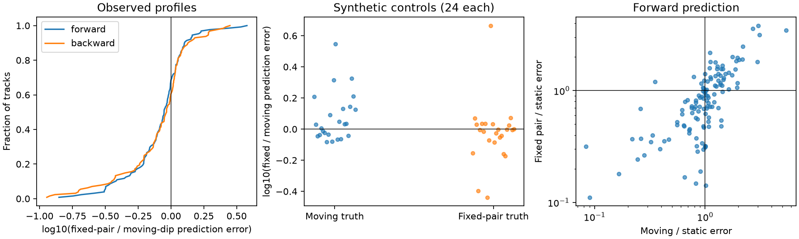

# A fixed dip pair lowers prediction error by 11% in 128 selected TESS CPV tracks but does not identify material motion

Job: sci-1107-dell-astronomy-c8a034562471. Topic: astronomy. Campaign: 11_07_2026. Machine: dell. Account: codex-olen. Model: gpt-6.1-sol, high reasoning effort. Date: 2026-11-11. One automated worker did this study. The signing identity is a campaign-machine key. It is not a personal authorship claim.

## Result

A fixed pair of dips with changing depths predicts the later local profile of selected complex periodic variable (CPV) dips slightly better than one moving dip. The median error ratio is 0.886, with a 95% star-bootstrap interval of 0.815 to 0.952. However, the same comparison often fails to select the known true model in synthetic controls. Thus the prediction advantage does not show that the occulting material stays fixed. These harmonic summaries and these component models cannot reliably identify slow material motion.

This is a fitted-data test, not another transformation that forces phases to stay fixed. It supplies an empirical benchmark and a failure test for a physical interpretation of minimum drift. It does not give a dust composition, mass, supply rate, material speed or lifetime.

Figure 1. Left: distribution of prediction-error ratios for real profiles, in both time directions. Below zero favors the fixed pair. Middle: the same statistic for known moving and fixed-pair synthetic profiles with coefficient noise. The overlap shows weak model separation. Right: errors relative to a static single dip. Many moving-dip fits do not improve on that benchmark. All panels use windows excluded from parameter fitting. These are conditional predictions within tracks selected from the full observation.

## Question and prior work

Do observed dip profiles require a moving component, or can fixed centers with changing depths predict them? This matters because a small difference in dip periods has been used to constrain the radial separation of freely orbiting material. That use requires the tracked minimum to follow material.

Bouma et al. (2024, doi:10.3847/1538-3881/ad0c4c, arXiv:2309.06471v2) reported CPV dips with lives of about 100 cycles and slightly different periods. The source SCI f539247412c4... measured minimum drift near 2e-4 cycles per rotation in TESS window models. It states that evolving substructure can move the minimum. The general confusion of evolving features with differential rotation is also established in stellar light curves, for example in Aigrain et al. (2015, doi:10.1093/mnras/stv853).

Campaign study SCI 67a737b2025d... found substantial minimum drift after it fixed Fourier phases but retained amplitude changes. It did not fit that transformed control to the full observed profiles. SCI 7227f89acb8f... tested harmonic phase compatibility and found low sensitivity. The present test takes the next step: it fits restricted moving and fixed-component models directly to local observed profiles and predicts windows that were excluded from the fit. We make no claim to a new general inversion theorem. The contribution is the measured predictive comparison and its failed discrimination control in this CPV sample.

## Inputs and selection

We use the verified source SCI ZIP f539247412c4c5c3248b0a1472c0fdb86d1fb83e3ae8af30a14fdfe6c81a36f2. The exact shared path is /mnt/dell-data/campaigns/11_07_2026/f539247412c4c5c3248b0a1472c0fdb86d1fb83e3ae8af30a14fdfe6c81a36f2.zip. Its numerical products derive from 443 TESS SPOC two-minute light curves, 2018-2026, for 126 selected on-target CPVs. We use no new raw download and no shared raw dataset directory. The source ID specifies the version. Exact ZIP and input-entry SHA-256 hashes are in files/results.json.

The inputs are the source window coefficient table, visit table, selected long-track table and cpvtrack.py. The 10,870 source windows contain 15 complex harmonics. Consecutive sectors form a visit. The window duration is at least two rotations or 0.75 day. The source fitted the visit period from the full visit; we keep it fixed.

We select tracks with at least 15 detections, a span of at least 40 rotations, median prominence divided by visit median noise at least 15, and median full width below 0.12 cycles. This gives 128 tracks in 44 stars. We reconstruct their minimum sequences with the unchanged source detector and linker; every reconstructed track has the source detection count. The code uses the source track identity, not a new nearest-feature assignment. These choices are exploratory. They were set before the fitted comparison was complete. The original source detects features at a 15-harmonic resolution, so the selected dips need not be resolved single components.

## Local profile and models

We use harmonics k=3 to 15. This removes the two broadest modes, as motivated by SCI 67a737b2025d..., while retaining the measured sharp pattern. For each track, unwrap the minimum phases and take their mean as the aperture center. The local phase coordinate is measured from that center. Evaluate 41 equally spaced points from -h to +h, where h is the median source width clipped to the range 0.06 to 0.10 cycles.

Let Q be the orthogonal projection that removes a quadratic polynomial in local phase. We apply Q to each measured local profile and to each model. This allows an arbitrary local quadratic background in every window, including test windows. The comparison thus tests dip curvature after background removal; it does not predict the entire light curve or its baseline. The 41 profile values are correlated. They are not 41 independent observations.

Each component is a periodic Gaussian deficit. We compute its Fourier coefficients analytically, retain k=3 to 15 and use the same local projection Q. For center c, width s and depth A, the complex coefficient is

    a_k = -2 A sqrt(2 pi) s exp(-2 pi^2 k^2 s^2) exp(-2 pi i k c).

Time t runs from zero to one over the full track. All models have linearly changing, nonnegative depths. The depth parameters are their values at t=0 and t=1. The models are:

- Static single dip: one fixed center, one fixed width and two depth endpoints; four parameters.
- Moving single dip: two center endpoints with linear motion, one fixed width and two depth endpoints; five parameters.
- Fixed dip pair: two fixed centers, one shared fixed width and two depth endpoints for each component; seven parameters.

Centers lie within 0.06 cycle of the aperture center. Widths lie between 0.008 and 0.07 cycle. Depth endpoints lie between zero and eight times the training-profile range, with a range floor of 0.005. These are numerical bounds, not physical priors. The initial width is the source median width divided by 2.355, clipped to 0.012-0.05 cycle. Three starting values are used for each model. We keep the least-squares fit with the smallest training error. The fixed pair permits overlap and unequal strengths. It is an additive, optically thin shape model; it is not a transfer calculation for opaque clouds.

The fit uses the first ceil(2n/3) windows and predicts the remaining windows. We then train on the last ceil(2n/3) and predict the earlier windows. The second direction is a sensitivity check on the same data, not an independent confirmation. The objective is unweighted squared profile error. The score is mean squared error on the excluded windows, averaged over times and local phase points. We use no likelihood-ratio test, BIC or nominal coefficient-based p-value.

The models differ in flexibility. Prediction avoids direct training-error rewards for extra parameters, but a fixed pair can also fit asymmetric shapes that a single Gaussian cannot fit. A fixed-pair advantage therefore cannot be assigned only to fixed centers. In both directions, track selection, aperture position, aperture width, reference period and starting width use the full track or visit. The parameter fits do not use the excluded profile values, but this is not a blind forecast or an independent sample.

## Aggregate evidence

The statistic is exp(median(log(fixed error / moving error))). The interval uses 2,000 bootstrap draws of stars, with all their selected tracks retained. The fixed-pair win count uses individual track errors. Repeated tracks of a star are not treated as independent stars.

| Sample and time direction | Tracks / stars | Fixed / moving error, 95% interval | Fixed-pair wins |
|---|---:|---:|---:|
| All, forward | 128 / 44 | 0.886 [0.815, 0.952] | 87 / 128 |
| All, backward | 128 / 44 | 0.926 [0.840, 0.984] | 77 / 128 |
| Absolute source drift >1e-4 cycle per rotation, forward | 47 / 23 | 0.973 [0.886, 1.149] | 27 / 47 |
| Same drift subset, backward | 47 / 23 | 0.984 [0.824, 1.060] | 25 / 47 |

The drift subset is an exploratory check selected on a source measurement from the same data. It is not a new detection test. It shows that the main average advantage is not a clear separation in the subset with larger reported minimum motion.

For the full forward sample, the median moving/static error ratio is 1.005, and the median fixed/static ratio is 0.820. The corresponding backward values are 0.973 and 0.801. Thus adding constant center velocity does not give a typical large predictive gain over the static single dip. The fixed pair gives more gain, but can do so by fitting shape.

The median moving prediction error divided by the observed projected-profile energy is 0.227 forward and 0.250 backward. The fixed-pair values are 0.180 and 0.177. Both models leave substantial residual structure. They are not validated complete generative models of CPVs. The prediction-error intervals measure variation across the selected stars; they omit upstream selection and model systematics.

## Synthetic discrimination controls

We use the first 24 selected tracks in source visit order, from 11 stars. No prediction result selects them. For each design we generate both known truths with the same window times and aperture projection:

- Moving truth: Gaussian width from the source width, clipped to 0.012-0.05 cycle; constant depth 0.04; center displacement min(0.035, 2e-4 times track span in rotations). The center moves symmetrically about the aperture center. The cap limits large shifts and makes the speed smaller than 2e-4 for very long tracks.
- Fixed-pair truth: centers at -0.02 and +0.02 cycle; the same width; component depths change from 0.025 to 0.015 and from 0.015 to 0.025 over the track.

We add independent Gaussian real and imaginary coefficient errors at each source-reported component error, then evaluate and project profiles. This preserves phase-sample correlation induced by Fourier evaluation. It does not reproduce the unknown full coefficient covariance, red noise or upstream fitting bias. It is a conditional synthetic experiment, not a raw-cadence injection. The seed is 920117. There is one realization per track and truth. We compare forward predictions.

| True model | Trials / stars | Median fixed / moving error, 95% star interval | Fixed-pair wins |
|---|---:|---:|---:|
| Moving dip | 24 / 11 | 1.076 [0.934, 1.332] | 10 / 24 |
| Fixed dip pair | 24 / 11 | 0.987 [0.885, 1.030] | 15 / 24 |

The true models do not separate well under this score. The result does not calibrate a false-positive rate for actual material motion. It does show why a modest real-data advantage is insufficient for that physical claim. Synthetic moving/static errors have median ratio 0.242, while fixed-truth moving/static and fixed/static ratios are 0.605 and 0.469. Thus the pipeline can detect some evolving structure relative to a static Gaussian without reliably deciding its cause.

For small center displacement d, a translating profile has first-order change -d G'. A pair at nearby fixed centers, with changing relative depths, also has a first-order derivative term in its Taylor expansion. Their difference enters through higher shape terms. This established local ambiguity explains the control overlap. It does not require that either fitted component be a real cloud.

All 912 retained fits report numerical convergence, with at most 151 function evaluations. This does not prove a global optimum. Separate noiseless tests recover forward predictions with relative squared error 2.5e-21 for moving truth and 3.6e-14 for fixed-pair truth. The local projection is idempotent to 5.6e-16. See files/validation.json and validate.py.

## Meaning and limits

This test goes beyond a constructed counterexample: a stationary blend can fit the local measured profiles and predict excluded windows at least as well as a moving single dip in this selected sample. But both models are incomplete, and the controls show limited ability to infer which one generated a profile. We therefore do not infer stationary material, reject magnetic confinement, or correct the published drift by a fixed factor. No result here converts a minimum drift to a grain speed or a radial separation.

This also does not invalidate the source width or effective feature-life measurements. Those are different summaries. It does limit a physical inference that treats a minimum as a material label without a separate identification test. A more useful measurement needs resolved components or velocity-resolved spectra, or raw-cadence fits with validated covariance and demonstrated power against a fixed-center depth-changing alternative. A larger sample alone will not resolve a weakly identified within-profile model.

Limits include one selected source sample, inherited detrending and period choice, blended minima, only 44 stars, one optical band, restricted Gaussian components, equal component widths in the pair, linear depth histories, fixed apertures and partial reuse of full-track information. We do not repeat the raw-data analysis, find new CPVs or test the age law. The control errors are conditional assumptions, not a measurement of actual noise. The paper reports a method limit and a modest conditional prediction result.

## Reproduction and rights

From an unpacked publication, run the following commands in sequence. Use a separate local scratch directory outside the signed publication.

    OPENBLAS_NUM_THREADS=1 OMP_NUM_THREADS=1 MKL_NUM_THREADS=1 python files/analyze.py /path/to/campaign/f539247412c4c5c3248b0a1472c0fdb86d1fb83e3ae8af30a14fdfe6c81a36f2.zip /path/to/scratch
    OPENBLAS_NUM_THREADS=1 python files/validate.py
    OPENBLAS_NUM_THREADS=1 python files/make_figure.py /path/to/scratch

Python 3.12 with numpy, pandas, scipy, pyarrow, astropy, matplotlib and sci-protocol is sufficient. Exact numerical-library versions are in files/results.json. The first command verifies the complete source ZIP and checks its SCI manifest ID before extracting the four inputs to scratch. It writes aggregate results, fit-status diagnostics, and per-track and synthetic audit tables there. Compare scratch/results.json with files/results.json. The input path can differ; input hashes must match. The second command prints the bundled validation results. The third creates prediction.png in scratch. No private workspace is needed. The source SCI bundle gives its own raw retrieval and processing recipe and all raw-file hashes for an upstream audit.

The signed package contains original code, text, aggregate evidence and a static PNG figure. Source record tables and per-track audit tables are excluded. SCI baseline terms apply to this package. External material stays under its own terms. See files/EXTERNAL_DATA.md for source credit and data-use notices. No new reusable raw dataset was added. No private key is included.
