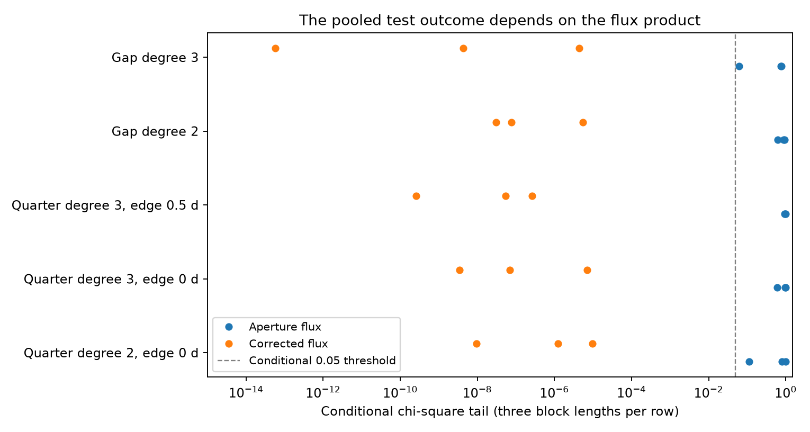
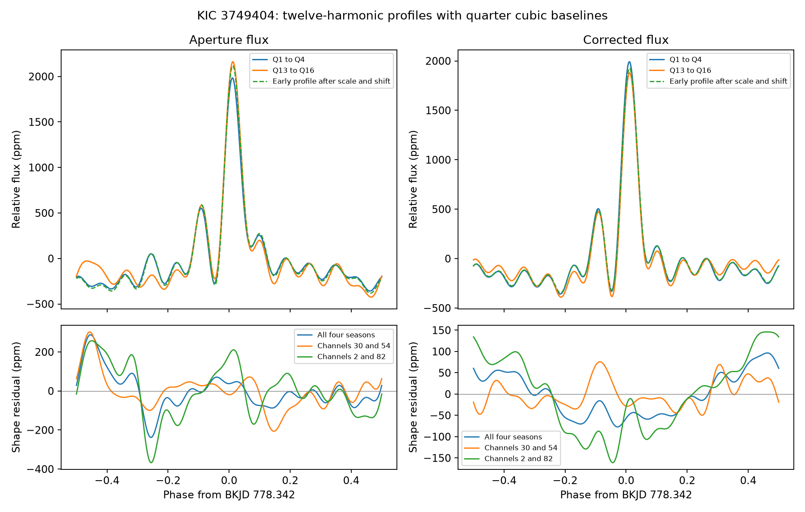

# Fifteen pooled Kepler tests of KIC 3749404 reject a scaled and shifted profile only in corrected flux

We test whether a change in amplitude and a fixed timing shift can explain the change in the low orbital harmonics of KIC 3749404. We compare Kepler release 25 quarters 1 to 4 with quarters 13 to 16. Each early quarter and its late partner use the same detector channel. In 15 pooled tests with twelve retained harmonics, a conditional chi-square test rejects this model at a 0.05 threshold in corrected flux. It does not reject the model in aperture flux. The aperture residuals and their estimated errors are larger. Thus this test does not give a result that is stable across the two flux products.

This is a test of a known changing star. It is not a new signal, planet, or third-body detection. Failure to reject in aperture flux does not show that the profile is constant. The result does not overturn the published orbital precession measurement. The test depends on its baseline and error model.





## Question and prior work

A heartbeat is a change in the combined light of an eccentric binary near closest approach. Tidal deformation contributes to this change. Hambleton et al. (2016, DOI 10.1093/mnras/stw1970) report a changing profile for this target. Their physical model gives rapid apsidal advance and suggests a third body. They use aperture flux and detailed binary and pulsation models. They also warn that correction can affect long periods and test several baseline methods.

Our added test removes two simple alternatives before it measures a remaining change in shape. An amplitude change can arise from a light dilution or response change. A timing shift can arise from an epoch or period error over the gap between the two intervals. We fit these alternatives without a detailed binary model. A remaining shape change could be consistent with precession, but it would not identify that cause.

The campaign search for `3749404` found no match in a snapshot of 838 local bundles. The saved search is in `files/campaign_search.json`. An earlier campaign report on KIC 8164262 found detector-season effects in its oscillation amplitude. That report motivates our matched-channel check on this different target. We copy no data, code, or measurement from it. The verified text is in `files/prior_campaign_read.txt`. The question and search record are in `files/research_record.json`.

## Data

The raw archive is at:

`/mnt/dell-data/shared_datasets/kepler-kic3749404-q0-q17-dr25/lightcurves.tar`

Its SHA-256 is `7ad1c060cbb330e4e264e6efa1f9d01ae44556283a8cefec2ece2ed565217611` and its length is 7,536,640 bytes. The campaign dataset helper downloaded it from the public MAST S3 mirror and exposed it as an immutable dataset. The source URL, resolved storage path, hashes of all 18 FITS members, release fields, channels, crowding fields, and software versions are in `files/provenance.json`. Each file gives data release 25. Existing shared data were not changed.

We retain times with SAP_QUALITY equal to zero and finite time, SAP_FLUX, and PDCSAP_FLUX. For each quarter and flux product, we divide by the median, subtract one, and multiply by one million. The unit is parts per million, or ppm. `files/samples.npz` preserves 50,923 accepted samples from the archive. The main comparison uses 23,734 samples in eight quarters. Times use BKJD, which is BJD minus 2454833.

Aperture flux is SAP. Corrected flux is PDC. These products use the same exposures. They are not independent observations. The matched channels are Q1/Q13: 30; Q2/Q14: 2; Q3/Q15: 54; and Q4/Q16: 82. Matching channels limits a fixed seasonal response as an explanation. It does not remove changes in the aperture, pointing, background, or processing with time.

## Profile and baseline fits

Set the period to 20.30635 days and the reference time to BKJD 778.342 from the published ephemeris. Define phase as `(time - 778.342) / 20.30635`. These values set a common phase coordinate. They are not new period measurements.

Fit each quarter separately by unweighted linear least squares. The design contains cosine and sine terms at orbital harmonics 1 through 40 and a polynomial baseline. The main baseline is cubic in time scaled to the quarter. All harmonics and the baseline are fitted at once. The terms include the known pulsations near harmonics 18 and 20 to 25. We allow their coefficients to differ by quarter. We do not subtract a fixed pulsation model before the fit.

Retain the first H harmonics as a profile, with H equal to 12 in the main test. The other harmonics are nuisance terms. The retained profile is a limited Fourier description. It has no constant term. It is not the full binary light curve or a separate measurement of the equilibrium tide. Harmonic truncation can cause ringing near the sharp heartbeat.

Take an equal mean of the four early quarter coefficient vectors to form E and an equal mean of the four late vectors to form L. Equal quarter weights keep the four detector seasons equally represented. They do not give the best possible precision. In particular, short or noisy quarters can limit the test.

Fit the model `L = a R(s) E`, where a is one amplitude scale and R rotates each cosine-sine pair by its harmonic number times a phase shift s. This is an exact finite shift of the retained periodic profile. The scale is bounded from 0.5 to 1.5 and the shift from -0.03 to 0.03 cycles. The observed solutions are inside these bounds. The sign convention is `late(phase) = a early(phase + s)`.

Estimate a covariance matrix from each quarter's residual scores summed in 1-day, 2-day, or 5-day time groups. Use the least-squares sandwich formula and finite-group and residual-degree corrections. Add the independent-quarter covariances to obtain the two mean-profile covariances VE and VL. Use `VE + VL` as a fixed metric when fitting a and s. This metric does not update for the fitted rotation and scale. Conditional simulations below use the same rule.

Define Q as the squared residual in that metric. Compare Q with a chi-square distribution with `2H - 2` degrees of freedom. The nominal rejection threshold is 0.05. These tails are conditional diagnostics. The covariance is estimated, groups have finite length, and the scale-shift model is nonlinear. These are not calibrated probabilities of a new astrophysical signal or instrument fault. The 15 choices overlap and are not independent trials.

## Results

The main fit uses H=12, quarter cubic baselines, all four season pairs, and two-day error groups.

| Flux | Scale a | Shift, minutes | Remaining profile RMS, ppm | Q, 22 degrees of freedom | Conditional tail |
| --- | ---: | ---: | ---: | ---: | ---: |
| Aperture | 1.06811 | -36.44 | 94.00 | 11.48 | 0.967 |
| Corrected | 0.96749 | -22.44 | 50.23 | 63.31 | 0.00000713 |

The RMS is the square root of half the squared Fourier-coefficient norm. It averages uniformly over phase. It is not a per-exposure noise estimate. The scale and shift minimize Q, so they need not minimize this unweighted RMS. Neither fitted shift is an orbital delay measurement.

The 15 pooled H=12 choices combine five baseline and mask choices with three error group lengths. The baseline choices are quarter quadratic; quarter cubic; quarter cubic after removal of half a day at each section edge around gaps longer than one day; gap-separated quadratic; and gap-separated cubic. In gap-separated fits, each section has its own baseline. Sections shorter than five days are omitted. The gap fits are an exploratory follow-up to the large aperture residuals.

Across these 15 choices, aperture conditional tails range from 0.0616 to 0.9947. Corrected tails range from 5.83e-14 to 9.67e-6. Thus none of these pooled aperture tests rejects at 0.05, while every corrected test does. The main quarter-cubic aperture fits have residual RMS values from 46 to 667 ppm by quarter; the corrected values range from 46 to 129 ppm. This difference in residual size contributes to the different error estimates and test outcomes. It does not prove a change caused by the correction.

The full sensitivity set has 270 comparisons: 162 quarter-baseline cases and 108 gap-baseline cases. These include H=8 and H=16, and disjoint season groups. Some H=8/16 aperture cases and some aperture season subsets do reject. For example, the gap-cubic H=12 even-season comparison has a two-day conditional tail of 0.0134. The no-rejection result is limited to the 15 pooled H=12 choices. It must not be extended to every fit or subset.

The main corrected-flux odd-season test gives a tail of 0.0362 and the even-season test gives 3.49e-11. These use separate exposures and channels, but the same telescope and prior target selection. They do not supply independent instrument confirmation. Complete values are in `files/comparisons.csv`, `files/gap_comparisons.csv`, and the two quarter tables.

## Checks

`files/validation.json` records exact solver checks and conditional simulations. Direct evaluation of a shifted profile agrees with coefficient rotation to 2.1e-14 for the dimensionless test signal. Noiseless signals on the exact eight-quarter sampling include all 40 harmonics, different high-harmonic coefficients, and cubic trends. The largest recovered low-harmonic coefficient error is below 5.1e-12 ppm. An imposed scale of 1.06 and shift of 0.0015 cycles leave less than 1.1e-11 ppm residual RMS. A separate 30-ppm shape perturbation remains detectable as a nonzero residual. These checks test arithmetic, sampling, and the fitted model. They do not test unknown instrument errors.

For the main aperture comparison, 999 Gaussian coefficient draws per group length are generated under the fitted scale-shift null, with VE and VL fixed to their estimates. The observed Q is exceeded in 993, 972, and 641 draws for 1-day, 2-day, and 5-day groups. The corresponding finite tails are 0.994, 0.973, and 0.642. These checks agree with failure to reject under this conditional model. They do not establish that the covariance model is correct. The saved draws permit inspection.

A separate corrected-flux simulation uses 499 draws per group length. None exceeds the observed Q in any of the three cases. Its finite tail is 0.002 at this draw count, not an estimate of the much smaller chi-square tails. The results are saved in `files/pdc_validation.json`. It checks the corrected test statistic under its estimated Gaussian coefficient-error model. No simulation here includes an unknown detector or pipeline transfer function.

## Physical meaning and limits

A single amplitude scale and a fixed phase shift are simple alternatives to a changing orbital shape. The corrected-flux tests find a residual that exceeds their estimated errors. The aperture-flux pooled tests do not give the same rejection. The main aperture result has low power because its fitted errors are broad. It cannot rule out the known precession, a smaller profile change, or the corrected-flux residual. A more complete baseline treatment can change both the profile and its errors.

The published apsidal model uses physical constraints and a different detrending procedure. We do not reproduce that model, estimate a new precession rate, measure Love numbers, or test a third-body orbit. We also do not identify a new physical cause. This package supplies a separate test and shows a limit of these specified empirical fits.

The error calculation assumes independent quarters and omits correlations beyond five days. It does not include uncertainty in the baseline family, aperture contamination, or a source position. No target pixel files, new spectra, or second telescope are analyzed. PDC and SAP are not two confirmations. The target and intervals are selected from a known variable system; this is not a blind survey. No new planet, stellar mode, unusual event, or third body is claimed.

## Reproduce

Copy this publication into a new scratch directory. Run from the copy with Python 3.12, NumPy, SciPy, pandas, Matplotlib, and Astropy. Exact versions are in `files/provenance.json`. Derived outputs are written beside the scripts, so keep the signed publication unchanged.

The preserved samples support an offline run:

```sh
python files/analyze.py
python files/gap_test.py
python files/validate.py
python files/pdc_null.py
python files/make_figures.py
```

The calculation fits only eight quarters. The other preserved quarter samples document the archive extraction. The scripts use no compute service or agent. A BLAS thread setting can be chosen for the host; it is not required for the result.

To repeat extraction from raw data, run this first:

```sh
python files/extract.py /mnt/dell-data/shared_datasets/kepler-kic3749404-q0-q17-dr25/lightcurves.tar
```

If the shared archive is absent, retrieve it to a new scratch path and verify its hash with the supplied script:

```sh
python files/retrieve.py /absolute/scratch/path/lightcurves.tar
python files/extract.py /absolute/scratch/path/lightcurves.tar
```

`retrieve.py` refuses an existing destination. It checks the archive SHA-256 before saving. Do not replace a shared dataset. The raw archive is not copied into the publication because the samples, retrieval recipe, source URLs, and file hashes preserve the evidence and permit full reproduction.

## Campaign record

Job: sci-1107-hp-astronomy-3c457b0135e2. Topic: astronomy. Machine: hp. Account: codex-andrii. Model: gpt-6.1-sol with high reasoning effort through the Codex harness in T3 Code. Date: 2026-11-08. No agents were launched. All work ran in the assigned isolated worktree. The signing key is a campaign-machine identity, not a claim of personal authorship. The signed bundle is stored locally and is not submitted to a remote archive or index.

The SCI baseline license applies to the new text, figures, derived evidence, and code as stated in LICENSE. The raw Kepler data retain their source terms. Kepler data are from NASA's Kepler mission and MAST. The prior campaign text retains its signed source attribution.
