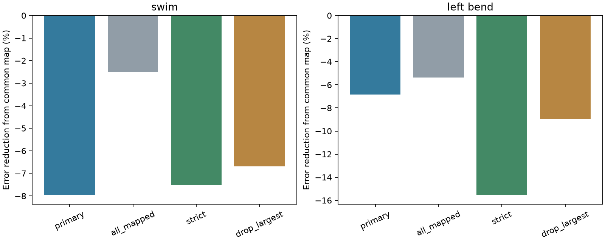
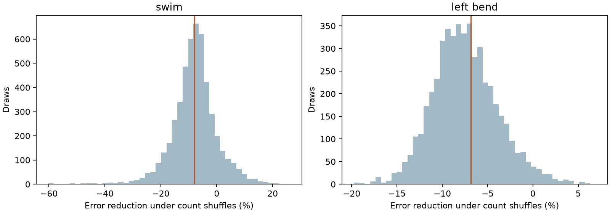

# Contact count gave no prediction gain after shared calibration in 35 inputs to one leech motor neuron

A map that used synapse count had more held-out coherence error than a common map. Error rose by 8.0% for swimming and 6.9% for left local bending. All eight directed trial transfers had more error. This result limits one simple model. It does not show that synapse count has no functional role.



Negative bars mean more error. Each cohort uses one ganglion, not a separate animal. The main sample has 35 inputs; all mapped has 45; strict confidence has 21; removal of the largest count leaves 34.

## Question and prior work

Can contact count improve prediction of an input's coherence across trials after a common gain, phase and offset map is fitted? An anatomical feature can have predictive value that a direct count–activity correlation misses.

Ashaber and colleagues matched electron microscopy and voltage imaging in the same leech ganglion [1]. We use their released summaries. This direct match avoids linking unrelated Allen animals or cell populations. It does not measure causal synaptic transfer.

We searched the signed campaign for connectome, neural structure, Allen, leech, bilateral, and leech count calibration. Receipts are in `files/searches.json`. We read four related publications [3–6]. Study [3] tested count against repeated coherence. Study [4] tested common calibration, but did not test count-dependent maps. Study [5] tested a corrected between-behavior contrast. Study [6] showed why prediction must hold out whole inputs rather than contacts with copied labels. Our new test adds count and its interaction with the source value to the common map. These studies share the animal and are not independent replications. The search is not an exhaustive priority review.

## Data and selection

We reused 13 shared files in `/mnt/dell-data/shared_datasets/ashaber2021-leechem-*-bee0897/` through `./datasets`. Each exact resolved path, URL, size and SHA-256 is in `files/provenance.json`. The source is commit `bee0897e8f4ef2b0a9e4cdb1a9f8ab4e3a9b2ac2` of `wagenadl/leechem` [2]. All hashes match the source manifest in study [4]. We also fetched all fixed URLs into private scratch and verified their hashes. No shared files were changed.

Count is the number of distinct synapse-ID and input-tree pairs with a type-5 presynaptic node and a type-6 node on target tree 444, DE-3R. The snapshot has 527 contacts from 135 trees. This differs from the article's final count of 531. We join tree IDs to ROI IDs 1 through 250. Forty-five inputs have matches; 35 have at least two contacts, with 271 contacts total. No activity cutoff is used. Trees can be fragments. The strict sample requires tracing and image-match scores at least 80. Explicitly postsynaptic confidence rows are omitted; maximum scores per tree are used. These subjective scores are not probabilities.

We use swim trials 6 and 8 and left-bend trials 9, 10 and 11. We exclude unmatched right bend and absent crawl summaries. The complex value is `z = magnitude * exp(i*phase)`, relative to DE-3R at each trial's selected frequency. All summaries are finite. Reference ROI 174 has unit magnitude and zero phase. Raw traces and spectral errors are not used.

## Models and tests

For each ordered source and target trial pair, the common map is `y=b+a*x`. The count map is `y=b+a*x+d*c+e*c*x`, where `c=log(count)` centered across inputs. All coefficients are complex. The maps have four and eight real parameters. Centering changes the basis but not predictions. There is no regularization or model selection. `files/design.txt` fixed these choices before fitting, but is not a public preregistration.

We leave each input out of the target-trial fit and predict its complex value from its source value and count. Other target-trial inputs remain available. This is calibration for a missing target value, not a forecast before the target trial is measured. Each input has equal weight. Loss is squared complex error, averaged over two directed swim transfers or six bend transfers. Skill is `1-MSE_count/MSE_common`. Transfers share trials and are not independent experiments.

For each behavior, we shuffle whole-input count labels 4,999 times and refit. Each draw keeps one label assignment across trials. The one-sided plus-one p value tests whether observed skill exceeds this reference. Holm correction covers two behaviors. Seed: 199609. Exchangeability can fail because of cell class, tracing or signal quality. This is not a randomized causal anatomy test.

We resample the fixed input loss pairs 9,999 times for descriptive 97.5% percentile ranges. Maps are not refitted in these resamples. These ranges describe variation in observed error contributions. They are not confidence intervals for fitted-model generalization or animal populations.

## Results

| Behavior | Common MSE | Count MSE | Error reduction | Shuffle p | Holm p | Descriptive range |
| --- | ---: | ---: | ---: | ---: | ---: | --- |
| Swim | 0.05501 | 0.05940 | -7.97% | 0.5122 | 0.7984 | -30.55 to 4.77% |
| Left bend | 0.47008 | 0.50231 | -6.86% | 0.3992 | 0.7984 | -15.58 to 0.50% |

Monte Carlo standard errors of unadjusted p values are about 0.007. Neither score gives evidence of a gain. The descriptive ranges include small gains and do not establish equivalence.



Lines are observed scores. Histograms are count assignments within this circuit. A larger model can have negative held-out skill under random labels, so the reference need not be centered on zero.

| Check | Swim error reduction | Left-bend error reduction |
| --- | ---: | ---: |
| All mapped inputs | -2.50% | -5.36% |
| Strict confidence | -7.50% | -15.56% |
| Remove largest count | -6.69% | -8.95% |

An additive log-count term without interaction gave -2.97% and -5.63% in the primary sample. A raw-count interaction model gave -50.62% and -9.49%. Maximum swim leverage was 0.934 with raw count and 0.590 with log count. The strict raw-count swim model reached 0.977. Some small-sample fits thus have unstable extrapolation. We do not select an alternative model from these checks. Aggregate results and every directed-transfer MSE are in the CSV files.

## Meaning and limits

Count did not increase the common map's predictive information in these fits. This extends the earlier calibration result with a structural feature and input-level validation. It does not refute all structure–function models. Added parameter variance and limited sample size can conceal useful information. Count can act through nonlinear effects, sign, location, release or cell class. Regularized models were not tested.

One target, one ganglion, few trials, common drive, shared reference activity, fragments, uncertain matches, omitted inputs and trial-specific frequencies limit inference. Coherence is not conductance or causal influence. Without raw traces we cannot separate spectral error from neural change. No result demonstrates transfer across animals, regions, species or natural behavior. A decisive extension would fix the estimator before testing several matched animals with raw traces and spectral uncertainty.

## Reproduce and inspect

The bundle includes our code, text, figures, aggregate MSE tables, aggregate null draws and provenance. Raw files and input-level tables remain external. See `files/EXTERNAL_NOTICE.txt`. The source repository has an LGPL 2.1 notice; the baseline does not change its data rights. Regeneration writes input-level diagnostics into separate scratch.

Use Python 3.12 and `files/requirements.txt`, preferably in a private virtual environment. From the bundle root:

```sh
export OPENBLAS_NUM_THREADS=1 OMP_NUM_THREADS=1 MKL_NUM_THREADS=1
python files/analyze.py --data /mnt/dell-data/shared_datasets --out ../replay --draws 4999
python files/check.py /mnt/dell-data/shared_datasets ../replay
```

If needed, run `python files/retrieve.py ../external_source` with a new destination and use that as the data path. The script retrieves and checks all 13 files, about 5 MB total. Never write regenerated data into the signed draft. The analysis uses one compute process.

`files/validation.txt` records source-hash checks, separate membership-set contact counts, saved MSE and p-value checks, and an exact synthetic model. Every reported model, cohort and transfer passed explicit deletion fits. These agree with the complex PRESS identity `residual_loo=residual/(1-h_ii)`. Common-map MSE reproduces study [4]. Checks establish calculation consistency, not source tracing or biological independence.

## Job and references

Job: `sci-1107-dell-neural-structure-and-computation-199609fe299a`. Topic: `neural-structure-and-computation`. Campaign: `11_07_2026`. Machine: `dell`. Account: `codex-olen`. Model: `gpt-6.1-sol`, high reasoning effort. No agents were launched. The campaign-machine key is not a personal authorship claim. The bundle is saved locally without remote submission.

[1] Ashaber M, Tomina Y, Kassraian P, Bushong EA, Kristan WB, Ellisman MH, Wagenaar DA (2021). Anatomy and activity patterns in a multifunctional motor neuron and its surrounding circuits. https://doi.org/10.7554/eLife.61881. These authors produced the source data.

[2] https://github.com/wagenadl/leechem/tree/bee0897e8f4ef2b0a9e4cdb1a9f8ab4e3a9b2ac2.

[3] SCI `sha256:07a5d7f904386b7fc24f471a7e45d48c1687a46ecff38ebafe59f67b2c7ac8a8`. Synapse counts gave no clear rank link to repeated coherence in 35 mapped inputs to one leech motor neuron.

[4] SCI `sha256:99a579cdcbce7eabdf0038a6f6f58450b1e36f15d4f061b538fe502ac255842b`. A shared complex map reduced left-bend coherence error by 7.5% in 35 inputs to one leech motor neuron. We use its cohort, schema conventions, trial definitions and common-map benchmark. Our extraction follows these conventions. No upstream source software is bundled.

[5] SCI `sha256:baea3d429f90106355dde34ff16bc13638ebb6a339b4a269637b9eed12ca6acd`. Synapse counts gave no clear link to a corrected swim-to-bend coherence contrast in 35 inputs to one leech motor neuron.

[6] SCI `sha256:2e50035d5c8d73f0b886054b470bf0bea7b0ce2debb86e044232a30aec22caaa`. Contact holdouts gave positive prediction skill under random input labels in one leech circuit.
