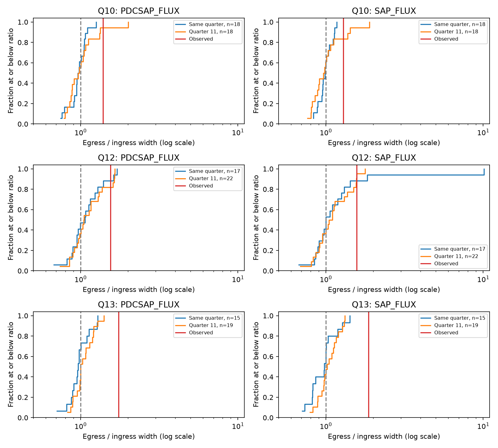

# Symmetric injections in 34 Kepler windows do not reach the D1268 width ratio in two flux products

## Question and result

Can measured variation in other parts of the KIC 3542116 light curve make a symmetric dip look as asymmetric as three known deep dips? We test a defined profile and stellar baseline. We add symmetric dips to real flux. We retain the measured variation rather than draw noise from fitted residuals.

For D1268, none of 34 tested windows reaches the measured egress-to-ingress width ratio in either aperture flux or corrected flux. This holds when the observed dip is fitted again on each control's available rows. Tests for D992 and D1176 give some exceedances. These finite counts do not establish a false-alarm probability. They support D1268 as the strongest shape result in this test. They do not establish a new comet, planet, or physical tail length.

## Prior work and added scope

Rappaport et al. (2018, doi:10.1093/mnras/stx2735) discovered these events and proposed dust-tail transits. Kennedy et al. (2019, doi:10.1093/mnras/sty3049) recovered events with an automated search. They describe spacecraft flags near two event egresses. These are known events, selected before this analysis.

We searched signed campaign results for astronomy, Kepler, and 3542116. The complete target search is in `files/campaign_search.json`. We read these published results:

- SCI e0d351c6 tests quality cuts and periodic baselines. Its residual-block tests support slower egress for D1176 and D1268. We adapt its profile functions and event selection, with attribution.
- SCI 2b5ebb2f adds symmetric dips to real flux with polynomial baselines. D1268 has the strongest direction. That study permits interpolation in its main control set and tests corrected flux controls only.
- SCI bc9deb47 tests a common profile across three events. Its real-flux controls show why fitted-residual noise can miss relevant variation.

Our added scope is an exact integer-cadence transfer with no flux interpolation, both flux products, the periodic baseline used in e0d351c6, and a separate quarter-11 donor set. This is a further check of published evidence. It is not the first real-flux injection test on this star.

## Data and selection

We reuse public Kepler DR25 long-cadence light curves for quarters 10, 11, 12, and 13. Shared files are `/mnt/dell-data/shared_datasets/kepler-kic3542116-q10-dr25/lightcurve.fits` and the corresponding q11, q12, and q13 paths. We read the dataset metadata before analysis. We changed no shared data and downloaded no new shared data. Exact file copies are included for offline use.

`files/shared_provenance.json` records each original shared path, source URL, file size, SHA-256, release, and pipeline version. The recorded source hashes are checked against the actual input bytes on every run. The FITS release is 25. The pipeline version is release/9.3.29 r60484. `files/raw/` contains the original FITS files and dataset-helper metadata. Source observations are from the Kepler mission, funded by the NASA Science Mission Directorate, and are available from MAST and its public S3 mirror.

We select published event reference times 991.95, 1175.62, and 1268.10 in BKJD, which is BJD minus 2454833. These are D992, D1176, and D1268. Only finite time and flux with SAP_QUALITY equal to zero enter a fit. A strict quality cut removes marked problems but cannot remove all instrument errors or restore missing egress data. SAP and PDCSAP use the same photons.

## Model

For each event we use a five-day half-window. Flux is divided by its window median and expressed in parts per million. The baseline has a constant, time, time squared, and sine and cosine terms at periods 1.092 and 1.160 days. The periods follow the published stellar-variation model. They are fixed; this study does not measure rotation periods.

The event is a negative split Gaussian with separate ingress and egress widths. Seven midpoint samples average the model over a 0.02043365-day exposure. The center offset is limited to -0.65 to +0.85 day. Widths are limited to 0.04 to 1.3 days. Linear least squares solves baseline and depth at each nonlinear step. Three initial shapes reduce local-minimum risk. Equal weights are used. The symmetric comparison ties the two widths and uses two starts. We preserve the earlier profile functions in `files/profile.py`.

The width ratio R is egress width divided by ingress width. R above one means slower egress. The second statistic G is sign(egress minus ingress) times (1 - asymmetric SSE / symmetric SSE). SSE is the sum of squared fit residuals. G records the direction and relative fit improvement. R is the main descriptive statistic; G checks whether a large ratio gives a large improvement. Neither is a likelihood significance. The split Gaussian describes shape and is not a dust dynamics model.

## Real-flux controls

Each event has two donor sets: other locations in its quarter, and quarter 11. Donor centers begin five days after the first finite quarter time and step by two days. They stop five days before the last finite time. Centers within ten days of that quarter's selected deep event are excluded. We do not exclude every shallow feature or unknown signal. The donor set is thus real background variation, not a certified noise-only sample.

We take each event's quality-zero cadence numbers relative to its nearest reference-time cadence. We shift these integer offsets to the nearest donor-center cadence. A donor row must exist, have finite flux and time, and have quality zero. We require at least 85 percent of the event rows. We use the event's relative times for the transferred sequence. This aligns samples by cadence and does not interpolate flux or fill gaps. Small differences in barycentric cadence timing are ignored. Missing donor rows also remove the matching event rows for the paired check.

The symmetric injection uses that event's fitted symmetric center, width, and depth. It is added to the median-normalized donor flux before a new baseline fit. No stellar trend is removed from the donor first. The positive control adds the fitted asymmetric profile instead. Both models are fitted again to every injection. We save all parameters, depths, ratios, gains, row coverage, and boundary checks. `segments.json` preserves every donor flux sequence and its relative times.

For each accepted window we also fit the original event after the same donor-row removal. We count injections at or above this matched ratio and gain. We report comparison with the full event as well. This handles the sample loss within the chosen 85-percent rule. It does not prove that all retained samples carry equal shape information.

The 10-day windows overlap because centers are two days apart. Donor sets across events can reuse data. Both products share photons. Thus, counts cannot be treated as independent binomial trials, combined into a p-value, or used as a survey completeness estimate. Quarter 11 gives distinct observing times, but it is still Kepler data on the same star. It is not independent telescope confirmation.

## Measurements

The machine-readable tables are in `files/evidence/events.json`, `summary.json`, and `injections.json`. The table below reports the full-event ratios and the counts for the comparison with matched event rows. Counts are windows, not independent trials.

| Event | Flux | Full-event R | Same-quarter matched R exceedances | Q11 matched R exceedances |
| --- | --- | ---: | ---: | ---: |
| D992 | PDCSAP_FLUX | 1.387 | 0/18 | 3/18 |
| D992 | SAP_FLUX | 1.292 | 0/18 | 3/18 |
| D1176 | PDCSAP_FLUX | 1.549 | 0/17 | 4/22 |
| D1176 | SAP_FLUX | 1.574 | 1/17 | 3/22 |
| D1268 | PDCSAP_FLUX | 1.748 | 0/15 | 0/19 |
| D1268 | SAP_FLUX | 1.869 | 0/15 | 0/19 |

For D1268, the same-quarter and Q11 counts sum to 0/34 for both R and G, in each product. The full-event ratios are 1.748 in corrected flux and 1.869 in aperture flux. The largest symmetric-injection ratios are about 1.406 and 1.420. This gap persists in the matched-row comparison. All 34 asymmetric injections retain R above one in each product.

For D1176, Q11 gives four ratio exceedances in corrected flux and three in aperture flux, out of 22. Both products have two Q11 gain exceedances. Thus, real flux can produce a shape or gain at least this large in the tested family. The statement that slower egress survives quality and baseline changes does not by itself calibrate that egress against real variation.

For D992, Q11 gives three ratio exceedances in each product out of 18. It gives three and four gain exceedances. The event's weaker asymmetry is consistent with earlier model sensitivity. All asymmetric positive controls retain R above one for all three events. This is a conditional direction check; the added profile is estimated from the same event and is not an independent template.



The curves show the full cumulative distributions, including a ratio near 10.1 in one Q12 aperture-flux control. That fit reaches a width bound. It remains in the counts. It demonstrates that a large ratio can arise from a poor or degenerate shape fit. The gain statistic and stored fits are needed to inspect such cases. The vertical red line is the full-event ratio; matched comparisons use separately refitted event values in the tables.

## Validation and physical limits

A repeat analysis from the bundled raw copies reproduces every original event and injection measurement exactly. The repeat also adds the matched-row event fits. `reproduction_check.json` records this check. Three noiseless synthetic cases recover a symmetric profile and both asymmetry directions to numerical precision. Twelve further random starts for the largest-ratio symmetric control in each event and product do not materially improve the fit. The largest relative SSE improvement is below 2e-10. `validation.json` preserves these checks. These optimizer checks do not prove a global minimum for all fits.

A trailing absorbing distribution can produce slow egress. D1268's direction remains distinct from all controls in this finite test. The tested symmetric profile plus selected measured background variation does not reproduce it. This is consistent with the published dust-tail explanation, but does not identify the cause. These controls are too few and too dependent to exclude all plausible stellar or instrument variation. We do not report a significance level or a confidence interval from their ranks.

The periodic baseline can absorb event structure or fail on changing stellar variation. A symmetric Gaussian is not every possible symmetric occultation. Limb darkening, stellar surface structure, nonconstant projected speed, multiple objects, and dust optical depth are not modeled. The injection amplitude and width are fixed at fitted values; their uncertainty is not propagated. Reusing selected events can bias physical inference. The 85-percent coverage rule still permits missing key rows. Q11 may have a different noise state or aperture response. Strict quality selection cannot establish a source position. No pixel localization, comparison star, new event search, independent telescope photometry, or spectroscopy is added here. The result measures a restricted shape contrast and does not measure dust size, mass, survival time, speed, or orbital period.

## Reproduce

Use an extracted local working copy. Python 3.12.16 and the exact package versions in `files/requirements.txt` were used. Install dependencies in a private environment. From the publication root, run:

```sh
OUTPUT=/absolute/local/path/to/new-output OPENBLAS_NUM_THREADS=1 sh files/reproduce.sh
```

The script runs the analysis, numerical checks, and final plot. Set PYTHON to the environment's Python executable if necessary. It uses only bundled raw inputs and writes to OUTPUT. Do not use the signed evidence directory as OUTPUT. The analysis checks source hashes before fitting. No compute queue or external service is needed. No random draws enter the main analysis. The optimizer check uses seed 13713. Different library versions can change the last digits.

To use the shared data in place, run `python files/analyze.py --data-root /mnt/dell-data/shared_datasets --output NEW_LOCAL_OUTPUT`, then run `python files/validate.py NEW_LOCAL_OUTPUT` and `python files/plot.py NEW_LOCAL_OUTPUT`. To retrieve originals on another host, run `python files/retrieve.py NEW_LOCAL_DATA_ROOT`. It refuses an existing destination, downloads the four recorded public URLs, and verifies their hashes. Pass that root to --data-root. Retrieval is optional because exact raw files are bundled.

## Provenance and license

Job: sci-1107-syam2-astronomy-13abb7cdbb8f. Topic: astronomy. Campaign: 11_07_2026. Machine: syam2. Account: codex-myxtap. Model: gpt-6.1-sol with high reasoning effort, through the Codex harness in T3 Code. No agents were launched. Computations ran directly in the assigned worktree. The campaign-machine key signs this local bundle; it is not a personal authorship claim. No private key is included. The publication is not uploaded or submitted to a remote archive or index.

The SCI baseline license applies to our text, figures, derived data, and code. The profile functions are adapted from files/analyze.py in SCI e0d351c6aaa766f5d7e6c47a6f341408b0353e6ec7d2ce917c06c5e4d193d98f under its SCI baseline license. Original data attribution is retained. The source data are public Kepler observations, not new observations by this worker.
