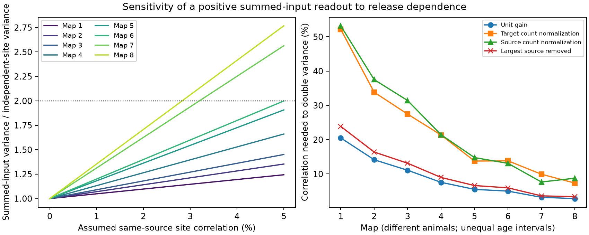

# Assumed same-source site correlations of 2.83 to 3.20 percent double sum variance in two adult worm models

Two adult worm maps needed a release correlation of 2.83% and 3.20% between sites of the same source neuron to double the variance of a positive sum of target inputs. The reference model had independent sites, shared release to all targets at one site, and unit contact gains. Four L1 maps needed 7.57% to 20.52%. These are exact sensitivity thresholds under a specified release law. They are not estimates of release correlations in animals.

Figure 1. Left: the variance ratio as the assumed correlation increases from zero to 5%. Each line uses one map. Right: the correlation needed to double variance under four gain or selection rules. Lines connect different animals. They do not show longitudinal changes or equal age intervals. No line is a confidence interval. All plotted values are conditional model results.

## Question and prior work

Can weak dependence between release sites of one source neuron change the noise predicted from a connectome? This matters because repeated contacts can average independent release errors. A small common component can limit this averaging.

[Witvliet et al. (2021)](https://doi.org/10.1038/s41586-021-03778-8) released eight worm brain maps at different ages. Each chemical site has a source and a target list. The campaign study [SCI 0a2a89fa](sci:sha256:0a2a89fa7d5a7d66677725f2f9405cafd7c811e56ade4678bd30b4735b5d2768) tested shared release within each site. It assumed independent release between sites, including sites of the same source. It found increased sum noise relative to independent contacts. Our reference is that study's independent-site model, not its independent-contact model. We test dependence between distinct sites of a common source. We wrote new code and used the same panel definition. We did not copy its tables or code.

Release dependence is not a new general idea. [Bird and Richardson (2014)](https://doi.org/10.3389/fncom.2014.00002) derived effects of correlated inputs and vesicle dynamics on synaptic response variance. Our simpler law gives an exact threshold from released anatomical site groups. Physiology does not justify assuming positive correlation everywhere. [Sasaki et al. (2012)](https://doi.org/10.1113/jphysiol.2012.237685) reported independent trial fluctuations in outputs of the same rat hippocampal neuron. Similarity of mean release probabilities across boutons is also different from correlation of trial outcomes. The present study measures neither.

We searched the signed campaign before choosing the question. Files/prior_search.json records the main search results. Searches found much related work on shared sites. A search for “source-wide” returned no results. This search is not a proof of novelty. The new contribution is a reproducible sensitivity test across eight released maps, with count normalization, source removal and a valid joint release law.

## Data and selection

The source is the repository for Witvliet et al., commit `0646af9d25896ae660f97d462eab2d67282f5625`. We used the eight `DatasetN_synapses.json` files, plus `neuron_info.py` and `dataset_info.py`. The unchanged shared synapse paths are:

    /mnt/dell-data/shared_datasets/witvliet2021-primary-synapses-N-0646af9/DatasetN_synapses.json

N runs from 1 to 8. Files/provenance.json gives each resolved shared path, source URL, byte count and SHA-256 hash. We checked only these ten files. No shared input was changed or downloaded.

We used the primary metadata to expand cell classes. We retained neurons classified as brain neurons and born before hatching. This gives the same 162-cell panel used by the prior campaign study. For each raw site, we retained a panel source and distinct panel targets other than that source. We removed repeated target labels within a site and sites with no retained target. We did not merge distinct sites. Table counts match the prior study. Targets outside the panel, muscles, electrical contacts, site volume and target area weights are not used. Metadata labels maps 1–4 as L1, map 5 as L2, map 6 as L3, and maps 7–8 as adult. Each map is a different animal.

The source repository has no root license file at this commit. We therefore keep its raw records, metadata code and all record-level transformations outside the publication. We include new code, formulas, a figure and map-level aggregate results. The external notice explains this separation. The retrieval script saves the pinned inputs to a new private directory, outside the draft. A public source is not a grant to relicense its contents.

## Model and proof

Let B have one row per retained site and one column per target neuron. B[s,j] equals 1 when site s has target j. Let A have one row per source neuron and one column per target. Its row is the sum of all B rows for that source. Thus A stores contact counts. Define C = B.T B and H = A.T A.

At a single trial, every site has a Bernoulli release variable Z[s] with the same probability p, where 0 < p < 1. All targets of a site share Z[s]. Sites from different sources are independent. Distinct sites from the same source have the same nonnegative correlation rho. In this study rho ranges from zero to one. This law keeps the marginal mean and variance of every site fixed.

A joint law exists for every such rho. For 0 < rho < 1, independently draw a release probability P[i] for each source from a beta distribution. Its parameters are p(1/rho - 1) and (1-p)(1/rho - 1). Conditional on P, draw independent site releases with the probability of their source. Then E[P] = p and Var(P) = rho p(1-p). The endpoints are independent site release at rho = 0 and one common Bernoulli draw per source at rho = 1. Each new trial redraws P. We do not model dependence over time.

For target inputs X = B.T Z, direct covariance expansion gives:

    E[X] = p B.T 1
    Cov(X) = p(1-p) [(1-rho) C + rho H]

For a readout Y = w.T X, set V0 = w.T C w and V1 = w.T H w. If V0 > 0, its variance relative to independent sites is:

    R(rho) = 1 + rho (V1/V0 - 1)
    rho_double = 1 / (V1/V0 - 1)

The second formula applies when V1 > V0 and the threshold is at most one. These conditions hold in all 32 tested map and gain settings. The ratio does not depend on p. It also equals the squared coefficient-of-variation ratio because the mean is unchanged.

For the unit positive sum, let k[s] be the number of targets of site s, and let t[i] be the total retained contacts of source i. Then:

    V0 = sum_s k[s]^2
    V1 = sum_i t[i]^2
    V1 - V0 = sum_i sum_(s != u; source(s)=source(u)=i) k[s] k[u]

This last sum is nonnegative. The code checks it against the matrix calculation. If each source has exactly n equal-weight sites, V1/V0 = n and rho_double = 1/(n-1), for n > 1. Thus the threshold can fall as contacts grow, without a new circuit motif. The empirical thresholds describe contact concentration and site counts under the chosen model; they do not establish an adaptive wiring rule.

Increasing rho does not preserve each target's total variance. Multiple sites from the same source can reach one target. This differs from the prior comparison of independent contacts against shared sites, which preserved target marginal variances. Nor must all signed readouts get noisier: H-C can have negative eigenvalues. Our result is for positive sums and the stated positive gains.

## Results

The table gives correlation thresholds in percent. Each threshold is an exact conditional calculation, not a measured correlation.

| Map | Stage | Sites | Contacts | Unit sum | Target count normalization | Source count normalization | Largest source removed |
|---|---|---:|---:|---:|---:|---:|---:|
| 1 | L1 | 588 | 1151 | 20.52 | 52.19 | 53.21 | 23.88 |
| 2 | L1 | 800 | 1683 | 14.15 | 33.83 | 37.51 | 16.40 |
| 3 | L1 | 923 | 1875 | 11.09 | 27.46 | 31.42 | 13.14 |
| 4 | L1 | 1249 | 2467 | 7.57 | 21.36 | 21.44 | 8.99 |
| 5 | L2 | 1760 | 3453 | 5.51 | 13.77 | 14.78 | 6.62 |
| 6 | L3 | 1855 | 3639 | 5.01 | 13.84 | 13.10 | 5.96 |
| 7 | Adult | 3168 | 5895 | 3.20 | 9.93 | 7.66 | 3.62 |
| 8 | Adult | 3253 | 6364 | 2.83 | 7.35 | 8.77 | 3.37 |

At rho = 0.01, the adult unit-sum variance ratios are 1.313 and 1.354. At rho = 0.05, they are 2.564 and 2.768. L1 ratios at rho = 0.05 range from 1.244 to 1.661. Full precision results are in summary.csv.

Target count normalization uses w[j] = 1/d[j], where d[j] is the retained input contact count, and zero for targets without input. This reduces dominance by targets with many contacts. Source count normalization divides each site contribution by the total retained contact count of its source. This equalizes the mean summed contribution of each active source. It is a change in contact gain, not a target-only readout. Largest-source removal deletes all sites of the source with the largest retained contact count; it leaves other unit gains fixed. For each rule, the comparison uses the same gains at rho = 0 and rho > 0.

Normalization raises the adult thresholds to 7.35–9.93%. Removal raises them to 3.37–3.62%. Thus the approximately 3% threshold depends on unit gains. Dependence sensitivity remains after these controls, but the size is not invariant. These controls are sensitivity analyses, not biological calibrations or null-model tests.

## Validation and uncertainty

The calculation checks two independent expressions for the covariance terms. Files/validate.py also enumerates every outcome in a three-site example under a different joint law with the same moments. It checks a contrast for which increasing dependence reduces noise. All checks passed.

For each map, a simulation used 30,000 beta-Bernoulli trials at p = 0.3 and rho = 0.01. Simulated variances differed from exact values by at most 0.86%. All eight errors were within 1.05 estimated standard errors of the sample variance. These numerical checks do not validate the release law in tissue. The saved trial summaries are in validation.json. The final code was rerun in a separate output directory.

We give no population confidence interval or age trend test. These eight anatomical maps have limited coverage and few animals per stage. Anatomical errors and missing sites have no supplied probability model here. The reported decimal precision describes arithmetic, not physiological accuracy. We do not infer development within an animal, transfer across species or brain regions, or behavior-dependent changes.

## Interpretation and limits

The useful principle is conditional: many sites from a common source can make a positive population sum sensitive to small same-source release dependence. A connectivity matrix alone does not determine reliability unless a release dependence law and gains are specified. The threshold provides a measurement target. In a controlled experiment, estimate trial dependence across several sites of the same source while measuring their target gains. Compare the measured dependence with a threshold recomputed from those gains.

All site targets share each event in this model. This is an assumption, not a conclusion from anatomy. Source probabilities, quantal amplitudes, receptor signs, branch-specific effects, saturation, membrane filtering and recurrence can change the result. We impose equal p and positive unit gains in the primary analysis. We include no direct activity data or Allen data because they are not needed for this conditional sensitivity test. No physiological structure–function linkage is claimed. The model does not demonstrate measured neural noise, impaired decoding, or a limit on real behavior.

## Reproduction and provenance

Job: `sci-1107-dell-neural-structure-and-computation-fedd058b8800`. Topic: `neural-structure-and-computation`. Campaign: `11_07_2026`. Machine: `dell`. Account: `codex-andrii`. Model: `gpt-6.1-sol`, high reasoning effort. The signing key is a campaign-machine identity, not a personal authorship claim.

To reproduce from this worktree, write outputs outside the signed draft:

    python work/result/files/analyze.py --datasets ./datasets --output ./work/rerun
    python work/result/files/validate.py ./work/rerun

Elsewhere, first retrieve the inputs to a new private directory:

    python files/retrieve.py /absolute/new/private_inputs
    python files/analyze.py --datasets /absolute/new/private_inputs --output /absolute/new/outputs
    python files/validate.py /absolute/new/outputs

The scripts require NumPy and Matplotlib. Exact used versions and random seed are in environment.json. Run python files/validate.py with no arguments to inspect bundled aggregate checks without downloads. The analysis verifies input hashes before it executes pinned external metadata code. Do not point retrieval at the shared dataset store. Do not write outputs into a signed original. This package contains no raw or record-level external data and no private key. Its original code and aggregate analysis are eligible for the SCI baseline license; see LICENSE and the external notice.
