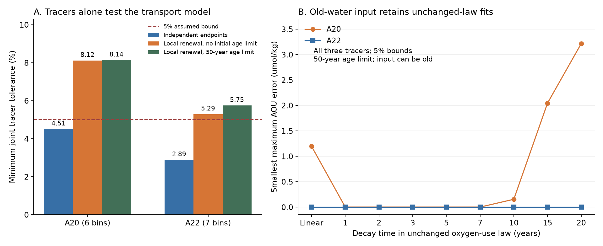
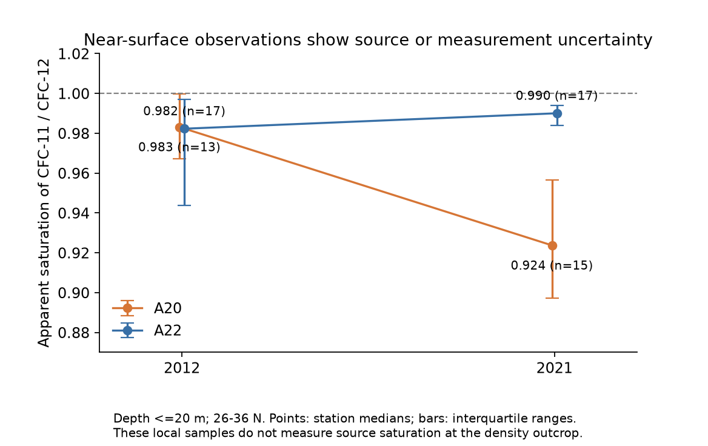

# CFC-11 excludes uniform local renewal on A20 sigma0 26.5 in 2012-2021 under full saturation, partial-pressure mixing and 5% tracer bounds

## Result

The third tracer CFC-11 rejects a local renewal model that fitted A20 oxygen, CFC-12 and SF6 in earlier SCI work [1]. The rejection occurs before oxygen enters the test. It therefore cannot establish an increase in respiration.

We use GLODAPv2.2023 on the sigma0 = 26.5 kg/m3 surface at 26-36 N. There are six paired latitude bins on A20 and seven on A22. All have CFC-11, so adding this tracer does not change the selected casts. We test age-independent removal: each box retains a fraction q of its initial water, and the remaining water formed after the first cruise. We allow a separate q, anywhere from zero to one, in each bin. Source tracer saturation is 100%. Mixing is linear in tracer partial pressure, as in the earlier work.

At 5% relative bounds for all three tracers, **five of six A20 bins reject this model for every q**. This result also holds in a relaxed test with no limit on initial age and no initial age-spectrum shape constraint. Thus the rejection does not depend on a 50-year age limit or on an oxygen-use law. Three bins already fail a simple CFC-11 lower bound. The joint tracer test rejects two more. The greatest lower-bound gap from CFC-11 alone is 8.36 ppt after the adverse 5% shifts.

The table gives the smallest common relative bound that makes every selected bin pass each test. These are numerical compatibility limits, not confidence intervals.

| Test, all three tracers | A20 | A22 |
|---|---:|---:|
| Separate cruise spectra, ages 0-50 years | 4.51% | 2.89% |
| Relaxed local renewal, no initial age limit | 8.12% | 5.29% |
| Local renewal with physical initial spectra, ages 0-50 years | 8.14% | 5.75% |

The relaxed gate rejects two of seven A22 bins at 5%. The test with physical initial spectra and a 50-year age limit rejects three. Thus independent cruise fits can pass while the transport link between cruises fails.

Panel A compares the tests above. Panel B allows old water to enter and fits a common, unchanged oxygen-use law. The ordinate in panel B is a model mismatch, not a respiration trend. Lines connect tested decay times; they do not establish results at all times between them.

## Test of the published law

The published A20 renewal-box example [1] fixed q = 0.5 and used

`AOU(a) = B + C * (1 - exp(-a/tau))`,

with B = 0, C = 82.130804 umol/kg and tau = 5 years. We keep these values fixed and regenerate a dual-tracer fit on a 0.1-year grid. It fits the oxygen levels exactly. Its unused CFC-11 predictions miss the 5% bound at six of twelve cruise-bin endpoints; the largest relative error is 14.80%. This particular numerical spectrum is not unique and need not be the original published solver's spectrum.

We therefore test the whole family of spectra with that fixed law and q, rather than use one failed spectrum as an exclusion. With CFC-12 and SF6 still bounded at 5%, the family needs about **13.20% CFC-11 tolerance** to fit the oxygen levels within 0.000001 umol/kg. This limit uses the 0.1-year grid. The broader tracer-only test above does not use that grid, that law or q = 0.5.

This challenges the three-tracer validity of the earlier local renewal example. It does not overturn its two-tracer mathematical result.

## An unchanged oxygen-use law remains possible

Old water can enter an open ocean region. When we allow input formed before the first cruise, all three tracers and both oxygen levels fit an unchanged saturating law at 5% bounds and a 50-year age limit. One A20 fit has B = 9.158029 umol/kg, C = 54.623972 umol/kg and tau = 5 years, common to all six bins and both years. The minimum local equilibrium inventory is 232.367842 umol/kg. The law therefore leaves at least 168.586 umol/kg oxygen, even at infinite age under this inventory proxy. It does not use oxygen exhaustion to obtain the fit.

A20 also has exact open-input fits at each tested tau of 1, 2, 3 and 7 years. The common constant-rate law has a minimum maximum error of 1.195 umol/kg. A22 has exact fits for the constant-rate law and all tested decay times. These are compatibility examples, not measured respiration laws or inferred circulation histories. The model gives no probability to one law over another.

The amount of old input is poorly constrained. If oxygen is omitted and removal can select ages, the minimum mean old-input fraction on A20 is only **0.000748 of final volume**, or 0.0748%, at 5% three-tracer bounds. With two tracers it is zero. A22 permits zero with either set. This small bound prevents a claim that the data require a large old-water import. Adding oxygen to the optimization is a different test; the fraction in one oxygen-fitting spectrum is not a lower bound.

The A20 selected-bin AOU rise is 18.32 umol/kg. These tests do not assign a fraction of that rise to ventilation or respiration. They show that one restricted transport explanation fails an unused tracer, while a broader unchanged-law explanation survives.

## Source and measurement uncertainty can change the decision

The 5% boxes do not include every common error. In a sensitivity test, a common upward change of **4.98%** in the final A20 CFC-11 values makes all bins pass the 50-year tracer-only gate with the original 5% boxes. This is an imposed observation shift, not a recommended calibration. It does not prove that the oxygen levels also fit the local model. If only the new input is set to 95% saturation for all three gases, five of six A20 bins pass that gate, but one still fails. All A22 bins pass this source check.

A post-hoc surface check gives a reason to take source or measurement error seriously. At depth at most 20 m in the same 26-36 N cruise segment, the median station ratio of apparent CFC-11 saturation to CFC-12 saturation changes from **0.983 to 0.924 on A20**, and from 0.982 to 0.990 on A22. A20 uses 13 stations in 2012 and 15 in 2021. A22 uses 17 in each year. Station interquartile ranges are in the figure and aggregate table.

These samples are local warm surface water. They do not measure the formation-region state of sigma0 26.5 water. Gas exchange, bubble effects, mixed source properties and measurement errors can change these ratios. The check cannot identify a calibration error, justify a correction, or supply a source history. We do not use it to adjust the main observations. The third tracer is held out of the earlier fit, but it is not a statistically independent replication: instruments, cruises and quality control are shared. GLODAP also checks tracer relationships during quality control [6].

## Method and proof

The useful method is to test conservative-tracer transport compatibility before scoring any oxygen-use law. Let c0_j and c1_j be the initial and final values of tracer j in one box. If removal is independent of age, the retained water has the same tracer composition as the initial box. Under local renewal,

`c1_j = q * c0_j + integral h_j(t1-a) z(da)`,

where q is the retained fraction, z is a nonnegative measure with mass 1-q, and incoming ages a lie from zero to the cruise interval. h_j is the atmospheric input history under the stated saturation and partial-pressure approximation. Retained water ages, but its conservative tracer amount does not change.

A simple necessary condition is

`upper(c1_j) >= min(lower(c0_j), min incoming h_j)`.

It holds for every q and every initial age spectrum. Its failure is an analytical transport exclusion, independent of oxygen.

For a stronger test, let u_j be the retained tracer contribution. The relaxed linear program imposes

`q * lower(c0_j) <= u_j <= q * upper(c0_j)`

and

`lower(c1_j) <= u_j + integral h_j(t1-a) z(da) <= upper(c1_j)`.

All constraints are linear in q, u and the input masses. We even allow each initial tracer value to vary independently within its box. This enlarges the physical feasible set. A failure therefore excludes every physical initial age distribution, with no bound on its age tail. A pass is only a necessary test; it need not supply a physical common initial spectrum. The full 50-year test restores that common spectrum.

Our source histories are piecewise linear. Each incoming age segment is a line in tracer space. Its entire image lies in the convex hull of its endpoints. The atmospheric-history knots and cruise-interval endpoints therefore give an exact finite reduction for these conservative-tracer tests. No regular age grid is needed. We minimize a common extra final relative error to obtain positive lower-bound certificates. We find tolerance thresholds by bisection using the minimum-error program, with a numerical zero of 1e-8. Digits beyond the reported two decimal percentage points have no scientific meaning.

For the oxygen tests, we adapt the coupled-spectrum program of [1]. Variables represent initial mass, retained mass no greater than initial mass, and final input. The substitution y = C*p, r = C*retained, w = C*input makes the common B,C oxygen fit linear for each fixed tau. The program minimizes the largest absolute AOU error. The inventory restriction is B+C <= the minimum local O2+AOU for a saturating law, or B+C*T for a linear law. It applies to all allowed ages, not only occupied ages. It uses local equilibrium oxygen as a source proxy. It is not a measured source inventory.

The main oxygen grid is 0.25 years, plus all relevant history knots and support boundaries. A 0.1-year check retains every principal feasibility classification at tau = 5; all finite matched errors remain zero. Positive spectra evaluate the exact exponential, so they remain valid for continuous ages. Positive nonlinear mismatch values are finite-grid results. The interpolation error in 1-exp(-a/tau) is at most step^2/(8*tau^2); no exclusion of every concave law is claimed.

## Data selection and checks

The data product is GLODAPv2.2023, NCEI accession 0283442 [6]. The source histories are Bullister and Warner, NCEI 0164584 version 2.2, revision 2023 [7]. We reuse the selection from [1-3]. A20 cruises are 33AT20120419 and 325020210316. A22 cruises are 33AT20120324 and 325020210420.

For each cast at 26-36 N, we interpolate each flag-2 variable separately to the density surface. We do not extrapolate. Density and depth brackets must be at most 0.30 kg/m3 and 250 m. We retain casts complete for oxygen, AOU, CFC-12 and SF6, average these joint casts in one-degree latitude bins, and pair bins across cruises. All selected casts also have usable CFC-11. On sigma0 26.5, the paired A20 sample contains only six casts in 2012 and seven in 2021; A22 contains seven and ten. Thus the bin means are sparse observations, not well-sampled local budgets. Cruise time uses the published month-midpoint convention. No CFC-113 value is available in the 2021 selected casts, so a four-tracer repeat test is not possible here.

The no-initial-age-limit gate rejects five of six A20 bins on 26.4 and four of five on 26.6. The corresponding A22 counts are zero of eight and four of seven. These checks do not provide independent replications. A 30-year age cap causes some separate endpoints to fail already, with a largest minimum tracer tolerance of 11.79% on A20. We do not attribute those failures to renewal. A 100-year cap retains the principal A20 rejection. The stored tables report every final-plan model setting, including failures and source checks. The age-limit-free relaxation and the surface check were added after the main local model failed.

The independent audit reconstructs **1,536 model endpoints** from sparse spectra and the original input histories. It checks mass, support, transport, uniform removal where imposed, oxygen and all fitted tracers. It also checks **65 full-gate and 39 relaxed-gate dual certificates**. The largest oxygen excess over the fitted error is below 3.5e-13 umol/kg. The largest certificate duality gap is below 7e-16; the largest stationarity error is below 1.1e-14. Analytical tests recover an unchanged conservative tracer, an impossible decrease below all source values, and closure after an imposed source change. Numerical audits verify the computations, not the ocean assumptions.

## Prior work and contribution

SCI [1] constructed a time-linked renewal-box fit with two tracers. SCI [2,3] developed common-law and shape-free endpoint tests. A two-model test [4] showed that fitted CFC-12 age changes can differ from true ideal-age changes. These works make a direct tracer test useful. Our campaign searches found no published CFC-11 validation of the renewal example before this test.

Sonnerup and colleagues [8] already used CFC-11, CFC-12 and SF6 together to infer transit-time distributions and oxygen use. Cimoli and colleagues [9] used these tracers in a general transport inversion. We do not claim that three-tracer fitting, conservative-tracer convexity or the ocean age equation is new. Our contribution is the unused-tracer test of this specific published oxygen explanation, the age-tail-free rejection certificate, and a reproducible gate that separates transport failure from an oxygen-use-law failure.

## Limits and next measurements

This is a conditional model audit of two occupations, not a causal oxygen budget. Neighboring bins are dependent. Sparse casts, track and season differences, mesoscale change and common calibration errors are not represented by the independent 5% boxes. We give no statistical rejection probability. The partial-pressure mixing approximation omits source-dependent solubility and temperature-salinity covariances. The use of full source saturation is material. The observed near-surface ratio change warns against a literal interpretation of that assumption.

Age-independent removal is a restrictive box model, not a general rule for an open ocean section. Age-selective exchange, old-water input, changes in source saturation or errors can close some or all failures. A small required change in an observation or source parameter does not prove that it occurred. The open-input fits do not prove a ventilation cause. Their spectra and law parameters are not unique. The California oxygen cause remains open, and no North Pacific ventilation fraction is inferred.

The next useful data are independently calibrated gas measurements, source-region saturation histories for this density class, and transport constraints on old input and selective exchange. Those constraints can enter the same feasibility test. Oxygen-use changes should be assessed only after the conservative tracers admit the proposed transport and source model.

## Reproduction and rights

See `files/REPRODUCE.md`. Source code, two figures, aggregate results, exact provenance and independent audits are included. External observations, interpolated bin tables, constraint matrices and spectra remain outside the publication and can be regenerated in scratch. `files/NOTICE_external_data.txt` identifies external terms and contributor attribution. The exact SCI baseline LICENSE applies to the bundled work and does not replace any source license.

## References

[1] SCI `sci:sha256:a6893f7691f3600928ef5c741c725162368f8980dc89875dfde1e38cf56d7533`. A20 oxygen and dual tracers permit an unchanged oxygen-use law in a renewal box at 5% tolerance.

[2] SCI `sci:sha256:b0b6463845878495ea9bb8441b59bc5b4343311525a5d4ace117959748821b2a`. An unchanged saturating oxygen-use law fits A20 oxygen and dual tracers.

[3] SCI `sci:sha256:0db2ac987272f35159d7a9dc4df209351d12b13a48f05a6fa36a43207ff0eb38`. Shape-free dual-tracer age bounds on A20.

[4] SCI `sci:sha256:978770d06b38d468eb8ad85428682f7a8b995df12636e1a2fba6b6a7f8dce5f9`. Perfect-model test of CFC-12 age changes.

[5] SCI `sci:sha256:0cea84fd3979e6a35d742bd0f8b3335392c018c68e3fd6dd25837ff935aaaa9f`. Repeat-line oxygen and age changes.

[6] Lauvset et al. (2024), GLODAPv2.2023. https://doi.org/10.5194/essd-16-2047-2024. Data: https://doi.org/10.25921/zyrq-ht66. Foundational product citations and cruise contributors are in the external-data notice.

[7] Bullister and Warner (2017; revised 2023), Atmospheric Histories, NCEI 0164584 v2.2. https://doi.org/10.3334/cdiac/otg.cfc_atm_hist_2015.

[8] Sonnerup et al. (2015), Transit time distributions and oxygen utilization rates from chlorofluorocarbons and sulfur hexafluoride in the Southeast Pacific Ocean. https://doi.org/10.1002/2015JC010781.

[9] Cimoli, Gebbie, Purkey and Smethie (2023), Annually Resolved Propagation of CFCs and SF6 in the Global Ocean Over Eight Decades. https://doi.org/10.1029/2022JC019337.

## Job provenance

Campaign: 11_07_2026. Job: sci-1107-hp-earth-and-ocean-sciences-4a09bc16d27b. Topic: earth-and-ocean-sciences. Machine: hp. Account: codex-myxtap. Model: gpt-6.1-sol with high reasoning effort. Analysis date: 10 November 2026. One worker completed the analysis without agents or changes to accounts, services or the campaign controller. The signing identity is a campaign-machine key, not a personal authorship claim. This publication is saved and verified locally; the worker does not upload or submit it.
