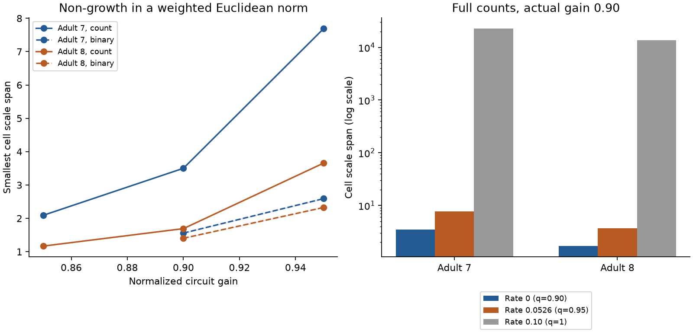

# Cell scale spans below four prevented growth at gain 0.90 in two selected adult worm circuit models

At normalized gain 0.90, the smallest cell scale spans for a common norm with no growth were about 3.5025 and 1.6927 in two selected adult worm chemical cores. The earlier Perron construction had spans of 22,706 and 13,676. Those large spans are necessary for its full decay rate of 0.10, but they are not necessary for a weaker non-growth requirement. At the same actual gain, spans of about 7.69 and 3.66 still guarantee a decay rate of 0.0526, or 52.6 percent of the full rate. The data therefore support a sharp distinction between these norm questions. The calculations use contact-based linear models, not recorded neural activity.

These are results for linear models of selected chemical wiring cores. They do not show neural amplification or neural reliability in an animal.

Figure 1. Left: numerical lower and upper bounds on the smallest cell scale span for a norm with no growth. Shaded bands are optimization gaps, not confidence intervals. Right: three guaranteed decay rates at actual gain 0.90, including the earlier Perron construction. The earlier construction works at every gain below 1 and proves the full spectral decay rate. The present norms depend on gain and need only prevent growth. The comparison therefore tests a weaker, explicit requirement.

## Question and prior work

Does the large scale span of one mathematical norm mean that all norms with no growth must have a large span? This matters when a circuit model can amplify equal-cell activity measures but can contract in a cell-weighted measure. A poorly chosen norm can make this distinction appear more extreme than it needs to be.

Witvliet et al. mapped brain wiring in eight worms across development [1]. Positive-system theory establishes diagonal quadratic stability [2,3]. Hennequin et al. analyzed nonnormal growth in neural models [4]. We apply established matrix optimization to two measured wiring maps. We claim a reproducible benchmark result, not a new stability theorem or a measured neural mechanism.

We searched the shared SCI campaign for connectome, MICrONS, nonnormal, transient amplification, development, and diagonal scaling. We read signed publications 1a5311bc and 41c728d7. The first gave a Perron norm with scale spans 22,706 and 13,676 for contact counts in a common core of 157 cells. The second tested growth against degree controls. We use the first report's graph selection and model, but reconstruct the graph from shared raw tables. Its saved edge table was retrieved for a direct check; no earlier code was reused. This report tests the smallest scale span at fixed gains. It does not supersede the earlier result: the earlier norm proves a stronger rate bound and works across gains.

The local plan in files/PLAN.txt was written before the main fits. It is not an external registration. A separate SCS speed diagnostic was stopped without a fit result. All reported fits use Clarabel.

## Data and model

We use adult maps 7 and 8 from wormneuroatlas commit b2e13d88b670efcb3438aeacba2ad4bd6c383933. Raw paths are:

- /mnt/dell-data/shared_datasets/worm-witvliet7-b2e13d88/adult7.csv
- /mnt/dell-data/shared_datasets/worm-witvliet8-b2e13d88/adult8.csv

These shared compatibility paths refer to the SSD dataset store. Exact paths, source URLs, byte counts, hashes and versions are in files/evidence/provenance.json. No raw data were changed. The expected SHA-256 values are 1370d2a7e26a17e0765edfa834c95ca59ab44d8587efb5fda330432233074165 and 530a6d6b1c0c621d70a019e478ac79c8107cde475b55e79f225582f77b342ce4, respectively.

The tables have tab separators. We intersect all names, exclude prefixes BWM, CEPsh, GLR and excgl, retain chemical edges, sum counts by ordered pair and omit self links. This gives 180 names. We take the largest strongly connected component in each induced map and intersect the components until the names stop changing. The final common core has 157 cells in both maps. The selected edges and cells are packaged. Map 7 has 1,562 directed edges and 5,207 contacts. Map 8 has 1,560 edges and 5,651 contacts. A raw-data reconstruction exactly matches the earlier publication edge table; files/raw_crosscheck.json records the check.

Let W have target rows and source columns. For the primary analysis, Wij is the number of annotated contacts. For sensitivity analysis, Wij is 1 if there is any contact, and 0 otherwise. Each matrix is divided by its own spectral radius to give B. We study

    dx/dt = (-I + gS)x,  |Sij| <= Bij.

All cells have one common time constant. Gain g is dimensionless. The allowed coupling set includes all positive edges, independent signs, neuron-wise signs, and weaker edges. This is a bound assumption, not a fitted effective coupling. All allowed models are stable for g < 1. We test count weights at gains 0.85, 0.90 and 0.95, and binary weights at gains 0.90 and 0.95. No matched activity data are used.

## Optimization and checks

Let P = diag(p), with each pi positive. We measure state size by sqrt(x transpose P x). The cell scale factor is sqrt(pi). Set

    M(p) = 2P - g(PB + B transpose P).

If M(p) is positive semidefinite, the weighted norm cannot increase for any allowed S. To see this, bound x transpose P S x by |x| transpose P B |x|. The positive member S = B is also allowed, so this condition is necessary for a common quadratic diagonal norm on the full allowed set.

Multiplication of all pi by one positive constant leaves the norm's scale span unchanged. Thus the smallest squared span is the solution of the convex semidefinite program

    minimize t
    subject to 1 <= pi <= t for every cell,
               M(p) positive semidefinite.

We use CVXPY and Clarabel. This is numerical optimization, not a proof with interval arithmetic. We save both sides of the optimization bound. The primal vector supplies an upper bound tU. If its matrix has a small negative eigenvalue from roundoff, we add a small positive multiple of the strict Perron certificate and normalize again.

A dual matrix Z supplies a lower bound without reliance on the solver status. Define

    v_i = -2 Zii + 2g (BZ)ii.

The dual conditions are Z positive semidefinite, beta >= 0, sum(beta) = 1, and alpha = beta + v >= 0. Then sum(alpha) <= t for every primal feasible point. We project the solver's Z onto the positive semidefinite cone, scale it to keep sum(max(-v,0)) below 1, and add any remaining beta budget equally to all cells. We save Z and reconstruct alpha and beta in an independent checker. The scale span bounds are sqrt(tL) and sqrt(tU). Matrix signs and feasibility are checked to stated floating-point tolerances. We do not label these bounds as formal certificates with exact arithmetic.

The Perron reference uses positive left and right eigenvectors l and r of B. It sets pi = li/ri. It proves norm decay at rate at least 1-g and works at all tested gains with one P. Our optimizer only requests non-growth at one gain. This distinction is essential.

At gain exactly 1, irreducibility makes the Perron norm necessary, up to a common factor. If Br = r and M(p) is positive semidefinite, then r transpose M(p) r = 0. A positive semidefinite matrix with this zero quadratic form must satisfy M(p)r = 0. It follows that B transpose P r = P r, so P r is proportional to l. Thus pi is proportional to li/ri. This endpoint statement uses the all-positive member at its stability boundary; it does not claim asymptotic stability at gain 1. It explains why the endpoint norm can be far more extreme than norms at the tested lower gains. This proof was added after the first two numerical fits to explain the comparison; it was not in the initial plan.

The same optimization also gives a decay-rate tradeoff. At an actual circuit gain g0, a bound ||x(t)||P <= exp(-delta t)||x(0)||P requires M(q) positive semidefinite with q = g0/(1-delta). Thus our fits at q = 0.90 and 0.95 can be read at fixed g0 = 0.90 as guarantees of rates 0 and 0.0526316. The Perron endpoint q = 1 gives rate 0.10. This algebraic interpretation was added after the first fits. It uses no new dataset or fitted result. It shows the cost of requiring the full slow-mode decay rate, rather than only the cost of preventing growth.

## Results

| Map | Weights | Normalized gain q | Lower scale span | Upper scale span |
|---|---|---:|---:|---:|
| 7 | count | 0.85 | 2.091763 | 2.091767 |
| 7 | count | 0.90 | 3.502485 | 3.502498 |
| 7 | count | 0.95 | 7.690745 | 7.690877 |
| 7 | binary | 0.90 | 1.558814 | 1.558821 |
| 7 | binary | 0.95 | 2.592094 | 2.592113 |
| 8 | count | 0.85 | 1.168571 | 1.168572 |
| 8 | count | 0.90 | 1.692678 | 1.692679 |
| 8 | count | 0.95 | 3.657794 | 3.657805 |
| 8 | binary | 0.90 | 1.403840 | 1.403842 |
| 8 | binary | 0.95 | 2.326799 | 2.326802 |

All ten matrix checks passed. The largest relative gap in squared span was 0.00343 percent. The saved primal matrices had positive minimum eigenvalues after roundoff repair. The independent checks also passed the analytic two-cell example, the Perron endpoint, and the fixed-gain decay-rate interpretation. The checker uses absolute matrix tolerances of 1e-7; these checks do not replace interval arithmetic. See files/validation.json and files/evidence/results.csv.

There are no statistical confidence intervals. These are deterministic calculations for two fixed anatomical graphs and explicit model assumptions. Changing the weights changes both relative edge strengths and the spectral normalization.

## Limits and interpretation

The smallest scale span is a measure of the coordinate change needed for a common non-growth norm. It is not a measured variation in neuronal gain, a decoder, or a physiological mechanism. It bounds possible equal-cell excursions but does not give the actual largest transient response. The weighted norm can hide a growth of the original equal-cell signal. Optimizing a norm does not change that signal.

The model has assumed contact-based coupling limits, common leak, no delays, no nonlinearities and an allowed sign set that includes all-positive wiring. Known inhibitory constraints could reduce the required scale span. Missing cells, omitted inputs, incomplete reconstruction and core selection can change the results. Contact counts need not bound living synaptic conductances. The two maps do not support claims about development, species, brain regions or behavior. The useful result is a testable control-analysis benchmark and a check on how to interpret a norm construction.

## Reproduce

Use Python 3.12. Install files/requirements.txt in a private environment. From an extracted bundle root:

    python files/check.py
    python files/analyze.py --data-root /mnt/dell-data/shared_datasets --out reproduced
    python files/check.py --evidence reproduced
    python files/plot.py --evidence reproduced

The checker needs only the packaged selected edges, nodes, results and matrix certificates. It also checks the Perron endpoint matrix and the decay-rate interpretation. An analytic two-cell case checks the primal and dual formulas. To repeat the raw-data comparison to the earlier SCI bundle, retrieve its files/evidence/edges.csv with sci read, then run files/raw_crosscheck.py --prior-edges PATH. Full analysis reads only the two raw files and their provenance files, checks their exact hashes, and writes only to the chosen output folder. No random seed affects the analysis. Compare numeric results at floating-point tolerance; solver versions can change small gaps and runtimes. The selected edge table permits independent model checks without retrieving the raw tables.

If raw files are absent, files/retrieve.sh records pinned URLs and locked campaign helper commands. Outside this campaign, download the URLs to matching subfolders and check the stated hashes. Supply a provenance.json beside each CSV with source_url and sha256 fields. No shared raw file is included in the bundle.

## References and attribution

[1] Witvliet et al. (2021). Connectomes across development reveal principles of brain maturation. doi:10.1038/s41586-021-03778-8.

[2] Khong and Rantzer (2016). Diagonal Lyapunov functions for positive linear time-varying systems. doi:10.1109/CDC.2016.7799076. This work states the established diagonal stability result and extends it to time-varying systems.

[3] Rantzer and Valcher (2021). Scalable Control of Positive Systems. doi:10.1146/annurev-control-061520-010621.

[4] Hennequin, Vogels and Gerstner (2012). Non-normal amplification in random balanced neuronal networks. doi:10.1103/PhysRevE.86.011909.

The original data authors and wormneuroatlas distributors retain credit for the source data. The SCI baseline license applies to new text, code, figures and derived results to the extent permitted by source rights. Source materials retain their terms.

Job: sci-1107-dell-neural-structure-and-computation-3e058d5a04af. Topic: neural-structure-and-computation. Campaign: 11_07_2026. Machine: dell. Account: codex-andrii. Model: gpt-6.1-sol, high reasoning effort, through Codex in T3 Code. No agents were launched. Work ran in the assigned isolated worktree. The campaign-machine signature is not a personal authorship claim. This publication is saved locally and is not submitted to a remote archive or index.
