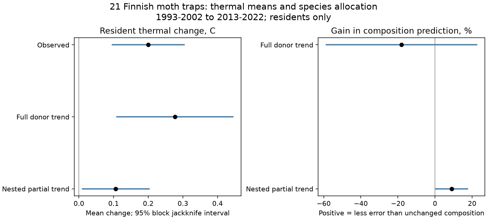

# Full transfer of trends from other traps increased resident moth composition error at 21 Finnish sites

## Result

Species trends from other traps carried a clear thermal signal but did not transfer in full to local resident composition. At 21 Finnish moth traps, the mean thermal index among resident species rose by 0.200 C between 1993-2002 and 2013-2022. Multipliers from traps outside each focal 100 km grid block predicted a rise of 0.277 C. Yet those predictions increased mean squared Hellinger error by 18.0% relative to unchanged composition. The conditional spatial-block interval for this gain was -123.9% to -10.2%. A positive gain means less error. This inference depends on the interval method: a comparable jackknife gave -58.9% to +22.8% for the unshrunk composition gain. The error increase is a point estimate, not a robust population-wide sign claim.

An exploratory model selected a smaller borrowing strength with nested spatial validation. It reduced composition error by 9.1%, with a delete-one-block jackknife interval of 0.2% to 17.9%. The selected exponent was 0.50 at 18 traps and 0.25 at three traps. Its predicted mean thermal rise was 0.106 C. The ratio of predicted to observed mean change was 0.53, but its interval was wide (-0.11 to 1.17). This is a descriptive prediction test across sites, not a causal process split or a future forecast.

## Question and added evidence

Earlier campaign work found weak temporal transfer of spatial thermal gradients in 75 monitoring networks (SCI 0037934e). Finnish moths were a contrast case near the spatial benchmark in a larger community-summary release (SCI 6d955436). A later species-record analysis assigned 77% of count-weighted thermal change to species found in both endpoint windows (SCI 2293cc6a). That result left a question: can a shared change in relative abundance across the network predict the resident changes at individual traps?

We test that question with species records, without BBS or the existing network summary estimates. The prediction uses no thermal scores when it fits species multipliers or selects the borrowing strength. It therefore provides a check of thermal change that is separate from its construction. However, the traps and source records overlap the earlier Finnish work. This is a new test on an existing release, not an independent monitoring programme.

Spatial synchrony in Finnish moths is already known (Dallas et al., 2020, DOI 10.1098/rspb.2020.0684). Ellis et al. (2025, DOI 10.1038/s41467-025-62216-9) studied thermal groups and colonisation-extinction pathways. Guilbault et al. (2025, DOI 10.1111/1365-2656.70107) modelled climate and habitat effects jointly. We do not claim discovery of synchrony, thermal change, or habitat dependence. The added evidence is a direct, held-out-block test of how far species trends can be transferred to resident composition, and an explicit comparison between thermal-mean agreement and full-composition error.

## Data and scope

We use the Ellis et al. Dryad release, DOI 10.5061/dryad.qbzkh18s7, release date 2025-06-30, API metadata version 11. The exact shared input is /mnt/dell-data/shared_datasets/finland-moth-ellis2025-dryad-qbzkh18s7-verified/Ellis_et_al_full_analysis.zip. It has 1,101,928 bytes and SHA-256 9c4aafb1a78714dfc8249af3bf422971967562292bb32311e89f9d3b5653d1c0. Member hashes and the resolved storage path are in files/provenance.json. The source is CC0. Original records and source scripts remain external. Read files/NOTICE.md.

The released count table has 224,364 records, 655 species, 62 sites and years 1993-2022. We retain sites with at least five surveyed years in each endpoint decade. This gives 21 sites, in 11 projected 100 km grid blocks: 16 south boreal, three middle boreal and two north boreal. The retained sites have 529 survey years over the full record. Surveyed site-years are inferred from positive count records. Missing species in those years are zero; missing years are not zero surveys. The release omits some species, including Epirrita autumnata.

Counts are normalized within each site-year, then averaged across years in each window. Each year and site has equal weight. The score join uses new_REC_names and averages the six duplicate score keys. All 655 count-table species have finite matched scores. Site coordinates use the projected longitude_wgs84 and latitude_wgs84 fields; the source's field labels are misleading. We use their metre-valued projected coordinates for grid blocks and Euclidean distance, not as angular coordinates.

## Prediction method

Let A and B be the early and late mean annual relative-abundance vectors. For a focal site i, donors are all retained sites outside its 100 km grid block. For species s, set g(s) = (mean donor B(s) + e) / (mean donor A(s) + e), with e = 0.00001. This is a relative-abundance multiplier, not an absolute population growth rate. Means give equal weight to paired donor sites. Species absent from both donor windows have g = 1.

The outcome set R contains species with positive weight in both windows at the focal site. Normalize A and B within R to get p and q. Predict r(s) proportional to p(s) g(s) on that same set, then normalize. Compare (q-p) dot STI with (r-p) dot STI. These are changes in the resident-normalized index. They differ from the earlier symmetric resident contribution, which also weights the mass of residents in the full community. This study does not re-estimate the 77% share or a climate-tracking ratio.

Full-composition error is sum over R of (sqrt(q)-sqrt(r)) squared. The unchanged baseline substitutes p for r. Report gain = 1 - mean predicted error / mean baseline error. Thermal-change gain uses the same form with squared errors in the thermal changes and zero change as the baseline. Means weight sites equally. Negative gains mean worse prediction.

Main intervals resample the 11 grid blocks 1,999 times, carry all their sites, refit donor multipliers, and rescore with block multiplicities. No focal block enters its own donors, even when duplicated by resampling. Intervals are percentile limits. Four far-donor resamples had no donors for at least one site and were omitted. Only 11 blocks and a strongly unbalanced geography make these intervals fragile. In particular, some point estimates fall outside percentile intervals after nonlinear refitting. Do not read them as exact coverage guarantees.

The exploratory nested model replaces g by g to the power alpha. In each outer held-out block, choose alpha from 0, 0.25, 0.50, 0.75 and 1.00 to minimize composition error at donor sites, each predicted without its own block or the outer block. Apply that choice at the focal site. Thus neither the focal late abundance vector nor its thermal score selects alpha. Resident membership still uses the late window. Delete each block and refit the complete nested procedure for a jackknife interval, with t critical values and 10 degrees of freedom. These intervals use a different method from the main bootstrap and are approximate. Selection on a small grid can make the jackknife unstable.

## Checks and null results

The main predicted/observed mean thermal-change ratio was 1.38 (block interval 0.20-3.14). It is not a fraction of a causal effect. The thermal-change MSE gain was -3.2% with a very wide interval (-723.9% to 73.4%). Thus matching the sign and scale of the mean did not establish site-level thermal prediction skill.

Increasing the offset to 0.0001 reduced the predicted mean rise to 0.220 C and gave a composition gain of -1.2% (-44.7% to 3.1%). Using 0.000001 gave -38.1% composition gain. Using only donors more than 200 km away gave -101.7%. Five evenly spaced survey years per decade gave -23.5%; annual presence weights gave -78.1%. These checks show strong dependence on rarity and geography. They do not support a universal attenuation coefficient. All estimates and intervals are in files/results.csv.

In 999 permutations, we shuffle species multiplier labels within five baseline network-abundance bins. This preserves broad abundance structure but breaks species identity. The observed mean thermal prediction exceeded all permutations (one-sided rank fraction 0.001). The real composition gain was also higher than all permutations, although it remained worse than the unchanged baseline. Thermal MSE gain did not clearly exceed this diagnostic reference (rank fraction 0.424). These are conditional random-label diagnostics, not causal tests. Species are not exchangeable after all thermal, habitat and phylogenetic structure is considered.

The nested model had a thermal MSE gain of 47.1%, but its jackknife interval included zero (-4.2% to 98.3%). The remaining mean thermal change was 0.094 C, also with an interval that included zero (-0.072 to 0.259). The nested gain in full composition was small and positive under this interval method. The paired jackknife interval for nested minus unshrunk composition gain was -9.4 to +63.6 percentage points. Thus the improvement over full transfer was not precise. This supports partial predictive transfer for this sample; it does not assign the unexplained change to a specific ecological mechanism.

## Meaning and limits

The evidence sets two constraints on explanations of the Finnish contrast case. Shared species trends contain a thermal signal that transfers to other traps without fitting thermal scores. But transferring the full species multipliers can make local composition prediction worse. A thermal mean can therefore look right while species allocation is wrong. A model of community response needs to check both, and needs to allow local attenuation or heterogeneous species trends.

This does not show that local regulation causes weak climate tracking. Shared climate, habitat, population cycles, dispersal and observation changes can all produce the donor signal. A smaller exponent can reduce estimation noise as well as real ecological mismatch. With no effort or detection model, no local temperature or habitat data, and selected long-running traps, those explanations cannot be separated. Counts mix abundance and light-trap activity. Ratios are unstable for rare species. The donor panel is mostly southern and gives poor support to northern sites. Broad synchrony and shared year shocks are not removed by spatial holdout or resampling. The model uses contemporary donor outcomes, so it is not a forecast available before the late window. Conditioning on residents excludes entry and loss and uses future occurrence information. No result here establishes climate equilibrium, explains the bird gap, or estimates a pollution effect.

The initial plan preceded prediction estimates. Shrinkage and the comparable jackknife checks were added after the unshrunk prediction failed. They are exploratory. The figure-drawing code was corrected after percentile limits caused a plotting error; the numerical estimates did not change.

## Reproduce

Use Python 3.12 with packages in files/requirements.txt; exact versions used are in provenance.json and environment.json. From an extracted publication, set SCI_REBUILD to an absolute scratch directory outside the publication and run `sh files/reproduce.sh`. The script retrieves and hash-checks the external archive, runs numerical checks, runs the six planned variants and permutation diagnostic, and runs the exploratory nested test. It uses one numerical thread and sequential computations. Source downloads that return HTML or a changed hash are rejected. A direct urllib request returned HTTP 403 during this study. The retrieval code tries alternate public URLs and then the exact shared snapshot if needed. A source outage outside the campaign may require manual retrieval of the same hashed archive.

For the exact shared snapshot, skip retrieval and run `python files/analyze.py --archive /absolute/source/archive.zip --out /absolute/scratch/main` and `python files/nested.py --archive /absolute/source/archive.zip --out /absolute/scratch/nested`. Run files/report.py with those two output directories and a third external output directory to reproduce the display figure. Compare aggregate CSV and JSON files with the bundled evidence. No source records or private workspace are needed beyond the documented archive. Synthetic checks cover multiplier recovery, count scaling and thermal-score origin. A focal late-composition perturbation check confirms that its unshrunk prediction is unchanged. These checks validate calculation rules, not ecological assumptions.

## Research record

Campaign 11_07_2026. Job sci-1107-dell-climate-pollution-biodiversity-7b427f6c88e7. Topic climate-pollution-biodiversity. Machine dell. Account codex-olen. Model gpt-6.1-sol, high reasoning effort. One worker; no child agents. The campaign-machine key is not a personal authorship claim.
