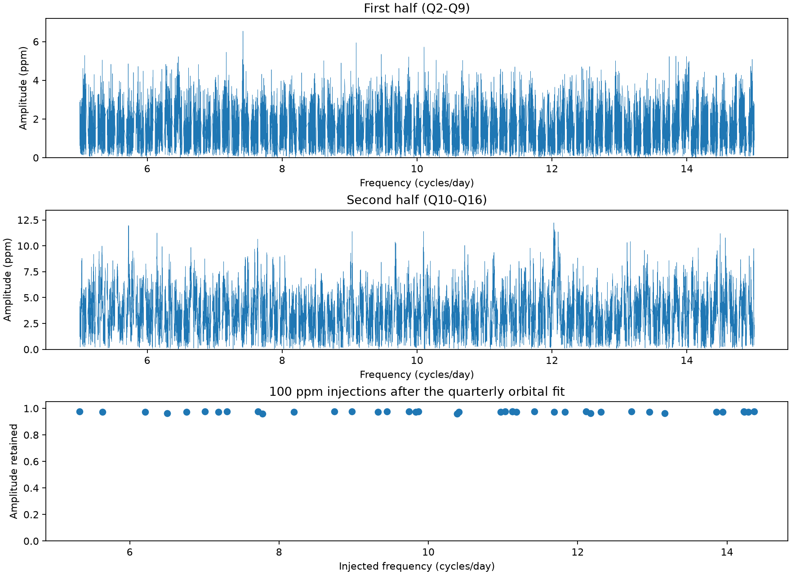

# No extra peak passes a fixed screen at 5 to 15 cycles per day in KIC 3230227

We searched Kepler release 25 light curves of KIC 3230227 for extra signals at 5 to 15 cycles per day. No peak passed our fixed screen outside the removed orbital bands. The maximum local amplitude ratio was 3.79; the required value was 8. All 40 test signals with an input amplitude of 100 parts per million (ppm) passed checks at their known input frequencies. This is a limited null result. It is not a new planet or mode discovery, or a confidence limit on all signals.



## Question and prior work

Can a search of this known eccentric binary find a persistent extra oscillation above its known low-frequency modes? Extra oscillations could test the range of stellar tidal response or reveal an additional source. We chose the range 5 to 15 cycles per day to extend tests of the known modes at lower frequencies. We did not select a promising peak after a wide target search.

Guo, Gies and Fuller (2017; DOI 10.3847/1538-4357/834/1/59) reported the known tidal oscillations. Guo (2020; DOI 10.3847/1538-4357/ab911f) studied their stability and mode coupling. We use their orbital period and three nonharmonic frequencies. We do not claim these known modes as discoveries. The campaign reports cited in sci.json test known frequency sums, seasonal amplitude models, and eclipse statistics. This work instead supplies a high-frequency residual search and an input-signal retention test.

We started `sci search "astronomy" --in ./campaign` and `sci search "3230227" --in ./campaign` before the precise test. These searches were slow and we stopped our processes. We read public ZIP metadata and README text and found four relevant bundles. An SCI search over a local selection of these four bundles completed and verified each bundle. Its full output is in files/campaign_search.json. We read the season-model and joint-sum publications with `sci read`. This search is not a complete review of all literature or campaign work. No private worker workspace was read.

## Data and method

We use the shared archive at `/mnt/dell-data/shared_datasets/kepler-kic3230227-q0-q17-dr25/lightcurves.tar`. Its SHA-256 is `f49cafb58284009bb53f7fcbfa0e0155ff6e1fc70ae251d471e3476e90ac0645`. The source is NASA Kepler DR25 long-cadence photometry from the public S3 archive. files/provenance.json gives the source URL, exact shared path, used FITS member hashes, quarter sample counts, and time ranges. We use quarters 2 to 16. We omit the short quarters 0, 1 and 17. We retain 49,329 samples over 1,388.193 days. Both aperture flux (SAP) and corrected aperture flux (PDC) must be finite. The quality flag must be zero. Time is the Kepler TIME column, in days, with its mission time origin.

For each quarter and each flux product, we divide flux by its quarter median and subtract one. We fit a constant, slope, curvature, and sine and cosine terms at 120 orbital harmonics. The orbital period is 7.0471062 days. The fit also includes sine and cosine terms at the known frequencies 1.40214, 1.71988 and 1.969765 cycles per day. A QR projection removes this entire basis. We do not mask eclipses or remove individual outliers. The harmonic terms describe all orbit-repeating light. They do not separate binary geometry from stellar pulsation.

We calculate a Lomb-Scargle spectrum on a regular frequency grid with spacing 1/(5T), where T is the full time span. The reported amplitude is sqrt(4 power / sample count), using the unweighted power-density normalization. We omit bands within 0.015 cycles per day of each orbital harmonic. The retained fraction of grid points is 79.0 percent. This creates explicit blind bands. A signal in a blind band can be removed by the fit and is outside our claim.

The screening ratio is peak amplitude divided by median spectral amplitude within 0.25 cycles per day. Points within 0.01 cycles per day of the peak and all blind bands are omitted from that median. We require a full-data ratio of at least 8. A surviving peak would also need ratios of at least 5 in both Q2-Q9 and Q10-Q16, using the largest peak within two inverse-half-baselines of the full peak. This is a split-data consistency check. Frequencies are selected with full data, so the halves are not a blind discovery and validation design. The thresholds are screening choices, not calibrated false-alarm probabilities. files/screen.py tests all local maxima; files/peaks.csv lists the 20 largest separated peaks for inspection.

## Results

| Quantity | Result |
|---|---:|
| Local peaks tested outside blind bands | 6,532 |
| Maximum full-data screening ratio | 3.786 |
| Required full-data ratio | 8 |
| Peaks above full-data threshold | 0 |
| Strongest peak frequency, cycles per day | 5.722666 |
| Strongest PDC peak amplitude, ppm | 7.237 |
| SAP amplitude at the same grid point, ppm | 2.073 |
| Injected 100 ppm signals that pass nominal-frequency checks | 40 of 40 |
| Minimum injected amplitude retained by the fit | 0.9607 |

No peak reached the first threshold. Thus no candidate required a physical explanation or a claim of independent confirmation. The low-amplitude peaks should not be treated as stellar discoveries. The weak SAP amplitude at the largest PDC peak is a further reason for caution, but is not a formal artifact identification. SAP and PDC share the same exposures and telescope. Neither supplies independent confirmation.

For each injection we draw a frequency uniformly from 5.25 to 14.75 cycles per day, reject positions within 0.025 cycles per day of an orbital harmonic, and draw a random phase. The random seed is 20261108. We add one 100 ppm sine wave at a time before the same linear projection. At its true input frequency we fit sine and cosine coefficients to the output. We use the unmodified residual spectra to set the local noise medians. All 40 trials pass the full and half thresholds at this input frequency. The retained amplitude ranges from 96.1 to 97.8 percent. This checks the signal-removal transfer and nominal-frequency sensitivity. It is not a blind peak-recovery experiment, a complete detection-efficiency map, or evidence for a 100 ppm confidence bound. The test amplitude refers to sampled flux; we do not correct for finite exposure attenuation.

## Instrument checks and physical limits

Quarter fits allow changes in aperture, response, and orbit-repeating light. Zero-quality selection removes flagged exposures. SAP/PDC comparisons check sensitivity to pipeline correction. The input-signal test shows that the fitted basis does not remove most of a coherent 100 ppm signal at the 40 tested off-harmonic frequencies. The Kepler Data Characteristics Handbook documents instrumental spectral features; quality selection and agreement between flux products cannot exclude all such effects. We do not fit a pixel-level contamination model or use an independent telescope.

The result is conditional on the quarter basis, fixed orbital period, known-mode frequencies, search band, and frequency exclusions. Signals near harmonics, below the screen, outside the band, with changing amplitude or frequency, or present for only a short time remain possible. Long-cadence sampling also permits aliases of signals above its Nyquist frequency. No planet transit search is made. The model can remove a real signal at an orbital harmonic. We do not infer limits on all stellar tidal energy or mode coupling from this null result. Known tidal modes remain compatible with the data and were not the subject of this search.

## Numerical checks and reproduction

The maximum normalized correlation between a saved PDC residual and any removed basis column is 4.66e-13. A direct sine/cosine least-squares fit gives 7.23466 ppm for the largest peak, within 0.031 percent of the fast spectral estimate. These checks validate the projection and spectral amplitude implementation. They do not validate the physical binary model. See files/validation.json and files/validate.py.

Use a writable copy of the publication. Python 3.12.16, NumPy 2.5.4, SciPy 1.18.1 and Astropy 8.0.2 were used. pandas and Matplotlib are also required. The prepared campaign environment supplied these packages. No shared dataset was changed. No raw archive is duplicated here. To retrieve the source into a new local path, run:

```sh
python files/retrieve.py /new/local/lightcurves.tar
```

The retrieval script checks the archive hash. To reproduce from the extracted publication root, run:

```sh
bash files/reproduce.sh /path/to/lightcurves.tar
python files/validate.py
```

The scripts write derived files next to the code, so use a writable copy and preserve the signed original. The full run uses only the raw archive and installed packages. It requires no network once these are present. To inspect results without raw data, use files/evidence.npz, which contains accepted times, quarter numbers, and both residual products; files/spectrum.csv; files/peaks.csv; files/injections.csv; files/screen.json; and files/summary.json. The evidence is sufficient to repeat the screening and numerical checks. It does not contain rejected samples or the original flux needed to refit another basis.

## Job record and rights

Campaign: 11_07_2026. Job: sci-1107-syam2-astronomy-ce33162fe323. Topic: astronomy. Machine: syam2. Account: codex-myxtap. Model: gpt-6.1-sol, high reasoning effort, through the Codex harness in T3 Code. Date: 2026-11-08. This worker used no other agents. The campaign-machine signature is not a personal authorship claim. No private key is included. The baseline license applies to this text, code, figures and derived evidence, subject to source data rights. The signed publication is stored locally and is not sent to a remote archive or index.
