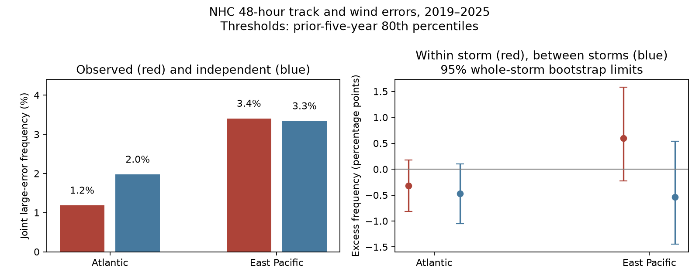

# Large NHC track and wind errors occurred together less than an independent reference at 48 hours in the Atlantic in 2019-2025

## Result

Large track and wind errors did not have a common excess of joint events in two basins. In the Atlantic, they occurred together less often than a reference with independent errors within each year. The East Pacific result was close to that reference and was uncertain.

We used official National Hurricane Center (NHC) forecast error records. A large error exceeded the 80th percentile of paired valid errors from the past five years. Wind error means absolute wind intensity error. The main test used 48-hour forecasts from 2019 to 2025.

| Basin | Cycles / storms | Joint large errors | Independent reference | Ratio | Difference, 95% whole-storm limits |
|---|---:|---:|---:|---:|---:|
| Atlantic | 1,605 / 102 | 19, or 1.18% | 1.98% | 0.60 | -0.79 points (-1.45 to -0.06) |
| East Pacific | 1,087 / 99 | 37, or 3.40% | 3.34% | 1.02 | +0.06 points (-1.17 to +1.48) |

The independent reference uses the measured marginal fractions in each test year. It is not fixed at 4%. The past thresholds, wind-error ties, and changes between years cause test exceedance rates to differ from 20%.

Whole-year limits for the Atlantic difference were -1.21 to -0.31 percentage points. East Pacific limits were -1.01 to +1.49 points. These are conditional bootstrap limits from only seven years. They are not a guarantee for later forecasts. The result does not establish that physical track and wind errors are independent or negatively related in general. The other thresholds and leads did not give a stable sign.

This is a test of dependence in point forecast errors. We did not test an issued NHC joint probability product. We did not assume that NHC uses independent errors.

## Question and prior work

The selected PAGER study (SCI 156946e5) found a large error in issued earthquake loss probabilities. It motivates tests of other public hazards, but does not imply that other forecasts have the same error. We read that study and campaign NHC studies on track coverage (SCI d0ccb210), wind error bands (SCI 6c9d68a8), and forecast revisions (SCI 10f1a3ce). Campaign searches for forecast, hurricane, and joint track intensity dependence preceded the choice of this test. These studies leave joint track and wind error behavior open.

Track and wind dependence is not a new concept. Kieu and colleagues (2021, doi:10.1175/WAF-D-20-0085.1) studied it in COAMPS-TC model forecasts. We used the primary source abstract for this context. DeMaria and colleagues (2009, doi:10.1175/2009WAF2222286.1) describe an NHC wind probability method that accounts for track, intensity, and land interaction. We read the source PDF. Thus a claim that NHC ignores this interaction would be wrong.

Our contribution is a later-period, two-basin benchmark for official forecasts. It has thresholds fitted only from past years, a reference that keeps test-year margins, an exact separation of within-storm and between-storm terms, and a chronological test of a simple joint probability estimate. This is a bounded extension of marginal verification. It is not a new theory of cyclone dynamics, a first discovery of error dependence, or a validation of the NHC wind probability method.

## Data and selection

We reused two immutable NOAA/NHC snapshots dated 10 November 2026. Both cover 1989-2025. No new raw data were added to the shared store.

- Atlantic: `/mnt/dell-data/shared_datasets/nhc-atl-ti-errors-1989-2025-20261110-e321/errors.txt`, SHA-256 `4bfc2994b7d3f83f7f532dd92ab4aaaa57de05e72be9b039e12eaf4b9753994a`.
- East Pacific: `/mnt/dell-data/shared_datasets/nhc-epac-ti-errors-1989-2025-20261110-e321/errors.txt`, SHA-256 `63541d3d3ece9214ba2bc995a8eda742f23b37d0a3f430ab42f2ae9735a6e0a9`.

Exact resolved paths, byte counts and hashes are in sources.json. The retrieval code and sci.json give source URLs. documents.json gives the URLs and hashes of the format PDF and the 2009 source paper. External documents are not bundled.

The table headers include depressions and subtropical stages, exclude extratropical stages, and exclude dissipation forecasts. NHC errors use post-storm best track. We retain paired valid track and intensity errors at each lead: track error at least zero and intensity error above -999. The missing sentinel is -9999. A duplicate storm-time key causes failure. The format document identifies track units as nautical miles and intensity units as knots. We use absolute intensity error, so its sign convention does not affect this test.

The F columns give equivalent sample sizes. We do not treat them as probability weights. Each retained forecast cycle has equal weight. Whole-storm resampling handles dependence between cycles within storms. The initial wind column WS is best-track wind, not necessarily the estimate available at issue time. Its use is limited to descriptive subgroup checks.

The publication contains our original code, text, figures and analytical aggregates. Raw tables and cycle-level extracts stay outside it. See NOTICE-external-data.md. The NWS policy identifies its information as public domain unless marked otherwise. We claim no copyright in NHC records and no NOAA endorsement.

## Method

files/plan.md preceded the main calculation. files/prediction-plan.md added a secondary forecast comparison while that calculation was running and before its output was read. Neither document has an independent registration or time stamp. The leave-one-storm influence check was added after the primary result.

For each test year y, we select paired valid errors from y-5 to y-1. We compute separate 80th percentiles for track error and absolute wind error by linear interpolation. Let T and I be binary indicators that the test errors are strictly above these thresholds. Let J=T*I. Thresholds use only earlier years. Dependence estimates use the test outcomes and are retrospective diagnostics.

Write pT_y, pI_y and pJ_y for test-year fractions, n_y for counts, and N for total counts. The primary difference is

    D = sum_y n_y * (pJ_y - pT_y*pI_y) / N.

The ratio divides the pooled joint fraction by the weighted independent reference. We use year-specific products to avoid calling shared year variation a same-year association. This reference is descriptive and uses test outcomes. It is not a forecast that can be issued in advance.

For each storm s, define n_s, pT_s and pI_s. Each storm belongs to one year. The exact separation is

    within  = mean(J) - sum_s n_s*pT_s*pI_s/N
    between = sum_s n_s*pT_s*pI_s/N - sum_y n_y*pT_y*pI_y/N
    D       = within + between.

The within term compares aligned pairs with the product of fractions within each storm. It is also the expected change from random pairings within that storm. It does not isolate a physical cause. Storm age, land interaction, serial dependence and changing environments can all affect it. The between term measures the remaining association between storm fractions within years. Estimated storm fractions are noisy, especially in short records. The decomposition is an exact finite-sample identity, not an unbiased estimate of latent storm difficulty.

We draw 5,000 whole-storm bootstrap samples and separately 5,000 whole-year samples, with replacement, using seed 513. In each draw we recompute the fractions and products. Thresholds stay fixed. A draw divides summed counts by its summed cycle count. Limits are two-sided 2.5th and 97.5th percentiles. They omit training-threshold uncertainty and dependence between distinct storms. They are pointwise, without correction for the two basin tests or the secondary tests. The Atlantic storm interval only narrowly excludes zero; it does not establish a result with a family-wise error guarantee across the two basins.

## Further evidence and limits on interpretation

The Atlantic difference separated into -0.32 points within storms and -0.47 points between storms. Both separate whole-storm intervals included zero. The East Pacific terms were +0.60 and -0.54 points; both intervals also included zero. Thus the East Pacific near-zero total can hide offsetting terms, but neither term is well established. No physical mechanism is identified.

Atlantic joint events came from 12 storms, with at most four cycles from one storm. Leaving out each storm in turn kept the difference negative, from -0.94 to -0.61 points. East Pacific joint events came from 14 storms. Its leave-one-storm range crossed zero. This influence check uses fixed thresholds and does not make the sparse tail sample large.

All planned checks are in summary.csv. At 48 hours, the Atlantic difference was near zero at the two-thirds threshold (+0.02 points) and uncertain at the 90th percentile (-0.18 points). In 2008-2018 its 80th-percentile difference was +0.42 points with limits across zero. Thus the primary deficit does not define a general Atlantic law. At 24, 72 and 120 hours in 2019-2025, Atlantic point differences were -0.33, +0.30 and +1.04 points; all whole-storm limits crossed zero. East Pacific point differences were -0.48, +1.47 and -1.66 points. Its 72-hour interval barely excluded zero (+0.003 to +2.98 points). That secondary result needs a new test; we do not select it as a discovery after several comparisons.

The weaker initial-wind Atlantic group kept a deficit (-1.12 points). The hurricane group had a smaller uncertain deficit (-0.21 points). These groups use revised best-track wind, so they do not establish a rule available at issue time.

Positive co-failure dependence has two different implications. The probability that both errors exceed their thresholds rises by D compared with independent margins. The probability that both stay inside also rises by the same D, by the identity P(T=0,I=0)=1-pT-pI+pJ. Therefore, excess simultaneous large errors does not itself imply too little joint rectangular coverage. In the primary Atlantic test D was negative. This distinction prevents an unsupported claim of general joint overconfidence from a co-failure statistic.

## Secondary probability test

For each primary year, we used the same past-five-year sample and thresholds to estimate two probabilities of J=1. One was the product of the two historical fractions. The other was the historical joint fraction. Both are constructed constant annual forecasts, not issued NHC probabilities. Their Brier score is mean (J-p)^2. Lower is better.

| Basin | Independent Brier score | Joint Brier score | Joint minus independent | 95% storm limits | 95% year limits |
|---|---:|---:|---:|---:|---:|
| Atlantic | 0.012003 | 0.011893 | -0.000110 | -0.000163 to -0.000057 | -0.000250 to +0.000002 |
| East Pacific | 0.032853 | 0.032993 | +0.000140 | -0.000027 to +0.000324 | -0.000040 to +0.000396 |

The Atlantic storm limits suggest a small gain, but the year limits include zero. The East Pacific point result is worse. Thus the direct joint estimate does not give a clear improvement across both forms of uncertainty or both basins. It does not use forecasts of land interaction, wind change or storm structure. A richer conditional method may do better.

## Scope

The archive can be revised. Past-only fitting here is not a literal replay of files available in each year. Stage exclusions, dissipation exclusions, common-sample rules and missing paired errors can affect dependence. The findings do not cover all issued advisories, storm dissipation, landfall-only events, Central Pacific forecasts, wind radii, rainfall, surge, or damage. Marginal ties and threshold choice matter. Only 19 Atlantic and 37 East Pacific cycles have joint large errors in the primary test. Seven years and the number of event-bearing storms limit inference. Intervals conditional on fitted thresholds can be too narrow for future deployment.

The evidence rejects an automatic extension from marginal forecast errors to a common positive joint-error excess. It also supplies a reproducible joint-error benchmark. It does not prove independence, identify a physical cause, or support a replacement for an operational probability product.

## Reproduction

Use Python 3.12 and files/requirements.txt. Outputs must be outside the signed publication.

    python files/analyze.py --data-root /path/to/datasets --out /absolute/scratch/analysis
    python files/check_results.py --data-root /path/to/datasets --out /absolute/scratch/analysis
    python files/influence.py --out /absolute/scratch/analysis
    python files/score_joint.py --data-root /path/to/datasets --out /absolute/scratch/prediction

On this machine, `/path/to/datasets` can be the resolved shared datasets link. Else run `python files/retrieve.py --scratch /absolute/external-data`, then use that directory as data-root. Live NHC tables can change. The script rejects other hashes; obtain the immutable recorded snapshots if the live files differ. No method can recover an old version from a changed URL alone.

Compare summary.csv, annual.csv, thresholds.csv, influence.json, checks.json, prediction.csv and prediction_annual.csv with files/. sources.json paths can differ across machines. The main script creates evidence_EXTERNAL.csv.gz outside the publication. Keep it there. The independent check uses a separate whitespace parser, standard-library quantiles and arithmetic; it reproduces primary counts, fractions and the decomposition to 1e-12. It does not independently verify bootstrap uncertainty or source observations.

## Campaign record

Job: sci-1107-dell-earth-and-ocean-sciences-5f4b3e13c8fe. Topic: earth-and-ocean-sciences. Campaign: 11_07_2026. Machine: dell. Account: codex-myxtap. Model: gpt-6.1-sol, high reasoning effort. No agents were launched. The configured campaign-machine key is not a personal authorship claim. All work used the assigned worktree. The signature validates package bytes, not scientific truth.
