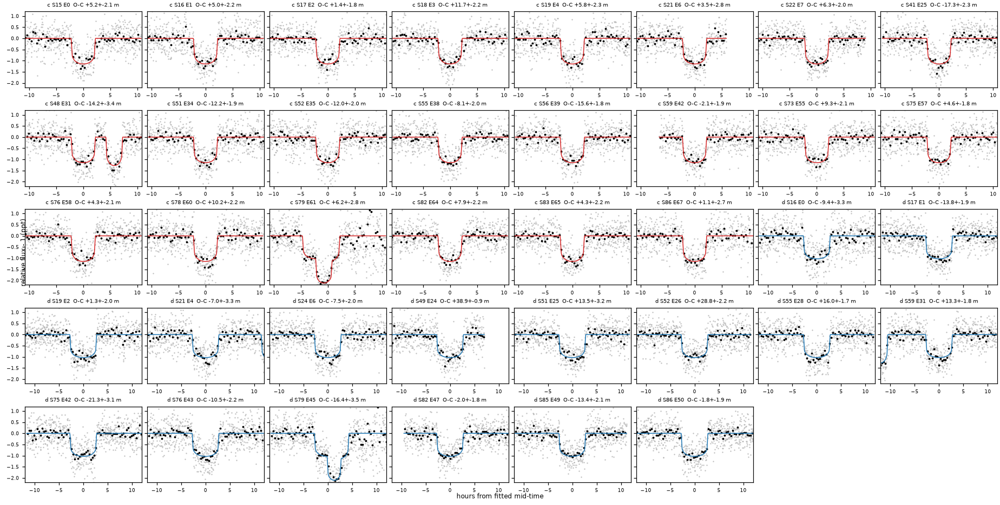
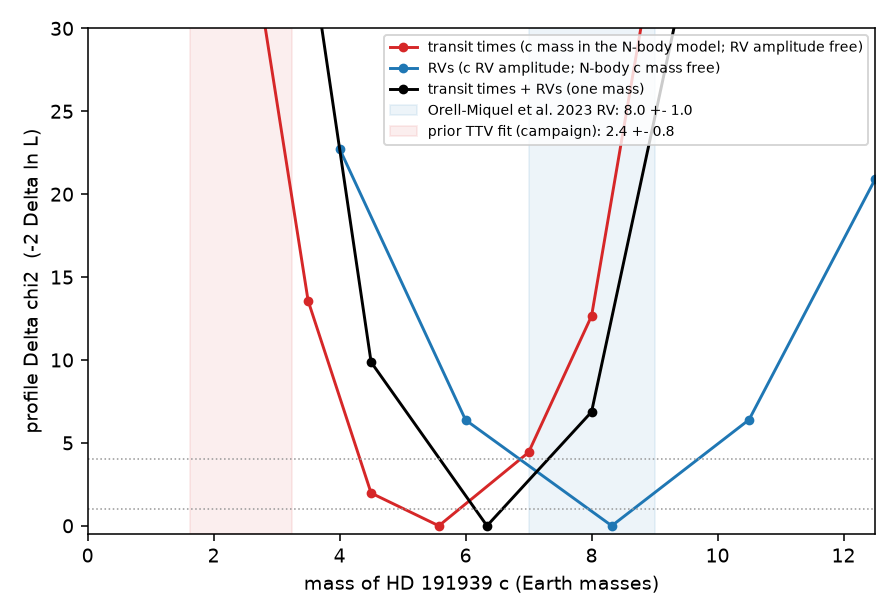
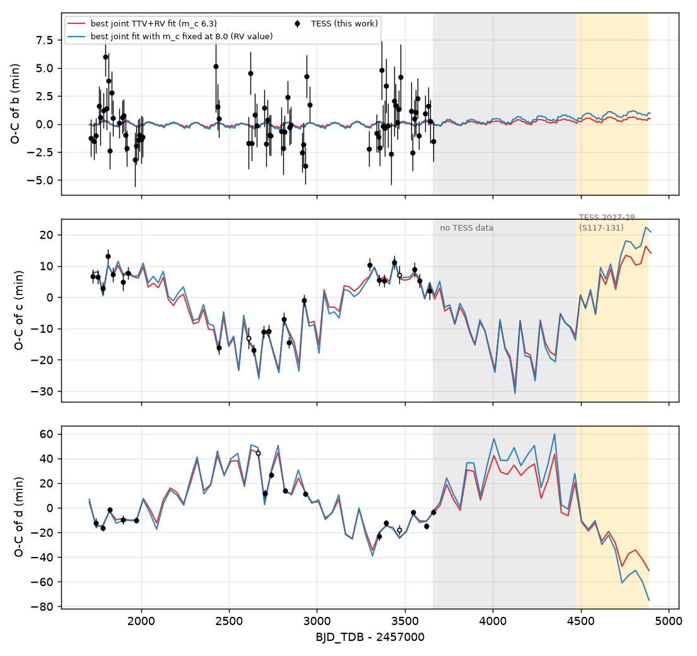

# A joint N-body fit of TESS transit times (2019-2024) and 545 RVs gives HD 191939 c a mass of 6.3 +- 0.6 Earth masses; this removes most of the reported 4-sigma TTV-RV tension and leaves a 2.4-sigma difference

## Summary

A prior campaign result found anticorrelated transit timing variations (TTVs) of the sub-Neptunes HD 191939 c and d. Its N-body fit gave a mass of c of 2.4 +- 0.8 Earth masses, which is about 4 sigma below the radial-velocity (RV) mass of 8.0 +- 1.0. We measured all 111 TESS transit times of b, c and d again (2-min and 20-s data, sectors 15-86, 2019-2024) and calibrated the timing errors with 450 injected transits. We then fitted the transit times and 545 public RVs (CARMENES, HARPS-N, HIRES, APF; 2019-2024) together, with a six-planet N-body model in which the outer planets e, g and f are also free.

Main results:

- Our transit times agree with the prior campaign times (RMS difference 1.0, 1.5 and 1.8 min for b, c, d). The difference in the mass result therefore comes from the model, not from the data.
- The joint fit (one mass per planet) gives m_c = 6.3 +- 0.6 and m_d = 4.1 Earth masses, with eccentricities e_c = 0.10 and e_d = 0.08 and aligned apsides. It fits the TTVs to chi2 = 12.8 (23 times of c) and 13.4 (16 times of d).
- The transit times alone give m_c = 5.6 +0.7/-0.8; the RVs alone give 8.3 +- 0.9. The difference is 2.4 sigma. A likelihood-ratio test of one mass per planet against separate TTV and RV masses for b, c and d gives 2 Delta lnL = 8.7 for 3 parameters (p = 0.03).
- A mass of c of 2 Earth masses (the prior value) is excluded by the transit times alone: Delta chi2 = 50.
- The transit times of d and the RVs both reject the published period of planet e (101.12 d). With P_e fixed at 101.12 d the fit is worse by Delta lnL = 43 (d TTV chi2 13 -> 39); the fitted period is 101.84 d.
- The result does not change with a Rayleigh eccentricity prior (m_c = 6.3), without the four flagged transits (6.4), or with planet e inclined by 10 degrees (6.2).
- TESS will observe the star again in sectors 117-131 (about 2027-2028). The best solution and the best solution with m_c = 8 then differ by up to 6 min (c) and 18 min (d), which is 3-9 times the timing errors.

- The fitted b-c-d-e-f configuration is regular over 10,000 years (MEGNO 2.0); the fitted orbit of the candidate g is chaotic and probably not physical.

Main limitations: point estimates and profile likelihoods from a local optimiser, not a full posterior (the optimiser found better optima from new starts, so profile points are upper limits on Delta chi2 to about 1-3 units); coplanar orbits; no stellar-activity model for the RVs; the d mass has no profile interval.

## Background and question

HD 191939 (V = 9, G9 V, 54 pc) has three transiting sub-Neptunes, b (8.88 d), c (28.58 d) and d (38.35 d), a non-transiting Saturn-mass planet e (about 101 d), a long-period giant f and a candidate g (Badenas-Agusti et al. 2020; Lubin et al. 2022; Orell-Miquel et al. 2023; Lubin et al. 2024). The c-d pair is 0.6 % wide of the 4:3 resonance (super-period about 1,500 d).

The prior campaign publication sci:sha256:302c828025a9bd83fc117b7e011530d375577d6ed8f66ac5072e7bb3d26e51b2 ("TESS 2-minute transit times from 2018 to 2026 ...") detected the c and d TTVs. Its N-body fit used TESS times only, fixed the outer planets to published values (P_e = 101.12 d), fixed b to a circular orbit and used two starting points. It gave m_c = 2.4 +- 0.8 and m_d = 2.4 +- 0.7, and stated that the mass-eccentricity degeneracy limits the result.

Question: when we measure the times again and fit them together with all public RVs in one N-body model with free outer planets, do the TTV and RV masses of c agree?

## Data

- TESS SPOC PDCSAP light curves of HD 191939 (TIC 269701147) from MAST: 2-min cadence in 31 sectors (S15-S86) and 20-s cadence in 19 sectors (S41-S86). TESS did not observe the star after S86 (December 2024); tess-point (0.9.5) gives S117, S118, S120-S124 and S126-S131 as the next sectors. The TESScut cutouts of S54, S57, S74 and S84 are empty (star not on silicon). In S14 the star is at the CCD edge; our aperture photometry does not detect the transits there (Delta chi2 < 8), so we use no FFI data.
- RVs: VizieR J/AJ/168/196 table3 (Lubin et al. 2024), 545 RVs from 2019-11 to 2024-08: CARMENES 138 and HARPS-N 42 (Orell-Miquel et al. 2023), HIRES 73 and APF 111 (Lubin et al. 2022), HIRES 35 and APF 143 (Polanski et al. 2024), and 3 HIRES (Lubin et al. 2024). We use one offset and one jitter per instrument.
- URLs and SHA-256 hashes of all inputs: `files/data/external_inputs_sha256.csv`. The raw data are not in this bundle (`files/EXTERNAL_DATA_NOTICE.md`).

## Methods

1. Transit times (`files/code/timing.py`, `lcio.py`). Each window (+-0.40, 0.45, 0.50 d for b, c, d) is fitted with a batman transit model times a quadratic baseline. The shape of each planet (Rp/R*, a/R*, impact parameter, q1, q2) is fitted to all 2-min windows, with Gaussian priors on a/R* (from M* = 0.81, R* = 0.94; width 5 %) and on the limb darkening (q1 = 0.38, q2 = 0.34, width 0.1). The mid-time comes from a grid scan (+-90 min, 0.2-min step) with the baseline solved linearly at each step. The point error is the residual RMS, with a red-noise factor from binned residuals. Transits of other planets in a window are part of the model. Ephemerides and shapes are iterated three times. A window must contain at least 60 % of the in-transit cadences, ingress, egress and baseline on both sides.
2. Error calibration (`files/code/inject.py`). We injected 150 model transits per planet into the 2-min data at least 0.25 d from any real transit, with random offsets of up to +-20 min, and timed them with the same code. The RMS of (measured - injected)/sigma is 1.06 (b), 1.01 (c) and 1.15 (d), and the mean offset is below 0.5 min. We multiply the formal errors by these factors.
3. Final times (`files/code/combine_times.py`, `files/results/transit_times.csv`): 72 (b), 23 (c) and 16 (d) times. We use 20-s times only for two epochs without 2-min data (b S86, c S49). Four transits have flags: c S48, c S79 and d S79 overlap a transit of b (modelled), and d S49 has a data gap after egress. Median timing errors are 1.8 (b), 2.2 (c) and 2.4 (d) min.
4. Dynamical model (`files/code/dyn.py`, `fit.py`). TTVFast (Deck et al. 2014; python wrapper 0.3.0) integrates b, c, d, e, g and f from BTJD 1700 with a 0.4-d step (error below 0.002 min against a 0.05-d step). One integration gives the transit times and the stellar RV at the RV epochs. Orbits are coplanar and edge-on (so masses of e, g, f are minimum masses), M* = 0.81 Msun. Free parameters: mass, osculating period, conjunction time, sqrt(e) cos w and sqrt(e) sin w for each planet, plus offset and jitter for each RV instrument (38 parameters).
5. Two model versions. "Joint": one mass per planet for both data sets. "Split": b, c and d also have an RV mass that sets only their RV amplitude (a Keplerian correction to the N-body RV). The split model measures a TTV mass and an RV mass of each planet with the same outer-planet model.
6. Fitting (`files/code/optimize.py`). Least squares on the normalised residuals, in (e cos w, e sin w); jitters are iterated so that the reduced RV chi2 is 1 per instrument. Six built-in starts (different inner masses and eccentricity vectors) and starts from other solutions. Profile likelihoods fix the mass of c at grid values and re-optimise all other parameters (`run_profiles.sh`); at each grid value we keep the best of all starts. Errors come from a local parabola through the nearest grid point on each side.
7. Robustness fits: without the four flagged transits; P_e fixed at 101.12 d; a Rayleigh eccentricity prior (sigma 0.05; Van Eylen et al. 2019) for b, c and d; planet e at sky inclination 80 deg.
8. A 10,000-yr REBOUND WHFast integration with MEGNO of the best joint solution, with and without planet g (`files/code/stability.py`).

## Results

### Transit times

**Figure 1.** All 38 transits of c (red model) and d (blue model) in 2-min data, detrended with the fitted baseline; grey: 2-min points, black: 20-min bins. Panel titles give the O-C from a linear ephemeris and the calibrated error. Windows with a second, deeper dip contain a transit of b.

- Linear ephemerides fail for c and d: chi2 = 458 (21 dof) and 635 (14 dof); for b, chi2 = 81 (70 dof).
- The O-C of c changes from +5 to +13 min (2019-2020) to -10 to -17 min (2021-2022) and back to +4 to +11 min (2023-2024). The O-C of d moves in the opposite direction, between -23 and +47 min, with transit-to-transit jumps from synodic "chopping".
- Our times and the prior campaign times agree (Figure 2): median differences 0.1, 0.4 and 0.9 min and RMS 1.0, 1.5 and 1.8 min for b, c and d. Our 20-s and 2-min times agree with RMS 0.9, 1.5 and 2.0 min. We have 3 (b), 3 (c) and 2 (d) epochs that the prior table does not have.

**Figure 2.** Top: O-C of our times (black) and of the prior campaign times (orange) against the same ephemeris. Bottom: prior minus our times (orange) and our 20-s minus 2-min times (green).

### Masses from the joint N-body fit

| fit | m_b | m_c | m_d | e_c | e_d | TTV chi2 (b, c, d; n = 72, 23, 16) | RV lnL | lnL |
|---|---|---|---|---|---|---|---|---|
| joint, best | 10.0 | 6.34 | 4.12 | 0.096 | 0.081 | 78.4, 12.8, 13.4 | -1553.5 | -1605.8 |
| split, best: TTV masses | 15.5 | 5.58 | 3.60 | 0.103 | 0.088 | 78.4, 12.5, 11.1 | -1550.4 | -1601.4 |
| split, best: RV masses | 9.86 | 7.97 | 3.04 | | | | | |
| joint, m_c fixed at 8.0 | 9.95 | 8.0 | 4.60 | 0.114 | 0.096 | 77.1, 13.3, 22.6 | -1552.7 | -1609.2 |
| joint, m_c fixed at 3.0 | 8.82 | 3.0 | 2.60 | 0.089 | 0.078 | 81.0, 21.1, 23.1 | -1567.4 | -1630.0 |
| joint, P_e fixed at 101.12 d | 9.56 | 6.80 | 4.16 | 0.123 | 0.103 | 77.9, 12.9, 39.2 | -1583.9 | -1648.9 |
| joint, without 4 flagged transits | 9.85 | 6.43 | 3.90 | 0.108 | 0.091 | 77.7, 12.6, 10.1 | -1552.3 | (fewer data) |
| joint, Rayleigh e prior | 9.90 | 6.29 | 3.98 | 0.098 | 0.083 | 78.4, 13.0, 12.2 | -1553.0 | (prior term) |
| joint, planet e at i = 80 deg | 9.90 | 6.23 | 3.93 | 0.104 | 0.088 | 78.1, 12.5, 13.1 | -1552.9 | -1604.7 |

Masses in Earth masses (M* = 0.81 Msun). All fits: `files/results/fits/*.json` (mode, fixed values, full parameter vector, chi2 parts).

- In the best joint fit the c and d eccentricity vectors are aligned (w = -159 deg for both), so the TTVs constrain mainly the small difference of the two vectors, as expected near a first-order resonance (Lithwick et al. 2012). Planet b has e = 0.03.
- Outer planets in the joint fit: e: M sin i = 115 Earth masses, P = 101.84 d, e = 0.05; g: 15 Earth masses, P = 370 d, e = 0.45 (poorly constrained; the published value is 284 d); f: 815 Earth masses, P = 2,895 d (baseline 1,700 d, so f is not well constrained). RV jitters: CARMENES 4.9, HARPS-N 1.8, HIRES 1.7, APF 4.4 m/s.

**Figure 3.** Profile Delta chi2 of the mass of c. Red: information from the transit times (split model, c mass in the N-body model, RV amplitude free). Blue: information from the RVs (split model, c RV mass). Black: joint model. Shaded: the published RV mass and the prior campaign TTV mass.

| data | m_c (Earth masses) | grid values (Delta chi2) |
|---|---|---|
| transit times | 5.6 +0.7/-0.8 | 2.0 (49.9), 3.5 (13.6), 4.5 (2.0), 7.0 (4.4), 8.0 (12.7), 10.0 (57.0) |
| RVs | 8.3 +- 0.9 | 4.0 (22.7), 6.0 (6.4), 10.5 (6.4), 12.5 (20.9) |
| transit times + RVs | 6.3 +- 0.6 | 3.0 (48.5), 4.5 (9.9), 8.0 (6.9), 9.5 (33.4) |

- The difference between the TTV and RV masses of c is 2.7 +- 1.1 Earth masses (2.4 sigma). The one-mass model loses 2 Delta lnL = 8.7 against the split model with 3 more parameters (p = 0.03); part of this comes from b (TTV mass 15.5, RV mass 9.9; the TTVs of b are weak).
- The prior value m_c = 2.4 is not consistent with our fit: m_c = 2.0 gives Delta chi2 = 50 from the transit times alone.
- Why the prior fit differed: with the same transit times, it fixed P_e at 101.12 d. Our fit with P_e = 101.12 d is worse by Delta lnL = 43; the d TTVs alone are worse by Delta chi2 = 26. The chopping of d by planet e therefore needs the correct period of e. The prior fit also used fewer starts in the strongly degenerate eccentricity space.

### Forecast for TESS 2027-2028

**Figure 4.** O-C of b, c and d with the best joint fit (red, m_c = 6.3) and the best joint fit with m_c fixed at 8.0 (blue), extended to 2028. Open circles: flagged transits. Grey: no TESS data (2025-2026). Yellow: approximate span of sectors 117-131 (our estimate from the mean sector length, BTJD 4470-4880).

- In 2027-2028 the two solutions differ by up to 6.0 min for c and 17.9 min for d (median 1.9 and 4.4 min); the late transits of d (BTJD 4735-4850) differ by 13-18 min. Our timing errors are 2-3 min per transit, so the new TESS sectors can test m_c = 8 against m_c = 6.3. Predicted times: `files/results/forecast.csv` (differences between two point solutions, not full predictive uncertainties).

### Stability

We integrated the best joint solution for 10,000 years with REBOUND WHFast (0.4-d step) and MEGNO (`files/results/stability_*.json`).

- All six planets: MEGNO = 1080 (chaotic). The chaos comes from the fitted orbit of g (e = 0.45, P = 370 d): its semi-major axis wanders from 0.85 to 1.24 AU and its eccentricity reaches 0.59. The semi-major axes of c and d change by less than 0.2 %, and e_c and e_d stay below 0.13 and 0.12.
- Without g: MEGNO = 2.00 (regular), e_c <= 0.10, e_d <= 0.09.
- The fitted c-d configuration is therefore regular over 10,000 years; the fitted g orbit is probably not physical. The 10,000-yr test is short (1.3e5 orbits of c), and we did not test other points of the solution space.

## Limitations

- No full posterior. Intervals come from profile likelihoods of a local optimiser. Better optima appeared from new starts (for the split model the best lnL improved by 3.5), so the profile points are upper limits on Delta chi2, probably to within 1-3 units, and the intervals can be somewhat wider than given. We did not profile m_d or m_b.
- Orbits are coplanar and edge-on except one test with planet e at 80 deg. Planets g and f are poorly constrained; g has a high fitted eccentricity (0.45), a period that differs from the published 284 d, and makes the six-planet solution chaotic. Its mass is small (15 Earth masses at about 1 AU), so it has little effect on the c and d TTVs, but we did not test this directly.
- RVs: white jitter per instrument, no stellar-activity (Gaussian-process) model, and one offset per instrument across data releases. M* = 0.81 is fixed; TTV masses scale as M* and RV masses as M*^(2/3), which changes the TTV/RV ratio by less than 2 % for a 5 % error of M*.
- Only TESS photometry; no independent ground-based or CHEOPS transit times. The TESS 20-s and 2-min data share photons, so their agreement checks the method, not the noise.
- The 2027-2028 sector span is approximate.

## Reproduction

1. `bash files/code/get_inputs.sh SCRATCH` downloads the TESS files, TESScut cutouts and RV table into a scratch folder outside this bundle. Compare with `files/data/external_inputs_sha256.csv`. VizieR adds a query date to the file header; compare the hash of the lines without "#" (dde2a79d...).
2. Software: Python 3.12, numpy 2.5.4, scipy 1.18.1, pandas 3.1.1, astropy 8.0.2, matplotlib 3.11.2, batman-package 2.5.3, ttvfast 0.3.0, astroquery 0.4.11, tess-point 0.9.5, rebound 4.4.10 (stability check only).
3. Times: `python -I files/code/timing.py SCRATCH/tess SCRATCH/tesscut OUT`, `python -I files/code/inject.py SCRATCH/tess OUT 150`, `python files/code/combine_times.py OUT`. Our outputs are in `files/results/`.
4. Fits: `python -I files/code/optimize.py files/results/transit_times.csv SCRATCH/rv/lubin2024_table3.tsv OUT.json joint uniform base=START.json startidx=0`; options `fix=m_c:8`, `start=FIT.json`, environment `INCL=e:80` and `NROUND`. Each saved fit in `files/results/fits/` records its mode, prior, fixed values and the full parameter vector, so any fit can be restarted from it. Profiles: `files/code/run_profiles.sh`. Figures: `plot_windows.py`, `compare_prior.py`, `plot_profiles.py`, `plot_oc.py`; forecast: `forecast.py`; stability: `stability.py`.
5. Each optimisation needs about 5-25 CPU minutes. On the shared campaign machine (load 150-400 on 24 CPUs) each took 1-5 h of wall time.

## Provenance

- Campaign 11_07_2026, job sci-1107-dell-astronomy-776e88953639, topic astronomy, machine dell, account claude-olen. Model: Claude Opus 5.5 (claude-opus-5-5) working with the SCI CLI. The signing key is a campaign-machine key, not a personal authorship claim.
- Builds on sci:sha256:302c828025a9bd83fc117b7e011530d375577d6ed8f66ac5072e7bb3d26e51b2. From its bundle we used only the transit-time table, for the starting period of d (38.3514 d) and for Figure 2. All times here are new measurements.
- References: Badenas-Agusti et al. 2020, AJ 160, 113; Lubin et al. 2022, AJ 163, 101; Orell-Miquel et al. 2023, A&A 669, A40; Polanski et al. 2024, ApJS 272, 32; Lubin et al. 2024, AJ 168, 196; Deck et al. 2014, ApJ 787, 132 (TTVFast); Kreidberg 2015, PASP 127, 1161 (batman); Lithwick, Xie & Wu 2012, ApJ 761, 122; Van Eylen et al. 2019, AJ 157, 61; Rein & Liu 2012, A&A 537, A128 (REBOUND).
