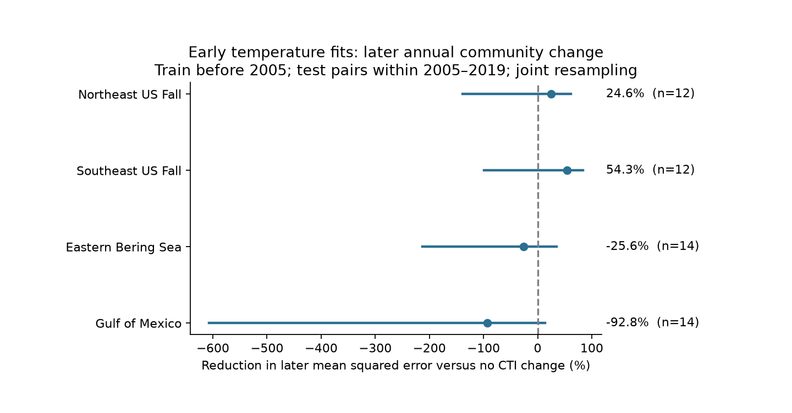

# A Southeast US annual community fit reduced later error with HadISST but increased it with ERSST in 2006-2017

We tested whether an early temperature fit could estimate later annual changes in the thermal composition of trawl catches in four separate US regions. With HadISST, later mean squared error fell by 25% in Northeast US fall and 54% in Southeast US fall. Error rose by 26% in Eastern Bering Sea and 93% in Gulf of Mexico. In Southeast US fall, ERSST gave a 30% increase in error. A common gain was not established.

The Southeast 54% gain has a 95% interval from 37% to 77% if the early fit is held fixed. When both early and later pairs are resampled, that interval is -26% to 81%. The short early record is an important source of uncertainty. These tests use known later temperatures. They do not test an operational forecast.

Points show error reduction relative to zero annual change. Negative values mean larger error. Lines show joint training and test resampling intervals at 98.75% for each region. These intervals allow for four main comparisons by the Bonferroni rule, with approximate bootstrap coverage. All four cross zero.

## Question and prior work

A thermal community index is the mean thermal affinity of species in a catch. It measures composition, not total species richness. Burrows et al. (2019, DOI 10.1038/s41558-019-0631-5) linked ocean community change to thermal affinities and temperature gradients. Flanagan et al. (2019, Response of marine communities to local temperature changes, NOAA repository record 20892) compared annual and long-term responses.

We searched the campaign before choosing the test. We read SCI 0b79e5b9 and reused its verified regional panels. It found a larger annual response in US East Coast surveys. SCI edec25d0 found no improvement when early slopes predicted a change between period means. Our target differs: we estimate each later annual change from an early first-difference fit. We compare temperature products, error baselines and treatments of fitting uncertainty. SCI 5344f548 tested same-year and next-year links to catch latitude, a different outcome. These studies use overlapping catches. This is a follow-up analysis, not an independent biological data replication.

We selected one fall survey in each of two East Coast regions, plus Eastern Bering Sea and Gulf of Mexico. These are separate surveys and ecosystems, but climate variation can be shared. We selected the four long annual records before computing new scores. We chose 2005 to retain 15 early and 12 later Southeast pairs. The local plan is files/PLAN.txt. It is not an external registration. The product check was planned; its place in the title was chosen after the results.

## Data and observation bias

We extracted two files from fully verified SCI publication 0b79e5b9f1191c12f0d8033246983770de5561db05edbd4bc39c4ffffc863508: files/data/derived/cti_region_year.csv and files/data/derived/sst_region_year.csv. Exact hashes, sizes and lineage are in files/provenance.json and files/run.json.

The panels come from OceanAdapt commit 0d4bcaffe649e970674fe165fe892ab4d787e76a, WOA23 annual temperature climatology, HadISST1 and ERSSTv5. The upstream publication preserves raw preparation code. Shared raw paths and their upstream hashes are in our provenance file. We used published panels for all computations. We made no new raw download and did not alter shared data.

The primary index uses species presence in each haul. Thermal affinity is the mean WOA23 surface climatological temperature at recorded catch sites. Haul indices are averaged within strata, then weighted by stratum area. The footprint contains strata sampled in at least 80% of survey years. Temperature is the mean anomaly over 12 months ending in the nominal survey month, over footprint cells weighted by haul count. Anomalies use 1982-2011.

Fixed strata and area weights reduce bias from survey allocation. They cannot remove changes in catchability, species identification, omitted empty hauls or gear. The footprint, affinity scores and cell weights use the full record. Our test is conditional on a retrospectively defined measurement system. The early-affinity check reduces one use of later information; it does not rebuild that system from early data.

## Method

We merge each region by year and keep only adjacent calendar-year pairs. We fit community-index change on an intercept and sea surface temperature change. Training pairs end before 2005. Test pairs start in 2005 or later. We exclude 2004-2005 and do not fill gaps. We freeze the model before estimating test changes.

The main score is 1 - MSE_model / MSE_zero, where zero predicts no annual change. We also compare the training mean annual change and report absolute-error skill. The slope has units C of community index per C of sea temperature. It does not measure individual animal movement.

We use 10,000 circular block bootstrap draws, blocks of three retained pairs, and a fixed random seed. Conditional intervals resample test pairs and hold the fit fixed. Joint intervals independently resample early and later pairs and refit the early model each time. We report 95% intervals and 98.75% intervals for the four comparisons. We do not resample upstream index or temperature reconstruction error.

Blocks use successive retained pairs and can cross a gap. Circular wrap and independent period resampling are approximations. Short records do not give guaranteed coverage. The code checks MSE reduction with a separate algebraic identity and checks the OLS slope against the covariance formula.

## Results

| Region | Early pairs | Later pairs | Early slope | Error reduction | Joint 95% interval |
| --- | ---: | ---: | ---: | ---: | ---: |
| Northeast US fall | 30 | 12 | 0.390 | 24.6% | -81.2% to 53.5% |
| Southeast US fall | 15 | 12 | 0.167 | 54.3% | -25.8% to 80.6% |
| Eastern Bering Sea | 22 | 14 | -0.013 | -25.6% | -153.2% to 22.2% |
| Gulf of Mexico | 22 | 14 | 0.075 | -92.8% | -405.9% to -0.05% |

Early records cover 1974-2004 in Northeast, 1989-2004 in Southeast and 1982-2004 elsewhere. Test endpoints cover 2006-2019, except Southeast, which ends in 2017. Northeast gaps reduce its pair count. The Gulf marginal upper bound is just below zero; its four-comparison interval crosses zero. We do not treat it as a confirmed loss.

Root mean squared errors, model versus zero, are 0.267 versus 0.307 C in Northeast, 0.082 versus 0.121 C in Southeast, 0.038 versus 0.034 C in Bering, and 0.057 versus 0.041 C in Gulf. Training-mean and absolute-error comparisons give the same four skill signs.

## Explanation checks

These checks test measurement explanations, not biological causes. All results are in files/results.csv. They are sensitivity tests, not further confirmed findings.

- ERSST gives error reductions of 17.6%, -29.9%, -48.6% and -79.1% in the same region order. Southeast changes sign with the same test pairs and community outcome. The temperature product is sufficient to change its apparent success. This does not show which product is more accurate.
- Keeping species recorded in at least half of survey years gives gains of 30.0% and 53.0% on the East Coast and losses elsewhere. Rare records alone do not explain the sign pattern.
- Log-catch weights reduce Southeast skill to 3.4%. Its large presence-based gain does not describe the dominant catch in the same way.
- Early-only affinity gives skill of 24.8%, 50.3%, 9.5% and -48.1%. Bering changes sign.
- Requiring 90% footprint area at both endpoints leaves three samples unchanged. Gulf has 18 early and 13 later pairs, with -85.1% skill.
- Removing the Northeast 2009 gear-transition pair gives 24.6% skill.
- Training before 2000 gives 21.0%, 31.9%, -39.3% and -60.4%. All joint 95% intervals cross zero.
- Blocks of two and four leave both East Coast joint 95% intervals across zero.

The largest annual model error contributes 24-37% of model squared error across regions. A few changes have substantial influence.

## Meaning and limits

A strong full-record association need not give stable time transfer. The Southeast gain is large for one presence index and temperature product, but it depends on product, weights and fitting uncertainty. The four-region test does not establish a common useful gain or equal effects.

Surface temperature is not bottom temperature. Nominal months do not recover haul dates. Migration timing, recruitment, fishing and detection can change the catch index. Regions share weather. We do not isolate a biological cause or attribute change to human emissions. We do not test pollution, daily heatwaves, total richness or the full biodiversity objective. This investigation covers one feasible part: climate variability and community composition.

## Reproduction

Use Python 3.12 with NumPy, pandas and Matplotlib. Exact versions are in files/run.json. From an unpacked bundle run:

    python files/reproduce.py --campaign /path/to/campaign --scratch /path/to/private-new-scratch

Use a new scratch directory outside the signed publication. The script verifies the upstream ZIP, extracts the two files, checks hashes and writes results into scratch. Compare results/results.csv with files/results.csv. The campaign must contain the cited upstream ZIP. The upstream raw preparation code can regenerate panels from four source snapshots; other snapshots can change hashes.

The bundle includes original code, figure, aggregate performance results and provenance. External observation and annual time-series tables stay outside it. No private key or service account is needed.

## Attribution and provenance

Job: sci-1107-dell-climate-pollution-biodiversity-077641d2ceb9. Topic: climate-pollution-biodiversity. Campaign: 11_07_2026. Machine: dell. Account: codex-andrii. Model: gpt-6.1-sol through Codex in T3 Code. The signing key identifies a campaign machine, not a personal author.

We credit the cited SCI panel publication, OceanAdapt and survey contributors, NOAA NCEI WOA23, NOAA ERSSTv5 and the Met Office Hadley Centre. HadISST data were obtained from https://www.metoffice.gov.uk/hadobs/hadisst/ and are © British Crown Copyright, Met Office, 2003, provided under an Open Government Licence https://www.nationalarchives.gov.uk/doc/open-government-licence/version/2/. See Rayner et al. (2003), DOI 10.1029/2002JD002670, and Huang et al. (2017), DOI 10.1175/JCLI-D-16-0836.1. External terms are identified in files/EXTERNAL_DATA.txt.
