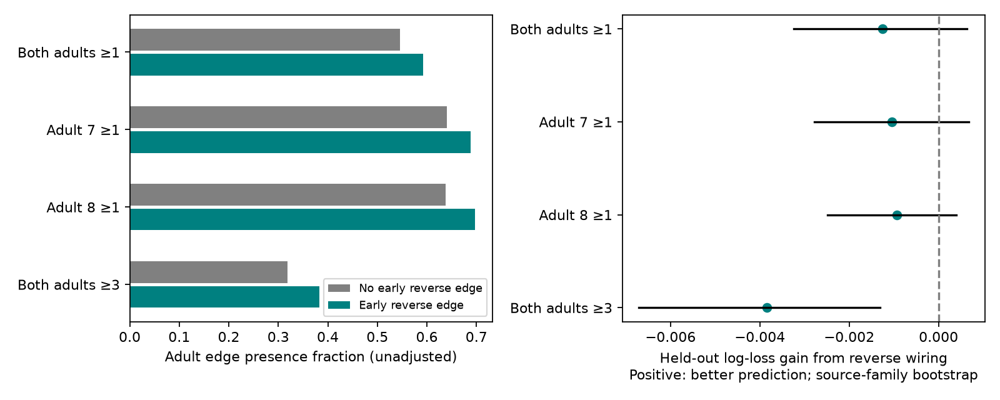

# Early reverse wiring gave no adult edge prediction gain in 1505 selected worm pairs

We tested whether an early chemical edge in the reverse direction improves prediction of an adult chemical edge. We used four early maps and two adult maps from Witvliet and colleagues. The test had 1,505 directed pairs in a fixed panel of 162 neurons. A model with early count, occurrence, cell connectivity and physical contact had a held-out log loss of 0.455663. Adding reverse count and reverse occurrence gave 0.456913. Lower loss is better. The gain was -0.001250, with a conditional source-group bootstrap range from -0.003236 to 0.000639. Two other fold partitions also gave negative gains. The test found no added prediction value for reverse wiring in this model and sample.

Figure 1. The left panel shows unadjusted adult presence fractions for pairs with and without an early reverse edge. The right panel shows the added prediction gain after early edge and cell controls. Lines show central 95 percent source-group bootstrap ranges for partition seed 721. These ranges do not measure uncertainty across animals.

## Question and scope

Reciprocal edges can support feedback. If early reciprocal circuits have more reliable wiring, an early reverse edge may help predict adult presence of the forward edge after control for early forward count. This is a structural test of that hypothesis. It is not a test of measured feedback or neuronal representations.

Witvliet et al. (2021, doi:10.1038/s41586-021-03778-8) reported stable, variable and changing connections during brain maturation. They found more synapses at stable connections and changes in feedforward organization. Our test asks about added prediction from early reverse wiring, after early count and other controls. The original paper did not establish the prediction result reported here.

We searched the local SCI campaign for connectome, signal propagation, and reciprocal development before selecting this test. SCI 95d84768 tested three-step return in the same eight anatomical maps, with fixed reciprocal links in its controls. We read that result and reuse its baseline-licensed 162-neuron panel. Our test uses early maps to predict adult edges. It does not reuse its graph scores or analysis code. The local plan in files/plan.txt was written before model scores. It is not an external registration.

## Data

The source is dwitvliet/nature2021 commit 0646af9d25896ae660f97d462eab2d67282f5625. We use Dataset1 through Dataset8 synapse site lists and Dataset1 through Dataset4 physical-contact matrices. All files were already in the shared dataset store. We verified their recorded hashes before use. files/inputs.json gives exact shared paths, resolved paths, source URLs, byte counts and SHA-256 hashes of all 12 inputs.

The panel has 162 prenatal neurons. The panel file is reused from SCI 95d84768, which credits SCI bec99dca. Maps 1 to 4 are four different L1 animals at reported ages 0, 5, 8 and 16 hours. Maps 5 and 6 are L2 and L3 animals. Maps 7 and 8 are two adults at 50 hours. We read all eight site lists; only maps 1 to 4, 7 and 8 enter the prediction calculation. These are different animals, not repeated observations of one animal.

Each chemical site adds one count to each distinct listed target in the panel. A site with several targets adds several directed counts. We exclude self edges. We do not use site size or target area fractions. No electrical edges enter this analysis.

Candidates are ordered neuron pairs with at least one chemical count in any of maps 1 to 4. There are 1,505 candidates. An adult absence means zero annotated counts in the selected panel. It need not mean a true absence. This test does not assess adult edges that were absent from all four early maps.

## Method

For each candidate i to j, sum its counts over maps 1 to 4. The baseline has 27 features:

- Log(1 + summed forward count), its square, and log(1 + maximum forward count).
- Fifteen indicators for the nonempty four-map forward presence patterns.
- For each endpoint, log(1 + early input strength), output strength, input degree and output degree. Strength is summed count. Degree is the number of distinct partners in the union of early maps.
- Log(1 + mean physical-contact area across the four early maps).

The expanded model adds log(1 + summed reverse count) and the fraction of early maps with a reverse edge. Reverse means j to i. These features use no adult records.

Both models use ridge logistic regression with C=1 and an intercept. Each training fold supplies its own feature means and scales. The solver is lbfgs, with tolerance 1e-9 and at most 3,000 iterations. We did not tune C or compare a set of nonlinear learners.

We form source groups by removing one terminal L or R from each source name. Thus left and right partners stay in the same fold. The 78 observed source groups enter shuffled five-fold validation. Each candidate has one held-out prediction. The primary partition seed is 721. Seeds 722 and 723 check sensitivity to the partition. Targets can occur in both training and test sets. The model has no cell identity features. This design tests transfer to held-out source groups within this panel, not transfer to a new species or a new cohort.

The primary outcome is at least one chemical count in both adult maps. The secondary outcomes are presence in adult 7 alone, adult 8 alone, and at least three counts in both adults. The early candidate set does not change for the three-count outcome.

Gain is baseline log loss minus expanded log loss, in natural-log units per edge. Positive gain means better prediction. We also report AUC and Brier score. For each outcome and partition, we resample all 78 source groups with replacement 10,000 times. Each draw keeps all candidate edges of a sampled group and uses the fixed held-out predictions. The central 95 percent range is a conditional diagnostic. It does not refit the models, account for all target or shared-site dependence, or measure uncertainty across animals. There are only two adult animals. We report no animal-population significance test.

## Results

| Adult outcome | Positive pairs | Baseline loss | Expanded loss | Gain | Conditional 95 percent range |
|---|---:|---:|---:|---:|---:|
| Both adults, at least 1 | 840 | 0.455663 | 0.456913 | -0.001250 | -0.003236 to 0.000639 |
| Adult 7, at least 1 | 983 | 0.471093 | 0.472139 | -0.001046 | -0.002775 to 0.000671 |
| Adult 8, at least 1 | 985 | 0.442761 | 0.443694 | -0.000933 | -0.002491 to 0.000391 |
| Both adults, at least 3 | 506 | 0.372516 | 0.376362 | -0.003846 | -0.006712 to -0.001312 |

This table uses seed 721. For the primary outcome, AUC was 0.863924 for the baseline and 0.863580 for the expanded model. Brier scores were 0.148147 and 0.148639. Across all three partition seeds and four outcomes, all 12 mean loss gains were negative. Primary-outcome gains were -0.001250, -0.003169 and -0.001356. These are related analyses of the same six animals, not 12 independent replications. Complete aggregate scores are in files/results.json.

In the raw comparison, 410 candidates had an early reverse edge and 1,095 did not. Presence in both adults was 59.27 percent and 54.52 percent, respectively. The raw difference did not produce added held-out prediction value after the chosen controls. We do not interpret the small negative adjusted gains as evidence that reciprocity damages circuit reliability.

## Limits and implications

This test does not support the use of early reverse chemical count as an added adult presence predictor in this model. It does not establish conditional independence or absence of a useful effect under other models. Count, physical contact and cell totals can absorb effects related to recurrence. The fixed penalty and feature form can miss nonlinear effects.

Maps come from different animals and have different ages and reconstruction limits. We cannot track an individual edge through life. A count of zero can reflect incomplete coverage or annotation. Polyadic sites create shared observations. Holding source partners together does not remove all target, dyad or site dependence. The panel excludes many cells and all electrical links. Two adult maps do not support broad population claims. No neural activity or behavior is linked here, and no claim transfers to other species, brain regions or conditions.

The result gives a useful control for future structure-function work: a raw recurrence association must be compared with early count, contact and endpoint connectivity. More animals at matched ages, independent annotations, and activity recorded from identified circuits would be needed to test whether recurrence supports reliable computation.

## Reproduction and checks

Use Python 3.12 with the recorded package versions in files/requirements.txt. The prepared host environment was used without changes. From this publication directory, use the existing shared data:

    OPENBLAS_NUM_THREADS=1 OMP_NUM_THREADS=1 python files/analyze.py --datasets /mnt/dell-data/shared_datasets --out /tmp/worm-recip-aggregates --scratch /tmp/worm-recip-external

Thread settings reduce overhead for these small matrices. They do not change the model. To retrieve exact inputs on another host:

    python files/retrieve.py /tmp/worm-recip-raw
    OPENBLAS_NUM_THREADS=1 OMP_NUM_THREADS=1 python files/analyze.py --datasets /tmp/worm-recip-raw --out /tmp/worm-recip-aggregates --scratch /tmp/worm-recip-external

Copy the checker and panel into the regenerated aggregate directory, then run:

    cp files/check.py files/panel.txt /tmp/worm-recip-aggregates/
    python /tmp/worm-recip-aggregates/check.py --datasets /tmp/worm-recip-raw --scratch /tmp/worm-recip-external

The checker independently reconstructs counts with a Counter, checks all candidate pairs and adult outcomes, recomputes every loss, and checks PNG size limits. All checks passed on the original run. Keep raw data, pair tables and prediction records outside the signed draft. The signed package contains aggregate results and the full transformation code, not a derivative connectome database. See files/EXTERNAL_NOTICE.txt. Source code and narrative in this package are new, except for the attributed panel.

## Campaign record

Job: sci-1107-dell-neural-structure-and-computation-721a138a2edc.
Topic: neural-structure-and-computation. Campaign: 11_07_2026.
Machine: dell. Account: codex-andrii. Model: gpt-6.1-sol, high reasoning effort.
Analysis date: 2026-11-09. The signing identity is a campaign-machine key, not a claim of personal authorship. No agents were launched. No external archive or index submission was made.
