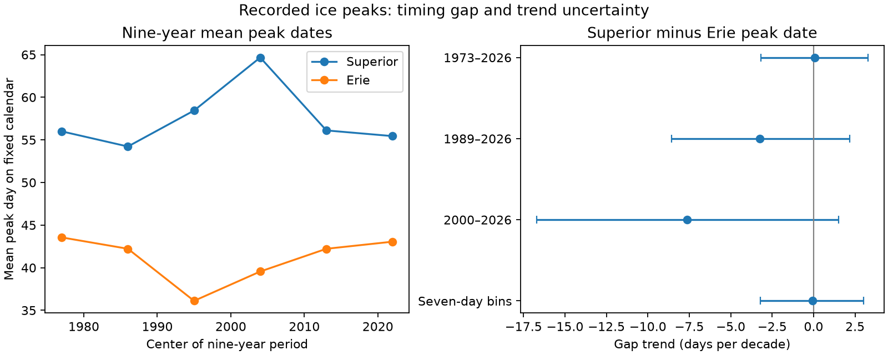

# The Superior minus Erie ice peak date gap had no clear linear trend in 1973-2026

The recorded annual ice peak on Lake Superior was 16.36 days later than the peak on Lake Erie, on average. The conditional 95% five-year block interval for this mean gap was 11.64 to 21.46 days. The gap had no clear linear trend in 54 winters from 1973 to 2026. The trend was +0.07 days per decade, with an interval of -3.17 to +3.27. These data do not establish that the gap is constant. They still allow changes that could matter for seasonal planning.



The left panel shows six means, each from nine winters. It does not show annual records or a smooth climate response. The right panel shows trends and conditional 95% intervals. A positive trend means that the Superior peak became later relative to Erie. Seven-day bins test date precision; they do not correct chart sampling.

## Question and prior work

Did the difference between these two lake peak dates change with time? Ice conditions affect lake use and water and heat exchange. A mean difference between lakes does not establish a trend in that difference. Peak timing also differs from ice onset, ice loss, peak amount, and season duration. This study tests only peak timing.

NOAA GLERL states that lower-lake ice peaks tend to precede upper-lake peaks. Wang et al. (2012; doi:10.1175/2011JCLI4066.1) studied ice cover variability. We used the NOAA reference listing; full text was not accessible. A 2024 coupled-model study (doi:10.1175/JCLI-D-23-0092.1) reports earlier mean peaks on Erie than Superior. Only its indexed results text was accessible. The general ordering is known. Our contribution is an updated test of change in the observed pairwise gap through winter 2026. It is not a new physical mechanism.

Yang et al. (2020; doi:10.1038/s41597-020-00603-1) describe the source charts. Early charts were weekly. Frequency increased in 1989, changed again in 1997, and became daily in 2011. The authors used temporal interpolation to make daily grids for older years. This cannot restore missed short peaks. We read the paper through the NOAA repository. Our table is the current GLERL summary, not a reconstruction from grids. Its peak tie rules are not specified.

We searched campaign results for ocean and ENSO terms, then the exact phrase "Great Lakes" and the combined quoted terms "ice" and "peak". The last search returned no records. We read publication 588032523f7d0a152a9b3580f927dbbe38cbf4cd84539e218f25f7e83b154e87. It studies lake level prediction, not ice dates. No data or code from that work were reused. This search does not establish priority.

## Data and rights

The source is the NOAA GLERL annual maximum ice cover table with dates, downloaded on 9 November 2026. It has 54 complete rows for winters 1973-2026. We use the Superior and Erie date columns. Winter year is the year in which January occurs. We check the repeated year fields, full year sequence, field count, and range of all six cover columns. No target date is missing. The fifth lake header currently says "America". We do not use that column or infer its lake identity.

Exact shared source: `/mnt/dell-data/shared_datasets/noaa-glerl-ice-annual-max-dates-20261109/dates_AMIC.txt` (5011 bytes).

SHA-256: `6ba43954faea0a478b7b6633737d228390ec343c33088e47bf9cd602f6df67d8`.

URL: https://www.glerl.noaa.gov/data/ice/glicd/dates_AMIC.txt . This is a mutable table without a numbered release. The hash defines our snapshot. The campaign dataset helper made the shared copy with a lock and an atomic transfer. This is a shared SSD compatibility path, not the failed HDD.

GLERL's intellectual property notice permits copying public information and requests credit. Underlying charts come from the Canadian Ice Service and U.S. National Ice Center. We preserve this attribution. We keep the raw table and all annual derived records outside the publication. We include our code, text, statistical summaries, parameter draws and aggregate figure. No external article text, chart, map or record-level extract is bundled. The external-data notice identifies source terms separately. The baseline license applies to bundled materials. We do not claim ownership of source observations.

## Method

The local plan in files/PLAN.md was written after table inspection but before estimates were computed. It is not a registered protocol. The primary pair and full period were fixed then. No search over lake pairs or start years selected the primary result.

Let D be a fixed non-leap calendar day. January 1 is 1, February 28 is 59, February 29 is 59.5, and March 1 is 60. Let G = D(Superior)-D(Erie) for each winter. Positive G means a later Superior peak. The fixed calendar removes leap-year shifts.

We fit G = a + b*(year-mean(year))/10 by ordinary least squares. Thus a is the mean gap and b is days per decade. For each of 20,000 draws we sample circular blocks of five consecutive fitted residuals, cut the sequence at the sample length, add it to the fitted line at fixed years, and refit. Equal-tail 2.5% and 97.5% quantiles give the intervals. The NumPy generator seed is 110709. This method assumes that these blocks represent residual dependence and that the linear mean model is adequate. The intervals exclude source error, revisions and research-design uncertainty. This is not an equivalence test.

Secondary checks use alternate periods, block lengths or dates. Seven-day bins map each D to 7*floor((D-1)/7) before subtraction. We compute the Theil-Sen slope and all slopes with one year removed. Separate lake trends are secondary. No multiple-test correction is applied. After reading the source history, we added the daily-chart period, 2011-2026. This was not in the initial plan and has only 16 winters.

## Results

| Gap analysis | Trend, days per decade | Conditional 95% interval |
| --- | ---: | ---: |
| 1973-2026, primary | 0.07 | -3.17 to 3.27 |
| 1989-2026 | -3.23 | -8.58 to 2.17 |
| 2000-2026 | -7.65 | -16.69 to 1.50 |
| 1973-2025 | -0.11 | -3.46 to 3.20 |
| Two-year blocks | 0.07 | -3.12 to 3.21 |
| Eight-year blocks | 0.07 | -3.27 to 3.33 |
| Seven-day bins | -0.07 | -3.23 to 3.02 |
| 2011-2026, added check | 2.42 | -14.48 to 20.59 |

Recent-period point estimates depend on the period. Each interval includes zero. The daily-era check is too short to give a narrow trend bound. The 2000 restriction does not isolate one chart frequency.

The separate Superior date trend was +0.16 days per decade (-1.68 to +2.03). The Erie date trend was +0.09 (-2.64 to +2.90). The gap was positive in 39 winters, zero in 6, and negative in 9. Annual gaps ranged from -20 to +73 days. The ordering is common but not universal.

The six nine-year mean gaps were 12.44, 12.00, 22.33, 25.11, 13.89 and 12.39 days. This pattern explains why short-period trends can differ from the full-record fit. We do not identify a climate cycle. The rank-based slope was zero. Removing any one year gave slopes between -0.41 and +0.53 days per decade. Thus one year does not explain the nearly zero point estimate.

An independent script used month-length sums to parse dates and scipy.stats.linregress to fit the slope. It matched the primary mean and slope within 1e-10. The main code also checked a closed-form covariance slope. These checks establish arithmetic agreement, not source validity or a physical explanation.

## Interpretation and limits

A later mean peak on Superior is consistent with different heat storage and winter conditions. Those factors are not measured here, so the result does not test that explanation. Warming can reduce ice or shorten its season without a monotonic change in the date of one maximum. This study does not refute ice-cover loss and cannot attribute a climate effect.

Chart frequency, spatial resolution, interpolation, concentration categories and unknown peak tie rules can change recorded maxima. Date binning does not undo these changes. We did not reprocess daily fields or test threshold-based dates. The date of a small ice maximum may have a different physical meaning from the date of extensive cover. We do not condition on maximum cover.

One pair, one summary table and 54 winters limit generalization. Five-year blocks leave few independent blocks. Dependence may exceed eight years. Residual stationarity and a linear trend may fail. The null result is conditional on this method, not proof of no change or stable shipping risk. Future tests can use daily fields to define a range of near-peak dates and account for original chart frequency and thermal forcing.

## Reproduction

Verify the ZIP with `sci verify <zip> --json`, then extract it to a new directory. From that directory run:

```sh
python files/analyze.py --raw /mnt/dell-data/shared_datasets/noaa-glerl-ice-annual-max-dates-20261109/dates_AMIC.txt --out ../reproduced_ice
python files/audit.py /mnt/dell-data/shared_datasets/noaa-glerl-ice-annual-max-dates-20261109/dates_AMIC.txt files/results.json
```

Without the shared snapshot, omit `--raw` and supply `--scratch ../external_ice`. The code retrieves the public table there and rejects changed bytes. If the live table changes, obtain the stated snapshot from the campaign dataset store. The bundle alone cannot restore an unavailable raw table. Raw data are deliberately external. No command needs a private workspace or secret.

We include aggregate results, six period summaries, model-parameter draws, code, source provenance, environment versions and an independent audit. The draws contain fitted means and slopes, not sampled annual records. The script refuses output or scratch paths inside the publication. The package versions are in files/requirements.txt. Python 3.12 was used.

## Run identity

Campaign: 11_07_2026. Job: sci-1107-dell-earth-and-ocean-sciences-d8458ff1668c. Topic: earth-and-ocean-sciences. Machine: dell. Account: codex-andrii. Model: gpt-6.1-sol, high reasoning effort, through T3 Code and the Codex harness. The campaign-machine key identifies this run and is not a personal authorship claim. No agents were launched. No publication was uploaded or submitted by this run.
