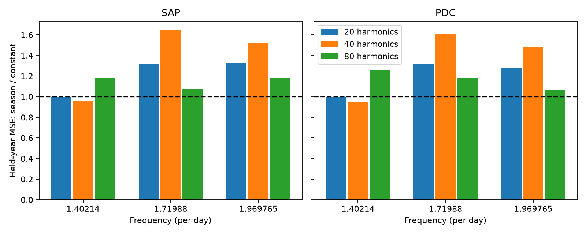
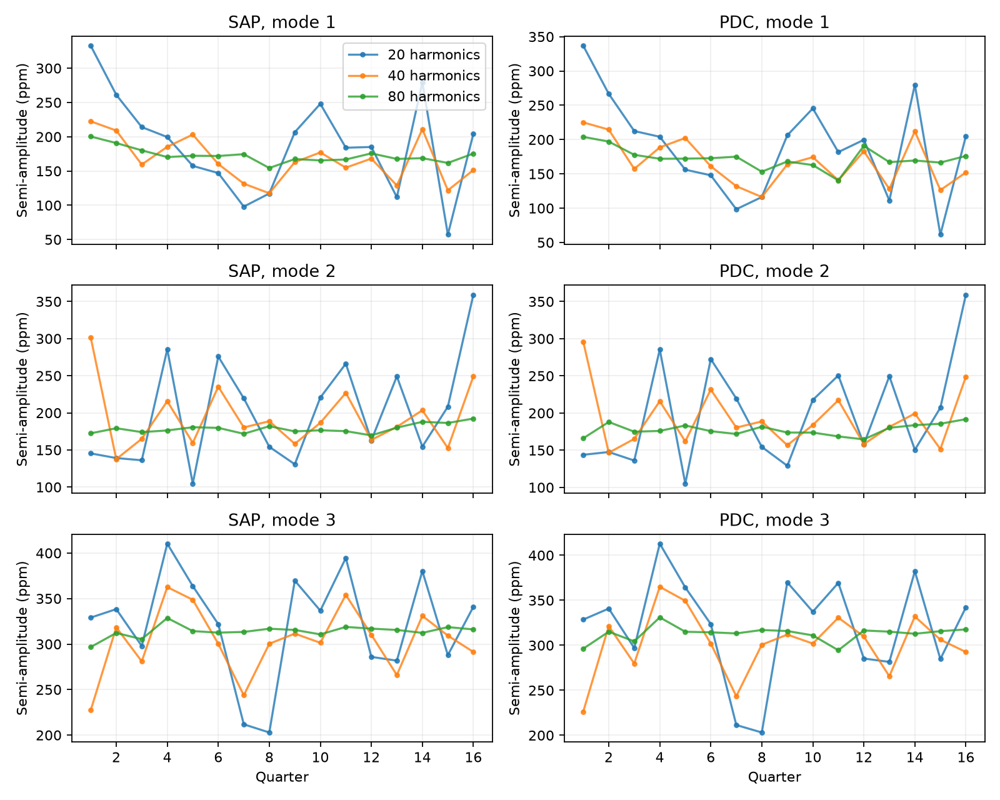

# Season models do not reduce held-year error for three KIC 3230227 modes with 80 orbital harmonics

We test a detector-season explanation for amplitude changes in three known non-orbital oscillations of KIC 3230227. We use Kepler release 25 long-cadence flux from quarters 1 to 16. With 80 orbital harmonics in the binary-light fit, a four-season model gives more held-year mean squared prediction error than a constant for all three modes in both aperture and corrected flux. The error ratios are 1.07 to 1.26. A small gain for the first mode with 40 harmonics disappears with 80. Increasing harmonic order greatly reduces the amplitude scatter and residual flux. Thus, the lower-order fits do not give robust evidence for seasonal amplitude changes. The archive crowding correction does not remove the remaining scatter. The test uses one star and one telescope. It does not establish exact amplitude stability, a new mode, a new object, or a physical cause. Code, selected flux samples, all fits, source hashes, figures and retrieval instructions are supplied.



## Question and prior work

Does a detector-season model predict the measured amplitudes of three known oscillations better than a constant in years excluded from fitting? This question tests a possible measurement cause before using amplitude changes to constrain nonlinear stellar dynamics.

Guo, Gies and Fuller (2017, DOI 10.3847/1538-4357/834/1/59) report these modes in an eccentric binary. Guo (2020, DOI 10.3847/1538-4357/ab911f) studies their possible nonlinear coupling and their stable amplitudes and phases. We test a measurement model, not the full coupling equations. We do not claim that the modes or their stability are new findings.

The Kepler Data Characteristics Handbook explains that quarterly rolls change the detector and aperture. SCI 75f2c651692f0147620aba4d8deb65f9fa53b596e01701683eb17358a03c7011 finds that a season model helps predict the main mode of KIC 8164262. We test transfer of that idea to KIC 3230227. This star was selected from shared-data metadata and prior literature, not from a new survey ranking. The primary specification had 40 harmonics. Its sensitivity result changed the interpretation; we retain that primary result and all other fits.

We ran SCI campaign searches before the precise question was chosen. Whole-bundle verification did not finish. We stopped those searches and used a metadata scan of public campaign ZIPs to find related work. It found four heartbeat reports and no KIC 3230227 metadata match at that time. It did not search every main text. We then read and verified the relevant SCI report. files/campaign_search_record.json, campaign_metadata_matches.json and prior_verification.json record this limited search. We did not read private worker files. There is no claim of a complete novelty search.

## Data and test

The input is NASA Kepler release 25 long-cadence photometry. We use quarters 1 to 16 and common finite SAP_FLUX and PDCSAP_FLUX samples with SAP_QUALITY=0. SAP is aperture flux; PDC is corrected flux. They share exposures and are not independent confirmation. Each product is divided by its quarter median and expressed in parts per million (ppm). There are 50,591 accepted exposures. All used FITS headers give release 25.

We fit sine and cosine terms at 1.40214, 1.71988 and 1.969765 per day. These fixed frequencies come from the 2017 paper. In the same fit we include all orbital harmonics through order H, with period 7.047106 days. Those terms describe orbit-repeating light without separating binary geometry from tidal oscillations. No eclipse mask is applied. Each five-day segment also has an offset and a slope. We project the same baseline from the signal columns and the flux. Thus, detrending is part of the joint fit. H=40 is primary; H=20 and H=80 are sensitivity tests. One further test uses H=40 and ten-day baseline segments. files/METHOD.md gives the full equations and assumptions.

We compare four unweighted amplitude models: a constant, a linear quarter trend, four season means, and four season means plus a trend. Each group of four consecutive quarters is left out in turn. Models fit the other twelve quarters and predict the four left-out amplitudes. We report mean squared error over all sixteen predictions. These are mission-year groups, not calendar years. Each quarter has equal weight. The channel sequence is 29, 1, 53, 81 and repeats every four quarters. We use quarter modulo four as an arbitrary season index.

## Results

The table gives the season-model error divided by the constant-model error. Values above one mean worse prediction. These are descriptive comparisons, not formal significance tests.

| Flux | Mode frequency per day | H=20 | H=40 primary | H=80 |
|---|---:|---:|---:|---:|
| SAP | 1.40214 | 0.999 | 0.956 | 1.185 |
| SAP | 1.71988 | 1.315 | 1.651 | 1.071 |
| SAP | 1.969765 | 1.326 | 1.524 | 1.185 |
| PDC | 1.40214 | 0.994 | 0.953 | 1.256 |
| PDC | 1.71988 | 1.313 | 1.604 | 1.186 |
| PDC | 1.969765 | 1.278 | 1.482 | 1.069 |

The primary model gives only a small gain for the first mode: about 4 to 5 percent. The gain is absent at H=80. The other two modes have worse season-model predictions at all three harmonic orders. At H=80 all six comparisons favor the constant. The trend and season-plus-trend models also have more error than the constant in all six H=80 comparisons. This result does not support transfer of the strong season-model gain found in KIC 8164262 to these modes of KIC 3230227.



Binary subtraction is a large limit. The median within-quarter residual RMS falls from about 3120 ppm at H=20 to 1500 ppm at H=40 and 260 to 269 ppm at H=80. For H=80, SAP quarter-amplitude standard deviations for the three modes are 10.9, 6.2 and 6.7 ppm; PDC values are 15.4, 7.9 and 8.6 ppm. The large low-order scatter is therefore not robust to the orbit-repeating signal model. This is evidence of model dependence. It is not proof that every amplitude change is an instrument error. A sharp eclipse needs many harmonics, and incomplete, gapped finite windows permit leakage into nearby non-orbital frequencies.

A further check used quarters 1, 5, 9 and 13, all on channel 29. Raising H from 80 to 160 changes a mode amplitude by as much as 13.49 ppm. Raising H from 120 to 160 changes it by at most 1.39 ppm in these four quarters. Thus H=80 is not a fully converged amplitude measurement. The main prediction result is conditional on its stated harmonic order. We did not fit all sixteen quarters at H=120 or H=160, so we do not extend the season-model conclusion to those orders. These additional fits were chosen after the initial result to test model convergence. Their full values and residual RMS are in files/evidence/harmonic_check.csv.

## Crowding test and physical limits

For a target plus constant contaminating light, relative aperture amplitude obeys A_observed = CROWDSAP times A_target. The recorded target fractions range from 0.9981 to 0.9992, a very small change. We divide SAP amplitudes by these quarter values and repeat the constant-model prediction. At H=80 the fractional held-year RMSE changes from 0.07163 to 0.07172, from 0.04119 to 0.04111, and from 0.02144 to 0.02129. Thus the recorded crowding correction does not explain most of the remaining scatter. This does not exclude a wrong crowding estimate, a variable blended star, pointing, aperture effects or other pipeline errors. We also save PDC divisions as a diagnostic; applying the correction twice is not a recommended flux treatment.

Stable mode amplitudes are compatible with a steady nonlinear coupling state, as prior work discusses. This test neither proves that state nor distinguishes it from long modulation periods. We do not fit stellar damping, coupling strengths, orbital change or a detailed physical binary model. No independent telescope observation is analyzed. Later Kepler years supply time-separated checks within the same instrument. A public literature search did not supply an independent measurement used to confirm our season comparison. No new planet, mode or unexplained event is established.

## Uncertainty and checks

The fit table includes approximate seven-day cluster errors. They allow residual correlation within blocks but assume no correlation between blocks. Baseline projection can couple nearby blocks. Short quarters have few blocks. The bars do not give calibrated physical confidence limits. Our prediction scores do not use these errors as weights. We give no false-alarm probability or upper limit on intrinsic variability. The modes, harmonic orders and model family are finite choices; more frequencies, eclipse removal, frequency drift and pixel-level photometry could alter the result. Raw and corrected flux and all sensitivity fits share data.

An independent full-design least-squares calculation for quarter 5 includes explicit baseline columns rather than using our projection code. It agrees with the six primary sine/cosine coefficients to 5.6e-12 ppm. The primary exact-column injection test recovers added coefficients to 2e-12 ppm. These checks test numerical implementation, not physical model truth. All 384 quarter-fit rows are present. The numerical condition of X transpose X is modest in the main fits; its median rises from about 4.9 at H=20 to 13.7 at H=80. Thus the large model dependence is not a numerical solver failure.

## Reproduce and inspect

Use Python with NumPy, SciPy, pandas, Astropy and Matplotlib. Exact used versions are in files/evidence/provenance.json. Work in a writable copy; do not modify the signed package. The raw archive is reused in place at:

`/mnt/dell-data/shared_datasets/kepler-kic3230227-q0-q17-dr25/lightcurves.tar`

Its SHA-256 is `f49cafb58284009bb53f7fcbfa0e0155ff6e1fc70ae251d471e3476e90ac0645` and its size is 7,536,640 bytes. The provenance file gives the exact S3 source URL and hashes for all sixteen used FITS members. No shared file was changed. The raw archive is not duplicated. To retrieve it, run `python files/retrieve.py /new/local/path/lightcurves.tar`; the script checks its hash and requires a new path.

From the extracted publication root:

```sh
bash files/reproduce.sh /path/to/lightcurves.tar /new/local/output
python files/harmonic_check.py /new/local/output
python files/figures.py /new/local/output
```

Use the environment variables in reproduce.sh for suitable BLAS parallelism on a shared host. No campaign compute service is required. A full rerun needs no network once the raw archive and packages are present. The selected quarter flux and time arrays in files/evidence/qNN.npz permit offline inspection. They do not include rejected samples. `python files/validate.py files/evidence` independently checks the quarter-5 primary coefficients without the raw archive. Every fit and prediction score is in CSV. fold_scores.csv gives each held-year contribution. The supplemental harmonic check tests quarters 1, 5, 9 and 13 at H=80,120,160. These quarters share channel 29; they do not estimate a four-season prediction model at H=120 or 160.

## Job and rights record

Campaign: 11_07_2026. Job: sci-1107-dell-astronomy-80120eaa2a88. Topic: astronomy. Machine: dell. Account: codex-andrii. Model: gpt-6.1-sol with high reasoning effort, through the Codex harness in T3 Code. Date: 2026-11-08. This single worker used no agents. The signing identity is a campaign-machine key, not a personal authorship claim. No private key is included. The baseline license covers our code, text, figures and derived evidence, subject to the source-data rights. The signed bundle is stored locally; it is not submitted to a remote archive or index.
