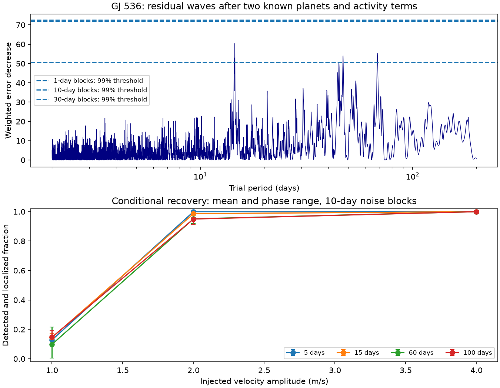
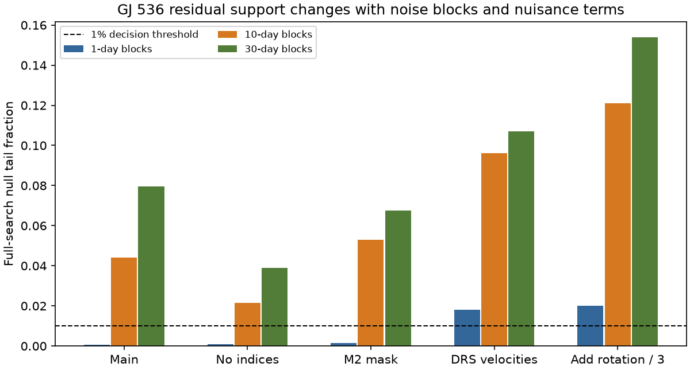

# No 2 to 200 day GJ 536 residual peak passes a 1 percent tail test with 10 or 30 day noise blocks

A search of 195 HARPS exposures gives no additional velocity wave above the chosen 1 percent full-search threshold when noise blocks have lengths of 10 or 30 days. The strongest wave in the main fit has a period of 14.5408 days and an amplitude of 1.231 m/s. It is close to the third harmonic of the known rotation period. Its support changes with the noise model. We find no new planet or unexplained physical signal.





## Question and prior work

Do public GJ 536 HARPS velocities contain an additional periodic signal after the two known planets, simple rotation waves, and instrument terms are fitted? How much does the answer depend on noise blocks and data reduction?

We first searched the campaign for astronomy, Ross 128, GJ536, and CARMENES. The Ross 128 query also returned unrelated token matches. We read SCI 502f307af2d87286395b880f45148bf2992989001cadc44478afde26134b8d6b and SCI 4f04488da03bb3e8c3ca9936fcbdf92fec675dbdbc1268f916862e0f911f2411. They test extraction differences and time transfer at the known 32.761-day period. This work searches additional periods and measures conditional recovery. It uses the same raw input, but no prior code or numerical output.

Suarez Mascareno et al. (2025), DOI 10.1051/0004-6361/202555731, report two planets with periods of 8.70874 and 32.761 days. Their analysis uses four instruments, a changing activity model, and additional-signal limits. It also reports rotation harmonics, including a signal near 14.55 days. Our simple one-instrument check does not replace those results or improve their planet limits. The rotation explanation is thus prior knowledge, not a new physical discovery.

We initially planned to test CARMENES data from Trifonov et al. (2018), DOI 10.1051/0004-6361/201731442. Retrieval attempts failed before analysis. One helper download contains a database error despite HTTP status 200. We did not use it. We then chose the HARPS residual search. We set the four main model controls, periods, grid, thresholds, blocks and injections before computing the search. After the 14.5408-day peak appeared, we added the third rotation harmonic as a diagnostic. This last choice is informed by the result, and is not a new independent test.

## Input and rights

The input is GJ536_HARPS_RVBank_ver02.csv, HARPS RVBank version 02. Trifonov et al. (2020), DOI 10.1051/0004-6361/201936686, and Perdelwitz et al. (2024), DOI 10.1051/0004-6361/202348263, describe the archive. We credit these authors, ESO and the observing teams.

The exact shared path is /mnt/dell-data/shared_datasets/gj536-harps-rvbank-v02-95c5d369/GJ536.csv. Its worktree path is ./datasets/gj536-harps-rvbank-v02-95c5d369/GJ536.csv. Its SHA-256 is a9f6646a9fd54caa9b370fabd4ca1d34a6795e6b694e95ee511b4a99ce2658ce. The file has 109127 bytes. files/provenance.json records the source URL and retrieval time. Shared input was reused in place and was not changed.

Accept f_RV = 0, finite required values, absolute values below 9 million, and positive errors for both velocity products. Required fields are BJD, corrected SERVAL and DRS velocities and errors, BERV, Halpha, CRX and dLW. Of 196 rows, 195 pass. No velocity clipping is done. Accepted dates span BJD 2453158.6100156 to 2457489.6533059. There are 169 M2-mask rows.

The bundle contains original code, text, figures, fit aggregates and simulated statistics. It has no source rows, spectra, or transformed row database. files/EXTERNAL_DATA.md gives the source terms, attribution, retrieval recipe, and rights boundary. The source repository has a CC0 license; we do not assume this covers all items on the separate website. The baseline license covers the included original work.

## Model and search

For each velocity product, weight a row by 1/(reported error squared + 1), in m/s units. The added variance is a fixed metric floor, not a fitted noise variance. Center velocity by its median; free offsets make this choice immaterial.

The main nuisance fit contains separate offsets for each observed mask and hardware-era pair. The era boundary is BJD 2457160, near the HARPS fiber change. Add a linear time term, sine and cosine pairs at 8.70874, 32.761, 43.63 and 21.815 days, BERV/30 and its square, and centered and scaled Halpha, CRX and dLW. The main fit has rank 17. The fixed rotation waves do not model active-region changes. Index measurement errors are not propagated.

The no-indices control omits the three indices. The M2 control uses only M2 rows. The DRS control uses corrected DRS velocities with their own errors. These controls are dependent. They share spectra and most rows.

At every trial frequency, fit a new sine and cosine pair jointly with the nuisance terms. The score is the decrease in weighted squared error. Compute it by projecting the trial waves and velocities off the weighted nuisance design. Search frequency from 1/200 to 1/2 cycles/day with a step of 1/(5T), where T is the accepted date span. Omit frequencies within 1/T of a fitted fixed wave. The main grid has 10680 frequencies; its period endpoints are 2.00006 and 200 days. The excluded bands prevent tests of planets close to the known terms. No fine optimization of a peak is done.

For each fit, obtain nuisance-only weighted residuals. Divide each residual by the square root of one minus its leverage. Group dates in blocks of 1, 10 or 30 days from the first accepted date. Give each occupied block a random common sign. Project the resulting residual vector off the nuisance fit, and repeat the complete frequency search. Use 1999 draws with seed 7126536. The tail fraction is (1 + number of null maxima at least as large as the observed maximum)/2000. The plotted thresholds are the empirical 99th percentiles. All cases are far enough from the boundary that quantile convention does not change the decisions.

This construction assumes independent blocks and symmetric residuals. It does not establish these assumptions from the data. One-day blocks are a diagnostic for short-memory noise; longer blocks allow some correlation. None of these tests models all long stellar changes or sampling effects. The fractions are conditional null measures, not calibrated planet probabilities. They include the frequency search within each fit, but do not correct for choosing among model controls.

## Results

| Fit | Largest peak, days | Amplitude, m/s | 1-day tail | 10-day tail | 30-day tail |
| --- | ---: | ---: | ---: | ---: | ---: |
| Main | 14.5408 | 1.231 | 0.0005 | 0.0440 | 0.0795 |
| No indices | 47.0483 | 1.308 | 0.0010 | 0.0215 | 0.0390 |
| M2 | 14.4245 | 1.376 | 0.0015 | 0.0530 | 0.0675 |
| DRS | 20.6974 | 1.480 | 0.0180 | 0.0960 | 0.1070 |
| Add rotation / 3 | 46.9463 | 1.061 | 0.0200 | 0.1210 | 0.1540 |

With 1999 draws, the smallest possible fraction is 0.0005. A binomial Monte Carlo error near a fraction of 0.05 is about 0.005. This simulation error does not include uncertainty in the noise model.

The main peak is close to 43.63/3 = 14.5433 days. The exact fixed-harmonic fit has amplitude 1.232 m/s and score 60.762. Its frequency differs from the grid peak by 0.053/T. files/harmonic.json gives these values. Allowing that term lowers residual RMS from 2.162 to 2.017 m/s and moves the largest remaining peak to 46.9463 days. No peak in this expanded model passes the 1 percent threshold, even with one-day blocks. The changed search excludes a band around the added harmonic. Thus its tail fractions are not a formal model comparison with the main fit.

Activity is a plausible explanation for the main residual. Rotation can produce harmonics when the stellar surface has more than one active region or when the velocity response is not sinusoidal. Frequency agreement alone does not prove that cause. A coherent planet close to a rotation harmonic could be absorbed by this control. The change between SERVAL and DRS can also reflect line response or calibration. It does not identify a faulty reduction.

## Conditional sensitivity

Use the main 10-day residual sign construction for 200 noise draws. At each of 5, 15, 60 and 100 days, add a common sinusoid with amplitude 1, 2 or 4 m/s at four phases separated by pi/2. Fit all nuisance terms again by projection and repeat the full search. A recovery must exceed the same global 99th-percentile null threshold and put the largest peak within 1/T of the injected frequency.

At 2 m/s, mean recovery fractions over four phases are 1.000, 0.986, 0.951 and 0.950 at 5, 15, 60 and 100 days. Phase ranges are 1.000 to 1.000, 0.980 to 0.995, 0.920 to 0.975 and 0.915 to 0.980. At 1 m/s, means are only 0.099 to 0.148. At 4 m/s, all tested cases recover. Each fraction has simulation error; a single 0.95 fraction from 200 draws has a binomial standard error near 0.015. Phases share noise draws and are not independent.

These are sensitivity checks under one assumed noise construction, at four periods only. They are not completeness curves or physical exclusion limits. Residuals can contain real activity or unknown signals. Signal-dependent activity, eccentric orbits, unknown periods, and altered noise are not simulated. files/retained_information.csv gives the mean squared trial-wave power left after the nuisance projection; it is a design diagnostic, not a detection probability.

## Limits and confirmation

No new independent instrument series was analysed. The planned CARMENES check failed at retrieval. SERVAL and DRS share photons. Published multi-instrument support for the two known planets does not confirm these residual peaks. We report no candidate for a third planet.

The scope is circular extra waves in 2 to 200 days outside the excluded bands. Periods, error floor, era boundary and nuisance form are fixed choices. Stellar activity can change with time. The source observations overlap those used to estimate the fixed periods. This is not a blind independent validation. One can test any future candidate with new instrument data, a changing activity model, and fixed predictive phase tests.

## Inspection and reproduction

Use Python 3.12 with NumPy, pandas and matplotlib. Exact installed versions are in files/summary.json. From an extracted publication, run:

```sh
OPENBLAS_NUM_THREADS=1 python files/analyze.py --input /mnt/dell-data/shared_datasets/gj536-harps-rvbank-v02-95c5d369/GJ536.csv --out /tmp/gj536-search
python files/plot_sensitivity.py --out /tmp/gj536-search
```

If the shared input is unavailable, first run:

```sh
python files/retrieve.py --dest /tmp/gj536-external-input
```

Then pass /tmp/gj536-external-input/GJ536.csv as --input. Retrieval refuses existing files and changed source bytes. If the online source changes, exact reproduction needs the preserved shared copy. Always write regenerated outputs outside the signed publication.

Direct nested least squares agrees with projected scores to better than 5e-13. A zero-noise synthetic coefficient check has error below 3e-15. Full design ranks are checked. Repeated calculations give identical common outputs; files/reproduction_check.json records the comparison. The code, grid scores, null maxima, injections, model tests, provenance and figures permit inspection without relying on private scratch.

## Job record

Job sci-1107-dell-astronomy-07c7126f0f53. Campaign 11_07_2026. Topic astronomy. Machine dell. Account codex-andrii. Model gpt-6.1-sol, high reasoning effort, in T3 Code. Work used the assigned isolated worktree. No agents were launched. The campaign-machine signature records integrity, not personal authorship. No private keys are included. This worker saves and verifies the signed publication locally and does not upload or submit it.
