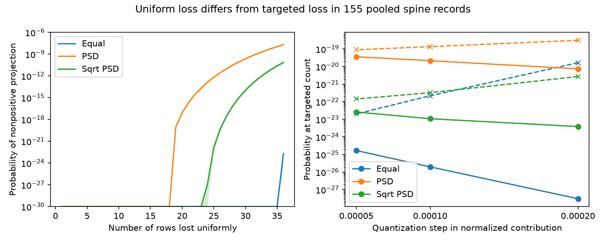

# PSD weights raised uniform-loss reversal risk in 155 pooled ferret spine records under a fixed projection model

For 36 uniformly chosen row losses, the probability of a nonpositive orientation projection was between 1.407e-8 and 2.066e-8 with postsynaptic density (PSD) area weights. With equal weights it was between 1.689e-25 and 2.039e-23. The starting projections were similar. Thus PSD weighting raised this model risk by at least 6.9e14. These are probability bounds for a fixed released table under an assumed loss process. They are not measured failure rates in a neuron.



## Question and prior evidence

Can a broad anatomical weight distribution change the probability of losing a positive orientation component even when the starting component changes little?

Scholl, Thomas, Ryan, Kamasawa, and Fitzpatrick linked visual calcium imaging and electron microscopy in ferret primary visual cortex (V1). Their study found that strong synapses did not dominate response selectivity (doi:10.1038/s41586-020-03044-3). The public table provides matched structure and function for 155 spines from five cells and three animals. We use the matched table rather than join unrelated animals. No Allen data are used.

We first searched the signed campaign for connectome, mitochondria, spine neck, and spine loss. The final search is saved in files/campaign_search.json. This search found a direct prior study of targeted loss, SCI fbc5f0b945ad95106c38ffa1467601937f4d2b7ce58380fbbe4f0d6bcceb808e. We read this study and the joint error study 38778decf16f81c8b763eea8ecba17d872ec0ed301242ee2b963e236a938a281. The targeted-loss study found minimum deletion counts of 36, 19, and 25 for equal, PSD, and square-root PSD weights. It saw no reversal in 20,000 uniform losses at each minimum count. That result leaves small probabilities unresolved. We add deterministic probability brackets that resolve these tails. We reuse the projection definition, but no prior code or numerical tables. The joint error study gives a separate warning about unknown angle and weight errors; we keep both fixed here.

This analysis is exploratory. We chose the random-loss question after reading the prior targeted-loss result. We report three weight rules, all loss counts from 0 to 36, and three grid resolutions. We do not report a biological significance test or claim global novelty.

## Data and provenance

The source is FigureData.mat at commit fe01cad8cee781192153e0296ef4c5facf45f6f8 in schollben/StructFuncEM2020. Exact shared path:

`/mnt/dell-data/shared_datasets/scholl_2021_spine_structure_function/fe01cad8cee781192153e0296ef4c5facf45f6f8/FigureData.mat`

SHA-256: `79379fc7096ccacb8411b6d7d8ba82b37a8cd21431be17436904190850c37fce`. Size: 8,938 bytes. files/provenance.json records the pinned URL, version, hash, path, and software. The code checks the hash before use. No shared file was changed. No raw data were downloaded. The source repository has no identified license. We keep the MAT file external and do not grant new rights to its measurements. The baseline license covers our new text, figure, code, and analysis outputs, subject to original source rights.

We use SpineSomeOrientationDifference in radians and SpinePSDArea in square micrometres. All 155 rows have finite angles and positive area. We retain every row. Equal weights, area weights, and square-root area weights are alternative assumptions, not independent datasets or validated efficacy laws. The square-root rule is motivated by the source simulation audit in SCI c6b62c56e7eed382f976caaab16759babf3d92a5a67b336d34daedc7c98889af. No simulated voltage is used here.

Cell, animal, branch, and trial labels are absent. We do not infer them from row order. Each angle is relative to its own soma. Pooling these relative coordinates does not produce a physical circuit. The source table contains selected visually responsive spines and is not a complete input population.

## Model and probability bound

For absolute angle difference d_i and positive proxy w_i, define the normalized signed contribution `c_i = w_i*cos(2*d_i)/sum(w)`. The factor two gives orientation its 180 degree period. Let `T = sum(c_i)`. After deleting set D the retained projection has the sign of `T - sum(c_i for i in D)`, since the retained weight sum is positive. We define reversal to include equality at zero. This scalar component is not a selectivity index, a measured current, or a full tuning curve.

We assume every k-row subset is equally likely to be deleted, with no replacement. The probability of reversal is the number of k-subsets with deleted contribution at least T, divided by the binomial coefficient C(155,k). This conditional process assumes no structural bias or shared loss. It is not an estimate of an actual deletion process.

We compute lower and upper bounds without rare-event Monte Carlo. Choose step h. Let `q_i = floor(c_i/h)` and `b = ceil(T/h)`. For a k-subset, the sum of q_i times h is no greater than the true contribution sum; the sum of q_i+k times h is strictly greater. Thus:

- Integer sums at least b give a sufficient event and a lower bound.
- Integer sums at least b-k include every true event and give an upper bound.

The second condition can include false events, which is safe for the upper bound. Fractions of the stored binary64 c_i values and the decimal h make all floor and ceiling operations exact. These bounds concern the stored contributions; they do not enclose unknown experimental angle errors or errors in cosine evaluation relative to real arithmetic.

Let D(i,k,s) count k-subsets of the first i rows with integer sum s. The recursion is `D(i,k,s) = D(i-1,k,s) + D(i-1,k-1,s-q_i)`, with D(0,0,0)=1. We shift q_i by its minimum so all array indices are nonnegative and shift each threshold by k times the same minimum. We update k in descending order, so every row enters a subset at most once. The recursion counts all subsets; it does not approximate their distribution by a Gaussian.

Counts use binary64 arithmetic with nonnegative additions. Their largest values remain far below overflow. Every nonzero count is at least one, so there is no count underflow. A count has at most 155 addition stages; a tail sum has fewer than 100,000 terms, checked in code. Under IEEE round-to-nearest arithmetic, the standard relative error bound gamma_m = m*u/(1-m*u), with u=2^-53, is less than 1.2e-11 for these operations, including normalization. We widen each probability downward or upward by a relative 1e-10. This conservative allowance covers numerical count, tail sum, integer-to-float denominator, and division error. There is no subtraction of nearly equal probabilities. A zero count is exact. The reported bounds include discretization and this numerical allowance, not biological uncertainty.

Steps are 0.0002, 0.0001, and 0.00005 in normalized contribution units. Only the finest grid supplies the table below. Coarser results are preserved. Finer grids need not give nested intervals, but their intervals must overlap. A separate intermediate-grid check uses 0.000075. The algorithm applies to any fixed finite set of signed scalar contributions and uniform subsets; its broader mathematical scope does not establish biological transfer.

## Results

| Weight rule | Starting projection | Minimum targeted losses | Probability at that minimum | Probability at 36 uniform losses |
| --- | ---: | ---: | --- | --- |
| Equal | 0.222152 | 36 | 1.689e-25 to 2.039e-23 | 1.689e-25 to 2.039e-23 |
| PSD area | 0.214816 | 19 | 3.613e-20 to 8.995e-20 | 1.407e-8 to 2.066e-8 |
| Square-root PSD | 0.205267 | 25 | 2.606e-23 to 1.438e-22 | 4.090e-11 to 7.449e-11 |

Table limits are rounded outward. The exact numerical outputs are in files/probabilities.csv. The positive lower bounds establish that these events are possible under the loss model. The upper bounds show why 20,000 random draws could return zero events. Zero observed events cannot distinguish probabilities on these scales.

At the common loss count of 36, PSD risk exceeds equal-weight risk by at least 6.9e14 and square-root PSD risk by at least 188. We use the lower probability for PSD and upper probabilities for the alternatives in these ratios. This comparison is conditional on the same fixed table, not an inferred species effect. PSD weighting lowers the targeted count and also changes random risk, but targeted count alone does not quantify that risk.

Some bounds remain wide in relative terms, especially for equal weights near the first possible event. They are probability brackets, not precise point estimates. We do not fit a tail distribution or extrapolate Monte Carlo zeros. Counts below the targeted minimum have zero probability; all three grid calculations confirm this for the relevant range.

## Validation and limits

files/validation.json records 359 checks. Exhaustive subset enumeration checked all k from 0 through n-1 in 35 synthetic vectors with n from 4 to 10. An independent resolution checked interval overlap at all 37 loss counts for each empirical rule. A 100,000-draw uniform-loss check at k=100 tests a part of each distribution where events are observable, using a six-standard-error tolerance. It cannot validate extremely rare tails by itself. The dynamic program also checks total subset counts against C(155,k). These checks test computation, not the biological loss assumption.

The table omits cell labels, response amplitudes, tuning widths, signed angle offsets, trial variability, and many input spines. It cannot establish a neuron-level risk or uncertainty across animals. Uniform subsets ignore shared axons, branch loss, correlated release, and dependence of damage on spine size. The model omits inhibition, dendritic nonlinearities, adaptation, recurrent activity, and changes in soma preference. Unknown efficacy calibration and preference errors can alter all results. A zero component does not imply loss of representation or behavior. A stronger test needs per-cell grouping, complete input samples, repeated trials, measured efficacy, and observed loss patterns.

## Reproduce

Use a writable copy and Python 3.12 with NumPy, SciPy, pandas, and Matplotlib. Versions are in files/provenance.json. No additional dependencies or agents were used.

```sh
python files/validate.py
python files/analyze.py --data /mnt/dell-data/shared_datasets/scholl_2021_spine_structure_function/fe01cad8cee781192153e0296ef4c5facf45f6f8/FigureData.mat --out reproduced
```

The validator checks archived signed contributions without the raw MAT file or network. To check new outputs, copy analyze.py and validate.py into reproduced and run validate.py there. Outside the shared store, run `python files/retrieve.py FigureData.mat` and then pass that file with --data. Retrieval refuses overwrite and checks the exact source hash. Compare numerical outputs at relative tolerance 1e-10; figure bytes can differ by graphics version. Signed files must not be overwritten during reproduction.

## Attribution and campaign record

Source measurements are credited to Benjamin Scholl, Connon I. Thomas, Melissa A. Ryan, Naomi Kamasawa, and David Fitzpatrick. Campaign: 11_07_2026. Job: sci-1107-dell-neural-structure-and-computation-259edddb0c0d. Topic: neural-structure-and-computation. Machine: dell. Account: codex-andrii. Model: gpt-6.1-sol with high reasoning effort through the Codex harness in T3 Code. Work ran in the assigned isolated worktree with no child agents. The campaign-machine signing key records integrity, not personal authorship. No private key is included. The publication is saved locally only.
