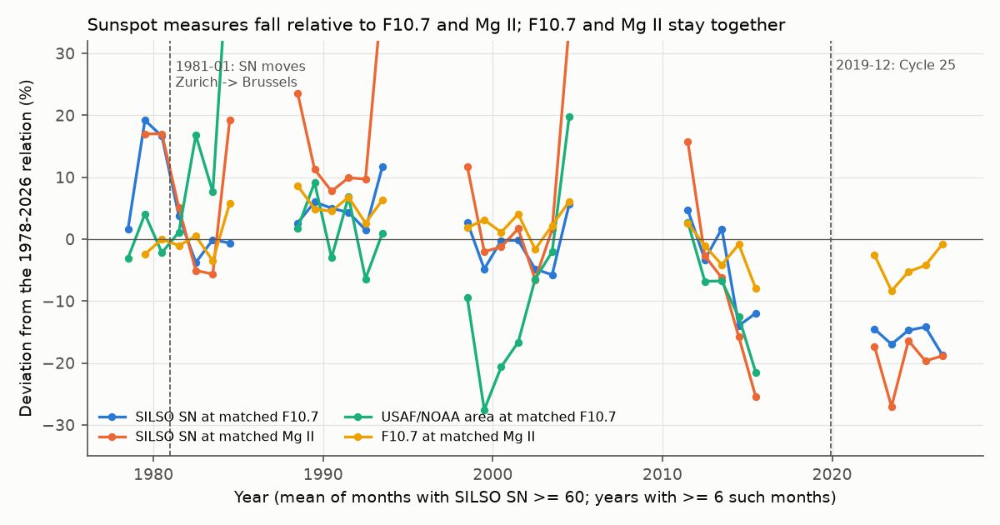
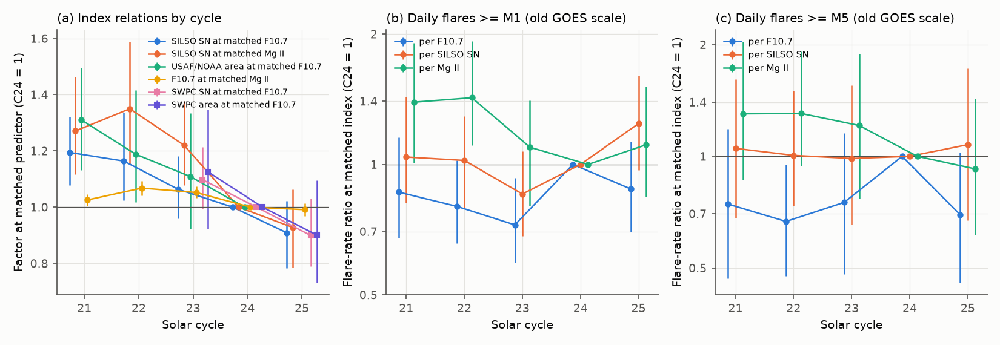
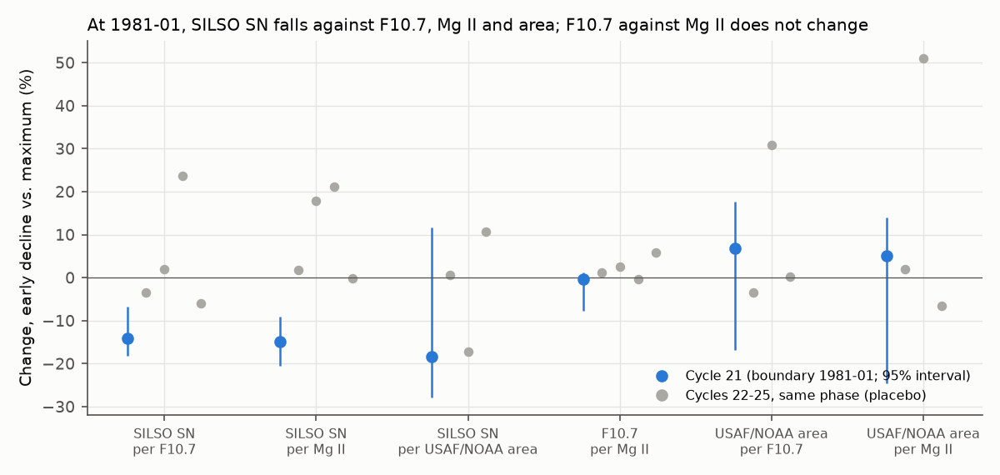

# On one GOES scale (1976-2026), Cycle 25 has no flare excess above 1.3x Cycles 21-23 per F10.7, sunspot number or Mg II; sunspot number fell 24% against F10.7 and Mg II, with a 14% step in 1981

**Job:** sci-1107-dell-astronomy-bc267bf2008b · **Campaign:** 11_07_2026 · **Topic:** astronomy · **Machine:** dell · **Model:** Claude Opus 5.5 (`claude-opus-5-5`), account claude-olen · **Date:** 2026-11-10.
The signing key is a campaign-machine key. It is not a personal authorship claim.

## Summary

The earlier work (sci:sha256:cf94434c…) found that the removal of the GOES 0.7 flux factor in December 2019 explains the apparent Cycle 25 excess of M flares per unit of F10.7. It also found that on one scale, Cycle 25 still has about 1.4 times more M flares per sunspot than Cycle 24, and that F10.7 per sunspot is 7-10% higher in Cycle 25. It used three cycles (1998-2026). It could not say which activity index is the correct normalization, or whether the change of F10.7 per sunspot is new.

We extended the homogeneous flare record to five cycles (Cycle 21 to Cycle 25, 1976-03 to 2026-11-08). We used the NOAA GOES X-ray event reports for 1975-1998 and the SWPC list of the earlier work for 1998-2026, all on the "old" GOES-1..15 operational scale. We compared the flare rates with four activity records from three different kinds of observation:

- the 10.7 cm radio flux (F10.7, Penticton/Ottawa),
- the Mg II core-to-wing index (Bremen composite; ultraviolet, from satellites),
- the SILSO sunspot number (SN, version 2.0), and the USAF/NOAA sunspot area (an independent sunspot network; 1977-2016). For 1998-2026, we also used the SWPC sunspot number and area.

Main results:

1. **Flare rates.** The Poisson model has one smooth curve of the daily M-flare count against one index and one factor per cycle. With full cycles, the five cycle factors agree with each other within the 27-day block-bootstrap noise for all three indices and all three thresholds (≥M1, ≥M5, ≥X1 on the old scale): the noise-corrected between-cycle spread (tau) is 0 to 0.10 in natural log units (Table 2). When each cycle is limited to its first 83 months, the spread is larger than the noise for F10.7 and SN at ≥M1 and for F10.7 at ≥M5 (tau 0.12-0.16, about ±15%), mainly because Cycle 23 is low and Cycle 24 is high per F10.7. No index makes all five cycles equal at all thresholds, and five cycles cannot show which index is the "correct" normalization. Per sunspot number, the ≥M5 rate of full cycles is almost constant: 1.05, 1.01, 0.99, 1.00 and 1.08 for Cycles 21 to 25. **Cycle 25 has no large excess.** Relative to the mean of Cycles 21-23, its rate is 0.54-1.28 times for all indices and thresholds. The largest value is ≥M1 per SN (1.28; relative to Cycle 24, 1.24 with 95% CI 0.97-1.60), which is the highest of the five cycles. At ≥M5 per SN it is 1.06, and per F10.7 it is 1.10 (≥M1) and 0.97 (≥M5).
2. **The sunspot number fell relative to F10.7 and Mg II in every cycle from Cycle 21 to Cycle 25.** At matched F10.7, SN is 1.19, 1.16, 1.06, 1.00 and 0.91 times the Cycle 24 value (Cycles 21-25). At matched Mg II, it is 1.27, 1.35, 1.22, 1.00 and 0.93. The two references agree with each other: F10.7 at matched Mg II stays between 0.99 and 1.07. When we use only the first 83 months of each cycle (the cycle age of the Cycle 25 data), we get the same decline (SN at matched F10.7: 1.18, 1.10, 1.07, 1.00, 0.90). Thus the higher F10.7 per sunspot in Cycle 25 that the earlier work found is the newest part of a decline over five cycles. It is not a new change.
3. **The decline is in all sunspot counts, not only in SILSO.** The SWPC sunspot number and SWPC sunspot area also fall by about 10% from Cycle 24 to Cycle 25 at matched F10.7 (0.90 and 0.90). The SILSO SN and the USAF/NOAA area agree with each other in Cycles 21-24 (SN at matched area 0.95-1.00). The USAF/NOAA area at matched F10.7 also falls (1.31, 1.19, 1.11, 1.00) over full cycles, but this result depends on the phase (first 83 months: 1.16, 1.06, 0.91, 1.00).
4. **January 1981.** Clette (2021) found an upward jump of about 10% in F10.7 relative to SN between 1980 and 1981, and attributed it to the F10.7 data. We see the same step (SN at matched F10.7: −14%, 95% CI −18% to −7%; the largest step in the 1978-2026 change-point scan of active months, z = −3.0, exactly at 1981-01). The independent Mg II record (one instrument, Nimbus-7 SBUV, in 1978-1991) shows the same SN step (−15%, −20% to −9%). F10.7 relative to Mg II does not change (−0.3%, −8% to +1%). Thus the Mg II data do not support a jump in F10.7. The step is in the sunspot number or in the sunspot-to-plage ratio. January 1981 is also the date when the production of the sunspot number moved from Zurich to Brussels. The USAF/NOAA area gives an SN step of −18%, but with a wide interval (−28% to +12%). Placebo windows at the same cycle phase in Cycles 22-25 give SN changes from −6% to +24% at matched F10.7. Thus steps of this size can also occur for other reasons. The result is strong evidence against the F10.7 explanation, but it is not a proof of a sunspot-number calibration error.
5. **Phase dependence of flare rates.** At matched index, the M-flare rate in the 30 months after the maximum is 1.0 to 2.0 times the rate in the 25 months around the maximum (F10.7: 1.60, 1.11, 2.04, 1.40 and 1.25 for Cycles 21-25). This phase effect is as large as the differences between cycles. Comparisons of an incomplete cycle with complete cycles must therefore match the cycle phase.
6. **Homogeneity of the early GOES record.** The flare rate at matched activity steps up by a factor of 1.7-2.3 in late 1980 relative to all four indices (z = 3.3 to 5.1). The NCEI archive has GOES-3 XRS data to August 1980, then no XRS data until GOES-6 in May 1983. In 1983-1985 the NOAA event reports agree with GOES-5 and GOES-6 peaks (median ratio 0.99-1.01). In 1978-1980 they agree with GOES-3 within 3% (after a 0.92 correction for its 5-minute averages), but in mid-1980 the reports are 10-17% above GOES-3. We cannot identify the satellite of the 1980-09 to 1983-04 reports. The size of the 1980 step is in the range of the post-maximum increase of other cycles (result 5). Thus the step can be solar, but an instrument change is also possible. Cycle 21 results carry this uncertainty.

Limitations are in Section 6.



## 1. Question

The earlier work left three open points: (a) which activity index gives cycle-independent flare rates, (b) whether the Cycle 25 change of F10.7 per sunspot and the "excess per sunspot" are new, and (c) whether a homogeneous flare record can go back further than 1998. We asked:

1. On one flux scale and over five cycles, which index (F10.7, SN or Mg II) gives the smallest differences of flare rate between cycles? Is Cycle 25 outside the range of the earlier cycles?
2. When the relation between two indices changes, which index changed? With four records from three kinds of observation, a change in one record shows as a change relative to all the others, while the others stay together.
3. Is the GOES event record of 1976-1998 on the same scale as the later record?

## 2. Data

| Data | Source and version | Use | In bundle |
|---|---|---|---|
| NOAA/NCEI GOES X-ray event reports 1975-2016 | `https://www.ngdc.noaa.gov/stp/space-weather/solar-data/solar-features/solar-flares/x-rays/goes/xrs/goes-xrs-report_YYYY.txt` (public domain). SHA-256 identical to the inputs of sci:sha256:d8fe1054… | Flares 1975-11 to 1998-05; overlap check | Derived daily counts |
| SWPC event list with true-scale peaks 1998-05 to 2026-11 | Publication sci:sha256:cf94434c…, `files/data/events_homog.csv.gz` (NOAA public domain) | Flares 1998-06 to 2026-11 | Derived daily counts |
| SWPC sunspot number and area 1998-2026 | Same publication, `files/data/daily_counts_forecasts_noaa.csv.gz` (NOAA/USAF) | Cross-check of sunspot records | No (in the cited publication) |
| NCEI GOES-3, -5, -6 averaged XRS (avg/ archive) | `https://www.ncei.noaa.gov/data/goes-space-environment-monitor/access/avg/` (public domain) | Which satellite the reports follow | Derived match tables |
| F10.7 (Penticton/Ottawa, National Research Council Canada) | LASP LISIRD `penticton_radio_flux`, retrieved 2026-11-10 | Activity index (adjusted flux, daily median) | No |
| Mg II core-to-wing composite (University of Bremen, IUP) | LASP LISIRD `bremen_composite_mgii`, retrieved 2026-11-10 | Activity index; days with composite source 20 removed in the main variant | No |
| SILSO daily total sunspot number V2.0 (WDC-SILSO, Royal Observatory of Belgium) | `https://www.sidc.be/SILSO/INFO/sndtotcsv.php`, retrieved 2026-11-10, CC BY-NC 4.0 | Activity index | No |
| Daily sunspot area (RGO to 1976; USAF/NOAA 1977-2016-10) | NASA/MSFC compilation `https://solarscience.msfc.nasa.gov/greenwch/daily_area.txt` | Independent sunspot record | No |

The SHA-256 of every input file is in `files/data/input_sha256.txt`. `files/NOTICE.md` gives the terms of the external data. The bundle contains no values of F10.7, Mg II, SN or area, and no daily or monthly series derived from them. It contains only model results (cycle factors, steps, test statistics) and figures.

**Flux scale.** We use the old GOES-1..15 operational scale ("legacy" scale), because the reports of 1975-1997 exist only on this scale. By NOAA design, the GOES-8..15 operational fluxes agree with GOES-7 (NCEI GOES-1..15 XRS science-quality readme, Section 3.1). For GOES-16 and later (from 2019-12-01), the old-scale peak is the true-scale peak divided by 1.451, which is the median science/operational ratio of GOES-8..15 found by the earlier work. The threshold "M1" here is ≥1×10⁻⁵ W m⁻² on the old scale (≈M1.45 on the true scale). In the 1998-06 to 2016-11 overlap, the reports and the SWPC list give 2,224 and 2,253 flares ≥M1, 380 and 381 ≥M5, and 163 and 163 ≥X1 (daily correlation 0.989-1.000).

**Cycles.** Cycle boundaries are the SILSO smoothed minima: 1976-03, 1986-09, 1996-08, 2008-12 and 2019-12; the data end on 2026-11-08. Flares ≥M1 per cycle: 2,351, 2,174, 1,562, 797 and 1,287.

## 3. Methods

All code is in `files/code/`. `run_all.sh` runs the full chain.

- **Daily table (`01_build_daily.py`).** Flare counts per UT day of the peak at three thresholds; F10.7 = daily median of the adjusted (1 AU) readings; SILSO SN; Mg II with its source code; areas.
- **Cycle factors of flare rates (`02_rates.py`).** Daily count ~ Poisson(exp(s(x) + b_cycle)), with s a natural cubic regression spline (df = 4) of x = log F10.7, log(SN + 1) or Mg II, and one factor per cycle (Cycle 24 = 1). 95% intervals: bootstrap of 27-day blocks within cycles (200 replicates). Samples: "common" (days with all three indices and measured Mg II, from 1978-11-07), "full" (F10.7 and SN from 1976-03), "common_all" (Mg II source 20 days kept), "split81" (Cycle 21 split at 1981-01-01) and "phase83" (each cycle limited to its first 83 months).
- **Heterogeneity (`09_summary.py`).** For the five log factors, we compare the observed SD with the mean sampling variance from the bootstrap intervals; tau² = max(0, SD² − mean variance).
- **Index relations (`03_index_relations.py`).** Monthly means (≥20 days of each index; months with SN ≤ 5 removed). Target ~ spline(predictor, df = 3) + cycle factor, by least squares on the log scale for F10.7, SN and area. Intervals: 12-month block bootstrap within cycles (500 replicates). Step tests: mean residual of the all-month fit in window B minus window A, with phase-matched windows (maximum M: A = M−13 to M+12 months, B = M+13 to M+42 months; for Cycle 21 the boundary is 1981-01). The same windows in the other cycles are placebo values.
- **Change-point scan (`05_changepoint_scan.py`).** 24-month windows on each side of each month, active months only (SILSO SN ≥ 60); z uses the residual scatter with a lag-1 autocorrelation correction.
- **Flare steps (`06_flare_steps.py`).** Monthly observed and expected counts from a model without cycle terms; window ratios with an over-dispersion factor from the monthly table; a change-point scan.
- **Satellite match (`07_report_satellite_match.py`).** For each report event ≥C2, the maximum satellite long-channel flux within ±7 minutes of the report peak. The bias of 5-minute averages (0.92) comes from GOES-5/6 1-minute data averaged to 5 minutes.
- **Model comparison (`04_flare_yearly.py`).** Daily Poisson deviance of one- and two-index models, with and without cycle terms.

## 4. Results

### 4.1 Index relations by cycle

Table 1. Factor of the target index at matched predictor, relative to Cycle 24 (full cycles; 95% interval). `files/results/index_cycle_factors.csv` has all variants.

| Target at matched predictor | C21 | C22 | C23 | C25 |
|---|---|---|---|---|
| SILSO SN at matched F10.7 | 1.19 (1.08-1.32) | 1.16 (1.02-1.34) | 1.06 (0.96-1.18) | 0.91 (0.78-1.02) |
| SILSO SN at matched Mg II | 1.27 (1.12-1.46) | 1.35 (1.15-1.59) | 1.22 (1.08-1.38) | 0.93 (0.78-1.06) |
| F10.7 at matched Mg II | 1.03 (1.00-1.05) | 1.07 (1.04-1.09) | 1.05 (1.03-1.07) | 0.99 (0.97-1.01) |
| USAF/NOAA area at matched F10.7 | 1.31 (1.13-1.49) | 1.19 (1.02-1.42) | 1.11 (0.92-1.33) | – |
| SILSO SN at matched USAF/NOAA area | 0.95 (0.85-1.07) | 0.99 (0.88-1.11) | 0.97 (0.83-1.13) | – |
| SWPC SN at matched F10.7 | – | – | 1.10 (0.99-1.21) | 0.90 (0.79-1.03) |
| SWPC area at matched F10.7 | – | – | 1.13 (0.92-1.35) | 0.90 (0.73-1.09) |
| SILSO SN at matched SWPC SN | – | – | 0.95 (0.91-0.99) | 1.01 (0.97-1.05) |

First 83 months of each cycle: SN at matched F10.7 1.18, 1.10, 1.07, (1.00), 0.90; SN at matched Mg II 1.20, 1.27, 1.13, (1.00), 0.90; F10.7 at matched Mg II 1.03, 1.08, 1.04, (1.00), 0.99. The Cycle 21 to Cycle 25 change of SN at matched F10.7 is a factor of 0.76; at matched Mg II it is 0.73.



### 4.2 Flare rates by cycle

Table 2. Flare-rate factor at matched index, relative to Cycle 24 ("common" sample, 1978-11 to 2026-11; 95% interval), and noise-corrected spread tau (natural log units). `files/results/cycle_rate_ratios_*.csv` and `files/results/heterogeneity.csv` have all samples.

| Index, threshold | C21 | C22 | C23 | C25 | SD of logs | tau |
|---|---|---|---|---|---|---|
| F10.7, ≥M1 | 0.86 (0.68-1.16) | 0.80 (0.66-1.02) | 0.73 (0.59-0.93) | 0.88 (0.70-1.13) | 0.12 | 0.00 |
| F10.7, ≥M5 | 0.74 (0.47-1.18) | 0.67 (0.48-0.95) | 0.75 (0.48-1.15) | 0.70 (0.46-1.02) | 0.16 | 0.00 |
| F10.7, ≥X1 | 0.90 (0.51-1.58) | 0.75 (0.45-1.31) | 0.89 (0.50-1.70) | 0.61 (0.33-1.08) | 0.20 | 0.00 |
| SILSO SN, ≥M1 | 1.04 (0.82-1.43) | 1.02 (0.79-1.29) | 0.85 (0.68-1.07) | 1.24 (0.97-1.60) | 0.13 | 0.04 |
| SILSO SN, ≥M5 | 1.05 (0.68-1.61) | 1.01 (0.74-1.50) | 0.99 (0.66-1.55) | 1.08 (0.67-1.73) | 0.04 | 0.00 |
| SILSO SN, ≥X1 | 1.40 (0.78-2.90) | 1.23 (0.72-2.51) | 1.22 (0.68-2.58) | 0.96 (0.51-1.84) | 0.16 | 0.00 |
| Mg II, ≥M1 | 1.39 (1.01-1.91) | 1.43 (1.11-1.93) | 1.10 (0.80-1.40) | 1.11 (0.84-1.52) | 0.16 | 0.05 |
| Mg II, ≥M5 | 1.30 (0.86-2.04) | 1.30 (0.94-1.92) | 1.21 (0.77-1.89) | 0.92 (0.61-1.43) | 0.16 | 0.00 |
| Mg II, ≥X1 | 1.67 (0.94-2.86) | 1.54 (0.98-2.72) | 1.48 (0.84-2.53) | 0.84 (0.47-1.57) | 0.30 | 0.10 |

The "full" sample (F10.7 and SN from 1976-03) gives the same values within 0.05. The phase-matched sample (first 83 months) gives, at matched F10.7 and ≥M1, 0.74, 0.73, 0.57, (1.00), 0.82 (tau 0.16); at matched SN 0.94, 1.03, 0.72, (1.00), 1.20 (tau 0.12); and at matched Mg II 1.27, 1.33, 0.89, (1.00), 1.03 (tau 0.04) (`cycle_rate_ratios_phase83.csv`, `heterogeneity.csv`). In the phase-matched sample, the spread for F10.7 and SN at ≥M1 is larger than the noise. Cycle 24 is again the highest cycle per F10.7, and Cycle 25 is the highest per SN at ≥M1. With Mg II source 20 days kept ("common_all"), the flare factors change by at most 0.07 (F10.7), 0.12 (SN) and 0.18 (Mg II, ≥X1), all inside the intervals.

F10.7 is the best single daily predictor of the flare count (Poisson deviance for ≥M1: 15,289 with F10.7, 17,180 with SN, 18,086 with Mg II; `model_comparison.csv`). F10.7 plus Mg II is better (14,235). This tells us about the day-to-day relation. It does not tell us which index is stable from cycle to cycle.

The earlier work reported a Cycle 25/Cycle 24 ratio of 1.45 per SWPC sunspot number at the true-scale M1 threshold, with Cycles 23-25 only. Here, with SILSO SN, the old-scale threshold and Cycle 23 from 1996-08, the ratio is 1.24 (0.97-1.60) at ≥M1 and 1.08 at ≥M5. Relative to the mean of Cycles 21-23, the Cycle 25 ≥M1 rate is 1.28 per SN and 1.10 per F10.7 (`heterogeneity.csv`).

### 4.3 The January 1981 step

Table 3. Change from window A (1978-11 to 1980-12) to window B (1981-01 to 1983-06), and the same phase in Cycles 22-25 (placebo; `index_step_tests.csv`).

| Series | Cycle 21 (1981) | Placebo C22, C23, C24, C25 |
|---|---|---|
| SILSO SN at matched F10.7 | 0.86 (0.82-0.93) | 0.97, 1.02, 1.24, 0.94 |
| SILSO SN at matched Mg II | 0.85 (0.80-0.91) | 1.02, 1.18, 1.21, 1.00 |
| SILSO SN at matched USAF/NOAA area | 0.82 (0.72-1.12) | 1.01, 0.83, 1.11, – |
| F10.7 at matched Mg II | 1.00 (0.92-1.01) | 1.01, 1.03, 1.00, 1.06 |
| USAF/NOAA area at matched F10.7 | 1.07 (0.83-1.18) | 0.97, 1.31, 1.00, – |
| USAF/NOAA area at matched Mg II | 1.05 (0.75-1.14) | 1.02, 1.51, 0.94, – |

With only one changed record, the expected pattern is: all ratios that contain the changed record move, and the other ratios stay. The 1981 values fit a change of SN best. They do not fit a change of F10.7, because F10.7 at matched Mg II does not move. In the change-point scan of active months (`changepoint_summary_sn60.csv`), the largest SN/F10.7 step of 1978-2026 is at 1981-01 (−16.5%, z = −3.0). The second largest is at 2013-09 (−16.4%, z = −2.4). For SN/Mg II, the 1981 step is −15.8% (z = −1.65) and the Mg II noise is larger. For F10.7/Mg II, the 1981 step is +1.0% (z = 0.35). The intervals from 12-month blocks in 25-29 month windows are approximate: there are only 2-3 blocks per window.



### 4.4 Phase dependence and the early GOES record

The window ratio of flares (30 months after the maximum against 25 months around it) is larger than 1 for most cycles and indices (`flare_step_tests_M1.csv`): at matched F10.7 1.60 (1.22-2.11), 1.11, 2.04, 1.40, 1.25; at matched Mg II 1.49, 1.03, 1.65, 1.02, 1.14. The Cycle 23 value includes the October-November 2003 flares.

The change-point scan of flare rates (`flare_changepoint_summary.csv`) has its largest values at 2003-10 (×2.9 for F10.7) and 1980-08 to 1980-11 (×1.7-2.3 for all four indices). Table 4 shows how the event reports compare with the archived satellite data (`report_satellite_match_quarterly.csv`).

Table 4. Satellite peak divided by report peak (median).

| Satellite (archive cadence) | Period | Events ≥C2 | Median ratio |
|---|---|---|---|
| GOES-3 (5 min; divided by 0.92) | 1978-07 to 1980-03 (integer magnitudes) | 1,732 | 0.97 |
| GOES-3 (5 min; divided by 0.92) | 1980-05 to 1980-08 | 697 | 0.91 (August: 0.83) |
| GOES-6 (1 min) | 1983-05 to 1984-11 | 1,255 | 0.99 |
| GOES-5 (1 min) | 1984-01 to 1985-03 | 781 | 1.01 |

The reports give integer magnitudes before April 1980 (two digits after it). We could not get XRS data of GOES-1 or GOES-2. In the NCEI avg/ archive, no XRS file exists for 1980-09 to 1983-04.


## 5. Interpretation

On one flux scale, the M-flare rate per unit of activity changes from cycle to cycle by up to about 1.4-1.8 times. With full cycles this spread is not larger than the noise from flare clustering; with phase-matched cycles, a real spread of about ±15% remains for F10.7 and SN at ≥M1. A 27-day block bootstrap gives intervals of ±25-60% for one cycle factor. Thus claims that one cycle is "more flare-productive" need differences larger than about 1.5 times. Cycle 25 does not have such a difference by any of the three indices.

The robust change is in the relation of the sunspot number to the other indices. Over five cycles, F10.7 and Mg II stay together within ±7%, while SN and the sunspot areas fall by about 25% relative to them. Two independent sunspot networks (SILSO and USAF/NOAA/SWPC) show the Cycle 24-25 part of this decline. Thus the decline is a property of the sunspots (fewer or smaller spots per unit of chromospheric and coronal emission), not an error in one sunspot series. The 1981 step is different: it is in SILSO SN relative to F10.7 and Mg II, and it coincides with the move of the sunspot number from Zurich to Brussels. Users of F10.7-SN proxy relations and of flare rates per sunspot should use different relations before and after 1981, and should not assume one relation for Cycles 21-25.

For the "excess of M flares per sunspot" in Cycle 25: the excess is at most 1.24 at ≥M1 relative to Cycle 24 (1.28 relative to Cycles 21-23), it is not present at ≥M5 (1.08), and the decline of sunspots per unit F10.7 by about 9% from Cycle 24 to Cycle 25 explains a part of it.

## 6. Limitations

- Five cycles, with Cycle 25 incomplete. Each cycle factor is one number for all activity levels.
- The old-scale record before 1998 uses the NOAA event reports, which have integer magnitudes before April 1980. The 1980-09 to 1983-04 report source has no archived XRS data. The late-1980 step of the flare rate can be solar (post-maximum increase) or instrumental. We did not use the GOES-1 and GOES-2 bandpass correction of the science-quality reprocessing, because these data were not available.
- The 27-day block bootstrap does not include dependence longer than 27 days. The step-test intervals with 12-month blocks in short windows are approximate.
- Mg II composite sources change over time (for example, a new source from 2019). The Cycle 25 Mg II result therefore also depends on the composite stitching. We removed composite source 20 days (meaning not documented in the file; their scatter about F10.7 equals that of measured days) in the main variant. With these days, the index relations change by at most 0.016 and the flare factors by at most 0.18 (inside the intervals).
- The USAF/NOAA area series of NASA/MSFC ends in 2016-10 and has its own scale questions; area results are phase-sensitive.
- The 1981 attribution rests on two independent references (F10.7, Mg II) and on one noisy third (area). Phase-matched placebo windows show SN excursions up to ±24% at other times. Station-level sunspot data would be necessary for a calibration claim.
- F10.7 values contain flare contributions on some days. The daily median of up to three readings reduces this effect but does not remove it.

## 7. Reproduction

```
bash files/code/00_fetch_data.sh <scratch>     # external files into <scratch>/raw (never into this bundle);
                                               # set PRIOR_ZIP to the verified ZIP of sci:sha256:cf94434c...
bash files/code/run_all.sh <scratch>           # all results and figures into <scratch>/out
```

Python 3.12 with numpy, pandas, patsy and matplotlib. The bootstrap seeds are fixed. The provider files for F10.7, SN and Mg II change in their recent tail; with the files of `files/data/input_sha256.txt` the results are exact. On a heavily loaded shared machine the full run took several hours, mostly for the bootstraps of `02_rates.py`.

Bundled files:

- `files/data/daily_flare_counts_oldscale.csv.gz`: daily counts ≥M1, ≥M5, ≥X1 and ≥C1 on the old scale, 1975-11 to 2026-11 (NOAA-derived, public domain).
- `files/data/avg_*_by_month.txt`: the NCEI avg/ archive inventory (satellites and XRS files per month, 1975-1988).
- `files/results/`: all model results listed above, and the event-level report/satellite match (`report_satellite_match.csv.gz`, NOAA-derived).
- `files/figures/`: Figures 1-4.

## References

- Clette, F. (2021). Is the F10.7cm – Sunspot Number relation linear and stable? J. Space Weather Space Clim. 11, 2. doi:10.1051/swsc/2020071
- Janssens, J., Delouille, V., Clette, F., Andries, J. (2025). Solar flare rates and probabilities based on the McIntosh classification: impacts of GOES/XRS rescaling and revisited sunspot classifications. J. Space Weather Space Clim. 15. doi:10.1051/swsc/2025007
- NOAA/NCEI. GOES 1-15 XRS Science-Quality Data Readme (Section 3.1, scaling factors).
- sci:sha256:cf94434cc907d929fe2342675f1f0b92b966e8804019441c0241614b7d55cbb3 (the earlier work; source of the 1998-2026 flare list).
- sci:sha256:d8fe105441f4a8deb0890611a7a4970adb89bee39e6907d41713aa800780c4cf (same NOAA report files; flux-scale check 2017).
