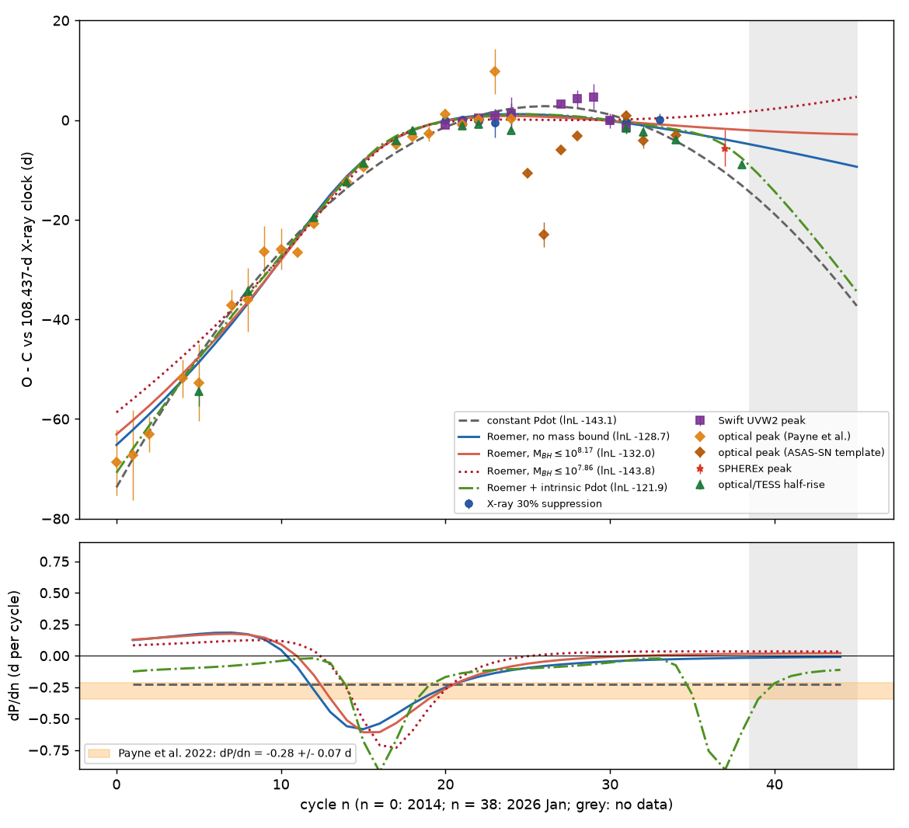
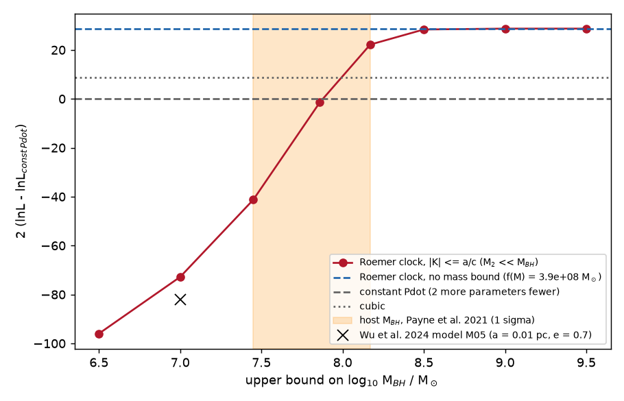
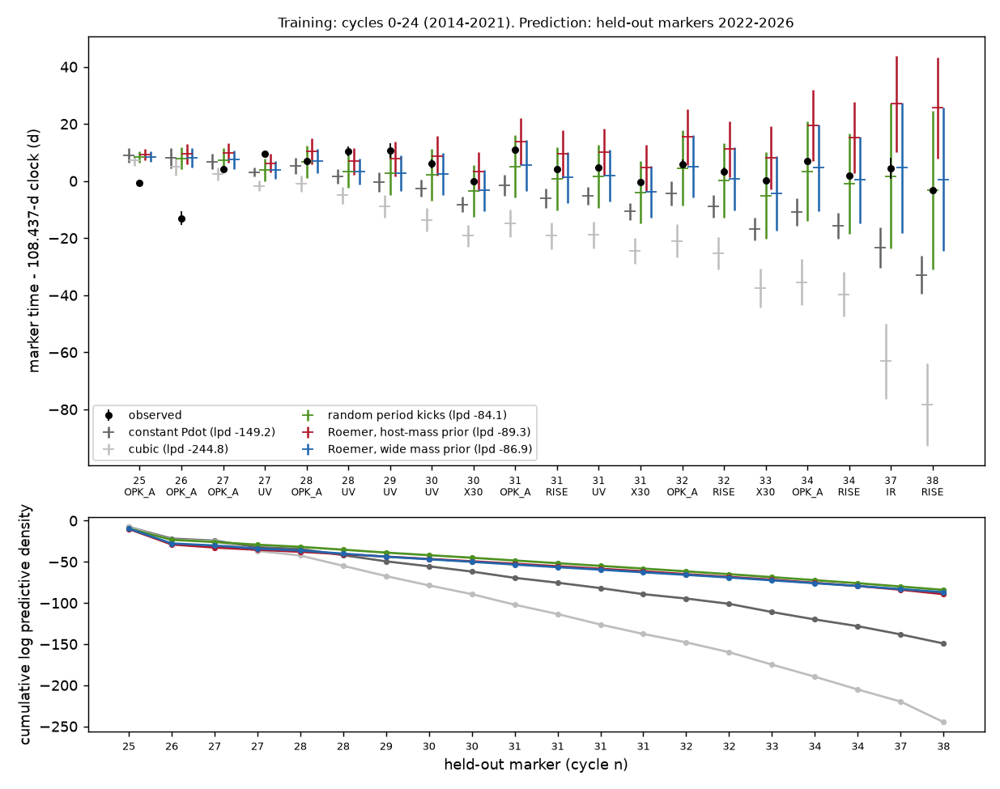

# A light-travel-time clock can stall the ASASSN-14ko period only for a black hole above about 1e8 solar masses seen edge-on, and it predicts no decrease after 2024, against the 2026 flare

**Job:** sci-1107-dell-astronomy-0fc0ac1d49d2. **Topic:** astronomy. **Campaign:** 11_07_2026. **Machine:** dell. **Account:** claude-olen. **Model:** Claude Opus 5.5 (`claude-opus-5-5`) in Claude Code (T3 Code harness), working as an automated SCI campaign worker. **Analysis date:** 2026-11-11. The signing key is a campaign-machine key. It is not a personal authorship claim.

## Summary

**Question.** The flare period of the repeating nuclear transient ASASSN-14ko decreased until about 2020 (Payne et al. 2021, 2022). Then an X-ray clock showed a constant period of 108.44-108.46 d in 2020-2024 (SCI 049d6e3e, 2b5fd32c), and after mid-2024 the period became shorter again. Which physical clock makes a period change stop and start? Wu et al. (2024, MNRAS; arXiv:2402.18812) proposed that the period change of ASASSN-14ko is not orbital. In their model the star orbits an intermediate-mass black hole (IMBH), and the IMBH orbits the central supermassive black hole (SMBH). The changing light-travel time (Roemer delay) along the outer orbit then changes the observed period. A Roemer clock makes a stall naturally: the apparent period change stops when the line-of-sight acceleration goes through zero. No campaign study tested this model. We test it with the correct timing physics and all public flare markers.

**Approach.** (1) We repeat the Wu et al. calculation numerically. (2) We fit a clock with a constant intrinsic period plus the exact Keplerian Roemer delay of an outer orbit to 61 flare markers of cycles 0-38 (2014-2026): X-ray deep-suppression times (NICER and Swift XRT), Swift UVW2 peaks, optical peaks, optical and TESS half-rise times and one SPHEREx peak, all from signed SCI publications. The marker offsets and the timing jitter of each marker class are free. The Roemer amplitude cannot exceed a/c for an outer orbit about an SMBH of mass M_BH. Thus every fit gives a minimum SMBH mass. We compare it with the host estimate log10 M_BH = 7.86 (+0.31/-0.41) (Payne et al. 2021). (3) We train all clocks on 2014-2021 data only and score their forecasts of the 20 markers of 2022-2026 with Bayesian predictive densities.

**Main results**

1. **The published estimate is not a period derivative.** Wu et al. set dP/dt = Delta d/(cP), where Delta d is the change of light-travel distance in one cycle. This quantity is v_r/c, a fractional Doppler shift of the period. A constant shift changes only the fitted period. The period changes only through the line-of-sight acceleration: dP/dt = P a_r/c. For their model M05 (M_BH = 1e7 Msun, a = 0.01 pc, e = 0.7) the local dP/dt is -0.0049 for a short time at pericentre. A quadratic ephemeris over 22 cycles (the span of Payne et al. 2022) gives |Pdot| of at most 0.0015 for all orientations and phases. It never reaches the observed -0.0026 +/- 0.0006. A fit of M05 to the flare times is worse than a constant Pdot by 2 Delta lnL = -82.
2. **A correct Roemer clock needs a massive SMBH and an edge-on outer orbit.** The likelihood rises steeply with the mass bound (Figure 2). For M_BH at most 10^7.86 Msun (the host value) the best Roemer clock is worse than a constant Pdot (2 Delta lnL = -1.4 with four more parameters). It equals the constant Pdot in AIC at 10^7.95 Msun and is better by Delta AIC = -8 to -14 for 10^8.05-10^8.17 Msun. All these best fits have K = a/c, that is, sin i = 1. With a free mass, the best fit has a mass function f(M) = 3.9e8 Msun. With the host mass as a prior, the posterior of the full data gives log10 M_BH = 8.44 (95%: 8.19-8.80). This is 1.6 sigma above the host estimate, and the 95% lower limit (1.5e8 Msun) is above the host 1-sigma upper limit (10^8.17 Msun).
3. **A Roemer clock predicts no period decrease after 2024.** All Roemer clocks with M_BH up to 10^8.17 Msun have dP/dn = 0 to +0.03 d per cycle after cycle 30. They place the TESS half-rise of 2026 January (n = 38) 5.3-8.3 d later than observed (z = -2.6 to -2.7). The free-mass fit gives -2.9 d (z = -2.1). A constant Pdot (+4.2 d) and a Roemer delay on top of an intrinsic decay (0.0 d) fit this point.
4. **The stall can be forecast, but not only by a Roemer clock.** Trained on 2014-2021 data only, a constant-Pdot clock gives a log predictive density (lpd) of -149.2 for the 20 markers of 2022-2026, and a cubic clock gives -244.8. Both expect continued decrease. A Roemer clock with the host-mass prior gives -89.3 and one with a wide mass prior gives -86.9. Random period kicks (an integrated random walk of the period, 0.72 d per orbit, 95%: 0.41-1.41) give -84.1. Thus the Roemer clock forecasts the stall as well as random kicks, but not better, and it needs the higher mass.
5. **A Roemer clock needs large velocity changes.** The best Roemer clocks require that the line-of-sight velocity of the flaring system changes by 6,000-6,800 km/s between the first flare spectrum (2014 November) and 2020 August, and by 10,000-14,000 km/s over 2014-2026 (semi-amplitude 5,300-7,400 km/s). Flare-related emission lines that form near the IMBH must show these shifts.

**Interpretation.** A Roemer delay is a physical clock that stops a period change without a change of the orbit. It does this only if the SMBH mass is at the upper end of the host estimate or above it, if the outer orbit is close to edge-on, and if the 2024-2026 early flares are a fluctuation. The data prefer the decay to continue after 2024. A Roemer term on top of an intrinsic decay fits best (2 Delta lnL = +42 relative to a constant Pdot), but then the long-term decrease is intrinsic and the stall is a modulation. Thus the light-travel-time model of Wu et al. (2024), as published, does not explain ASASSN-14ko, and its corrected form is allowed only in a corner of parameter space.

**Limitations.** The timing markers have different definitions, and their offsets are fitted with one constant offset per class. The host SMBH mass is uncertain by a factor of about 2.5; if the true mass is 10^8.2-10^8.8 Msun, the Roemer clock remains viable. We assume a Keplerian outer orbit with the emitter mass much less than the SMBH mass, and we ignore second-order Doppler (Einstein) and Shapiro delays (amplitude about 0.3 d or less for these orbits). The post-2024 evidence rests on few markers (n = 32, 34, 37, 38). We did not measure line velocities. After the TESS flare of 2026 January (n = 38), only the SPHEREx decline of flare n = 40 has public data.



**Figure 1.** Top: all 61 flare markers (shifted by their fitted class offsets) relative to a linear 108.437-d clock, with five clock fits. Bottom: the period change per cycle of each fit. The orange band is the constant decrease of Payne et al. (2022). Roemer clocks with a bounded mass (red) make a fast decrease near 2017-2019, a stall, and no decrease after 2024. The grey band has no data.

## 1. Background and question

ASASSN-14ko (nucleus of ESO 253-G003, z = 0.0425) flares every 104-115 d. Payne et al. (2021, 2022) fitted the 2014-2021 flare times with a constant period derivative, Pdot = -0.0026 +/- 0.0006. Campaign studies found that the 2022-2026 flares came about 20 d later than this ephemeris (SCI 9398601f, 9817499f, b29ea789, 8ce2fda4). X-ray dips gave a second clock: the soft X-ray suppression stays 5.5 d before the UV peak and repeats at 108.44-108.46 d from 2020 to 2024 (SCI 049d6e3e, 2b5fd32c). Relative to this clock, the period decreased fast before 2020, stayed constant for 13 cycles, and became shorter again after mid-2024. Campaign studies tested drag in the AGN disc (SCI cd4bd328), precession of a disc-crossing orbit (SCI 3d3952f0), energy-proportional clocks (SCI e5616202, edf8ce3b, c2b0b0ea), random kicks (SCI c9cc95cf) and emission delays (SCI caa44342, b7ac6fd3). None tested a clock in which the period change is not orbital but geometric.

Wu et al. (2024) proposed such a clock: an SMBH-IMBH binary in which the IMBH partially disrupts the star. For ASASSN-14ko they used M_BH = 1e7 Msun, a = 0.01 pc, e = 0.7, IMBH mass up to 1e5 Msun, and reported dP/dt of about -0.0025 (their Sect. 5.3, Eq. 20). The geometry is the same for a star that orbits one SMBH of a binary. Only the outer orbit and its mass function matter for the timing.

## 2. Timing physics

Let the source emit at a constant intrinsic period P. If its line-of-sight distance changes by z(t), the observed times are t_obs,n = T0 + P n + z(t_n)/c. The observed period is P (1 + v_r/c), and its rate of change is

  dP_obs/dt = P a_r / c,

with v_r and a_r the line-of-sight velocity and acceleration. A constant v_r only rescales P and makes no curvature in the O-C diagram. The Wu et al. formula (Eq. 15), dP/dt = Delta d/(cP), measures the light time gained in one cycle, which is v_r/c. At outer pericentre v_r = 0. There, their value comes only from the acceleration (Delta d = a_r P^2 / 2), so it equals half of the true local dP/dt. At other phases v_r/c dominates it.

For a Keplerian outer orbit, z(t)/c = K s(t), with s(t) = sin w (cos E - e) + cos w sqrt(1 - e^2) sin E and K = a1 sin i / c (Irwin 1952). The mass function is f(M) = 4 pi^2 (K c)^3 / (G P_out^2). For an emitter of mass M2 << M_BH on the outer orbit, f(M) = M_BH sin^3 i, so M_BH >= f(M), and K <= a/c with a fixed by Kepler's law for a given M_BH and P_out.

## 3. Data

| Data | Source | Markers |
| --- | --- | --- |
| X-ray deep-suppression time (first crossing of 30% of the pre-dip rate; NICER and Swift XRT) | SCI 2b5fd32c, `threshold_markers.csv` | 8 (n = 20-24, 30, 31, 33) |
| Swift UVW2 peak | SCI 049d6e3e, `xclock_oc.csv` | 10 (n = 20-31) |
| Optical peaks published by Payne et al. (2021, 2022) | via SCI 049d6e3e (from SCI b29ea789) | 21 (n = 0-24) |
| ASAS-SN g template peaks | via SCI 049d6e3e (from SCI b29ea789) | 7 (n = 25-34) |
| SPHEREx near-infrared peak (3 d added in quadrature for a band offset) | via SCI 049d6e3e (from SCI 8ce2fda4) | 1 (n = 37) |
| ASAS-SN and TESS half-rise times | via SCI 049d6e3e (from SCI b29ea789) | 14 (n = 5-38) |
| Swift XRT box ingress (variant only) | SCI 049d6e3e | 5 |

The timing table is `files/data/derived/timing_all.csv`. `files/code/00_get_inputs.sh` extracts the two input files with `sci read` (signature-verified). Their SHA-256 values are in `files/data/inputs/inputs_sha256.txt`. External terms: `files/NOTICE_external_data.md`.

## 4. Methods

**Clock models** (`ltte_lib.py`). Each marker time is C(n) + off_c + noise, with C(n) the clock of the X-ray marker, one free offset for each class (UV, optical peak, half-rise), and Gaussian noise with the stated error and a free jitter for each class (X-ray, UV, Payne et al. peaks, ASAS-SN template and SPHEREx peaks, half-rises). Clock families: `quad` (constant Pdot), `cubic`, `ltte` (constant intrinsic period plus Roemer delay; outer period 3-1000 yr, e at most 0.95), and `ltteq` (Roemer delay plus intrinsic Pdot). The Roemer delay is evaluated at the emission time. Linear parameters are solved by weighted least squares; when |K| exceeds a/c for the mass bound, K is fixed at the bound.

**Maximum-likelihood fits** (`02_fit_models.py`). Differential evolution (two seeds) over the orbit and jitter parameters, for the main data and two variants (Section 5.5). Mass bounds: 10^6.5 to 10^9.5 Msun, with extra steps at 10^7.95-10^8.3 Msun. The Wu et al. model M05 is fitted with P_out = 29.62 yr and e = 0.7 fixed and K at most 11.9 d.

**Wu et al. check** (`03_wu_check.py`). Exact observed eruption times for model M05 with the observer in the orbital plane, for 720 phases and 72 orientations. We compare Delta d/(cP), the true local dP/dt and the Pdot of a 22-cycle quadratic ephemeris.

**Bayesian forecast test** (`04_forecast_test.py`, `07_kick_forecast.py`). Training: 41 markers with n <= 24. Test: the 20 markers with n >= 25. Nested sampling with dynesty (600 live points; 500 for kicks). Linear parameters are marginalised analytically. Priors: log10 jitter uniform in -2 to 1.3; Roemer clocks with log10 P_out/yr uniform in log 3 to log 300, e uniform in 0-0.95, isotropic inclination, and log10 M_BH either normal (7.86, 0.36) (host prior) or uniform in 6-10 (wide prior). The kick model is an integrated random walk of the period (Gaussian process). We report the log predictive density of each held-out marker, averaged over the posterior. The same code with all data gives the full-data evidence and posterior.

## 5. Results

### 5.1 The Wu et al. (2024) estimate

`files/results/wu_check/wu_check.json`. For model M05 at pericentre, the Wu et al. value Delta d/(cP) is -0.00246 (they report -0.0025). The true local dP/dt there is -0.00493 = P a/c. Over the orbit the Wu et al. quantity reaches 0.0097-0.016 in absolute value, because it follows v_r/c. The Pdot of a 22-cycle quadratic ephemeris stays between -0.0015 and +0.0015 for all phases and orientations (Figure 3). The fast pericentre passage (a few years of a 29.6-yr orbit) cannot give a steady -0.0026 over seven years.


**Figure 3.** Model M05 of Wu et al. (2024), observer on the major axis. Grey: their Eq. 15 quantity (v_r/c). Blue: the true local period derivative P a_r/c. Red: the Pdot that a quadratic ephemeris over 22 cycles would report, plotted at the start of each window. Orange: the Payne et al. (2022) value.

### 5.2 Fits to all markers

Table 1. Maximum-likelihood fits (61 markers; `files/results/model_table.csv`). 2 Delta lnL and Delta AIC are relative to the constant-Pdot clock. r38: residual of the 2026 TESS half-rise (observed minus model, d).

| Clock | k | 2 Delta lnL | Delta AIC | P_out (yr), e | f(M) (Msun) | r38 (d), z |
| --- | --- | --- | --- | --- | --- | --- |
| constant Pdot | 11 | 0 | 0 | - | - | +4.2, +1.7 |
| cubic | 12 | +8.8 | -6.8 | - | - | +0.2, +0.2 |
| Wu et al. M05 (1e7 Msun, fixed orbit) | 13 | -82.1 | +86.1 | 29.6, 0.70 | 1.0e7 | -6.7, -1.1 |
| Roemer, M_BH <= 10^7.0 | 15 | -72.8 | +80.8 | 139, 0.95 | 1.0e7 | -8.9, -1.5 |
| Roemer, M_BH <= 10^7.45 | 15 | -41.3 | +49.3 | 201, 0.95 | 2.8e7 | -10.1, -2.3 |
| Roemer, M_BH <= 10^7.86 | 15 | -1.4 | +9.4 | 28.5, 0.65 | 7.2e7 | -8.3, -2.7 |
| Roemer, M_BH <= 10^7.95 | 15 | +8.4 | -0.4 | 26.4, 0.60 | 8.9e7 | -7.6, -2.7 |
| Roemer, M_BH <= 10^8.05 | 15 | +16.2 | -8.2 | 27.2, 0.59 | 1.1e8 | -6.6, -2.7 |
| Roemer, M_BH <= 10^8.17 | 15 | +22.2 | -14.2 | 32.9, 0.62 | 1.5e8 | -5.3, -2.6 |
| Roemer, M_BH <= 10^8.5 | 15 | +28.4 | -20.4 | 750, 0.95 | 3.2e8 | -3.5, -2.3 |
| Roemer, free mass | 15 | +28.7 | -20.7 | 842, 0.95 | 3.9e8 | -2.9, -2.1 |
| Roemer + intrinsic Pdot | 16 | +42.4 | -32.4 | 6.2, 0.43 | 3.1e6 | 0.0, 0.0 |

All bounded Roemer fits with M_BH up to 10^8.5 Msun have |K| = a/c, that is, an edge-on outer orbit. Their outer pericentres (1,370-2,950 au) are larger than the distance at which the apocentre of the star's orbit about the IMBH stays inside half of the IMBH Hill radius (1,070-1,750 au; for a retrograde inner orbit, inside the full Hill radius: 535-875 au). This condition does not depend on the IMBH mass. Thus dynamical stability does not exclude them. The Roemer + intrinsic Pdot fit has its pericentre at 800 au, which is stable only for a retrograde inner orbit. The free-mass fits run to the eccentricity bound (e = 0.95) with very long periods: they use only a part of one pericentre passage.



**Figure 2.** Best Roemer clock for each upper bound on the SMBH mass (red), relative to the constant-Pdot clock. Orange band: host mass of Payne et al. (2021). Cross: the Wu et al. (2024) model M05.

**Full-data posterior** (`files/results/evidence_all/`). With the host-mass prior, the Roemer clock has log10 M_BH = 8.44 (95%: 8.19-8.80), P_out = 19 yr (12-31), e = 0.38 (0.14-0.55), K = 25.7 d (18.0-42.0) and a velocity semi-amplitude of 7,600 km/s (6,200-9,500). Its evidence is ln Z = -158.06 +/- 0.19. The constant-Pdot clock has ln Z = -159.85 +/- 0.13 with a unit-width flat prior on the quadratic term, and -160.54 with a uniform prior of -1 to +1 d per cycle squared. Thus the Bayes factor is about e^2 in favour of the Roemer clock, and the posterior moves the SMBH mass up from the host value. With a wide prior on the mass (log10 M_BH uniform in 6-10), ln Z = -157.69 +/- 0.19 and log10 M_BH = 8.78 (95%: 8.32-9.84). The cubic clock has ln Z = -162.19 (flat unit-width priors) or -160.58 (proper priors: quadratic term in -1 to +1 d per cycle squared, cubic term in -0.05 to +0.05 d per cycle cubed). When the mass is free, the data alone ask for M_BH of at least 2.1e8 Msun (95%).

### 5.3 The period after the stall

In a Roemer clock the stall is the time when the line-of-sight acceleration goes through zero. After it the period change has the opposite sign or stays near zero. The bounded fits give dP/dn = +0.004 to +0.034 d per cycle at n = 33-41 (Figure 1). Relative to the X-ray clock, the optical, TESS and SPHEREx markers of 2024-2026 arrive 3-8 d early, which corresponds to a mean period of about 106.8 d after mid-2024 (SCI 049d6e3e). The 2026 TESS half-rise is the most precise of these markers (error 0.3 d). It disagrees with the bounded Roemer clocks by 2.6-2.7 sigma (including the fitted jitter).

### 5.4 Forecasts from 2014-2021 data

Table 2. Training on n <= 24 (41 markers), prediction of the 20 markers with n >= 25 (`files/results/forecast/`). lpd: sum of the log predictive densities (higher is better). Mean residual: observed minus predicted mean.

| Clock | ln Z (training) | lpd (held out) | rms z | mean residual (d) |
| --- | --- | --- | --- | --- |
| constant Pdot | -92.14 | -149.2 | 3.5 | +9.3 |
| cubic | -92.90 | -244.8 | 4.9 | +24.3 |
| random period kicks | (Gaussian priors) | -84.1 | 1.7 | +1.5 |
| Roemer, host-mass prior | -89.11 | -89.3 | 2.0 | -7.9 |
| Roemer, wide mass prior | -89.17 | -86.9 | 1.9 | +0.8 |



**Figure 4.** Out-of-sample test. Top: held-out markers (black) and the predictive mean and 1-sigma range of each clock trained on 2014-2021 data. Bottom: cumulative log predictive density.

The Roemer clocks forecast the 2022-2024 stall from the 2014-2021 data. They do this because the training data already contain the start of the flattening and a Roemer clock bends naturally. Their predictive ranges grow to 17-25 d by 2026. The host-prior Roemer clock predicts the 2024-2026 markers 8-29 d too late, because it expects a longer period after the stall. The training posteriors already move the mass up: log10 M_BH = 8.13 (95%: 7.74-8.64) for the host prior and 8.66 (7.83-9.89) for the wide prior. Random period kicks do as well with one parameter. Thus the forecast test does not prefer a light-travel-time origin.

### 5.5 Robustness

Table 3. Two variants of the timing set (`files/results/fits_no2022pk.json`, `fits_xbox.json`; `summary.json`). no2022pk: without the 2022 ASAS-SN template peaks of n = 25 and 26, which have changed flare shapes (SCI e5616202). xbox: the Swift XRT box-ingress times (SCI 049d6e3e, 5 cycles) in place of the 30-percent X-ray marker. Values: 2 Delta lnL relative to the constant-Pdot clock of the same set; in brackets, the residual (d) and z of the 2026 TESS half-rise.

| Clock | main | no2022pk | xbox |
| --- | --- | --- | --- |
| cubic | +8.8 (+0.2, +0.2) | +10.1 (0.0, 0.0) | +7.6 (+0.4, +0.2) |
| Roemer, M_BH <= 10^7.86 | -1.4 (-8.3, -2.7) | -1.0 (-8.0, -2.7) | -3.7 (-8.0, -2.7) |
| Roemer, M_BH <= 10^8.17 | +22.2 (-5.3, -2.6) | +24.6 (-5.1, -2.6) | +19.1 (-5.4, -2.6) |
| Roemer, M_BH <= 10^8.5 | +28.4 (-3.5, -2.3) | +31.0 (-3.4, -2.3) | +24.5 (-3.7, -2.3) |
| Roemer, free mass | +28.7 (-2.9, -2.1) | +31.3 (-2.9, -2.1) | +24.6 (-3.3, -2.2) |
| Roemer + intrinsic Pdot | +42.4 (0.0, 0.0) | +44.8 (0.0, 0.0) | +38.7 (0.0, 0.0) |

In all variants the Roemer clock is not better than a constant Pdot at the host mass, it is better above about 10^8 Msun, it misses the 2026 TESS half-rise by 2.1-2.7 sigma, and the free-mass fit has f(M) = 3.6e8-3.9e8 Msun.

### 5.6 Testable predictions

Table 4. Predicted marker times (MJD) for the next flares from the maximum-likelihood fits (`files/results/forecasts_n39_43.csv`).

| Clock | X-ray suppression n = 40 | UVW2 peak n = 41 | UVW2 peak n = 42 |
| --- | --- | --- | --- |
| constant Pdot | 61238.0 | 61349.4 (2026-11-05) | 61454.3 |
| Roemer + intrinsic Pdot | 61242.6 | 61353.6 (2026-11-09) | 61458.2 |
| cubic | 61245.5 | 61358.4 (2026-11-14) | 61465.1 |
| Roemer, free mass | 61251.0 | 61365.2 (2026-11-21) | 61472.9 |
| Roemer, M_BH <= 10^8.17 | 61254.6 | 61369.4 (2026-11-25) | 61477.7 |
| Roemer, M_BH <= 10^7.86 | 61259.1 | 61374.9 (2026-11-30) | 61483.8 |

- **Chandra 2026.** Five Chandra ACIS-S observations (MJD 61206.9-61236.0, 2026 June 15 to July 15; public from 2026 December to 2027 January) end 2 d before the constant-Pdot suppression time of n = 40 and 15-23 d before the bounded Roemer times. The 2021 dips began to fall 1-6 d before the deep suppression (SCI 2b5fd32c). Thus a falling soft X-ray rate in the last Chandra visits supports a continued decay. A steady rate is expected in all Roemer clocks.
- **Line velocities.** The bounded Roemer clocks require that flare-related emission lines shift by 6,000-6,800 km/s between 2014 November and 2020 August. Payne et al. (2021) reported no H-beta shift larger than about 3,000 km/s in their spectra, but they did not separate the flare lines from the broad lines of the AGN, which belong to the SMBH and do not move in this model. A velocity analysis of the flare lines in archival spectra (for example the 2014 PESSTO spectrum and the 2020-2021 HST/STIS spectra) can test the model directly.
- **The next flares.** The models differ by up to 25 d for flare n = 41 (2026 November) and n = 42 (2027 March).

## 6. Discussion

**What the Roemer clock can and cannot do.** The Roemer clock is the only tested clock that stops a period change without a change of the orbit or of the emission delay. It reproduces the 2014-2024 markers if the SMBH has at least about 1e8 Msun and the outer orbit is almost edge-on. The host mass of Payne et al. (2021) combines broad-line, bulge-luminosity and stellar-mass estimates, each with a scatter of 0.3-0.4 dex. The broad-line estimate alone is 10^8.18 Msun. Thus the required mass is not excluded, but it is at the upper end. Edge-on orientation (sin i of 1 in the bounded fits; posterior K near a/c) has a low prior probability. The main problem is the period after 2024: a Roemer clock bends once at each sign change of the acceleration, but the data show a stall followed by a second decrease. A fluctuation of the flare times (as random kicks allow) can hide this, but then the Roemer term is not needed.

**Relation to the other clocks.** The best description of the timing is an intrinsic decay plus a modulation (Roemer + intrinsic Pdot: P_out = 6.2 yr, K = 2.9 d). We do not claim that this modulation is a light-travel effect: any quasi-periodic delay with an amplitude of about 3 d and a period of about 21 orbits, for example from apsidal precession with a varying emission geometry, fits as well. The precessing-drag clock of SCI cd4bd328 is one such model. Random period kicks of 0.4-1.4 d per orbit forecast the 2022-2026 markers as well as any tested clock. Thus the stall does not need a special clock, but the timing alone cannot identify the cause. The constant 5.5-d lag between the X-ray suppression and the UV peak (SCI 049d6e3e, 2b5fd32c) agrees with all these clocks, because both markers come from the same flaring system.

**For the other sources.** For any repeating transient, a light-travel-time explanation of a period change needs |Pdot| <= P a_r / c with a_r <= G M_BH / r^2 over the full time span of the change. For eRASSt J0456-20 (P of about 190 d) and AT2023uqm the same test can use the black hole masses of their hosts.

## 7. Limitations

- The markers have different definitions. Each class has one constant offset. A change of flare shape can shift a class (for example the 2022 ASAS-SN peaks n = 25 and 26; see Section 5.5).
- The host mass is uncertain by about a factor of 2.5. The test result depends on it: a mass above 10^8.2 Msun allows a viable Roemer clock.
- We assume a Keplerian outer orbit and M2 << M_BH. This gives the largest possible Roemer amplitude. A companion that is not much lighter than the SMBH gives a smaller amplitude. We neglect the Einstein delay (amplitude about e (P_out/2 pi) v^2/c^2, about 0.3 d or less for these orbits) and the Shapiro delay and perturbations of the star's orbit by the SMBH.
- Free-mass fits reach the eccentricity bound of 0.95, so their best values are not well defined. The bounded fits are well inside the bounds.
- The Bayesian evidences use flat priors on the linear parameters; the comparison with polynomial clocks depends on the prior width of the extra terms (we state it). The kick model uses Gaussian priors and is compared only by forecasts.
- We did not measure line velocities. We used only published timing markers; we did not reduce new photometry.
- No public data cover the 2026 flares after the TESS flare n = 38, except the SPHEREx decline of n = 40.

## 8. Reproduction

Python 3.12 with `files/code/requirements.txt` and the `sci` CLI. Run

```
bash files/code/run_all.sh <folder with the signed SCI ZIPs> <scratch_dir>
```

It reads the two input files from the signed bundles sci:sha256:049d6e3e... and sci:sha256:2b5fd32c... with `sci read`, builds the timing table, runs all fits (about 1-2 h on 2 CPUs), the Wu et al. check, the forecast tests (10-40 min each), the summary and the figures, and writes everything into the scratch folder. The differential-evolution and nested-sampling runs use fixed seeds; library versions can change the results by small amounts.

Files:

- `files/code/`: all code (MIT). `ltte_lib.py` has the timing models.
- `files/data/inputs/`: copies of the two input files from the signed SCI bundles (CC BY 4.0, with attribution in the notice), their SHA-256 values and the bundle identifier. `files/data/derived/timing_all.csv`: the timing table.
- `files/results/`: maximum-likelihood fits (`fits_*.json`, per-task files in `*.parts/`), `model_table.csv`, `roemer_solutions.csv` (geometry and velocities), `forecasts_n39_43.csv`, `forecast/` (training-only tests), `evidence_all/` (full-data runs), `wu_check/`, `summary.json`, logs.
- `files/figures/`: Figures 1-4.

## References

- Irwin, J. B. 1952, ApJ 116, 211 (light-time orbit).
- Payne, A. V. et al. 2021, ApJ 910, 125 (arXiv:2009.03321).
- Payne, A. V. et al. 2022, ApJ 926, 142 (arXiv:2206.11278).
- Wu, X.-J., Yuan, Y.-F., Luo, Y., Lin, W. 2024, MNRAS (doi:10.1093/mnras/stae641; arXiv:2402.18812).
- Linial, I. and Quataert, E. 2024, MNRAS (arXiv:2309.15849).
- Speagle, J. S. 2020, MNRAS 493, 3132 (dynesty).
- Campaign publications: SCI 049d6e3e, 2b5fd32c, 9398601f, 9817499f, b29ea789, 8ce2fda4, cd4bd328, 3d3952f0, c9cc95cf, caa44342, e2dd9320, c2b0b0ea, edf8ce3b (full identifiers in `sci.json`).
