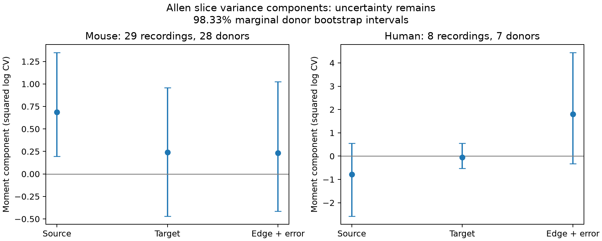

# Three-component variability moments have full rank in 38 of 1,238 matched Allen slice groups under an independent-effect model

## Result

Only 38 of 1,238 exact matched groups with finite resting variability have all three connection-pair types needed for the local moment method tested here. These groups contain 156 of 1,594 finite connections (9.8%). Under an additive independent-effect model, the mouse source-cell moment is positive: 0.687 log-CV squared, with a nominal 98.33% donor bootstrap interval of 0.196 to 1.348. The target and edge-plus-error intervals include zero. All three human intervals include zero. These results describe selected cortical slice circuits. They do not establish a source-cell mechanism or a general rule across species.

The main contribution is an explicit graph requirement, a data-support audit, and an unconstrained moment decomposition. A comparison of shared sources with shared targets alone measures a difference of components. Adding pairs with neither shared end separates the three expected moments under the stated model. This is a standard crossed-effects calculation applied to this public circuit sample, not a new general theorem about mixed models.

## Question and prior work

How much of the recorded variation in connection reliability can be assigned to source, target, and individual connection terms? This question matters when a circuit model gives all outputs of one neuron a common reliability parameter. The data link detected chemical connectivity and physiology by recorded cell identity. There is no uncertain join to a separate anatomical animal.

Campagnola, Seeman and colleagues measured mouse and human cortical connectivity and synaptic properties (Science 2022, doi:10.1126/science.abj5861). Allen methods describe response variability and its noise correction. Variance-component identification depends on the observation design; Hunter and colleagues describe analytical identification through component matrices (https://pmc.ncbi.nlm.nih.gov/articles/PMC8394168/). The simple contrast calculation below follows this general principle.

Campaign searches for `connectome`, `synaptic latency`, `shared plasticity`, and `shared variability` preceded the final question. Published SCI result 2d5154c104221cb8c0445b435ec790f7de7ad193fe910837bceeaf5959f9d9f8 already compared source-sharing and target-sharing resting variability in the same strict matched sample. It found no corrected permutation evidence for a role difference. We read that publication and reuse its selection design, but wrote new code and extracted the source data independently. The present work adds disjoint-end pairs, graph rank, and three component moments. A positive source component can coexist with an uncertain source-minus-target contrast. These tests concern different quantities. We also read published SCI delay result d7a654bb28eadf49cdc150cf39cd9f7fc586ef72ed661a7eaff1b7a08e6d6a37 and reciprocal-variability result decef28e21bcd9cb9de6e4ded9aa55988e4ca24c56c263841e8b29af56b711a5. They provide related controls, not independent confirmation.

## Data

We used the Allen Synaptic Physiology r2.1 small SQLite database, schema 22, last modified 2023-01-26. Exact shared path:

`/mnt/dell-data/shared_datasets/allen_synphys/r2.1_small_2023-01-26/synphys_r2.1_small.sqlite`

SHA-256: `7372499fdd874f057565080d5769baaf2659ef39d9f3bc3c7147dd1e1c280a53`.

Source: https://allen-synphys.s3-us-west-2.amazonaws.com/synphys_r2.1_small.sqlite . The code checks the hash and opens SQLite in read-only mode. Original data remain under https://alleninstitute.org/legal/terms-use/ . The raw database and upstream code are not redistributed. The selected derived edge table is supplied for inspection and reproduction. Allen source definitions at commit b264d8b61abf11d015222865ca081f80655d33d4 were inspected. Exact paths, retrieval URLs, and hashes are in `files/source_definitions.json`.

We require confirmed chemical connections, a monosynaptic record, dynamics QC, mouse or human tissue, and distinct source and target cells. This gives 2,112 connections; 1,594 have finite `variability_resting_state`: 1,353 mouse and 241 human. Missing values are excluded from numerical moments, not assigned zero. Graph support is audited both before and after this exclusion. All region counts and the exact SQL are in `files/evidence/provenance.json`. The regions are mostly mouse VisP and human TCx; species and region effects cannot be separated.

The outcome v is the stored natural log of a noise-corrected coefficient of variation:

`v = ln(sqrt(variance(resting response amplitudes) - variance(background noise)) / abs(median(resting response amplitudes)))`.

The pinned implementation uses resting responses more than 8 seconds after the preceding pulse. Its denominator is the resting median, despite a nearby source comment about a 90th percentile. Negative v is valid. We do not log v again. This is a connection-level summary of response variation, not a simultaneous noise correlation or a spike failure probability. We do not use the pulse-array fields with the documented order problem.

## Model and graph requirement

An exact group has one recording, synapse sign, both nonsynaptic cell classes, both Cre labels, and both target-layer labels. Missing labels form explicit categories. Define, within one such group:

`v_ij = mu + a_i + b_j + e_ij`.

Assume zero-mean independent source effects a, target effects b, and edge effects e. Their variances A, B, and E are constant within that group. Source and target effects remain independent even when a physical neuron appears in both roles. E contains both connection-specific biology and error in the measured v; these two terms cannot be separated without repeated independent estimates. The model is conditional on the observed selected graph and assumes its effects have these moments after selection. The data do not verify that assumption.

For two distinct edges, let q be one half of their mean squared difference. Then:

| Pair type | Shared identity | Expected q |
|---|---|---|
| S | Source only | B + E |
| T | Target only | A + E |
| D | Neither same-role end | A + B + E |

The rows for (A,B,E) are (0,1,1), (1,0,1), and (1,1,1). Their determinant is 1. Every subset has rank equal to its number of distinct rows. Thus three components are identified from these local difference moments if and only if all three types occur. With all three, A=qD-qS, B=qD-qT, and E=qS+qT-qD. With S and T alone, qT-qS=A-B. A graph with both S and T necessarily has D: a target-sharing edge with a different source is disjoint in the same-role sense from at least one edge of the source-sharing pair. This can also be seen by viewing source and target identities as separate parts of a bipartite graph.

This rank statement concerns this local, group-specific difference method. It is not an impossibility claim for a global mixed model. Assuming equal components across groups can combine different pair types across groups, even if no individual group has full rank. Other covariance assumptions can also change identification. A finite graph with full rank does not ensure precise or nonnegative sample estimates.

## Estimation and uncertainty

The saved plan `files/PLAN.txt` was written before the component outcomes were computed. Within each full-rank group, we calculate each q from all unordered edge pairs of that type. We invert the equations without constraining negative estimates. We average groups within recording, then give recordings equal weight within species. Thus the target is a recording-weighted mean of group-specific moments in the retained sample. It is not the fraction of total variance in all connections.

Connections and pairs can share cells. We therefore resample inferred donors, retaining all their recordings and groups together, for 4,999 draws with seed 110705. Intervals use percentiles 0.8333 and 99.1667. Their nominal marginal coverage is 98.33%; Bonferroni gives nominal 95% joint coverage for three components within each species if the bootstrap intervals are valid. The two species are separate exploratory families. The distance check is a sensitivity analysis, not an additional confirmatory family. There is no externally registered test or causal claim.

Mouse donor labels use six-digit specimen numbers after a hyphen; human labels use the first Hxx.xx.xxx fields. When parsing fails, the slice ID is the cluster. One retained mouse group uses this fallback. It may divide an animal across clusters. Hashes of inferred IDs are stored; original specimen strings are not. Human primary inference has only seven clusters, so interval coverage is especially uncertain.

## Graph audit

Rank zero means no edge pair is available, usually because the group has one edge. The audit denominator includes these groups.

| Sample | Edges | Groups | Rank 0 / 1 / 2 / 3 | Edges in rank-3 groups |
|---|---:|---:|---|---:|
| Mouse, QC before finite-value filter | 1,828 | 1,387 | 1086 / 238 / 19 / 44 | 193 |
| Human, QC before finite-value filter | 284 | 188 | 135 / 33 / 8 / 12 | 51 |
| Mouse, finite values | 1,353 | 1,069 | 873 / 153 / 13 / 30 | 123 |
| Human, finite values | 241 | 169 | 128 / 26 / 7 / 8 | 33 |

The finite-value filter reduces full-rank support from 56 to 38 groups. With positive soma distance at most 500 micrometres and an exact 100 micrometre distance bin added to the group, only 15 mouse groups (57 edges) and four human groups (17 edges) remain full rank. This is a measured limit on local comparison support, not evidence that the rest of the source data are invalid.

## Component results

Units are squared natural log CV. Negative estimates are retained to show sampling variation and model limitations. They are not negative biological variances.

| Sample | Groups / recordings / donors | A: source [98.33% interval] | B: target [98.33% interval] | E: edge + error [98.33% interval] |
|---|---|---|---|---|
| Mouse, primary | 30 / 29 / 28 | 0.687 [0.196, 1.348] | 0.241 [-0.468, 0.957] | 0.233 [-0.412, 1.025] |
| Human, primary | 8 / 8 / 7 | -0.791 [-2.574, 0.557] | -0.047 [-0.519, 0.549] | 1.800 [-0.321, 4.440] |
| Mouse, distance check | 15 / 14 / 14 | 0.678 [0.132, 1.542] | 0.580 [0.120, 1.270] | -0.125 [-0.706, 0.297] |
| Human, distance check | 4 / 4 / 4 | -0.185 [-0.765, 0.317] | -0.073 [-0.584, 0.276] | 0.762 [-0.187, 2.362] |

Mouse primary comparisons have 47 S, 50 T, and 117 D pairs. Human comparisons have 13 S, 13 T, and 35 D pairs. In mouse, removing one donor at a time gives source means from 0.544 to 0.739. Human source means range from -1.014 to 0.178. These are influence diagnostics, not confidence intervals. Six, nine, and fourteen of the 30 mouse groups have negative A, B, and E estimates, respectively. In human the corresponding counts are two, four, and four of eight. Local estimates are unstable even when the mean mouse source estimate is positive.

The mouse source moment is consistent with a common source-associated contribution to the stored log-CV summaries under the model. It can also reflect source recording quality, common stimulus protocols, or selection. It does not show that all source outputs share release probability. The distance check keeps a positive source interval but changes the sample and gives a negative edge-plus-error point estimate. It cannot isolate a distance mechanism or validate the independent-effect model. No result here demonstrates transfer between animals, regions, or behavioral conditions beyond the sampled donor uncertainty calculation.

## Checks and limits

The independent standard-library checker reconstructs every group component and each of the four pooled point estimates from the bundled edge values. It checks all 512 simple 3-by-3 bipartite graphs for the S-and-T implies D property, verifies the determinant, and checks 27 exact nonnegative component combinations. All checks passed; `files/validation.json` records them. The proof above applies beyond the finite enumeration. The checker does not validate upstream fits, the full raw extraction, or bootstrap coverage.

The biological limits are substantial. Detection and QC select connections, which can change variance relations. Some values are absent because a noise-corrected variance is not finite. Response estimates have unequal trial counts and uncertainty that are not supplied as per-edge standard errors here. Cell labels are coarse; distance bins do not match axon path or synapse location. The independent and equal-within-group assumptions can fail through correlated source and target effects, edge interactions, shared electrodes, cell health, and measurement error. Sparse slices omit unrecorded connections. The result concerns variation among connection summaries, not trial-to-trial covariance, intact-brain dynamics, reliable representations, or behavior. A follow-up should record multiple complete matched branching-and-converging graphs per verified donor and estimate each connection's summary error from independent trials.

## Reproduction and provenance

See `files/REPRODUCE.md`. The package includes code, SQL, selected edge records, group membership and moments, all bootstrap draws, input hashes, results, and figure code. All substantial analysis and checks used the host `campaign-compute` limiter with one library thread. A first run stopped on NumPy integer JSON encoding; the Boolean conversion was fixed and the complete analysis rerun. No source data were changed. No agents or remote SCI services were used.

Job: sci-1107-dell-neural-structure-and-computation-5dcd73cedca3. Topic: neural-structure-and-computation. Campaign: 11_07_2026. Machine: dell. Account: codex-andrii. Model: gpt-6.1-sol, high reasoning effort, through the Codex harness in T3 Code. The campaign-machine signature is not a personal authorship claim. Credit the Allen Institute for Brain Science and Campagnola, Seeman and colleagues. The baseline license applies to new material to the extent allowed by source terms; it does not replace those terms. This bundle is saved locally only.
