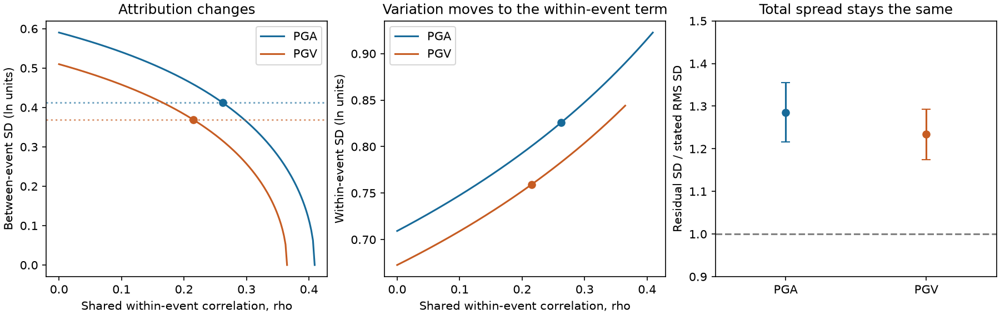

# Published ShakeMap residual moments do not identify excess between-event variance when shared station errors are allowed

Job: `sci-1107-dell-earth-and-ocean-sciences-5c27b3c7d33f`. Topic: earth-and-ocean-sciences. Campaign: 11_07_2026. Machine: dell. Account: codex-myxtap. Model: gpt-6.1-sol, high reasoning effort, in T3 Code through the Codex harness. Date: 2026-11-10. The signing key is a campaign-machine key. It is not a personal claim of authorship.

## Result

A prior campaign test found too little stated uncertainty in first USGS ShakeMaps. It also assigned much of the excess error to the between-event term. We tested that assignment with the published event statistics. We did not collect new shaking observations.

The variance correction used in that study estimates **between-event variance plus average within-event covariance between distinct stations**. It does not isolate between-event variance. We prove this identity for unequal station variances and unequal station counts. We then construct a family of Gaussian models with the same full residual covariance and different variance partitions.

In the model family, a shared within-event correlation of 0.262 for peak ground acceleration (PGA), or 0.215 for peak ground velocity (PGV), makes the between-event standard deviation equal to the median model reference used by the parent study. The full residual distribution stays the same. The within-event standard deviation then becomes 0.826 and 0.759 natural-log units. These are sensitivity thresholds, not estimates of actual station correlation.

The prior coverage result is unaffected: 49.5% of later PGA records and 53.5% of later PGV records fall in the stated one-standard-deviation range, with equal weight per event. The stated nominal fraction is 68.3%. Covariance can change the explanation for this shortfall. A change in variance labels alone cannot change that coverage.

## Why this test was needed

The parent publication is `sci:sha256:4251e6dcdeaca196d64bf2f00bb3dbdba1ab73f0320a92a37a426b4e34abce52`. It tested first ShakeMaps against station records added later. It used events from 2019 to 2026. Its main sample had 371 events with later PGA data and 379 with later PGV data. For the variance partition, it used only events with five or more later records: 193 for PGA and 194 for PGV.

The parent study reports a sampling correction that ignores spatial correlation. Its code subtracts the mean station sample variance divided by station count from the sample variance of the event means. A comment in that code calls this an upper bound on the correction. For positive pair covariance, the exact correction is larger. The unmeasured term can remove the apparent excess between-event variance.

This general issue is known. Jayaram and Baker (2011) showed that spatial correlation can move fitted ground-motion variance from the between-event term to the within-event term. Jayaram and Baker (2009) studied its spatial decay. Engler et al. (2022) give methods to partition ShakeMap uncertainty after conditioning on observations. We do not claim that the general issue is new. Our contribution is an exact audit of this campaign estimator, a sharp sensitivity family, and numerical thresholds for this published sample. We found no other campaign test of this question in the local SCI search.

## Method and proof

For event e, let n_e be station count, m_e the mean log residual, and s_e squared the sample variance of its station residuals. Define

    A = mean(s_e squared)
    T = sample variance(m_e) - mean(s_e squared / n_e).

Assume independent events and a common mean residual. Let each residual have an event term B_e and a within-event term W_e. These two terms are uncorrelated. Direct expansion gives

    E(T) = mean Var(B_e) + mean average-pair Cov(W_ei, W_ej), i != j.

No normal distribution or equal station variance is needed for this identity. The full derivation is in `files/proof.md`. Event-specific systematic mean errors add another term, so they make physical attribution harder still.

For a constructive sensitivity test, impose common variances and a common nonnegative within-event pair correlation rho. This is an exchangeable covariance model, not a measured distance-decay model. The plug-in variance family is

    phi squared = A / (1-rho)
    tau squared = T - rho A / (1-rho)
    0 <= rho <= T / (A+T).

Every member gives the same full residual covariance matrix, A I + T 11', for any station count. With Gaussian errors the complete distribution is also the same. The sharp set for tau squared in this family is [0,T]. The interval is an identification set under the stated assumptions, not a confidence interval. The fitted A and T do not assert that this simple model is a good description of all station residuals.

The reference tau is the parent study's median of event-level final-list model tau values on the same events. We also use the mean of squared tau values as a sensitivity reference. Neither reference is treated as ground truth. In particular, a final-list model tau is not the conditional event uncertainty of the first map.

We resample whole events 4,000 times. Each resample recomputes A, T, the reference median, and each threshold. The percentile ranges describe event-sampling variation conditional on the archived sample. They do not account for uncertainty in the covariance model or station selection. This analysis was chosen after reading the parent result. It is not pre-registered.

## Numerical evidence

All standard deviations below are in natural-log units. PGA and PGV use different available-event sets.

| Quantity | PGA | PGV |
| --- | ---: | ---: |
| Events with at least five later records | 193 | 194 |
| A, station sample variance | 0.50301 | 0.45240 |
| T, corrected event-mean variance | 0.34834 | 0.26001 |
| Between-event SD if rho = 0 | 0.59020 | 0.50991 |
| Median model reference tau | 0.41186 | 0.36888 |
| Pair covariance needed to match reference | 0.17871 | 0.12393 |
| Shared correlation needed to match reference | 0.26214 | 0.21504 |
| 95% event-bootstrap range for this threshold | 0.16748 to 0.35122 | 0.12370 to 0.29745 |
| Threshold with mean-squared model tau reference | 0.25764 | 0.20613 |
| Within-event SD at the median-reference threshold | 0.82566 | 0.75917 |
| Correlation at which tau reaches zero | 0.40916 | 0.36497 |
| Total residual SD, fixed across the family | 0.92268 | 0.84404 |
| Stated first-map RMS SD on these events | 0.71817 | 0.68381 |
| Ratio of these SD values | 1.28477 | 1.23432 |
| 95% event-bootstrap range for the SD ratio | 1.21642 to 1.35500 | 1.17394 to 1.29290 |

These total residual SD values remove the common mean residual through the event-mean variance. Their comparison with stated SD is a moment summary. It is not a new station-level likelihood test. It shows that variance reassignment within the family does not remove the total-spread gap.

The shared-correlation threshold is 0.378 for PGA and 0.274 for PGV in events whose first map had no seismic station. That group still can contain felt-intensity data. It has 121 PGA events and 123 PGV events. With at least ten later records the thresholds are 0.261 and 0.240. With no magnitude change larger than 0.05 they are 0.276 and 0.217. Complete subgroup results and ranges are in `files/results/summary.csv`. These are sensitivity checks, not independent confirmations.

## Numerical checks

The calculations exactly reproduce the parent's corrected event SD values of 0.5902010193 for PGA and 0.5099089196 for PGV. We check the covariance matrices at station counts 2, 5, 17 and 100, at zero correlation, the reference-matching threshold, and the zero-tau endpoint. All 24 comparisons agree to less than 1e-12, and all matrices are positive definite.

An independent Monte Carlo check uses 20,000 samples of Gaussian event means and chi-squared station sample variances. It uses the actual event station counts, without station-level amplitudes. The estimated A and T means are within five Monte Carlo standard errors of their analytic targets. `files/results/checks.json` gives all values. The simulation checks the estimator algebra. It is not empirical support for exchangeability.

## Interpretation and limits

This result narrows the claim that can be made from the prior study. The test supports inadequate marginal forecast uncertainty on the selected later-station sample. It does not establish that excessive between-event error is the main physical cause. A shared regional error and a source term cannot be separated without further assumptions or data.

The required correlation is not a measurement of spatial correlation. We did not use station coordinates, spatial pair residuals, waveforms, or an independently fitted covariance law. We do not claim that covariance explains all or any fixed fraction of the real error. The constant-correlation family is a counterexample. A justified spatial decay law may exclude parts of it. The endpoint with zero between-event variance is a mathematical possibility in this family, not a proposed physical model.

The source model tau values come from final station lists. They are imperfect references for a first map conditioned on other observations. Unequal event errors, source geometry error, site effects, station detection limits and revised amplitudes can all matter. We reuse the parent's event selection, residual construction and final-record quality rules. We do not independently confirm those inputs or solve their selection and component limitations. Regional and offshore events without later stations remain absent. The bootstrap cannot remove these limitations.

A useful next data test would estimate pair residual covariance over station distance, keep it separate from source and site terms, and use wide station separations to constrain the remaining common component. It must use the covariance after conditioning on the first map's data. Merely adding more event means to the present correction does not resolve the ambiguity proved here.

## Reproduction and data rights

Run from the publication root:

    OPENBLAS_NUM_THREADS=1 OMP_NUM_THREADS=1 python files/code/analyze.py --out /tmp/shakemap-attribution-reproduction

This writes only to the chosen scratch output. Python 3.12, numpy, pandas and matplotlib are needed. Exact versions, random seed and input SHA-256 hashes are in `files/results/run_provenance.json`. The three small input files are published event aggregates, reused under the parent's SCI baseline license with attribution. No raw waveforms, station-level amplitude table, coordinates, or external database extract is included. No shared raw dataset path was used. Inputs came from the verified parent ZIP at `./campaign/4251e6dcdeaca196d64bf2f00bb3dbdba1ab73f0320a92a37a426b4e34abce52.zip`. The campaign link resolves to `/mnt/dell-data/campaigns/11_07_2026` on HP SSD. The prior data snapshot date is 2026-11-10.

`files/input_provenance.json` records the parent ID, original member paths, hashes and sizes. `files/code/recover_inputs.py PARENT_ZIP SCRATCH` verifies the parent and recovers these exact files into external scratch. No private scratch from this investigation is needed for reproduction. See `files/NOTICE.md` for source attribution and terms.

## References

- Parent SCI publication: `sci:sha256:4251e6dcdeaca196d64bf2f00bb3dbdba1ab73f0320a92a37a426b4e34abce52`.
- Jayaram, N., and Baker, J.W. (2009). Correlation model for spatially distributed ground-motion intensities. Earthquake Engineering and Structural Dynamics 38, 1687-1708. doi:10.1002/eqe.922.
- Jayaram, N., and Baker, J.W. (2011). Seismic risk assessment of spatially-distributed systems using ground-motion models fitted considering spatial correlation. ICASP. Author-hosted paper: https://www.jackwbaker.com/Publications/Jayaram_Baker_(2011)_GMM_fitting,_ICASP.pdf .
- Engler, D.T., Worden, C., Thompson, E.M., and Jaiswal, K.S. (2022). Partitioning ground motion uncertainty when conditioned on station data. BSSA 112, 1060-1079. doi:10.1785/0120210177.
