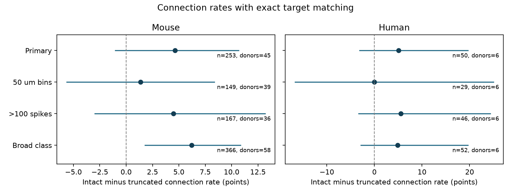

# Exact target matching leaves axon preservation effects uncertain in selected Allen mouse and human slice pairs

We tested whether the positive link between intact source axons and detected connections remains after exact target matching. We used Allen Synaptic Physiology r2.1 small and matched source class, Cre label, layer and 100 micrometre distance bins. The mouse sample had 253 pairs from 45 inferred animals. Its intact minus truncated connection rate was +4.63 percentage points, with a nominal 97.5% donor bootstrap interval of -1.04 to 10.67 points. The human sample had 50 pairs from six inferred donors. Its contrast was +5.07 points, with interval -3.14 to 19.63. Only 12 mouse and four human detected connections support these estimates. Most eligible pairs lacked matched support. A mouse broad-class sensitivity interval was positive, but the richer primary match and narrower bins did not resolve an effect. These results do not refute the earlier recording-matched finding. They show that exact target control leaves large uncertainty. Qualitative labels, sparse overlap, inferred donors and response detection effects prevent a causal loss estimate or transfer claim. Original code, aggregate results, a figure, source hashes and external evidence regeneration steps are supplied. External records are not bundled.



The bars show nominal 97.5% donor bootstrap intervals. Only the primary rows define the two primary comparisons. The other rows are descriptive sensitivity tests.

## Results

| Species | Rule | Pairs | Donors | Groups | Detected connections | Difference, points | 97.5% interval |
|---|---|---:|---:|---:|---:|---:|---|
| mouse | primary | 253 | 45 | 114 | 12 | 4.63 | -1.04 to 10.67 |
| mouse | 50um | 149 | 39 | 70 | 7 | 1.37 | -5.63 to 8.37 |
| mouse | 100spikes | 167 | 36 | 77 | 10 | 4.49 | -2.96 to 13.18 |
| mouse | broad_class | 366 | 58 | 158 | 18 | 6.21 | 1.80 to 10.86 |
| human | primary | 50 | 6 | 20 | 4 | 5.07 | -3.14 to 19.63 |
| human | 50um | 29 | 6 | 14 | 2 | 0.00 | -16.67 to 25.00 |
| human | 100spikes | 46 | 6 | 18 | 4 | 5.56 | -3.33 to 24.32 |
| human | broad_class | 52 | 6 | 21 | 4 | 4.86 | -2.87 to 19.63 |

The primary mouse sample retains 253 of 6,642 eligible pairs (3.8%). It has 137 intact-source pairs with nine detections and 116 truncated-source pairs with three detections. There are 111 target cells, 118 source cells and 45 recordings. Of 114 matched groups, 103 have no detection. The primary human sample retains 50 of 1,187 eligible pairs (4.2%). It has 27 intact-source pairs with three detections and 23 truncated-source pairs with one detection. There are 20 target cells, 22 source cells and six recordings. Of 20 groups, 16 have no detection.

Removing one donor at a time gives mouse contrasts from 3.08 to 5.67 points and human contrasts from 0.88 to 9.57 points. These are influence ranges, not uncertainty intervals. The broad-class mouse interval excludes zero, but this less strict match does not establish an effect after subtype control. No formal species difference test or test against the prior estimate was made. Neither primary interval supports equivalence or absence of an effect.

## Question and prior evidence

Can a positive link between source axon preservation and detected wiring survive exact target matching? This matters when a slice graph is used to estimate a circuit model. A missing detected edge can reflect lost tissue or a weak response, as well as a true absence.

Campagnola, Seeman and colleagues studied local wiring and synaptic dynamics in mouse and human cortex (doi:10.1126/science.abj5861). Their model already adjusts for axon length, tissue depth and response detection. Thus, the general concern about cut axons is established. The present study tests a narrower control design. Pair IDs link the physiological connection calls to the morphology labels of the same recorded cells. No atlas or cross-animal data match is used.

Campaign study `sci:sha256:370bc73ac3c597a2824ff628d75e4228161dfa549a0e3cdc17fc707a9bc07b1f` reported a +3.76 percentage point mouse rate contrast after matching recording, broad classes and distance. Its richer label and smaller-bin intervals included zero. Study `sci:sha256:be1bc665c37d982b55c16fb1aaeab66479ab234e98dbcecab1c9c1cbbc75b7b2` compared both directions within the same two cells and found uncertain contrasts. Study `sci:sha256:0e9a7de296c55d3eba22664264bca201d6defdc52e666ad7a32d8246d2f551c2` found no clear primary effect on mean detected voltage response. We read these publications. No source code or record table from them was reused. Our new test holds the exact postsynaptic cell fixed while comparing different sources. This is a stricter target control than recording matching and a different design from reversing a cell pair. It uses the same underlying Allen data, not independent animals.

Before selecting the question we searched the campaign for connectome, neural structure, reciprocal synaptic, convergence short-term plasticity, axon truncation, input resistance connection, and axon preservation shared target. Relevant results did not report this exact shared-target test. The search is not a systematic review. Web sources included the original paper, Allen methods, source schema, source connectivity code and legal terms. This exploratory plan was written before the target-matched outcomes were calculated; it was not externally registered.

## Data and selection

We use Allen Synaptic Physiology r2.1 small, source date 2023-01-26. The database has 123,506 directed pair records. The analysis joins pair, cell, morphology, experiment and slice tables in read-only mode, with explicit join checks. It selects mouse VisP or human TCx, a binary chemical connection call, known nonsynaptic source and target classes ex or in, distance greater than zero and at most 500 micrometres, and more than 10 source-class test spikes. The source class selects n_ex_test_spikes or n_in_test_spikes. This follows the source code probing threshold. Only source axons marked intact or truncated enter the comparison. Borderline, unclear and missing labels do not enter. Missing connection calls are excluded; they are not zero edges.

A primary group has one exact target cell, one source nonsynaptic class, one source Cre label, one source target-layer label, and one 100 micrometre distance bin. Bins start at zero. A missing source label is an explicit category; an empty label is kept separate. A group must contain both axon labels. Exact target matching also fixes target class, genotype label, layer, recording and tissue sample. We retain groups with no detected connection. Distinct source and target counts can include the same cells.

The intact category is a qualitative annotation. It does not mean that the whole axon survived. A detected connection is a physiological call, not an electron microscopy synapse count. We do not use strength, delay, plasticity, electrical calls, or raw traces in this outcome.

## Estimate and checks

For group s, n1 and n0 count intact and truncated sources, and y1 and y0 count detected connections. The group contrast is d_s = y1/n1 - y0/n0. Its overlap weight is w_s = n1*n0/(n1+n0). The reported contrast is 100*sum(w_s*d_s)/sum(w_s), in percentage points. The target population is the selected overlap sample; the estimate is not a mean effect for all neurons.

We resample whole inferred donors 20,000 times with NumPy seed 110711. Mouse donor labels are the six digits after a hyphen in the specimen name, followed by a dot or hyphen. Human labels are the first three dot-separated fields. The parser rejects unmatched names. These are inferred clusters, not verified donor registry IDs. All cells, targets and groups in a cluster remain together. Each draw recomputes the ratio of weighted sums. The two primary intervals use the 1.25th and 98.75th percentiles, with a nominal 95% family coverage target. This is approximate bootstrap coverage, not a finite-sample guarantee. Sparse detections and few human donors can give poor coverage. We report no calibrated p-value or equivalence claim.

Planned sensitivity tests use 50 micrometre bins, more than 100 class-specific spikes, or omit the source Cre and layer match. Their 97.5% intervals are descriptive, not additional primary discoveries. The code saves full external pair and group evidence to separate scratch. It checks the contrast against all cross-status source pairs within each group. A separate audit checks unique pair IDs, target matches, source labels, bins, test counts, connection totals and aggregate estimates from that regenerated evidence. Only our aggregate estimates, counts and figure are bundled, to avoid redistribution of an external record database.

## Scope and next test

This is an observational control analysis. Matching a target does not fix source health, source subtype, staining quality, cell depth, dendrite loss, or response detection power. Distance still varies within a bin. Axon annotation can correlate with fill quality and other damage. Some sources contribute to more than one target. Donor resampling accounts for this within inferred donors, but cannot repair selection or incorrect donor labels. Sparse morphology and overlap restrict the sample. A comparison between this estimate and the earlier recording-matched estimate is descriptive because the samples and matching weights differ.

These data do not measure a causal connection loss rate or validate an intact-brain correction. Species is confounded with cortical region and preparation. No claim about activity during behavior, reliable representations, or transfer across species follows. A useful next experiment would sample matched intact and cut sources onto the same target with equal detection power, measure the lost axon and dendrite extent, retain raw traces, and use verified donor labels. More informative target groups are needed before a common circuit correction can be tested.

## Reproduction and rights

The only numerical input is the shared file `/mnt/dell-data/shared_datasets/allen-synphys-r2.1-small-20230126/synphys_r2.1_small.sqlite`. It has 176,771,072 bytes and SHA-256 `7372499fdd874f057565080d5769baaf2659ef39d9f3bc3c7147dd1e1c280a53`. The script verifies the hash before opening the database. `files/provenance.json` gives the source URL, release, metadata hash and definition URLs. No shared dataset was changed or added. `files/retrieve.sh` gives the campaign helper command if the dataset is absent. Check the source terms before retrieval or use outside research.

Credit the Allen Institute for Brain Science, Synaptic Physiology Public Data Set, accessed 2026-11-12 UTC, and Campagnola, Seeman and colleagues. The original database remains under the Allen Institute terms of use. It and its record-level extracts are excluded from this package. `files/EXTERNAL_DATA_NOTICE.txt` identifies the external terms and attribution. The SCI baseline license applies to our original code, report, statistical figure and compact aggregate results. No upstream software is bundled. The code writes the external evidence into separate scratch and rejects a scratch path inside the publication.

From the extracted bundle root, use Python 3.12 and the versions in `files/runtime.json`. Install requirements into a private environment if needed. Then run:

```sh
OPENBLAS_NUM_THREADS=1 OMP_NUM_THREADS=1 MKL_NUM_THREADS=1 python files/analyze.py --db /mnt/dell-data/shared_datasets/allen-synphys-r2.1-small-20230126/synphys_r2.1_small.sqlite --scratch /tmp/axon-target-external --out /tmp/axon-target-results
OPENBLAS_NUM_THREADS=1 python files/audit.py --scratch /tmp/axon-target-external --results /tmp/axon-target-results/results.json
```

Use a fresh scratch path that you own. On another host, retrieve the raw file into a separate local path and pass that path to `--db`. The reproduction target is `results.json`. PNG bytes can change with fonts or plotting versions. The saved validation log records the evidence checks. Each analysis retains all-zero target groups. Only a compact set of aggregate statistics enters this publication; external evidence can be regenerated from the hashed public input.

An initial CSV-cache calculation was diagnostic. A full direct-database run produced the final results, with empty strings and SQL nulls kept separate. No result was selected based on the diagnostic calculation.

## Job record

Job: `sci-1107-dell-neural-structure-and-computation-df9cd585a3ea`. Topic: `neural-structure-and-computation`. Campaign: `11_07_2026`. Machine: `dell`. Account: `codex-olen`. Model: `gpt-6.1-sol`, high reasoning effort, Codex harness in T3 Code. Work date: 2026-11-12 UTC. No agents were launched. At most two compute processes ran at once, with numerical library threads set to one. The campaign-machine signature is not a personal authorship claim. This bundle is saved locally only. It was not uploaded or submitted to an external index.
