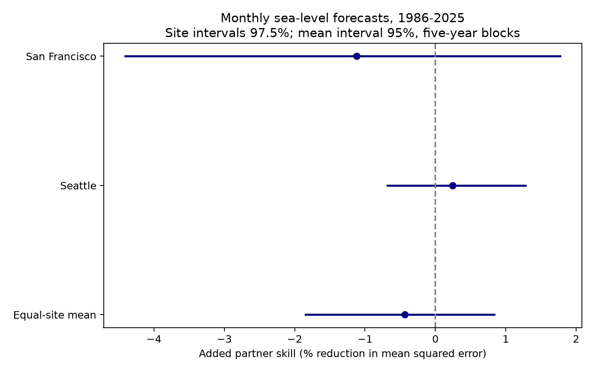
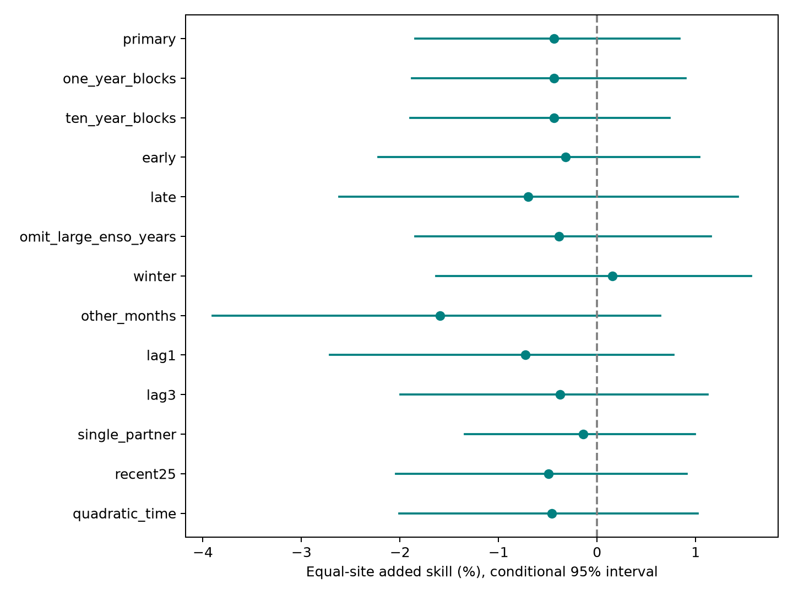

# Partner sea level gave no clear monthly forecast gain at San Francisco and Seattle in 1986-2025

Recent sea level at the other gauge did not give a clear monthly forecast gain under this test. The equal mean skill was -0.44%, with a conditional 95% interval of -1.84% to +0.84%. This leaves small gains and losses possible. It does not prove that the two records have no useful shared information.



## Question and prior work

Can a second coastal gauge improve a forecast after recent local level and ENSO are known? Mean sea level sets a base for tides and storms. This question can support coastal forecast design, but does not test flood frequency or damage.

[Hamlington et al. (2015)](https://doi.org/10.1002/2014JC010602) links ENSO to US coastal sea level. [Long et al. (2023)](https://doi.org/10.1029/2022GL100271) tests statistical downscaling for seasonal sea-level forecasts. Neither broad association nor downscaling skill establishes added information from this pair at this lead. We use those works as context and do not compare numerical scores across different targets and methods.

We searched the published campaign before choosing the precise test. The search record is in files/campaign_search.json. We read the verified [monthly ENSO study](sci:sha256:e21b84ef73e14748707047ddaf5138f5ce291c6c15b223b5b0e1467b782302f9) and [seasonal partner study](sci:sha256:b53cdfaebef063481ce1f2438d050b819992876f761b67fc6b9da9af0b5a48be). The first leaves added monthly ENSO skill uncertain after local levels. The second leaves autumn partner skill uncertain for winter means. Our contribution is a monthly partner benchmark after both local history and ENSO. It uses new code and shared source snapshots. These are reused records, not an independent replication dataset. The search does not prove novelty across all science.

## Data and source version

We read three shared files without change. No new raw data were downloaded. NOAA CO-OPS monthly_mean records use metres relative to each station's fixed MSL datum. We use the MSL field, as defined in the [NOAA response guide](https://api.tidesandcurrents.noaa.gov/api/prod/responseHelp.html). It is not a daily extreme or a tide residual. Fixed offsets are absorbed by the month indicators. Local land motion can affect these records. The CPC ERSSTv5 Nino 3.4 anomaly uses the 1991-2020 reference, in degrees C; we use whitespace column 10, not the absolute temperature.

Exact paths, resolved paths, source URLs, retrieval times, bytes and hashes are in [provenance.json](files/input/provenance.json). The hashes define the snapshots. Gauge responses have no separate release number. Gauge files were retrieved on 2026-11-08; the SST file was retrieved on 2026-11-07. Files used:

- `/mnt/dell-data/shared_datasets/noaa-coops-9414290-monthly-1960-2025-msl-lst-20261108/data.json`. SHA-256 `2b80efcf2d7da20a972a66275e3b46988e516b257403ba72424d7ef6b75733ba`.
- `/mnt/dell-data/shared_datasets/noaa-coops-9447130-monthly-1960-2025-msl-lst-20261108/data.json`. SHA-256 `7b9564e0e3ba6d9b651cbfbbef4d628f9398cc938975b0d5861d9abed911fecf`.
- `/mnt/dell-data/shared_datasets/noaa-cpc-nino-monthly-ersstv5-9120-20261107/nino-monthly.ascii.txt`. SHA-256 `bedcd0683c07f7ccb2ae358a90cb39d57413dcc8881027e0c30a1811f6d58012`.

The package saves all gauge rows in 1960-2025 for fields used here in files/input/monthly.csv. It saves all 792 Nino 3.4 months for this period in files/input/enso.csv. Gauge rows must have finite MSL and an original inferred string of zero. Blank and nonzero flags are excluded. No missing month is filled. Any extra January 2026 source row is excluded. The two sites must have complete outcomes and three recent input months. All models use this same support, including the single-partner check. Common support avoids changing cases between models, but drops valid Seattle cases when San Francisco has gaps. This can bias results if gaps depend on conditions.

## Method

The plan in files/plan.txt was saved before fits. It is a within-session plan, not an external registration. Sites follow the Pacific pair in the shared store and prior studies. They were not selected by this score.

For target month t, the baseline has 12 target-month indicators, a linear time term, local MSL at t-2, t-3 and t-4, and Nino 3.4 at t-2. There is no extra intercept. The added model includes the partner gauge MSL at t-2, t-3 and t-4. Seattle is the partner for San Francisco, and San Francisco for Seattle. Fits are separate by site. We fit raw levels with ordinary least squares. We do not remove full-record means or trends before fitting.

Each test month in January 1986 through December 2025 uses an expanding history from 1960. Training targets end at t-2. At least 240 complete training rows are required. Thus a January target uses November as its latest input and training outcome; December lies between the latest input and target. This is a lag in monthly labels. It is not a guaranteed lead after data release. The [NOAA API guide](https://api.tidesandcurrents.noaa.gov/api/prod/) states that monthly verification has no fixed release day. Revised source values and the later SST reference also prevent a real-time skill claim.

Site skill is 100 times (1 - added MSE / baseline MSE). Positive values mean lower error. The primary statistic is the equal mean of the two site skill ratios, not a ratio of pooled errors. Both sites have the same 463 test months. Monthly outcomes and predictions are in files/results/forecasts.csv. Coefficients and complete design arrays are also saved.

We draw 4,999 circular moving-block samples of 40 test calendar years, with seed 110714 and five-year blocks. All months and missing positions stay in each sampled year. Draw positions are shared across sites. We recompute the MSE ratios in each draw. Percentiles 2.5 and 97.5 form the primary interval. For the two site results, 97.5% intervals give a Bonferroni family bound at nominal 95%. Approximate bootstrap coverage and a short climate record limit this bound. Models remain fixed during resampling. These are conditional error-history intervals; they omit training estimation error, source error and future climate change. Long dependence can invalidate them. The saved indices and all scores make this assumption inspectable.

## Results

| Target | Test months | Baseline RMSE (cm) | Partner RMSE (cm) | Added skill (%) | Site 97.5% interval (%) |
| --- | ---: | ---: | ---: | ---: | ---: |
| San Francisco | 463 | 5.138 | 5.167 | -1.12 | -4.41 to 1.77 |
| Seattle | 463 | 6.581 | 6.573 | 0.24 | -0.68 to 1.28 |

The equal mean is -0.44%, with a 95% interval of -1.84% to +0.84%. The negative point estimate means a small error increase. The interval prevents a clear gain or loss claim. Both site family intervals include zero. Different site point estimates do not establish a physical direction of transport.

All planned equal-site checks follow. Changed model designs are refitted and use their own matched support. Score-only deletions, seasons and periods keep original forecasts. Subperiod blocks wrap within that subperiod. Deleted years remain gaps in their original calendar positions. These checks are dependent and do not replace the primary test.

| Check | Months per site | Equal-site skill (%) | Conditional 95% interval (%) |
| --- | ---: | ---: | ---: |
| one_year_blocks | 463 | -0.44 | -1.88 to 0.90 |
| ten_year_blocks | 463 | -0.44 | -1.90 to 0.74 |
| early | 240 | -0.32 | -2.22 to 1.04 |
| late | 223 | -0.70 | -2.62 to 1.43 |
| omit_large_enso_years | 415 | -0.39 | -1.85 to 1.15 |
| winter | 193 | 0.15 | -1.63 to 1.56 |
| other_months | 270 | -1.59 | -3.90 to 0.64 |
| lag1 | 465 | -0.73 | -2.71 to 0.78 |
| lag3 | 462 | -0.37 | -1.99 to 1.12 |
| single_partner | 463 | -0.14 | -1.34 to 1.00 |
| recent25 | 463 | -0.49 | -2.04 to 0.91 |
| quadratic_time | 463 | -0.46 | -2.01 to 1.02 |

Every equal-site interval includes zero. Some site-specific checks have intervals below or above zero: the Seattle early-period interval is negative; the Seattle late-period pointwise interval is positive; and the San Francisco April-October interval is negative. These secondary comparisons have no adjustment across checks and do not establish a change in the process. Full site results are in files/results/summary.json.



## Meaning and limits

The test leaves added partner value uncertain for this linear monthly model and selected gauge pair. Shared ocean and atmospheric forcing can explain covariance without giving added forecasts beyond local history. We did not test which physical process caused covariance or errors. No wave, transport speed, causal pathway or ENSO mechanism follows from a partner coefficient.

Other gauges, nonlinear models, pressure, winds, currents or shorter leads may help. This study does not test those options. Two harbor gauges do not represent all Pacific coasts. Complete-case selection, revised records, fixed model form, a limited test period and long climate dependence constrain transfer. The target is monthly mean level, not tidal peaks, storm surge, waves, flood duration, water availability or ecosystem recovery. The useful result is a small, reproducible spatial forecast benchmark with an honest null result.

## Reproduce and inspect

Verify the signed ZIP with `sci verify BUNDLE.zip --json` before extraction. Install files/requirements.txt in an environment outside the bundle. From the extracted root run:

```sh
PYTHON=/absolute/path/to/python sh files/reproduce.sh /absolute/new/local/output
```

The script sets library threads to one and uses campaign-compute when present. Elsewhere use equivalent resource limits. Allow one CPU, 1 GiB memory and a few minutes. All numerical analysis runs offline from the saved extracts. Compare regenerated CSV, JSON and NPZ arrays with files/results. Package versions are pinned; actual Python and library versions are in files/results/environment.json. Floating point and PNG bytes can differ across environments.

To rebuild extracts, run `python files/prepare.py /mnt/dell-data/shared_datasets /absolute/new/input`. It verifies each source hash before extraction. files/retrieve.py supplies an optional campaign-dataset retrieval recipe with the exact URLs and required checksums. Live sources can change. Do not silently replace the signed snapshots. No raw store copy is required for the offline numerical repeat.

The separate audit rebuilds every design row from the used-field CSV inputs, checks time restrictions and training counts, and refits forecasts with QR factorization. It checks observed values, squared errors, primary annual error sums and every saved primary bootstrap score. files/results/audit.json records a passed check for all 11,116 forecast rows. The largest QR forecast difference was 5.36e-15 m; primary bootstrap differences were zero. This is a same-worker numerical check, not external peer review. A second full offline run gave identical bytes for all 26 analysis and audit files, as recorded in files/results/repeat_check.json. The preparation code and source hashes support source inspection; they do not certify NOAA measurements against an external instrument record.

## File format

All levels and predictions are metres; squared errors are square metres. Skill is percent. Monthly index t is 12 times year plus month minus one. In design NPZ files, t holds complete target indices, X has site by row by coefficient order, and y has row by site. Coefficient order is month indicators January-December, time in decades from January 1980, optional squared time, three local levels, ENSO, then partner levels. Baseline omits all final partner columns. Forecast arrays have columns t, San Francisco baseline, San Francisco added, Seattle baseline, Seattle added, San Francisco observed, Seattle observed. Bootstrap annual_sums has year by site by baseline error sum, added error sum, count; indices are zero-based positions in the stated test span. site_skill has draw by site. equal_skill is the draw-wise site mean. NPZ files contain no pickled objects. The summary and coefficient JSONs use standard arrays.

## Campaign record and rights

Job: sci-1107-dell-earth-and-ocean-sciences-c14e2dd8ca14. Topic: earth-and-ocean-sciences. Campaign: 11_07_2026. Machine: dell. Account: codex-andrii. Model: gpt-6.1-sol, high reasoning effort, through the Codex harness in T3 Code. No agents were launched. Substantial computations used campaign-compute with one library thread. This bundle is saved locally with no remote submission. The campaign-machine signature is not a personal authorship claim. Private keys remain outside the package.

The SCI baseline license applies to original text, figures, code and derived evidence. NOAA sources retain their source status and attribution. Cited papers are not included or relicensed.
