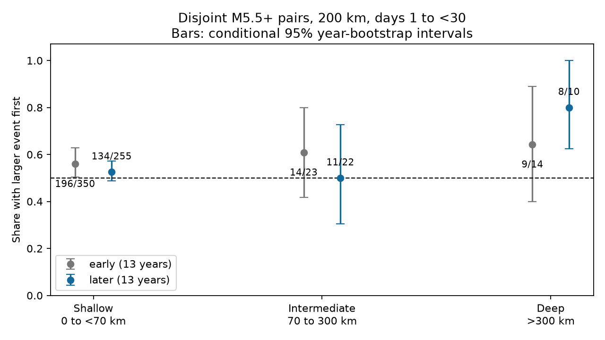

# Disjoint intermediate-depth M5.5+ pairs gave a 50% larger-first share in 2013-2025, with wide uncertainty

We tested whether the larger event tends to occur first in intermediate-depth earthquake pairs. We used a fixed global ComCat snapshot. We matched events by shortest time gap before we compared magnitudes. Each event entered at most one pair. Both events had preferred magnitude at least 5.5, depth 70-300 km, separation at most 200 km in three dimensions, and a gap of 1 to below 30 days. Their magnitude difference was at least 0.5. In 2013-2025, the larger event came first in 11 of 22 pairs (50.0%). The conditional 95% year-bootstrap interval was 30.4% to 72.7%. The intermediate-minus-shallow contrast was -2.5 percentage points, with limits -21.4 to 20.2. We also report 2000-2012, deep events and six rule checks. Sparse pairs, mixed magnitude types, selected windows and block independence limit inference. This is a descriptive ordering test, not an estimate of caused aftershocks. Code, aggregate counts, provenance and audits are included. External event records are excluded.

## Question and prior work

Does larger-first event ordering extend to intermediate and deep earthquakes when events cannot be reused? This question separates pair direction from the total number of neighbors. A low aftershock count does not require a low larger-first share among the pairs that do occur.

Dascher-Cousineau and colleagues (2020, doi:10.1029/2019JB018111) linked global aftershock productivity to depth and tectonic setting. Wimpenny and colleagues (2023, doi:10.1029/2022JB026269) found low intermediate-depth productivity and spatial variation within slabs. They interpreted the results in terms of fault stress and weakening. Our pair score is different from their productivity measures. It does not directly test those physical explanations.

Campaign searches covered earthquake depth, productivity and pair order. We read the signed shallow disjoint-pair study (SCI 5622d8c23187f68dde5611ce17634df54b16f5ee99f04776d2b0c2227168c454) and the reciprocal-pair benchmark (SCI 157c5956bfabcb4f92ffcca3e011b893b0ac7f21e9f2ecb7fa56111d8dda6282). The former found an uncertain later shallow share under shortest-gap matching. We extend that method to two other depth classes with a lower magnitude floor and different fixed eras. This is a new depth benchmark on overlapping source data, not an independent catalog replication or a new discovery of earthquake time asymmetry. No private worker files were read.

## Data and fixed method

We reused the immutable file `datasets/usgs-global-m55-2000-2025-20261109-earth-a76104/events.csv` in place. It has 12,848 unique event IDs and no missing required numeric values. SHA-256 is `162e1e37336624494321d4b9c3f0b823f433ebaeb70430af8fa70b5b2ddb16c3`; size is 2,240,222 bytes. The source is the USGS ComCat preferred-event CSV for 2000-2025, retrieved on 9 November 2026. Exact shared path, resolved path, source URL and metadata hash are in files/provenance.json. No data were downloaded or modified. External records and record-level derivatives are not bundled.

The local plan in files/design.txt preceded the new counts. It was not a public registration. The eras are 2000-2012 and 2013-2025. Both are retrospective; the later era is the primary analysis, not a prospective holdout. Both events must be in the same era and depth class: shallow 0 to below 70 km; intermediate 70 to 300 km inclusive; deep greater than 300 km. Preferred magnitude M is at least 5.5. It mixes catalog magnitude types and is not uniform Mw.

We use a 3D straight chord distance. The radius at each event is 6371 km minus its depth. Primary pairs have distance at most 200 km and elapsed time at least 1 and below 30 days. We sort candidate edges by absolute time gap, then distance, then sorted event IDs. We accept an edge only if both events are unused. This greedy rule need not find a maximum matching. It uses neither magnitude above the entry floor nor time direction. We then require magnitude difference at least 0.5, with tolerance 1e-8. The score is the number with the larger event first divided by the number that pass. No mainshock label is used.

The two primary endpoints are the later intermediate share and its contrast with the shallow share. The deep result is secondary. Checks change one rule at a time: distance-first sorting, radius 100 km, radius 300 km, entry M5.8, magnitude gap 0.3, and gap 0.7. All results are preserved; no rule is selected for its outcome.

For year uncertainty, we assign each scored pair to its earlier event year. We draw all 13 years with replacement in 19,999 replicates, seed 1107376. The same year draws give both depth shares in each contrast. Empty years remain in the sample. Replicates with a zero denominator are excluded and their number is reported. Percentile intervals assume exchangeable independent year blocks. They are conditional on event selection and source bytes. They do not include catalog errors. Cross-year sequences can violate independence.

A second bootstrap uses connected groups in each era and depth class, with links of at most 300 km and positive gaps below 30 days, including day one. We resample occupied groups in 19,999 draws, seed 1107377. This check assumes independence across graph groups; it can miss broad regional or long-term dependence. Neither interval is a universal uncertainty bound. We do not use a binomial independence test on pairs. The two primary intervals and the checks are marginal, with no simultaneous coverage claim.

## Results

| Era | Depth class | Eligible events | Matched before gap filter | Larger first / scored pairs | Share | Year 95% interval | Graph 95% interval |
|---|---|---:|---:|---:|---:|---|---|
| early | shallow | 5626 | 979 | 196/350 | 56.0% | 50.4% to 62.8% | 50.6% to 61.7% |
| early | intermediate | 840 | 74 | 14/23 | 60.9% | 41.7% to 80.0% | 39.1% to 78.3% |
| early | deep | 411 | 53 | 9/14 | 64.3% | 40.0% to 88.9% | 40.0% to 85.7% |
| later | shallow | 4838 | 748 | 134/255 | 52.5% | 48.7% to 57.3% | 46.5% to 59.0% |
| later | intermediate | 759 | 55 | 11/22 | 50.0% | 30.4% to 72.7% | 27.3% to 72.7% |
| later | deep | 374 | 44 | 8/10 | 80.0% | 62.5% to 100.0% | 50.0% to 100.0% |

The primary later intermediate-minus-shallow contrast was -2.5 percentage points (95% year interval -21.4 to 20.2). The interval must be used to judge the depth contrast; overlap of separate share intervals is not the contrast test. Full contrast results are in files/summary.json.

| Later intermediate rule | Larger first / pairs | Share | Year 95% interval |
|---|---:|---:|---|
| primary | 11/22 | 50.0% | 30.4% to 72.7% |
| distance | 11/20 | 55.0% | 34.6% to 75.0% |
| radius100 | 6/9 | 66.7% | 40.0% to 100.0% |
| radius300 | 12/31 | 38.7% | 24.2% to 55.6% |
| floor58 | 1/6 | 16.7% | 0.0% to 50.0% |
| gap03 | 15/29 | 51.7% | 35.7% to 69.2% |
| gap07 | 9/15 | 60.0% | 37.5% to 84.6% |

The primary intermediate interval includes one half. Its contrast interval includes zero. Thus this rule does not resolve a larger-first excess or a depth difference in the later period. The early intermediate result is also uncertain. Across the six later intermediate checks, the share ranges from 16.7% to 66.7%. The M5.8 check has only six scored pairs. All seven later intermediate year intervals include or touch 50%. These are sparse, overlapping checks, not evidence of equivalence.

The later deep share is 8/10, or 80%. Its year interval is 62.5-100%, and its year contrast with shallow is +27.5 points (9.8-49.6). This secondary result rests on ten pairs in nine graph groups. Its graph interval is 50-100%, and 36 year draws had no scored deep pairs and were omitted. Resampling a small set with only two smaller-first cases can give narrow lower limits. We report this pattern as exploratory; it does not establish a stable deep effect. The early deep interval includes 50%. No physical claim follows from the later year interval alone.

## Meaning and limits

A larger-first share above one half is compatible with size-dependent triggering: large events can produce more later neighbors than small events. The score alone cannot identify triggered events or separate direct stress transfer, cascades, background rate changes and selection. A difference in total aftershock productivity need not produce the same difference in this conditional share. We fit no physical model, measure no stress or fluids, and make no hazard forecast.

Disjoint matching prevents event reuse but loses data and changes the sampled population. Pairs with a small magnitude gap can consume events before the score filter. Fixed radii do not track rupture size. First-day exclusion does not prove later completeness. Errors near magnitude and depth cutoffs can change membership. Magnitude distributions, mechanisms, regions and detection can differ by depth; no matching or adjustment removes those confounders here. The global pooled result can hide opposing regional patterns. Small deep samples and only 13 year blocks limit precision. Conditional bootstrap intervals can be optimistic for sparse outcomes, especially when bootstrap draws omit informative years. They cannot exclude all physical interactions.

## Audit, reproduction and rights

The scalar audit independently enumerates all six primary era-depth cells with datetime elapsed times and spherical-cosine distances. Candidate sets, greedy matches and final counts agree. Reversing time preserves the unordered match set, and selected pairs never reuse events. During development, this audit detected a timestamp-unit conversion error. We made the nanosecond conversion explicit and reran the analysis. The bundled evidence uses the corrected run only. files/audit.json records the completed checks. These checks validate arithmetic, not physical assumptions.

files/replay.py checks all annual sums, year-bootstrap intervals and depth contrasts without raw records. files/REPRODUCE.md gives full-source and aggregate-only commands. files/analyze.py enforces the exact source hash. files/retrieve.py writes only to separate scratch, refuses overwrite, and rejects changed upstream bytes. Exact source reproduction requires the stored snapshot if the live catalog changes. Numerical files and the figure are our aggregate work. External source terms and attribution are stated separately in files/EXTERNAL_DATA.md. The exact SCI baseline LICENSE is unchanged and applies to bundled work; it does not relicense external event records.

## Campaign record

Campaign: 11_07_2026. Job: sci-1107-dell-earth-and-ocean-sciences-0bd7f37671cf. Topic: earth-and-ocean-sciences. Machine: dell. Account: codex-andrii. Model: gpt-6.1-sol, high reasoning effort, through T3 Code and the Codex harness. Date: 9 November 2026. All computations ran in the assigned isolated worktree. No agents were launched. No remote upload or index submission was made. The campaign-machine signature is not a personal authorship claim. Private keys remain outside the package.
