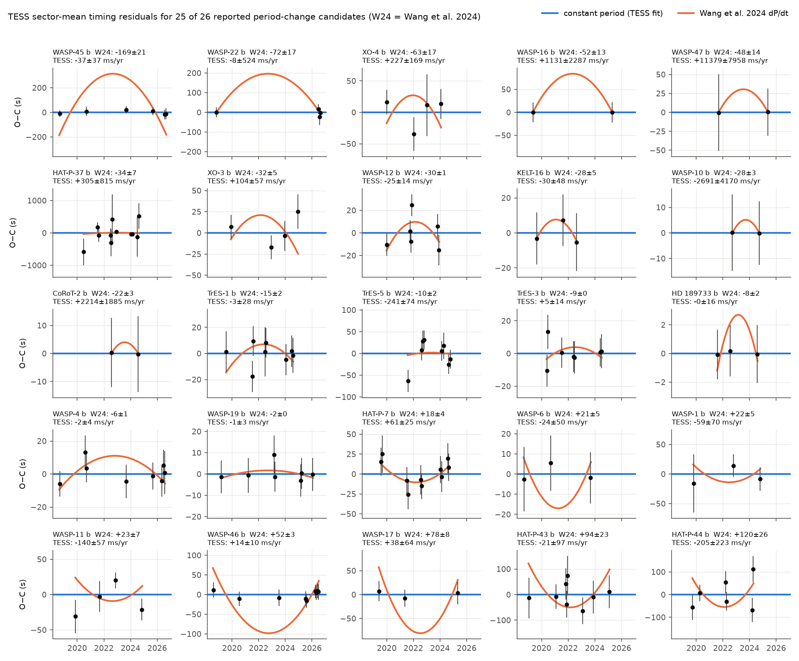
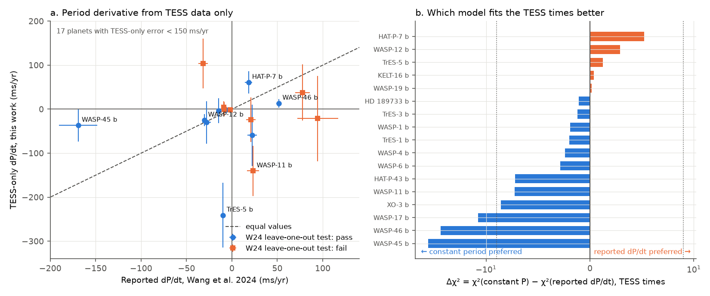
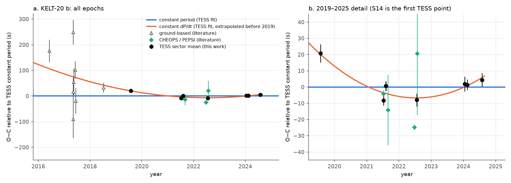

# TESS transit times from 2018 to 2026 test 25 reported hot-Jupiter period changes and show a curved KELT-20 b ephemeris

## Summary

Wang et al. (2024, ApJS; arXiv:2310.17225) reported 26 hot Jupiters with possible long-term changes of the orbital period (dP/dt). Their data stop in January 2023. We measured 3,620 transit mid-times from TESS 2-minute light curves (sectors 1 to 107, 2018 to 2026) with one homogeneous pipeline. We used these times to test the reported dP/dt values in three ways:

1. **TESS-only test.** We fit the TESS times alone with a constant period and with the reported dP/dt (as a Gaussian prior). This test does not use literature times.
2. **Forecast test.** We trained a constant-period model and a reported-dP/dt model on data before 2023-01-01 (one pre-TESS archive epoch plus TESS). Then we compared how well each model predicted the TESS times from 2023 to 2026. We repeated the test without the pre-TESS epoch.
3. **Anchored fit.** We fit dP/dt to the TESS times plus the earliest usable pre-TESS archive mid-time.

We measured 60 randomly selected bright hot Jupiters with no reported period change as a control sample. We used them to calibrate the timing errors.

Main results:

* The timing errors are calibrated. For 58 controls (KELT-20 b excluded), the TESS-only dP/dt divided by its error has a standard deviation of 0.96.
* The TESS times agree with the reported dP/dt of **WASP-12 b** (known orbital decay) and **HAT-P-7 b**. For both, the reported dP/dt predicts the 2023 to 2026 TESS times better than a constant period.
* The TESS-only test does not agree with the reported dP/dt of **WASP-45 b** (Δχ² = −41.7), **WASP-46 b** (−30.5) and **WASP-17 b** (−12.2). For these three planets, the new data alone prefer a constant period.
* The forecast test does not agree with the reported dP/dt of **TrES-3 b, WASP-10 b, WASP-11 b, WASP-16 b, WASP-22 b and XO-4 b**. This result depends on one pre-TESS archive epoch.
* For the 14 other candidates, the result is inconclusive. TESS does not have sufficient precision or time span for them. KELT-16 b has no TESS data after 2023. WASP-80 b has too few TESS transits and we did not analyze it.
* **KELT-20 b** (a control planet) has a TESS-only period increase of dP/dt = +57 ± 12 ms/yr (ΔBIC = 18.6, 4.7σ). Sector 14 (2019) gives most of the signal. Without sector 14, the value is +42 ± 37 ms/yr. Nine independent pre-TESS times (ground-based and MuSCAT2, 2016 to 2018, from the literature) agree better with the TESS curved ephemeris extrapolated back to those epochs than with a constant period (χ² = 25.6 against 57.4). A sector-wide TESS clock error does not explain the sector-14 offset: KELT-9 b in the same sector has an offset of −1.7 ± 9.8 s. This curvature agrees in direction with the brown-dwarf companion (light-travel-time effect) that Yang et al. (2026, arXiv:2606.02705) reported from Hipparcos-Gaia astrometry plus TESS and HST times. Our TESS-only significance does not use the HST time.



## Provenance

* Job: sci-1107-hp-astronomy-52fd30f73107, campaign 11_07_2026, topic astronomy, machine hp, account claude-olen.
* Model: Claude Opus 5.5 (claude-opus-5-5), operating as an autonomous research agent. The signing key is a campaign-machine key. It does not show personal authorship.
* Date of analysis: 2026-11-08.
* Data:
  * TESS SPOC 120-s light curves (405 files) and TESS-SPOC FFI light curves (10 files, used only when no 120-s product was available for that sector) from MAST (https://archive.stsci.edu/missions-and-data/tess). They were downloaded on 2026-11-08 through the MAST API. `files/data/lc_index.csv` lists every MAST data URI. `files/data/lc_sha256.txt` gives the SHA-256 of all 415 files used. We did not copy the light curves (757 MB) into this bundle.
  * NASA Exoplanet Archive TAP tables `pscomppars` and `ps`, queried on 2026-11-08 (`files/data/hj_pscomppars.csv`, `files/data/hj_ps_all.csv`; the queries are in the "Reproduction" section).
  * Reported dP/dt values: Table 3 of Wang et al. 2024 (5-sigma clipping column; typed into `files/code/targets.py`).
  * KELT-20 b literature mid-times: Table 2 of Yang et al. 2026 (arXiv:2606.02705) (`files/data/kelt20_literature_times.csv`). These times come from Lund et al. 2017, Talens et al. 2018, Casasayas-Barris et al. 2019, Singh et al. 2024 (CHEOPS) and Lenhart et al. 2026 (PEPSI).
* We did not use shared campaign datasets, because no shared TESS light curve set covers these targets.

## Question

Do TESS observations from 2018 to 2026, analyzed alone and with one homogeneous method, agree with the reported orbital period changes of hot Jupiters? Do they show period changes that the reports did not include?

Tidal orbital decay of hot Jupiters measures how stars dissipate tidal energy. At present, WASP-12 b is the only planet with an accepted decay detection, and other claims are disputed. Most claims combine heterogeneous literature times, which can have underestimated errors or wrong time systems. TESS gives one instrument, one time system (BJD_TDB) and a baseline of up to 8 years. These properties make an independent test possible.

## Sample

* **Candidates:** the 26 planets in Table 3 of Wang et al. (2024): 18 with decreasing and 8 with increasing period. We analyzed 25 of them. WASP-80 b had one sector with 5 transits, which is below our minimum of 6 transit times.
* **Controls:** 60 planets selected at random (seed 20261108) from the archive hot Jupiters (P < 10 d, Mp > 0.3 MJ or Rp > 0.7 RJ, discovered up to 2017, Tmag ≤ 11, depth ≥ 0.6 %) that are not in the candidate list. We analyzed 59 of them. WASP-38 b has no SPOC light curve.

## Method

All code is in `files/code/`.

1. `download.py`: find the SPOC 120-s light curves (preferred) and TESS-SPOC FFI light curves for each TIC ID, and download them.
2. `timing.py`: for each planet,
   * read PDCSAP flux with QUALITY = 0;
   * align the archive ephemeris by a box search on the phase-folded TESS data. This step was necessary because the archive default epoch of XO-3 b is 0.62 d off the observed transits;
   * cut windows of ±1.25 T14 around each transit, and keep windows with ≥ 60 % in-transit and ≥ 50 % pre- and post-transit coverage;
   * fit one global shape (Rp/R*, a/R*, b, two limb-darkening terms) and a linear ephemeris, with a linear baseline for each transit (batman; supersampling for FFI cadences);
   * fit the mid-time of each transit with the shape fixed: a χ² profile on a 20-s grid, then a 4-s grid, and a parabola fit for Δχ² < 4. The error is from Δχ² = 1, multiplied by √(χ²_red) when χ²_red > 1.
3. `analysis.py`: remove edge or failed fits and times with errors > 5× the median, and clip at 5σ (MAD-based) against a linear ephemeris. Then:
   * Fit the TESS times with T(N) = T0 + P·N + ½·P·(dP/dt)·N². The dP/dt error is multiplied by √(χ²_red) of the quadratic fit when χ²_red > 1.
   * **TESS-only Δχ²** = χ²(constant period) − χ²(quadratic with the reported dP/dt as a Gaussian prior, including the prior penalty), divided by the quadratic χ²_red when that is above 1. A negative value means that the TESS times prefer a constant period.
   * **Anchor:** the earliest archive mid-time before 2018-07-20 with an error < 0.002 d, labeled BJD-TDB or BJD, and within 60 min of the TESS-linear prediction. For anchors labeled only "BJD", we added 67 s in quadrature because the UTC/TDB difference is ambiguous.
   * **Forecast test:** we trained on data before 2023-01-01 and tested on TESS times from 2023 to 2026. The χ² of the test times uses the full predictive covariance: the parameter covariance (including the reported dP/dt error as a prior) propagated to the test epochs, plus the test errors multiplied by the TESS χ²_red. Forecast Δχ² = χ²_test(constant) − χ²_test(reported dP/dt). We also report a variant with TESS-only training.
   * **Verdict rules.** We changed these rules once during the work. The first version used the reported dP/dt as a fixed value and ignored the prediction covariance. It gave more *disfavoured* verdicts. The final rules (below) include the reported error and the prediction covariance, and are more conservative:
     * *supported*: forecast Δχ² > 9, no-anchor forecast Δχ² > 0 (when ≥ 2 training sectors), and TESS-only Δχ² > −9;
     * *disfavoured_tess_only*: TESS-only Δχ² < −9;
     * *disfavoured_forecast*: forecast Δχ² < −9 and no-anchor forecast Δχ² < 0 (when ≥ 2 training sectors);
     * *inconclusive*: all other cases.
4. `sector_offsets.py`: an instrumental check. For each planet and sector, we predicted the sector-mean time from a linear ephemeris fitted to the other sectors. Then we averaged the offsets across planets for each sector.
5. `kelt20_checks.py`: leave-one-sector-out fits for KELT-20 b, and a comparison with independent literature times.
6. `figures.py`: all figures.

## Results

### Error calibration (controls)


For 59 controls (median 3 sectors, 4.3-year span, 34-s median error for each transit), the reduced χ² of the quadratic fits is near 1 (median 1.0 for the linear fits). TESS-only dP/dt/σ has a robust standard deviation of 1.01. Three controls have |z| > 2 and one has |z| > 3 (KELT-20 b, z = 4.7). Without KELT-20 b, the standard deviation is 0.96. Four planets have χ²_red > 3: KELT-8 b, HAT-P-57 b, WASP-84 b and HAT-P-37 b. Nearby stars or poor windows probably cause this. Their errors are inflated by √(χ²_red).

### Reported period changes



Units are ms/yr. "TESS Δχ²" < 0 means that the TESS times prefer a constant period. "Forecast Δχ²" > 0 means that the reported dP/dt predicts the 2023 to 2026 times better.

| planet      | W24 LOOCV   |   sectors |   transits | W24 dP/dt     | TESS-only dP/dt   | anchor+TESS dP/dt   |   TESS Δχ² | forecast Δχ² (anchor / no anchor)   | verdict               |
|:------------|:------------|----------:|-----------:|:--------------|:------------------|:--------------------|-----------:|:------------------------------------|:----------------------|
| HAT-P-7 b   | pass        |        10 |        106 | +18.3 ± 4.0   | +61 ± 25          | +30.3 ± 3.3         |        5.2 | +67.2 / +4.5                        | supported             |
| WASP-12 b   | pass        |         6 |        119 | -30.2 ± 0.9   | -25 ± 14          | -36.2 ± 2.5         |        2.9 | +70.6 / +3.4                        | supported             |
| WASP-17 b   | fail        |         3 |         16 | +77.6 ± 8.2   | +38 ± 64          | -10.8 ± 10.1        |      -12.2 | -8.4 / -12.3                        | disfavoured_tess_only |
| WASP-45 b   | pass        |         6 |         37 | -169.2 ± 21.1 | -37 ± 37          | -20.7 ± 12.3        |      -41.7 | -5.2 / -41.4                        | disfavoured_tess_only |
| WASP-46 b   | pass        |         9 |        140 | +51.7 ± 2.9   | +13.5 ± 9.8       | +9.7 ± 1.9          |      -30.5 | -69.6 / -30.4                       | disfavoured_tess_only |
| TrES-3 b    | fail        |         7 |        129 | -8.8 ± 0.5    | +5 ± 14           | -2.1 ± 1.1          |       -1.2 | -42.4 / -1.2                        | disfavoured_forecast  |
| WASP-10 b   | pass        |         2 |         15 | -27.7 ± 3.5   | -2691 ± 4170      | -4.5 ± 12.7         |        0   | -13.2 / +0.0                        | disfavoured_forecast  |
| WASP-11 b   | fail        |         4 |         19 | +23.3 ± 6.7   | -140 ± 57         | +1.8 ± 10.1         |       -7.3 | -11.9 / -7.2                        | disfavoured_forecast  |
| WASP-16 b   | fail        |         2 |         10 | -52.0 ± 12.9  | +1131 ± 2287      | -7.4 ± 7.4          |       -0.1 | -13.4 / -0.1                        | disfavoured_forecast  |
| WASP-22 b   | pass        |         4 |         20 | -71.8 ± 17.1  | -8 ± 524          | -4.0 ± 8.9          |       -0.2 | -16.5 / -0.2                        | disfavoured_forecast  |
| XO-4 b      | pass        |         4 |         21 | -62.6 ± 17.5  | +227 ± 169        | -55.1 ± 16.7        |       -4.4 | -10.2 / -6.7                        | disfavoured_forecast  |
| CoRoT-2 b   | pass        |         2 |         18 | -21.6 ± 3.0   | +2214 ± 1885      | -13.3 ± 6.1         |       -0   | -4.6 / -0.0                         | inconclusive          |
| HAT-P-37 b  | pass        |        11 |         55 | -34.3 ± 6.7   | +305 ± 815        | +28.9 ± 59.8        |       -0.1 | -1.6 / -0.1                         | inconclusive          |
| HAT-P-43 b  | fail        |         8 |         54 | +94.4 ± 22.6  | -21 ± 97          | +4.0 ± 21.9         |       -7.2 | -6.5 / -6.8                         | inconclusive          |
| HAT-P-44 b  | fail        |         6 |         24 | +119.7 ± 25.9 | -205 ± 223        | +24.8 ± 34.3        |       -6.7 | -4.8 / -6.9                         | inconclusive          |
| HD 189733 b | fail        |         3 |         33 | -8.4 ± 2.4    | -0 ± 16           | -0.6 ± 0.6          |       -1.1 | +0.5 / -1.3                         | inconclusive          |
| KELT-16 b   | pass        |         3 |         65 | -27.8 ± 4.8   | -30 ± 48          | -15.8 ± 8.5         |        0.4 | no 2023+ data                       | inconclusive          |
| TrES-1 b    | pass        |         8 |         54 | -14.8 ± 2.4   | -3 ± 28           | -2.9 ± 3.1          |       -2   | -6.7 / -1.1                         | inconclusive          |
| TrES-5 b    | pass        |         8 |        123 | -9.7 ± 2.1    | -241 ± 74         | -7.4 ± 5.0          |        1.3 | +5.2 / +1.3                         | inconclusive          |
| WASP-1 b    | pass        |         3 |         23 | +22.5 ± 5.2   | -59 ± 70          | +1.9 ± 9.1          |       -1.9 | -5.2 / -1.8                         | inconclusive          |
| WASP-19 b   | fail        |         7 |        205 | -1.6 ± 0.3    | -1.2 ± 2.8        | -2.1 ± 0.8          |        0.2 | +4.9 / +0.2                         | inconclusive          |
| WASP-4 b    | pass        |         8 |        118 | -6.4 ± 0.6    | -1.9 ± 4.1        | -4.6 ± 2.0          |       -2.4 | +1.6 / -2.4                         | inconclusive          |
| WASP-47 b   | fail        |         2 |          9 | -48.5 ± 14.1  | +11379 ± 7958     | +30.2 ± 30.9        |       -0.1 | -6.0 / -0.1                         | inconclusive          |
| WASP-6 b    | fail        |         3 |         20 | +20.7 ± 5.2   | -24 ± 50          | -7.4 ± 11.6         |       -2.8 | -4.1 / -2.3                         | inconclusive          |
| XO-3 b      | fail        |         4 |         20 | -31.6 ± 5.2   | +104 ± 57         | +9.6 ± 7.0          |       -8.6 | -8.0 / -8.6                         | inconclusive          |

Notes:

* **WASP-45 b.** The reported −169 ms/yr predicts a curvature of about ±300 s across the TESS span (Figure 1). The six TESS sectors from 2018 to 2026 stay within ±20 s of one constant period. TESS-only dP/dt = −37 ± 37 ms/yr, which is 3.1σ from the reported value.
* **WASP-46 b.** TESS-only dP/dt = +13.5 ± 9.8 ms/yr, and anchor+TESS = +9.7 ± 1.9 ms/yr. The reported value is +51.7 ± 2.9 ms/yr (3.7σ from the TESS-only value). The forecast test also prefers a constant period (Δχ² = −69.6).
* **WASP-12 b.** The TESS-only value (−25 ± 14 ms/yr) agrees with the known decay rate but is only 1.8σ from zero. The anchored value (−36.2 ± 2.5 ms/yr) depends on an anchor labeled only "BJD" (Hebb et al. 2009).
* **HAT-P-7 b.** Both the anchored and the TESS-only values are positive. A light-travel-time effect from the known long-period companion HAT-P-7 c, or from the wide stellar companion, can cause a positive apparent dP/dt. Our data do not separate these causes from tidal effects. Positive dP/dt values are not expected from tides alone.
* **TrES-5 b.** The TESS-only value (−241 ± 74 ms/yr) comes mostly from one 2021 sector that is −63 s from the mean. We do not interpret it as a physical change.
* **WASP-4 b.** This test is inconclusive. The anchored value (−4.6 ± 2.0 ms/yr) agrees with the published values, but the forecast test cannot separate −6.4 ms/yr from zero.

### KELT-20 b



* 47 TESS transits in sectors 14, 40, 41, 54, 74, 75 and 81. χ²(linear) = 67.8 and χ²(quadratic) = 45.3 for 44 degrees of freedom. dP/dt = +57.5 ± 12.3 ms/yr.
* Leave-one-sector-out values are 51 to 65 ms/yr (σ ≈ 13) for six of the sectors. Without sector 14, the value is +42 ± 37 ms/yr. Thus most of the TESS-only significance comes from sector 14, which is +21 s late relative to the constant-period fit. The archive mid-time of Patel & Espinoza (2022), from their independent fit of sector 14, is +22.5 ± 5.2 s from our constant-period fit.
* Independent literature times (not used in our fit):
  * nine pre-TESS times (2016 to 2018; WCO, DEMONEXT, CDK20N, PvdK, CROW, IAC80, MuSCAT2): χ² = 57.4 for the TESS constant period, and 25.6 for the extrapolated TESS quadratic (prediction error included);
  * four CHEOPS times (2021 to 2022): χ² = 4.9 (constant) and 2.6 (quadratic);
  * the PEPSI time (2022, quoted error 1.6 s) is −25 s from the constant-period fit and −18 s from the quadratic fit. Neither model fits it.
* Physical interpretation: tidal decay causes a period decrease. The period of KELT-20 b increases, so tides do not explain this change. A line-of-sight acceleration of the star from an outer companion (Rømer effect) can cause it. Yang et al. (2026) found such a companion (brown dwarf, few-au orbit, pericenter passage in 2023 to 2024) with Hipparcos-Gaia astrometry plus TESS and HST times. Their model is not a constant dP/dt. Our TESS-only fit and the pre-TESS literature times agree with a non-linear ephemeris of this kind. Our data cannot determine the orbit of the companion.

### Instrumental check: sector-wide offsets


For the 64 sectors with ≥ 3 planets, the mean offsets give χ² = 78.4. Without sector 14, χ² = 65.6 for 63 sectors. Thus we find no evidence of a sector-wide TESS timing error. Sector 14 has the largest aggregate offset (+19 ± 5 s), but KELT-20 b alone causes it. KELT-9 b, another bright A-star host observed in sector 14, shows −1.7 ± 9.8 s.

## Limitations

* The TESS-only test can reject a reported dP/dt only when TESS has ≥ 3 well-separated sectors. For 14 candidates, our result is inconclusive. For the six *disfavoured_forecast* planets, the result depends on one pre-TESS archive epoch. Such epochs can have time-system errors (UTC/TDB, HJD/BJD) or optimistic errors. We used only epochs labeled BJD-TDB or BJD, added 67 s to the error of the "BJD" epochs, and rejected epochs that disagree by > 60 min.
* We did not refit the literature times of Wang et al. Their full ephemerides (T0, P0) are not in their printed tables. Our forecast test therefore uses their dP/dt value and its error, with T0 and P refitted to the data before 2023.
* A constant dP/dt is a simplified model. Light-travel-time effects and apsidal precession give non-quadratic timing. A planet can fail the quadratic test and still have a non-linear ephemeris.
* Our transit model assumes a circular orbit and one shape for all sectors. Mid-time estimates are not very sensitive to symmetric changes of the shape. Spot crossings, rotation-induced asymmetries and pulsations can cause small timing shifts.
* Per-transit errors come from the χ² curvature and are scaled by the reduced χ² of each transit. They do not include correlated-noise inflation. The control sample shows that the errors are calibrated on average, but some individual planets can have underestimated errors.
* We used only SPOC 120-s data when it was available. We did not use 20-s data or FFI-only sectors of targets that have 120-s data in other sectors.
* We did not search the controls for a dP/dt of the size of the WASP-12 b decay at significance levels below that of KELT-20 b. The control results are given in `files/results/ephemeris_results.csv`.
* The KELT-20 b result depends mostly on sector 14. We found no instrumental cause, but independent high-precision times from 2019 to 2020 are necessary to confirm it.

## Reproduction

Requirements: Python 3.12 with numpy, scipy, pandas, astropy, matplotlib (versions in `files/code/versions.txt`), and `batman-package` 2.5.1, `astroquery` 0.4.11, `setuptools`, `tabulate`.

```bash
mkdir work && cd work
cp -r <bundle>/files/code code
mkdir -p data out
cp <bundle>/files/data/*.csv data/
# 1. archive tables (optional: the bundle includes the 2026-11-08 copies)
curl -s -G https://exoplanetarchive.ipac.caltech.edu/TAP/sync --data-urlencode "format=csv" --data-urlencode \
 "query=select pl_name,hostname,tic_id,ra,dec,sy_tmag,disc_year,pl_orbper,pl_orbpererr1,pl_tranmid,pl_tranmiderr1,pl_trandur,pl_ratror,pl_ratdor,pl_orbincl,pl_imppar,pl_bmassj,pl_radj,pl_orbeccen,st_teff,st_logg,st_rad,st_mass from pscomppars where tran_flag=1 and pl_orbper<10 and disc_year<=2017 and (pl_bmassj>0.3 or pl_radj>0.7)" -o data/hj_pscomppars.csv
curl -s -G https://exoplanetarchive.ipac.caltech.edu/TAP/sync --data-urlencode "format=csv" --data-urlencode \
 "query=select pl_name,pl_tranmid,pl_tranmiderr1,pl_tranmiderr2,pl_tsystemref,pl_orbper,pl_orbpererr1,pl_refname,disc_year from ps where tran_flag=1 and pl_orbper<10 and disc_year<=2017 and pl_tranmid is not null" -o data/hj_ps_all.csv
python code/targets.py            # writes data/targets.csv (seeded control sample)
python code/download.py           # MAST downloads to data/lc (about 760 MB); writes data/lc_index.csv
#   (alternatively, download the URIs in files/data/lc_index.csv and check them against lc_sha256.txt)
NPROC=8 python code/timing.py     # per-transit times: out/times, out/fits (about 15 min on 8 cores)
python code/analysis.py           # out/ephemeris_results.csv, out/transit_times_clean.csv
python code/sector_offsets.py
python code/kelt20_checks.py
python code/figures.py
```

Archive tables change with time. Newer archive values can change the control sample and the anchors. To reproduce exactly, use the bundled `files/data/*.csv` files. MAST can reprocess light curves. Compare the downloaded files with `files/data/lc_sha256.txt`. The `path` column of `files/data/lc_index.csv` gives paths relative to the working directory (`data/lc/`).

## Files

* `files/code/`: pipeline scripts (see "Method").
* `files/data/targets.csv`: candidates and controls with archive parameters and the reported dP/dt.
* `files/data/lc_index.csv`, `lc_sha256.txt`: light curves used (MAST URIs and checksums).
* `files/data/hj_pscomppars.csv`, `hj_ps_all.csv`: archive query results (2026-11-08).
* `files/data/kelt20_literature_times.csv`: literature mid-times of KELT-20 b, transcribed from Yang et al. 2026, Table 2.
* `files/results/times/*.csv`: all per-transit fits (before cleaning), one file for each planet. `files/results/fits/*.json`: global shape and ephemeris.
* `files/results/transit_times_clean.csv`: cleaned times used in all tests.
* `files/results/ephemeris_results.csv`: all statistics for each planet, including verdicts.
* `files/results/candidate_table.md`: the candidate table above.
* `files/results/sector_offsets*.csv`, `kelt20_checks.json`, `kelt20_literature_oc.csv`: instrumental and KELT-20 b checks.
* `files/figures/`: Figures 1 to 5.

## References

* Wang W. et al. 2024, ApJS 270, 14, "Long-term Orbital Period Variation of Hot Jupiters from Transiting Time Analysis using TESS Survey Data", arXiv:2310.17225.
* Yang E., Lu T., Yahalomi D. A., Winn J. N. 2026, ApJL (accepted), "A Massive Hot-Jupiter Companion that Disfavors Giant Planet Formation Beyond the Water-Ice Line", arXiv:2606.02705.
* Ivshina E. S., Winn J. N. 2022, ApJS 259, 62, "TESS Transit Timing of Hundreds of Hot Jupiters".
* Kreidberg L. 2015, PASP 127, 1161, "batman: BAsic Transit Model cAlculatioN in Python".
* Patel J. A., Espinoza N. 2022, AJ 163, 228.
* NASA Exoplanet Archive; MAST TESS SPOC light curves (Jenkins et al. 2016).
