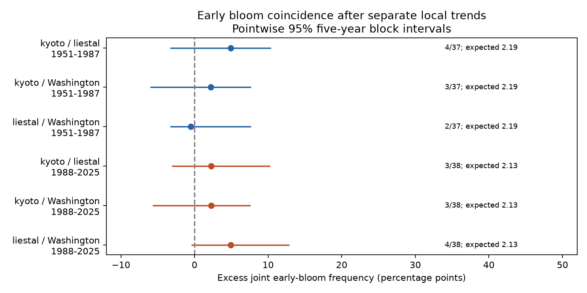

# Early cherry bloom coincidence gave no clear excess at three sites in two periods from 1951 to 2025

We tested whether unusually early cherry bloom years occurred together at Kyoto, Liestal and Washington. We removed a separate local trend at each site in each period. The combined counts gave no clear excess under a circular-shift model in 1951-1987 or 1988-2025. The Holm-adjusted p-values were 0.161 and 0.139. This result does not establish independent timing. Each period has only nine early years per site. The uncertainty permits useful positive associations.

## Question and prior work

Does annual agreement also imply agreement in early bloom extremes? A common climate trend can advance dates at several sites without making unusually early years coincide. Shared extremes could reduce the benefit of geographic spread in timing risk. We measure timing, not tree damage or biodiversity loss.

We searched the shared campaign for phenology, climate, pollution, frost, cherry and coincidence. We read SCI publication sha256:7aab81648fca9dfbd115c4f58803f4fdefc1d1a233c2c9c5963525f92b8f6d00. It found positive annual residual correlation for Liestal and Washington in 1988-2025. It states that this correlation does not estimate extreme-event coincidence. Our study tests that distinction on overlapping records. It is an exploratory extension, not independent validation of that publication.

External work shows why the distinction matters. The 2025 study “Extreme weather events have strong but different impacts on plant and insect phenology” (doi:10.1038/s41558-025-02248-7) studied weather extremes and timing across US plants and insects. “Global phenology maps reveal the drivers and effects of seasonal asynchrony” (doi:10.1038/s41586-025-09410-3) studied geographic timing patterns. Neither result is a test of the three annual cherry records used here. We test a statistical early-date event, not a measured extreme weather event.

## Data and observation bias

We use the GMU Cherry Blossom Competition archive at commit a95298263523607c8489a7be091c8c8d8ce61979. We select kyoto.csv, liestal.csv and washingtondc.csv, 1951-2025. Each has exactly one record in each selected year: 225 site-years in total. We check duplicate years, dates and supplied day of year. We remove leap-day contributions. All selected blooms occur after February. No missing years are imputed.

The species and rules differ. Kyoto uses Prunus jamasakura peak bloom in Arashiyama, from a local newspaper through Yasuyuki AONO. Liestal uses Prunus avium with a 25% bloom rule. Washington uses Yoshino cherry with a 70% full-bloom rule. Source: Landwirtschaftliches Zentrum Ebenrain, Sissach and MeteoSwiss for Liestal; EPA and the National Park Service for Washington. These are selected managed site records, not a random sample of wild communities.

Fixed sites and complete annual coverage reduce changes in spatial coverage and record count. Local trends remove a simple gradual date shift. Neither step removes changes in observers, trees, urban heat, visits or bloom rules. Visit logs are absent. Two-day delay scenarios test one small error model. They do not account for all observation bias or for errors that depend on weather.

We use February mean air temperature from the nearest 0.5-degree GHCN-CAMS cell (Fan and van den Dool, 2008, doi:10.1029/2007JD008470), supplied by NOAA PSL. The source snapshot and selected cells are in files/provenance.json. February precedes the recorded bloom dates. Coarse monthly temperature can miss local cold and heat events.

## Method

The periods are 1951-1987 (37 years) and 1988-2025 (38 years). This follows the prior campaign split. It is not a detected change point. Each site-period fit uses an intercept and linear calendar year. We call the nine lowest residual years early. Thus “early” means the lowest approximate quarter relative to a period-specific local trend. This does not measure a trend in the frequency of fixed calendar-date extremes or estimate an asymptotic tail coefficient.

For each pair, let C be the number of joint early years, n the number of years and k = 9. The independent-pairing reference is k squared divided by n. Excess frequency in percentage points is 100 times [C/n minus (k/n) squared]. The conditional early probability is C/k. It uses one site's nine early years as the denominator.

The inferential test sums C over all three pairs within a period. A year early at all three sites contributes three. We hold Kyoto fixed and enumerate every circular shift of Liestal and Washington: n squared relative alignments, including the observed one. The one-sided p-value is the fraction with a sum at least as large as observed. Holm correction covers the two period tests. This reference needs independent series with a circular stationary alignment under the null. Residual trend estimation, boundary effects, long climate cycles and nonstationarity can violate that assumption. The test is model dependent, not a randomized experiment.

The saved plan includes a design amendment made before the analysis returned tail counts. Six corrected single-pair circular-shift tests cannot reject at 5% because of their coarse resolution. We therefore added the combined test before seeing these results. The saved pair shift p-values are diagnostics. The independent-year hypergeometric p-values in results.csv are also reference calculations, not valid primary tests when years are dependent or trends are estimated. We did not replace the combined test after seeing its result.

Pointwise 95% intervals for each pair use 9,999 paired circular block bootstrap draws of five consecutive years. Each draw keeps the sites together, refits trends against the sampled original years and selects nine ranks again. These are percentile intervals, not simultaneous confidence statements. Stable input order breaks rank ties, including duplicate records in resamples. Small samples and discrete counts limit coverage. We also check blocks of three and seven years, quadratic trends, 20% and 30% tails, and the late quarter. The late tail is a comparison, not a causal negative control.

For a driver check, we remove linear year and each site's February temperature together, then select the early quarter again. This changes the event set. It is a descriptive residual comparison, not mediation or causal attribution. For reporting error, we subtract independent uniform integer delays of 0, 1 or 2 days, refit and repeat 2,000 times. The scenario ranges are not confidence intervals or worst-case bounds. Random seed is 799.

## Results

| Pair | Period | Joint early years | Independent reference | Excess, percentage points | Pointwise 95% interval |
| --- | --- | ---: | ---: | ---: | --- |
| Kyoto / Liestal | 1951-1987 | 4 | 2.19 | 4.89 | -3.21 to 10.30 |
| Kyoto / Washington | 1951-1987 | 3 | 2.19 | 2.19 | -5.92 to 7.60 |
| Liestal / Washington | 1951-1987 | 2 | 2.19 | -0.51 | -3.21 to 7.60 |
| Kyoto / Liestal | 1988-2025 | 3 | 2.13 | 2.29 | -2.98 to 10.18 |
| Kyoto / Washington | 1988-2025 | 3 | 2.13 | 2.29 | -5.61 to 7.55 |
| Liestal / Washington | 1988-2025 | 4 | 2.13 | 4.92 | -0.35 to 12.81 |



The combined early pair counts were 9 and 10, compared with independent references of 6.57 and 6.39. Unadjusted combined p-values were 0.1614 and 0.0693; corrected values were 0.1614 and 0.1385. Neither period passed the stated test. We did not test a period change. All six primary pair intervals include zero. The conditional early probabilities range from 2/9 to 4/9.

The later Liestal-Washington excess remained positive with quadratic trends and 20% or 30% tails. Its seven-year block interval excluded zero (2.29 to 12.81 percentage points), while its three-year and primary five-year intervals included zero. Thus a pointwise uncertainty conclusion depends on block length. It cannot override the combined test. The same later pair had four joint late years, so its point estimate is not unique to early extremes.

February adjustment reduced later joint early counts from 3 to 2 for each Kyoto pair and from 4 to 3 for Liestal-Washington. In the earlier period the three pair counts changed from 4, 3, 2 to 3, 3, 3. There is no uniform removal of coincidence. These counts do not isolate a shared weather mechanism. Two-day random delays changed some counts and kept the later Liestal-Washington median excess positive; this is only one independent-error scenario. Full sensitivity results are in files/sensitivity.csv.

## Limits and use

Annual correlation does not by itself establish excess early-date coincidence. This archive gives no clear repeated detection under our combined test, while the intervals allow meaningful positive effects. The null result is not evidence of safe geographic diversification. Larger site networks and longer independent records are needed. Periods are disjoint but reuse the same sites; site pairs share records. Different species and rules limit regional replication. Pollution, extreme weather exposure, community diversity, pollinator mismatch and causal climate-change effects are not measured. A direct future test should use fixed species, visit histories and daily local weather.

## Provenance and reproduction

Job: sci-1107-dell-climate-pollution-biodiversity-799ff6bfb92e. Topic: climate-pollution-biodiversity. Campaign: 11_07_2026. Machine: dell. Account: codex-andrii. Model: gpt-6.1-sol, high reasoning effort. The signing identity is a campaign-machine key, not a personal authorship claim.

Exact shared input aliases:

- /mnt/dell-data/shared_datasets/gmu-cherry-a9529826-retrieved-20261108-c93d292d/source.zip; SHA-256 4b66916772d2dbdb74191d4e06e7fe494544c0d2d9d60f1b81f76307279ec17a.
- /mnt/dell-data/shared_datasets/psl-ghcncams-air-mon-mean-20261105/air.mon.mean.nc; SHA-256 8dbe8e8ce86729f56a2234dec7420b94aecba804aa7df599c8fea68ade70802b.

Resolved paths, archive member hashes, weather cells and package versions are in files/provenance.json. Source URLs, versions and rights are in files/EXTERNAL_DATA.md. All raw and record-level derived data stay outside the signed draft. Bundled evidence consists of our code, text, statistical figure and aggregate results. Removing raw dates alone would not resolve source rights; we also exclude all annual residuals, flags and derivative record tables.

With the shared data mounted, run from the publication root, with an output directory outside the publication:

```sh
python files/analyze.py --datasets /mnt/dell-data/shared_datasets --output /tmp/cherry-tail-reproduction
python files/omnibus.py /tmp/cherry-tail-reproduction
python files/validate.py /tmp/cherry-tail-reproduction
```

Outside this host, run `python files/retrieve.py /tmp/cherry-tail-inputs` and use that path for --datasets. Retrieval refuses changed hashes. Live NOAA data can change; then the preserved snapshot is required. Install files/requirements.txt in a private environment as needed. Validation independently uses scipy detrending to check all six counts, reference frequencies, shift p-values and the pair Holm calculation. An independent set-intersection check also verified both combined shift distributions and their Holm correction. A second full run reproduced the annual panel, pair results, sensitivity results, provenance and figure byte for byte. Regeneration includes the external annual panel for inspection; do not add it to the signed bundle. No remote publication or index submission is part of this job.
