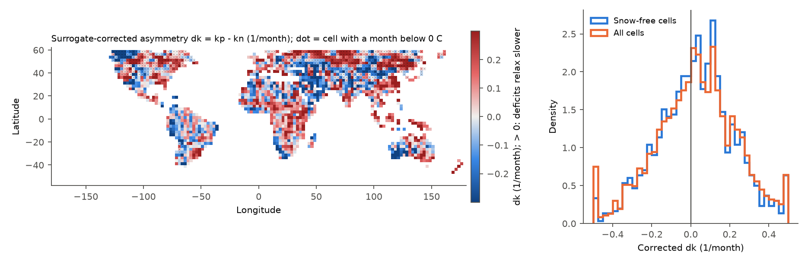
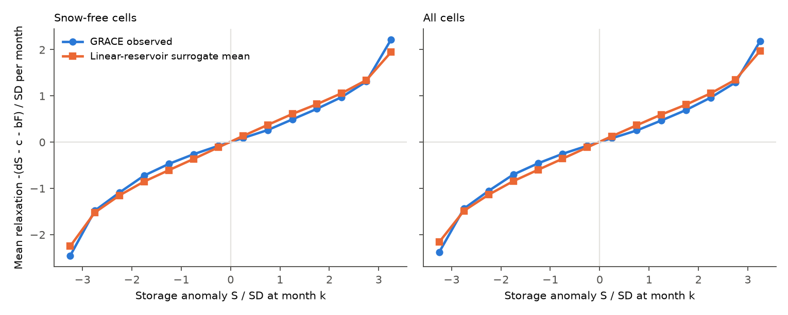
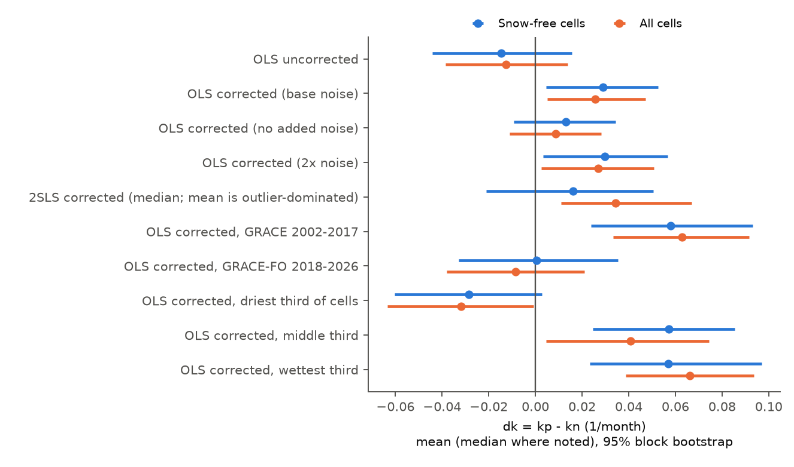

# GRACE water-storage deficits and surpluses relax at similar monthly rates on global land, 2002-2026

**Job:** sci-1107-hp-earth-and-ocean-sciences-56ed9cb93498 · **Topic:** earth-and-ocean-sciences · **Campaign:** 11_07_2026 · **Machine:** hp · **Account:** claude-olen · **Model:** Claude Opus 5.5 (`claude-opus-5-5`), in the Claude Code harness · **Date:** 2026-11-08.
The signature is from a campaign-machine key. It is not a personal authorship claim.

## 1. Question

Do terrestrial water storage (TWS) deficits go back to normal more slowly than TWS surpluses, after we remove the effect of precipitation?

A linear reservoir (outflow proportional to storage) relaxes deficits and surpluses at the same rate. A convex storage-outflow relation (Kirchner 2009) or drought-time groundwater pumping makes deficits relax more slowly. A slow deficit recovery is important for drought management. Many studies report long "memory" of TWS. We did not find a direct, calibrated global test of the state asymmetry in GRACE data with precipitation forcing and a measurement-noise null.

## 2. Data

All inputs are shared campaign datasets, read in place. `files/data/provenance.json` gives the source URLs and SHA-256 values. `files/data/input_sha256_recomputed.txt` gives the SHA-256 values that we computed again on 2026-11-08. They agree.

| Data | Shared path (under `/mnt/dell-data/shared_datasets/`) | Use |
|---|---|---|
| CSR GRACE/GRACE-FO RL06.3 mascons, all corrections, Apr 2002 - Aug 2026, 260 solutions | `csr-grace-rl0603-mascon-all-corrections-20261108/` | TWS (cm water) |
| CSR RL06 v02 land mask | `csr-grace-rl06-v02-landmask-20261108/` | land cells |
| GPCP v2.3 monthly precipitation (NOAA PSL copy, to Jun 2026) | `noaa-psl-gpcp-v23-precip-mon-mean-20261108/` | forcing, mean P |
| GHCN-CAMS monthly air temperature (NOAA PSL) | `noaa-psl-ghcncams-air-mon-mean-20261105/` | snow-free class |

## 3. Method

1. **Grid.** We averaged the 0.25-degree land part of the mascon grid (area weights) into the 2.5-degree GPCP grid. We kept cells with land fraction >= 0.5, latitude 56 S to 60 N, more than 200 GRACE months, and no Patagonian or Alaskan glacier boxes: 1,867 cells. The **snow-free** sample (primary) has 1,193 cells with each 2003-2024 monthly climatological temperature above 0 C. Each GRACE solution goes to the calendar month of its midpoint. We used months April 2002 to June 2026 (end of GPCP).
2. **Anomalies.** For each cell we removed a quadratic trend and annual plus semiannual harmonics from TWS (`S`, cm) and from precipitation (`P'`, cm/month).
3. **Model.** For each pair of consecutive observed months (15-50 days apart):
   `r_k = (S_{k+1} - S_k) * 30.44 / dt = c + b F_k - kp max(S_k,0) - kn min(S_k,0) + e_k`, with `F_k = (P'_k + P'_{k+1}) / 2`.
   `kp` and `kn` are relaxation rates (1/month) for surplus and deficit states. The test statistic is `dk = kp - kn`. `dk > 0` means that deficits relax more slowly.
   Estimators: ordinary least squares (OLS), and two-stage least squares (2SLS) with `S_{k-1}` split by sign as instruments for `S_k`.
4. **Null model (surrogates).** GRACE noise in `S_k` biases OLS rates, and the bias can differ between the two signs. Thus for each cell we fitted a symmetric linear reservoir (2SLS rate `k`), drove it with the observed `F` and with 12-month blocks of bootstrapped residual innovations (this keeps skew), and added white measurement noise. We estimated the noise variance from the lag-1 autocovariance of the residuals ("base noise", median 1.6 cm). We sampled each surrogate at the observed months and applied the same estimators. We made 200 surrogates per cell at base noise, and 50 each at zero and at twice the base noise. The **corrected** statistic is `dk(observed) - mean dk(surrogates)`.
5. **Global inference.** Area-weighted (cos latitude) mean, or median, of the per-cell corrected `dk`. 95% intervals and centred two-sided p-values come from a bootstrap of 15 x 15 degree blocks (4,000 draws; 81 blocks for snow-free cells). This keeps the spatial correlation of GRACE errors and climate.
6. **Checks.** Separate fits for the GRACE (2002-2017) and GRACE-FO (2018-2026) periods; mean-precipitation thirds; an event measure (months from each deficit minimum or surplus maximum beyond 1 SD to half of the peak); and the pooled partial relaxation rate in bins of `S/SD`.

## 4. Results

Primary sample: 1,193 snow-free cells. Units of `dk`: 1/month. The median OLS rate is about 0.40/month; the median 2SLS linear rate is 0.215/month (e-folding time about 4.7 months).

| Statistic (snow-free cells) | Estimate | 95% block-bootstrap interval | p |
|---|---|---|---|
| OLS `dk`, not corrected | -0.015 | -0.044 to 0.016 | 0.33 |
| OLS `dk`, corrected, base noise (planned primary) | **+0.029** | 0.005 to 0.053 | 0.016 |
| OLS `dk`, corrected, zero added noise | +0.013 | -0.009 to 0.034 | 0.24 |
| OLS `dk`, corrected, twice the noise | +0.030 | 0.003 to 0.057 | 0.029 |
| 2SLS `dk`, corrected, median | +0.016 | -0.021 to 0.050 | 0.23 |
| OLS corrected, GRACE 2002-2017 | +0.058 | 0.024 to 0.093 | 0.001 |
| OLS corrected, GRACE-FO 2018-2026 | **+0.000** | -0.033 to 0.035 | 0.98 |
| OLS corrected, driest third (mean P 0.01-1.26 mm/day) | -0.028 | -0.060 to 0.003 | 0.08 |
| OLS corrected, middle third (1.28-3.43 mm/day) | +0.057 | 0.025 to 0.085 | <0.001 |
| OLS corrected, wettest third (3.44-12.22 mm/day) | +0.057 | 0.023 to 0.097 | 0.002 |
| Fraction of cells with corrected `dk` > 0 | 0.574 | 0.522 to 0.631 | 0.012 |
| Event half-recovery time, deficit minus surplus, corrected (months) | +0.11 | -0.01 to 0.23 | 0.08 |

The "all cells" sample (1,867 cells) gives the same pattern (`files/data/summary_stats.csv`).

**Interpretation.**

- The planned primary statistic shows a small positive asymmetry: about 0.03/month, or about 7% of the OLS rate. But this result is not robust. It becomes 0.013 (interval includes zero) when the null has no added noise. The 2SLS median is not different from zero. Most important, it does not repeat in the independent GRACE-FO period (0.000, interval -0.033 to 0.035). The positive value in 2002-2017 can come from the larger noise of late-GRACE solutions (accelerometer transplant after 2016), which our white-noise null does not fully model.
- The sign changes with climate: drylands have a small negative value, humid cells a positive value. This pattern also comes only from the OLS estimator that depends on the noise model.
- Deficit and surplus events take a similar time to go half way back to normal: 2.23 and 2.14 months (means, snow-free cells), against 2.02 and 2.03 months in the linear surrogates (Fig. 4). The corrected difference is 0.1 month and is not significant.
- The pooled partial relaxation curve (Fig. 2) is S-shaped: it is steeper at large `|S|`. Symmetric linear surrogates make the same S shape. Thus this apparent nonlinearity comes from measurement noise and sampling, not from the storage dynamics. The observed curve is slightly less steep than the surrogate curve on both sides.

**Conclusion.** At monthly scale and 2.5-degree resolution, GRACE/GRACE-FO data in 2002-2026 do not give robust evidence that TWS deficits relax more slowly than surpluses after we control for precipitation. A symmetric linear reservoir is sufficient. The GRACE-FO period limits the mean asymmetry to about -0.03 to +0.035/month in snow-free cells, which is less than about 17% of the 2SLS linear rate.


**Fig. 1.** Per-cell surrogate-corrected `dk` (OLS, base noise); dots mark cells with a month below 0 C. Right: distribution of the values.


**Fig. 2.** Pooled partial relaxation rate against the storage anomaly in SD units. GRACE (blue) and the mean of the symmetric linear surrogates (orange) have the same shape.


**Fig. 3.** Global estimates of `dk` with 95% block-bootstrap intervals.


**Fig. 4.** Half-recovery time of deficit and surplus events in snow-free cells, observed and surrogate.

## 5. Limitations

- The noise null is approximate. Surrogate OLS rates are on median 16% higher than observed OLS rates. Thus the surrogates have slightly too much noise or too fast dynamics. We bracket this with zero-noise and double-noise nulls for the full period. The period split uses the base-noise null only; with zero added noise the GRACE-FO correction would change by a median of about +0.013/month per cell, which does not change the conclusion. GRACE errors are spatially and temporally correlated and not white; the block bootstrap handles the spatial part only.
- 2.5-degree cells are smaller than the effective GRACE resolution (about 300 km). Neighbouring cells are not independent. The 15-degree block bootstrap handles this in part.
- The model has one storage state and one rate per sign. Multi-reservoir dynamics, evapotranspiration anomalies, and human withdrawals are not modelled. The threshold between deficit and surplus is the anomaly mean (zero), after a quadratic trend. Thus long-term groundwater loss is removed and is not tested.
- GPCP is a coarse precipitation product; errors in `F` can bias `b` and, through correlation with `S`, the rates.
- Monthly sampling cannot resolve relaxation faster than about one month. A slow (multi-year) asymmetry is not tested.
- Process history: we inspected one test run (8 surrogates, null built with the OLS rate) before the final run. After that run we changed the null to use the 2SLS rate and added the binned curve. The median statistics, the p-value formula fix and the figure layout were added after we saw the final results. The primary statistic (surrogate-corrected OLS `dk`, snow-free cells) did not change.

## 6. Reproduce

```
cd files/code
DATA=/mnt/dell-data/shared_datasets OUT=/tmp/repro NPROC=8 ./run_all.sh
```

Python 3.12, numpy, pandas, xarray, netCDF4, matplotlib. All random seeds are fixed (per cell `1000003*iy + ix`; bootstrap seed 20261108), so the outputs repeat exactly. `01_prepare.py` takes about 4 minutes; `02_fit.py` about 45 minutes on 8 shared cores.

Files:

- `files/code/01_prepare.py`: grid aggregation. `02_fit.py`: per-cell fits and surrogates. `03_summarize.py`: global statistics and figures. `run_all.sh`: driver.
- `files/data/cells.csv`: one row per cell (location, climate, observed and surrogate estimates, binned curves, event times). SHA-256 `820d92549c495387c9cbaaeaa41c625e1193c24de928bd4cf27cb9340dbe71cf`.
- `files/data/summary_stats.csv`, `summary.json`, `summary_log.txt`: global results.
- `files/data/provenance.json`, `input_sha256_recomputed.txt`: input provenance.

## 7. References

- Save, H., Bettadpur, S., Tapley, B. D. (2016). High-resolution CSR GRACE RL05 mascons. JGR Solid Earth. doi:10.1002/2016JB013007
- Adler, R. F. et al. (2018). The Global Precipitation Climatology Project (GPCP) monthly analysis (new version 2.3). Atmosphere. doi:10.3390/atmos9040138
- Fan, Y., van den Dool, H. (2008). A global monthly land surface air temperature analysis for 1948-present. JGR. doi:10.1029/2007JD008470
- Kirchner, J. W. (2009). Catchments as simple dynamical systems. WRR. doi:10.1029/2008WR006912
- Riegger, J., Tourian, M. J. (2014). Characterization of runoff-storage relationships by satellite gravimetry and remote sensing. WRR. doi:10.1002/2013WR013847
- Humphrey, V., Gudmundsson, L., Seneviratne, S. I. (2016). Assessing global water storage variability from GRACE. Surveys in Geophysics. doi:10.1007/s10712-015-9353-4
- Campaign publications: sci:sha256:fd47a1b2b27bb4ce6df6e323179b5654419a5adc58201c473fdfb3e60417d2d2 (California GRACE recovery), sci:sha256:664b208cefa5e9bb1114a6ccf84255fc886f296b6f72198e385cbc30055fa7af (runoff after multi-year droughts).
