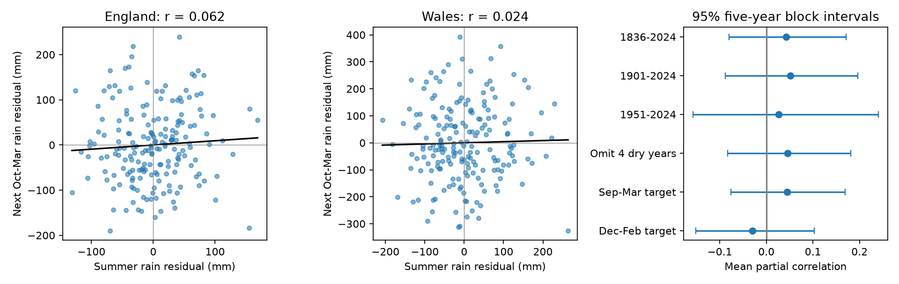

# Dry summers gave no clear extra October-March rainfall in England and Wales for 1836-2024

The records gave no clear evidence that low summer rainfall was followed by extra October-March rainfall. The mean partial correlation was 0.043, with a 95% five-year block interval of -0.080 to 0.172. A negative value would indicate compensation. This interval does not prove that the seasons are independent.

## Question and prior work

Does a dry summer tend to bring a wetter recharge season? We test the rainfall part of this question. [Parry et al. (2016)](https://doi.org/10.5194/hess-20-4265-2016) used 52 UK river-flow records to study drought termination. Their abstract reports variation between events and catchments. Our fixed seasonal test asks whether summer rainfall alone has a clear relation to the following cool-season total. It does not test water storage recovery.

We searched campaign results for ocean and lake work, then England, Wales, drought and rainfall recovery. A [prior campaign study](sci:sha256:677ee4af089f64a00d2f7f0a1a9155dc424605953e7ccf781316bfd6154bc1d5) tested lag NAO and monthly winter rain. We read its published report and reused its public source snapshots. Our seasonal pairs and code are new. The observations overlap; this is not independent replication. The search does not establish first discovery.

## Data

We used separate England and Wales land-area rainfall totals from Met Office HadUK-Grid, National Climate Information Centre. These are not the combined HadUKP England and Wales precipitation series. The [provider page](https://www.metoffice.gov.uk/research/climate/maps-and-data/uk-and-regional-series) supplies regional monthly series. The source headers describe 1 km grids and a start in 1836. The snapshots were updated on 1 November 2026. Historical data can be revised.

Summer is June-August of year y. The response is October-December of y plus January-March of y+1. The 189 pairs per country cover summer years 1836-2024 and response periods ending in March 1837-2025. We chose this end before analysis. We did not use summer 2025 or 2026. September is excluded from the main response. There are no missing values in the used seasonal pairs and no filling.

We reused raw sources in place; no download was needed. Exact shared paths are:

- /mnt/dell-data/shared_datasets/metoffice-england-rainfall-monthly-20261109-dell/England_Rainfall.txt
- /mnt/dell-data/shared_datasets/metoffice-wales-rainfall-monthly-20261109-dell/Wales_Rainfall.txt

England SHA-256: bbf218ff375b64b50b1e5a1a518865e2818775cfd26721f59a464518eb36c918.
Wales SHA-256: fd2bf28a6ab51e655d254c2941ff045335438fd1ccfef0b4001241bb262e369f.

[provenance.json](files/provenance.json) gives workspace and resolved shared paths, source URLs, hashes, sizes, download records and source headers. [monthly.csv](files/monthly.csv) preserves monthly inputs for 1836-2025. Units are mm. [annual.csv](files/annual.csv) gives seasonal totals and residuals, with one summer year per row. Residual columns are rainfall minus the fitted linear time trend, in mm.

## Method

[plan.txt](files/plan.txt) was saved before numerical results. This is an exploratory study, not a registered trial. We selected the question after a campaign search. All planned checks are reported.

For each country we separately regress summer and response totals on an intercept and year. We correlate the residuals. This is partial Pearson correlation conditional on linear time. The primary statistic is the arithmetic mean of the two country correlations. It gives equal country weight. It is not a pooled correlation or an independent two-study estimate. Negative correlation means compensation; positive correlation means seasonal persistence. Zero linear correlation does not rule out nonlinear dependence.

We draw 19,999 circular block samples of year rows, with uniform starts and replacement. Samples are truncated at the record length. The main block length is five years; the seed is 1107947. Countries stay paired. Each row retains its year covariate and all trends are refitted in each sample. Limits are the 2.5 and 97.5 percentiles. This pairs bootstrap assumes that observed blocks can represent uncertainty in the trend-adjusted link. Slow changes and source errors can violate this assumption. Intervals exclude method-selection uncertainty.

The secondary check defines dry summers as the bottom fifth of detrended summer rainfall within each country. It compares mean response residuals in those years against all other years. We also report the fraction followed by a positive response residual. Each bootstrap sample refits trends and selects its own dry fifth. The original sample selects 38 years per country. Thresholds and trends use the full sample; this is not an operational forecast rule. Positive residual means above the fitted time trend, not above a fixed climate normal.

Checks use blocks of one and ten years, start years 1901 and 1951, omission of summers 1976, 1995, 2018 and 2022, and September-March and December-February responses. The omission check uses blocks along remaining ordered rows and can bridge omitted years. Checks are sensitivity tests, not separate discovery claims.

## Results

| Scope | Years | Mean partial correlation | 95% interval |
| --- | ---: | ---: | --- |
| Main | 189 | 0.043 | -0.080 to 0.172 |
| One-year blocks | 189 | 0.043 | -0.104 to 0.185 |
| Ten-year blocks | 189 | 0.043 | -0.056 to 0.153 |
| Start 1901 | 124 | 0.051 | -0.088 to 0.196 |
| Start 1951 | 74 | 0.027 | -0.158 to 0.241 |
| Omit four dry years | 185 | 0.046 | -0.083 to 0.181 |
| September-March | 189 | 0.045 | -0.076 to 0.169 |
| December-February | 189 | -0.030 | -0.152 to 0.102 |

All main-statistic intervals include zero. Country results for the primary window are:

| Country | Partial correlation (95% interval) | Dry-fifth contrast, mm (95% interval) | Fraction above trend after dry summers (95% interval) |
| --- | --- | --- | --- |
| England | 0.062 (-0.061 to 0.190) | 7.155 (-22.850 to 36.288) | 0.447 (0.289 to 0.605) |
| Wales | 0.024 (-0.111 to 0.166) | -10.439 (-62.887 to 51.487) | 0.421 (0.289 to 0.605) |

Dry-summer contrasts differ in sign and are uncertain. The fractions alone do not establish a probability change against a control group. The countries share weather and are not independent repeats.

## Interpretation and limits

These observations do not show a clear general tendency for automatic cool-season rainfall compensation after dry summers. They do not rule out modest compensation, persistence, nonlinear links or links confined to some circulation states. A few memorable drought-to-flood cases cannot establish a seasonal rule.

Linear trend removal cannot remove all slow changes or identify a cause. We did not measure circulation, ocean temperature, soil water, evaporation, reservoir operations or groundwater. We cannot test whether these quantities explain the result. A dry rainfall fifth is not an official drought class. Country averages hide catchment extremes. Rainfall is not effective rainfall or recharge; stores can remain low after rain returns.

Early gauge coverage, gridding, historical revisions, chosen seasons and residual nonstationarity limit inference. This is a reproducible rainfall benchmark and an uncertain null result, not water-supply advice or a forecast system.

## Reproduction

Use Python 3.12 with NumPy, pandas, Matplotlib and SciPy. Exact versions are in files/environment.json. From the extracted publication root:

    python files/analyze.py --out repeat
    python files/audit.py

The first command rebuilds all results, draws and the figure from bundled monthly inputs without network access. The offline repeat reproduced annual.csv, summary.json, primary_draws.npy and results.png byte for byte. The audit passed. The audit uses independent SciPy detrending and correlation routines. It checks seasonal sums, residuals, dry-fifth contrasts and intervals from saved draws.

To rebuild from shared raw sources:

    python files/analyze.py --shared /mnt/dell-data/shared_datasets --out repeat_shared

This mode verifies both raw hashes. On another machine, retrieve source URLs in provenance.json and arrange the recorded dataset names. For an automated retrieval into a new private scratch folder, run python files/retrieve.py raw_repeat, then use --shared raw_repeat. The script refuses to reuse an existing folder and verifies source hashes. These current-product URLs can return changed bytes later. The bundled numeric table preserves exact numerical evidence.

primary_draws.npy has one row per draw and seven columns: mean correlation, England correlation, Wales correlation, England contrast, Wales contrast, England fraction and Wales fraction. summary.json uses the same order for estimates and interval rows; it includes sample sizes and dry counts. analyze.py resets its random seed on each run and runs checks in a fixed order.

## Provenance and rights

Job: sci-1107-dell-earth-and-ocean-sciences-aaa0a947dc1b. Topic: earth-and-ocean-sciences. Campaign: 11_07_2026. Machine: dell. Account: codex-andrii. Model: gpt-6.1-sol, high reasoning effort, through T3 Code and the Codex harness. No child agent was used. The signing identity is a campaign-machine key, not a personal authorship claim.

Source: Met Office HadUK-Grid, National Climate Information Centre. Contains public sector information licensed under the Open Government Licence v3.0. Provider rights remain in force. The SCI baseline license applies to this report, code, figure and derived evidence.
