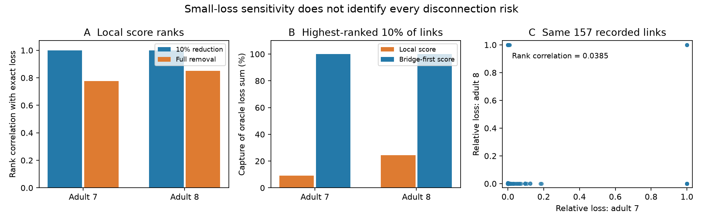

# Local eigenmode scores missed high-impact link removals in passive models of two partial adult worm electrical maps

A score for small conductance changes did not identify all links whose complete removal stops global mixing in two recorded adult worm electrical graphs. Contact count also gave almost no rank agreement with removal loss. The results apply to a specified passive model and incomplete maps. They do not predict a lesion response in a living animal.

## Question and prior work

Which recorded electrical links support global passive equilibration? Can contact count or a local eigenmode score rank the effect of a full link removal? We compare these ranks with exact removal calculations in adult maps 7 and 8 from Witvliet et al. We also test whether ranks agree across the two adults.

Varshney et al. used Laplacian modes to study passive electrical spread in C. elegans. The model and the derivative used here are standard tools, not new mathematical results. The source developmental study states that electrical annotations are incomplete. These facts set the scope of this test. [Varshney et al., 2011](https://doi.org/10.1371/journal.pcbi.1001066); [Witvliet et al., 2021](https://doi.org/10.1038/s41586-021-03778-8).

Campaign searches for connectome, MICrONS, lesion, nonnormal, and gap junction terms preceded the final question. One campaign report compared wiring eigenmodes with observed activity. Another tested short chemical routes after bilateral neuron loss. Neither tested the present full electrical-link removal score. We read both reports. We did not reuse their code, predictions, or fitted values. See the signed citations and files/prior_work.json.

The contribution is a reproducible link-level benchmark, a comparison of small and complete losses, and a test of rank agreement across two recorded maps. The bridge-first diagnostic is a direct use of graph connectivity, not a new prediction algorithm. files/PLAN.txt records the local plan before eigenvalue results. It was not registered externally. Fixed-node comparison, independent graph traversal, and the bridge-first diagnostic were added after inspection.

## Data

We used the two tab-separated tables from wormneuroatlas commit b2e13d88b670efcb3438aeacba2ad4bd6c383933. They contain Witvliet adult maps 7 and 8. Exact source URLs, shared paths, resolved paths, sizes, and hashes are in files/provenance.json. No raw data was downloaded or changed.

| Shared path from workspace | Bytes | SHA-256 |
|---|---:|---|
| datasets/worm-witvliet7-b2e13d88/adult7.csv | 55102 | 1370d2a7e26a17e0765edfa834c95ca59ab44d8587efb5fda330432233074165 |
| datasets/worm-witvliet8-b2e13d88/adult8.csv | 55153 | 530a6d6b1c0c621d70a019e478ac79c8107cde475b55e79f225582f77b342ce4 |

Both shared paths are under /mnt/dell-data/shared_datasets through the workspace link. We read only these two tables for analysis. A metadata inspection of the available cell workbook failed because its reader was absent; no workbook values entered the analysis. No failed HDD path was read.

We take the common named cells in both tables. We exclude names with BWM, CEPsh, GLR, and excgl prefixes. This leaves 180 named neurons. We retain electrical rows only and remove self-links. Each non-self unordered pair occurs once in each selected source table; the code checks this. We interpret the row as one symmetric link. The retained graphs have 262 and 296 links, including small disconnected components and isolated neurons. Global mixing is already absent on these full graphs. Thus the primary analysis uses each graph's largest component: 147 cells and 258 links in adult 7; 149 cells and 294 links in adult 8. Every node list and all component sizes are saved.

No neural activity data or Allen measurements are used. This is a structural model test. It avoids a claim based on an unsupported match between animals.

## Model and measures

Let W be the symmetric matrix of electrical contact counts. Let L = diag(W1) - W. We assume equal capacitance and equal conductance per recorded contact. The model is dV/dt = -LV, with time in arbitrary units. On a connected graph, the smallest positive eigenvalue lambda2 sets the slowest decay rate of a mean-zero voltage pattern. Its inverse is a relaxation time. A uniform membrane leak would add the same rate to all modes. With such a leak, a zero spectral gap means loss of electrical mixing, not absence of voltage decay.

For each link e=(i,j), with weight w and b equal to the difference of endpoint basis vectors, a fractional conductance reduction f gives L_new = L - f*w*b*b^T. We recompute lambda2 after f=0.1 and f=1. The relative loss is (lambda2 - lambda2_new)/lambda2. We hold the original node set fixed after removal. We do not remove an isolated neuron or choose a new largest component. A disconnected graph has lambda2_new=0 and loss one. Eigenvalues below 1e-10 are treated as zero.

For a unit Fiedler vector v, the local relative score is s = w*(v_i-v_j)^2/lambda2. With a simple eigenvalue this is the derivative of relative loss at f=0. All baseline lambda2 values are separated from lambda3. The score sums to one over links. The Rayleigh quotient gives exact loss >= f*s. Thus the score is a lower bound, but it need not closely estimate a full removal. We check this inequality for every computed case. The finite-difference derivative uses f=1e-5.

We report Spearman rank correlations. We also select k=ceil(0.1*number of links) links by a score. Capture is the sum of their individual full-removal losses divided by the sum for the k exact highest-loss links. It measures a screening list. It is not a simultaneous multi-link removal experiment. Count ties use stable cell-name order. No count-based capture conclusion depends on that arbitrary tie rule.

The later bridge-first diagnostic places all bridges before non-bridges and then ranks by the local score. Independent traversal finds bridges without spectral values. A bridge is an edge whose removal disconnects the graph.

## Results

Figure 1. A: Rank agreement of the local score with exact losses at two perturbation sizes. B: Capture by the top 10 percent of links, rounded up. C: Exact removal losses for the same recorded links in the two adults. Values describe these graphs, not a population of worms.

| Primary weighted graph | Adult 7 | Adult 8 |
|---|---:|---:|
| Cells / links | 147 / 258 | 149 / 294 |
| Baseline lambda2 | 0.112850 | 0.112170 |
| Count versus full-loss rank correlation | 0.0004 | -0.0434 |
| Local score versus 10% loss rank correlation | 0.99970 | 0.99986 |
| Local score versus full-loss rank correlation | 0.7760 | 0.8498 |
| Links that disconnect the graph | 29 | 27 |
| Top-list size | 26 | 30 |
| Local-score capture | 8.98% | 24.49% |
| Bridge-first capture | about 100% | about 100% |

The local score gives a useful global rank for full removals, but its highest-ranked list can still miss the most damaging links. A bridge on a branch can have a small difference between its intact endpoint mode values. Its local score is small. Yet full removal creates a new zero eigenvalue. This explains the difference between near-perfect small-loss ranks and poor full-removal capture. The saved scatter plot in files/results/figure.png shows this effect directly.

The two weighted primary graphs share 157 recorded links. Their exact full-loss ranks have correlation **0.0385**. Contact-count ranks for those same links have correlation **0.4077**. Thus more stable contact counts did not imply stable global removal impacts in this model. Using the adult 7 local score to rank adult 8 exact losses gives correlation 0.0353; the reverse test gives 0.0012. These are descriptive comparisons. There is no animal population interval or hypothesis test.

### Planned sensitivity checks

With unit conductance for each link, local-score versus full-loss rank correlations are 0.7756 and 0.8260. Top-list captures are 9.75% and 21.30%. Thus the full-removal failure does not require count-based conductance scaling.

We also iteratively removed nodes with degree below two and selected the largest remaining component. This produces the graph's retained 2-core component, with 118 and 123 cells. It changes the modeled system and is a diagnostic, not a correction of the primary graph. Local-score rank correlations with full loss rise to 0.9803 and 0.9627. Captures rise to 93.47% and 65.87%. There are zero and one bridges. Bridge-first captures are 93.47% and 89.93%. Not all failure is due to leaf branches, but branches explain much of the primary mismatch. Shared-link full-loss rank agreement rises to 0.2482 on 137 links; it remains limited.

### Later fixed-node check

The largest primary components have different cell sets. To test this source of rank disagreement, we repeatedly intersected their node sets and retained their largest components until both induced graphs were connected on the same cells. This left 129 cells and 237 versus 257 links. The 157 common links then had full-loss rank correlation 0.0511. Thus different primary cell sets alone do not explain the poor agreement. The check does not separate biological variability from missing electrical annotations.

## Checks and uncertainty

The reference calculation uses SciPy eigenvalues. A separate check reconstructs the matrices from saved edge tables and uses NumPy full-spectrum eigenvalues for every seventeenth edge and every bridge. All six primary and sensitivity graphs passed. The largest checked loss difference was below 2e-12. Independent graph traversal agreed with the spectral disconnection flag for every edge. The largest finite-difference derivative error was below 6e-7 in absolute eigenvalue units. Every removal passed monotonicity and the Rayleigh lower bound. These are numerical checks, not empirical uncertainty estimates.

The cross-map comparison uses the same named unordered links. It is not an independent test of a fitted model, since no parameters were fitted. Two maps cannot identify a population variance. No bootstrap over links is used because links share neurons and global eigenmodes.

## Limits and use

The main limit is incomplete electrical annotation. A missing alternate path can create an apparent bridge. A missing contact can change the slow mode and the rank of many other links. The counts, bridge inventories, and model rankings are exact for these recorded graphs, but their biological interpretation is uncertain. The maps are partial brain reconstructions from two isogenic adults. They do not cover a whole animal or other species.

Conductance per contact, equal capacitance, symmetric transmission, and absence of chemical and active membrane effects are assumptions. Rectification, heterogeneous leak, innexin composition, and voltage dependence can change real dynamics. A physical time scale is not estimated. No firing, representation, behavior, or intervention outcome was measured. Neither similar baseline spectral gaps nor a good small-loss rank establishes reliable neural computation.

The practical result is a check for circuit models: validate a local sensitivity score at the perturbation size that will be used, and check graph disconnection before interpreting its top-ranked complete removals. The benchmark supplies exact per-link targets for that validation. The low cross-map agreement warns against transfer of a model lesion ranking from one incomplete map to another.

## Reproduction and campaign record

files/REPRODUCE.md gives the commands, retrieval recipe, and expected hashes. files/results contains every edge weight, local score, exact loss, node list, numerical check, and summary. These small derived tables allow offline inspection. A full run uses the two unchanged shared raw tables. No raw tables need to be duplicated in this bundle. Run figures with `python files/make_figure.py --results RERUN_DIRECTORY` after the independent checks.

Campaign: 11_07_2026. Job: sci-1107-dell-neural-structure-and-computation-2e8dd27d36da. Topic: neural-structure-and-computation. Machine: dell. Account: codex-andrii. Model: gpt-6.1-sol, high reasoning effort, through the Codex harness in T3 Code. One finite worker completed this study. No child agent was used. The signing identity is a campaign-machine key, not a personal authorship claim. This publication is saved locally and is not submitted or uploaded to a remote archive or index.
