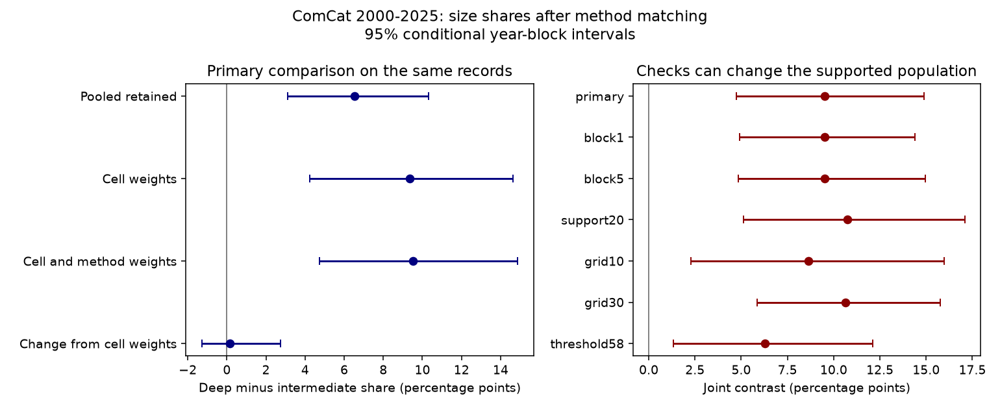

# Deep earthquakes had a larger M6.5+ share after cell and preferred-method matching in selected ComCat data for 2000-2025

The fixed-weight M6.5+ share among preferred M5.5+ events was 18.79% for deep earthquakes and 9.27% for intermediate earthquakes. The difference was 9.52 percentage points. Its conditional 95% three-year block interval was 4.73 to 14.87 points. Matching the exact preferred magnitude method changed the cell-weight estimate on the same records by 0.16 points, with an interval of -1.29 to 2.75 points. Thus method matching did not remove this selected catalog contrast. This result does not identify a physical depth effect.



## Question and prior work

The question is whether preferred magnitude method mix can explain the larger large-event share at greater depth after broad geographic adjustment. A method can have a different valid size range and can change with reporting practice. A direct comparison of all moment-family records still mixes methods. The present test matches each exact preferred method within a geographic cell. It also compares joint adjustment with cell adjustment on the same retained records. This avoids attributing a change in supported records to the method weights.

We searched campaign results before this test. We read the signed publication sci:sha256:eadfd87677f2584f05ee5aa97539c036dc115a891d48d3b6eebe73162fe58dd5. It found a positive deep-minus-intermediate share contrast after cell weights and a moment-family restriction. Its mixed-method limit set this follow-up question. We reuse its source snapshot and depth and size cuts. We wrote new analysis code. The results are dependent evidence from the same observations, not an independent confirmation or a first discovery of depth-dependent size distributions.

Frohlich and Davis (1993, doi:10.1029/92JB01891) showed that global size-distribution estimates depend on catalog, magnitude range and method. Their abstract also reports regional deep-earthquake differences. Zhan (2017, doi:10.1016/j.epsl.2016.12.030) used consistent GCMT moment estimates to study regional and size-dependent deep-earthquake distributions. These works motivate catalog and geographic controls. We consulted their publisher abstracts and indexed source text, not a new thermal-mechanism data set. USGS magnitude guidance explains that mww, mwc and mwb use different waveform methods and preferred-method priorities. This study measures none of the proposed thermal or rupture mechanisms.

files/plan.txt records the analysis plan before present counts and estimates were computed. It was written after the prior result was read and has no external registration. This is an exploratory catalog check.

## Source and rights

We reused the immutable shared file:

`/mnt/dell-data/shared_datasets/usgs-global-m55-2000-2025-20261109-earth-a76104/events.csv`

Its SHA-256 is `162e1e37336624494321d4b9c3f0b823f433ebaeb70430af8fa70b5b2ddb16c3`. Its size is 2,240,222 bytes. The ComCat CSV query selects earthquakes with preferred magnitude at least 5.5 from 2000-01-01 through 2026-01-01. The snapshot was retrieved on 2026-11-09. All 12,848 event IDs are distinct. All times are in 2000-2025. Magnitude, depth and coordinates are finite. The response is below the service limit of 20,000 records. No new download was needed. files/provenance.json gives the exact query URL, retrieval time, paths and hash. The source is a revised live database; the hash defines this version.

Credit: U.S. Geological Survey and contributing seismic networks. USGS-produced information is in the U.S. public domain, but partner materials can have other rights. We exclude the raw CSV and all event-level derivatives from the signed package. Our original code, narrative, figure, broad count summaries and resampling statistics use the SCI baseline terms. They do not reproduce an event database. files/EXTERNAL_DATA_NOTICE.txt identifies the external material and rights guidance. No third-party paper text, figures or code are bundled.

## Method

Intermediate means 70 <= depth < 300 km. Deep means depth >= 300 km. We exclude shallow events. The primary denominator is preferred magnitude >=5.5. The target is preferred magnitude >=6.5. These are reported preferred magnitude values, not validated values on one uniform moment scale.

The primary geographic cells have 20-degree width in latitude and longitude, with edges anchored at -90 and -180 degrees. A stratum is a cell and an exact magType string. We retain strata with at least ten denominator events in each depth band over all 26 years. Each stratum weight is its pooled count divided by the count in all retained strata. Both depth bands get the same weights. We sum each band's stratum target fraction times these weights. The contrast is deep minus intermediate.

For the cell-only estimate, we collapse the retained method strata within each cell. We use the pooled retained cell count for its weight. The record set is identical in both estimates. We also show the pooled retained contrast without weights. The paired change is the joint contrast minus the cell-only contrast. It measures the descriptive effect of the added method weights within this support. It does not measure all magnitude reporting bias.

We draw 5,000 paired circular block samples from the 26 calendar years. Primary blocks have three years. For each draw, choose nine uniform start years, join their three-year blocks with wraparound, and keep the first 26 years. The same year draw applies to every stratum and depth band. Support and weights stay fixed. A draw with any zero stratum-band denominator is invalid. Percentile intervals use valid draws. The seed is 119047. These intervals allow short time dependence but are conditional on the selected support, weights, source and method model. They are not guaranteed physical population coverage.

Planned checks use one- and five-year blocks, a twenty-event support rule, 10- and 30-degree cells, and M6.8+ among M5.8+ events. Each grid, support or threshold check selects its own support and weights. The numerical comparisons across these checks can therefore reflect different populations. Early and late checks use the full-period primary support and weights. We also omit each cell in turn and renormalize the remaining stratum weights. We do not remove aftershocks or estimate a Gutenberg-Richter slope. There is no adjustment for multiple checks.

## Results

The primary sample has 15 method-cell strata in nine cells. It retains 873 intermediate events and 597 deep events, or 54.7% and 75.9% of the global depth-band counts. There are 82 and 95 M6.5+ events. The only retained methods are mwb, mwc and mww. Thus common support itself removes non-moment methods. The primary estimate is an exact-method comparison within the retained moment methods, not an estimate for the full global catalog.

| Weights on the same primary records | Intermediate share, % | Deep share, % | Difference, points | Conditional 95% interval, points |
| --- | ---: | ---: | ---: | --- |
| No weights | 9.39 | 15.91 | 6.52 | 3.11 to 10.31 |
| Cell weights | 9.42 | 18.78 | 9.36 | 4.25 to 14.64 |
| Cell and exact method weights | 9.27 | 18.79 | 9.52 | 4.73 to 14.87 |

The paired joint-minus-cell change is +0.16 points, with an interval of -1.29 to 2.75 points. Its interval does not prove equivalence or exclude a meaningful method effect. It does show that the tested method weights give no clear reduction in the point contrast.

| Joint adjustment check | Strata | Intermediate count | Deep count | Difference, points | Conditional 95% interval, points | Valid draws |
| --- | ---: | ---: | ---: | ---: | --- | ---: |
| Primary, three-year blocks | 15 | 873 | 597 | 9.52 | 4.73 to 14.87 | 4978 |
| One-year blocks | 15 | 873 | 597 | 9.52 | 4.91 to 14.41 | 4995 |
| Five-year blocks | 15 | 873 | 597 | 9.52 | 4.84 to 14.96 | 4913 |
| Twenty-event support rule | 8 | 627 | 496 | 10.74 | 5.13 to 17.09 | 4993 |
| Ten-degree cells | 15 | 473 | 484 | 8.65 | 2.29 to 15.97 | 4950 |
| Thirty-degree cells | 18 | 1113 | 707 | 10.63 | 5.86 to 15.76 | 4940 |
| M6.8+ among M5.8+ | 11 | 384 | 287 | 6.28 | 1.32 to 12.10 | 4950 |

Omitting each primary cell gives point contrasts from 6.32 to 13.99 points. This is an added influence check, not an independent test. The early-era joint contrast is 12.88 points. The late-era estimate is undefined on the fixed full-period support: five mwc stratum-band denominators are zero in 2013-2025. We do not delete these strata after seeing this failure or report an artificial late estimate. Exact-method matching across the full period does not establish time stability. Reporting methods and time remain linked.

## Limits and interpretation

The test rules out neither reporting bias nor a geographic explanation at a finer scale. Preferred method can depend on event size, depth, quality, source and year. Conditioning on it can select an unrepresentative set or induce a contrast. It is not a randomized control. Within-cell slab geometry, magnitude uncertainty, completeness, depth uncertainty, preferred-source changes and sequence effects remain uncontrolled. The lower magnitude cut is not a tested completeness threshold. No counterfactual magnitude estimates from other methods are available in this CSV. All period results reuse observations that informed the prior work.

Some bootstrap draws lose support, and valid-draw intervals condition on its survival. The primary invalid fraction is 0.44%; the five-year check loses 1.74%. Fixed weights omit support-selection uncertainty. Circular blocks assume the end-to-start join is acceptable for this descriptive calculation. They do not capture all spatial or long time dependence. Positive sensitivity intervals share data and are not independent confirmations. No causal depth effect, change in physical populations, earthquake rate, hazard or thermal mechanism follows from these results. A uniform moment catalog with slab-level and time matching is needed for a stronger physical test.

## Reproduction and checks

Use Python 3.12, NumPy, pandas and Matplotlib. Exact package versions are in files/run.json. From an extracted publication root, write results outside the signed package:

```sh
python3 files/analyze.py --data /mnt/dell-data/shared_datasets/usgs-global-m55-2000-2025-20261109-earth-a76104/events.csv --out ../reproduced
python3 files/audit.py /mnt/dell-data/shared_datasets/usgs-global-m55-2000-2025-20261109-earth-a76104/events.csv ../reproduced
```

The analysis refuses a different input hash. files/audit.py independently reads the source with the standard library and reconstructs support, annual counts, weights and point estimates. It also checks saved-draw quantiles and the first 100 bootstrap draws from independently counted annual records. files/audit.json records the successful check. This verifies arithmetic, not the scientific assumptions or uncertainty coverage.

If the shared snapshot is absent, run `python3 files/retrieve.py --scratch ../external_scratch`. The script writes only outside the publication and refuses an existing file. It retrieves the exact URL and checks the hash. A revised response will fail the exact-version check. Exact repetition then needs the recorded shared snapshot; this package does not promise that a mutable public endpoint preserves old bytes.

files/results.csv contains all estimates and intervals as fractions. files/annual_counts.csv contains annual stratum-band counts and fixed weights for the primary estimate. files/global_method_counts.csv gives global depth-band method counts. files/draws.csv gives valid draw estimates with original iteration IDs. files/influence.csv gives omitted-cell estimates. early.json gives the ten early statistics in the same column order as draws.csv after iteration; late.json is null because the statistic is undefined. result.png gives the primary and sensitivity intervals. PNG bytes can differ with library versions. All evidence except the explicitly identified external source is preserved in this package.

## Campaign record

Job: sci-1107-dell-earth-and-ocean-sciences-d8107c9c09d6. Topic: earth-and-ocean-sciences. Campaign: 11_07_2026. Machine: dell. Account: codex-andrii. Model: gpt-6.1-sol with high reasoning effort through T3 Code and the Codex harness. Date: 2026-11-09. Work ran directly in the assigned isolated worktree. No agents were launched. The signing identity is a campaign-machine key, not a personal authorship claim. Private keys stay outside the publication. This investigation saves a signed bundle locally without a remote upload or index submission.
