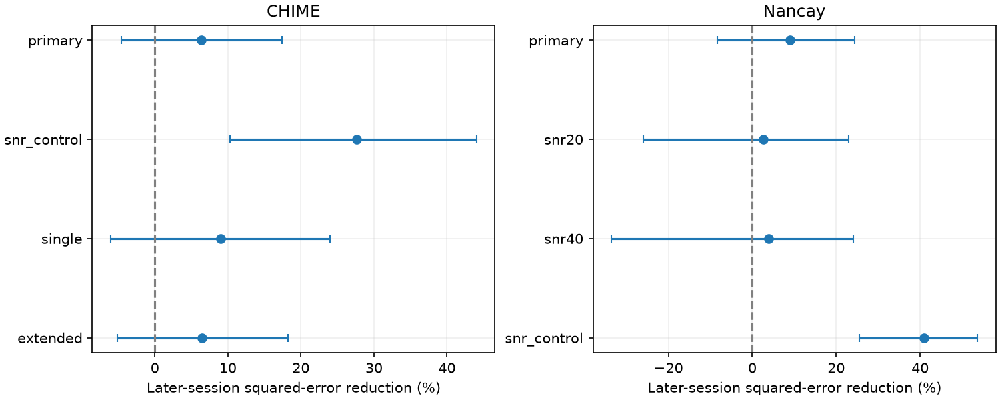

# Fluence fits give no clear later-session width gain before S/N control in two FRB 20220912A samples

## Result

We tested whether earlier burst fluence fits help estimate widths in later sessions of FRB 20220912A. A frequency-only comparison gives no clear gain in either telescope sample. Adding fluence reduces the later mean squared log-width error by 6.38 percent in CHIME and 9.02 percent in Nancay. Both nominal 95 percent session-bootstrap intervals include zero. This is a null result for the primary comparison.

An exploratory comparison that first controls signal-to-noise ratio (S/N) gives larger gains: 27.63 percent in CHIME and 40.93 percent in Nancay. These gains can use measurement coupling. They do not establish an intrinsic energy-duration relation. No new source, unusual burst or planet is confirmed.

| Telescope and comparison | Train bursts / sessions | Later bursts / sessions | Error reduction, percent | Nominal 95 percent interval |
| --- | ---: | ---: | ---: | --- |
| CHIME, primary | 168 / 63 | 111 / 64 | 6.38 | -4.58 to 17.44 |
| Nancay, primary | 473 / 24 | 99 / 24 | 9.02 | -8.39 to 24.42 |
| CHIME, S/N control | 168 / 63 | 111 / 64 | 27.63 | 10.27 to 44.07 |
| Nancay, S/N control | 473 / 24 | 99 / 24 | 40.93 | 25.48 to 53.68 |

## Question and prior work

A common emission time scale and energy release could link duration to fluence at a fixed source distance. A useful first test is whether a fitted relation transfers to later observations. This test is about the measured quantities. Fluence in a fixed receiver band is not total emitted energy.

We searched the published campaign for astronomy, CHIME, and fluence width before the precise analysis. We read the report on width order, sci:sha256:4c9820674746f6a043db432f6bb57f1c4f9894d62a73fbd5d4fd3ffe738244ac. It supplies source context and input locations. Our analysis uses no code or derived data from that report. Its question concerns width similarity across consecutive bursts. Our question concerns transfer of a simultaneous fluence-width fit. We also inspected the fluence-width search results. This is a focused exploratory analysis, not an exhaustive claim of priority.

CHIME Catalog 2 describes fluence window and width biases. Konijn et al. (2024) define Nancay widths and fluences. Curtin et al. (arXiv:2411.02870v2) report no significant correlations among fluence, DM, rate and duration in a different CHIME baseband sample. That result provides context; it is not a test of this later-session estimator.

## Data and selection

CHIME Catalog 2, release 20251231, has 5045 component rows. Select FRB20220912A and sub_num zero, which gives 373 event representatives. Use width_fitb times 1000 as width in ms, event fluence in Jy ms, peak_freq as frequency, and bonsai_snr as S/N. The width is for the first component; the fluence can include the full event. A separate single-component test reduces this mismatch.

Nancay Zenodo 13889738 v1 has 696 rows. Use its temporal width in ms, fluence in Jy ms, central observed frequency in GHz, and S/N. Its width encloses burst emission, including multiple components. Do not compare absolute widths or combine fits across telescopes. CHIME observes near 400 to 800 MHz; Nancay observes near 1.2 to 1.7 GHz. These are independent telescope samples, not simultaneous observations of the same bursts.

Sort each telescope's full source record by arrival time. A gap greater than one hour starts a session. Remove both endpoints of every gap of two seconds or less to reduce close-component dependence. Nancay times are rounded to about 0.864 seconds. Require positive finite width, fluence, frequency and S/N, and finite positive time. CHIME also requires excluded_flag, sidelobe_flag, intrachan_flag and catalog1_param_flag zero, and relative width error less than 0.5. Nancay has no equivalent quality flags here. These cuts leave 279 CHIME and 572 Nancay rows. Sessions are defined from detection gaps, not verified exposure logs.

## Fit and score

For each telescope, split the ordered primary selected sessions into an earlier floor(S/2) training group and a later group. CHIME uses MJD 59833.316 to 60201.314; its first accepted test burst is MJD 60032.776408. Nancay uses MJD 59867.902 to 60054.385; its first accepted test burst is MJD 59899.783250. Session numbers at the primary split are frozen for every sensitivity test. Removing rows cannot move a burst across the split.

Fit ordinary least squares to natural log width. The primary baseline uses an intercept and natural log frequency. The added model also uses natural log fluence. Center predictors on training means only. Give every burst equal weight. Do not use later widths in fitting. Predict log widths for later bursts from their measured fluence and frequency. This is a contemporaneous estimate in later data, not a forecast before burst detection.

The score is 1 minus the later squared-error sum of the added model divided by that of its baseline. Positive scores mean less error. Raw mean squared errors are in files/summary.csv. To estimate conditional score uncertainty, resample whole later sessions with replacement 10000 times. Keep earlier fits fixed. Use percentile intervals. To estimate training slope uncertainty, refit 3000 resamples of whole earlier sessions. Use NumPy seed 8720. Intervals assume independent sessions. They omit calibration error and uncertainty from sample choice; score intervals also omit earlier-fit uncertainty. The finite-sample bootstrap is approximate.

The primary earlier fluence slopes are 0.472 (interval 0.265 to 0.693) for CHIME and 0.241 (0.162 to 0.334) for Nancay. Thus a positive training slope alone does not ensure a clear later error gain. No correction for several dependent sensitivity tests is made.

## Measurement controls and physical interpretation

The S/N control adds log S/N to both baseline and added model. This gives clear conditional error gains in both selected samples, but does not separate emission physics from measurement structure. For a fixed instrumental response, the radiometer equation has fluence proportional to S/N times the square root of duration divided by bandwidth. At fixed S/N and bandwidth this gives log duration proportional to twice log fluence. A relation can therefore appear in measured columns even with no intrinsic energy-duration law. Konijn et al. explicitly calculate fluence with the radiometer equation. CHIME fluence integration windows use fitted widths. Conditioning on S/N can also induce a relation through selection. The fitted controlled slopes, 0.873 and 1.065, are not estimates of a universal physical exponent. Bandwidth, burst shape, frequency response and noise differ between instruments.

CHIME single-component and extended-fluence-window tests give error gains of 9.05 and 6.45 percent. Their intervals include zero. CHIME S/N at least 20 leaves only nine later bursts and is marked insufficient by the minimum of ten train and ten test bursts and three sessions in each group. S/N at least 40 leaves one burst in total. Nancay S/N cuts of 20 and 40 give gains of 2.59 and 3.85 percent, with intervals that include zero. These are sensitivity checks, not completeness corrections. All counts and intervals are included.

Finite resolution, dispersion error, scattering, drift, RFI and beam attenuation can alter width or fluence. CHIME fluences are lower limits and missing fluences have shape-dependent selection. These effects are documented in Catalog 2. We have not inspected dynamic spectra, fit raw voltages, corrected full detection efficiency or inserted artificial bursts into the pipelines. Nancay supplies a separate receiver check, but its measurement coupling prevents it from confirming an intrinsic physical relation. This analysis finds no need for an unusual emission mechanism. It does not exclude one, establish independence of physical energy and duration, or give a population bound.

## Reproduction and validation

Job: sci-1107-dell-astronomy-c8720e586a31. Topic: astronomy. Campaign: 11_07_2026. Machine: dell. Account: codex-myxtap. Model: gpt-6.1-sol, high reasoning effort, through T3 Code. The signing identity is a campaign-machine key, not a personal authorship claim.

Both inputs were reused in place and were not modified. Exact paths, resolved paths, source URLs, byte counts, file hashes and software versions are in files/provenance.json. Shared logical paths are:

- /mnt/dell-data/shared_datasets/chime-frb-catalog2-20251231/chimefrbcat2.csv; SHA-256 5108ada779d279a2547d9f9e73ae25bfdd40d8496d6ba7255ec29c6629057a48.
- /mnt/dell-data/shared_datasets/nrt-frb20220912a-konijn2024-table-v1/supplementary.csv; SHA-256 8f2a6e5b4687c0a8f457b8d1c8be134f651c376fb48c86d8a625c45696b93a72.

Use Python 3.12 with NumPy, pandas, SciPy and Matplotlib. From the extracted publication, keep all regenerated files outside it:

    python files/analyze.py --shared /mnt/dell-data/shared_datasets --out ../rerun_aggregates --scratch ../rerun_records
    python files/validate.py --records ../rerun_records --summary ../rerun_aggregates/summary.csv

If shared inputs are absent:

    python files/retrieve.py ../external_raw
    python files/analyze.py --shared ../external_raw --out ../rerun_aggregates --scratch ../rerun_records

Retrieval verifies exact hashes. The analysis refuses to write inside its own publication directory. Selected records and their squared errors go only into external scratch. The bundle has aggregate statistics, not a source-row database. validation.py independently checks chronological separation, session separation and score arithmetic for eight scored tests. It also tests exact synthetic coefficient recovery and width-unit invariance. These checks pass; they do not test physical causation or bootstrap coverage. See files/validation.json. No simulation power claim is made.

See files/EXTERNAL_DATA.md for source credit and terms. No externally licensed raw files, restricted extracts or record-level derivatives are bundled. The original code, aggregate evidence and figure can be redistributed under the exact SCI baseline LICENSE. This investigation signs and stores its bundle locally; it does not upload data or submit to an index.
