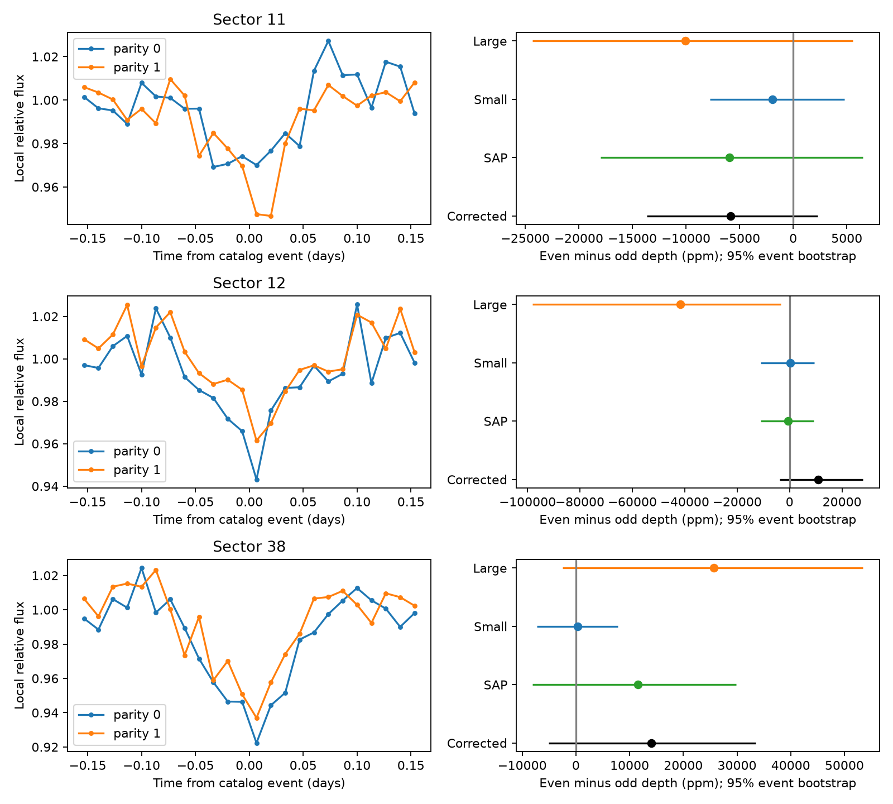

# A fixed-window test does not resolve alternating eclipse depths of TOI-3142.01 in three TESS sectors

## Question and result

Does the light curve of TOI-3142.01 show unequal depths at alternate catalog events? This test can help to separate a planet transit at 1.1536561 days from two stellar eclipses in an orbit of about 2.3073 days. We used the public QLP light curves of TIC 387791274 in TESS sectors 11, 12, and 38. The main test does not resolve a depth difference in any sector. This is a null result for the stated measurement. It does not show that the two depths are equal.

| Sector | Even events | Odd events | Even depth (ppm) | Odd depth (ppm) | Even minus odd (ppm) | Conditional 95% interval (ppm) |
|---|---:|---:|---:|---:|---:|---:|
| 11 | 8 | 8 | 26681 | 32526 | -5846 | -13663 to 2295 |
| 12 | 8 | 6 | 29314 | 18472 | 10842 | -3705 to 28040 |
| 38 | 10 | 9 | 56170 | 42110 | 14060 | -5072 to 33433 |

The means describe flux loss in a central window. They are not fitted maximum eclipse depths. Sector 11 and sector 12 have 30-minute exposures. Sector 38 has 10-minute exposures. We do not combine their depths into one estimate.



The left panels show binned event profiles after a local baseline correction. Blue and orange mark the two event parities. The right panels show the mean depth contrast and its event-bootstrap interval in four flux products. Profiles can include partial events; the depth test requires at least two central samples. Thus the two panels need not use exactly the same events. Aperture products use the same images and are not independent observations.

## Prior work and scope

The campaign publication `sha256:987dcc64327f9be8bea39fd94eb38a0faf60622c9e28a514f449820e95182c81` found that Gaia DR3 source 5854299913520272000 is at the target position. It reported a Gaia binary period of 2.3072652 days, close to twice the TOI period. It left the source class open. Its Gaia G model has primary and secondary depths of about 0.046 and 0.028 mag. These are catalog model values, not new measurements here. Our frozen Gaia row has a reduced model chi-squared value of 14.62. This gives a further reason for care with that model.

This work adds an event-level test in three TESS sectors to that published lead. It does not repeat the full Gaia match search. Exact-name web searches for TOI-3142 and TIC 387791274 did not give a target-specific external paper. This limited search is not proof of novelty. Gaia already lists this source as a binary candidate. The frozen ExoFOP row still lists PC and says that the signal came from the faint-star QLP search. We do not claim a new planet, binary, or source position.

QLP supplies public light curves from TESS full-frame images (Huang et al. 2020; Kunimoto et al. 2021). Gaia DR3 supplies a large binary candidate catalog (Mowlavi et al. 2023). Both are cited in sci.json. Unequal alternate eclipses are consistent with a stellar pair whose components have different surface brightness. Equal or unresolved depths do not exclude a stellar pair. A single planet transit also need not have a detectable alternate-depth contrast.

## Method

The input period is P = 1.1536561 days. The reference time is BJD(TDB) 2459360.085141. The listed duration D is 2.51 hours. We use event index n at T0 + nP. Even and odd refer to n modulo two; they do not assign the physical primary eclipse. All times in the code are BJD minus 2457000 days, as stated in the FITS headers.

We retain QUALITY = 0 samples with finite time and positive finite flux. For each flux product we divide by its sector median. For each event, we fit a straight baseline to samples with 1.5D < absolute time offset < 3D. We require three baseline samples on each side and two central samples. The measured depth is the mean of 1 - flux/baseline within an absolute offset of 0.35D. A separate baseline is used for each event. We do not remove large depths or use the quoted flux errors as weights.

The main product is KSPSAP_FLUX. The estimated contrast is the mean even depth minus the mean odd depth. We resample whole event depths within each parity 10000 times. The 2.5 and 97.5 percentiles give the displayed intervals. This treats events as exchangeable within a sector and parity. It includes event scatter but does not account for correlated errors between events or uncertainty in the catalog ephemeris. The standard error in the table file uses the separate sample variances. It does not use the scatter between cadences as if the cadences were independent.

## Checks and sensitivity

We repeat the depth measurement in SAP_FLUX and in the small and large corrected apertures. These checks expose dependence on the aperture and processing. For example, sector 12 gives -662 ppm in SAP but -41667 ppm in the large aperture; the large-aperture 95% interval excludes zero. The main corrected flux and the small aperture do not reproduce that result. Thus the large-aperture result is not sufficient evidence of a physical depth contrast.

We test central half-widths of 0.25D, 0.35D, and 0.45D, and baseline intervals of 1.5D to 3D and 2D to 4D. Only one of the 18 main-product sector and window intervals excludes zero: sector 11 at 0.25D with the 1.5D to 3D baseline gives -13399 ppm, with interval -24638 to -2638 ppm. It is an exploratory result among correlated tests and has no correction for multiple tests. It does not persist across the stated windows and sectors. We do not use it to select a source class.

A second check uses median event depths, shifts the reference time by plus or minus 0.02 days, and uses half the Gaia period while keeping the TOI reference time. All 24 intervals in this check include zero. This checks modest timing changes; it is not a period search or a fit for eclipse timing changes.

A numerical injection subtracts a box signal from the retained central flux samples. Its contrast is 0.02 in relative flux, with opposite signs on the two parities. The measured increment is recovered to absolute error below 1e-12. This is an implementation check for this exact box and baseline, not a physical transit recovery test or a test of QLP processing.

A separate conditional sensitivity calculation resamples centered observed event depths. For an added contrast of 10000 ppm, the fraction with absolute resampled contrast above 1.96 times the observed standard error is 0.647, 0.175, and 0.148 for sectors 11, 12, and 38. At 20000 ppm it is 0.998, 0.600, and 0.490. These fractions use a fixed observed error and an empirical noise model. They are approximate sensitivity measures, not calibrated detection probabilities. They show why this null result cannot exclude modest unequal depths.

## Physical interpretation and limits

The data retain repeated dips at the catalog event times. The present alternate-depth test does not choose between a 1.1536561-day transit interpretation and a roughly 2.3073-day binary interpretation. It also cannot exclude a blended binary at another position. A similar surface brightness in two stars can give similar eclipse depths. A planet or a more complex variable system can also pass this test. The lack of stellar mass and radius values in the frozen TOI row prevents a useful absolute companion-radius test here.

There are only 14 to 19 accepted events per sector. Errors can be correlated, and a straight local baseline can absorb real orbital variation or leave detector trends. Finite exposures smear the eclipse. The small and large apertures contain different mixtures of light. We did not fit a TESS point response model, measure an eclipse centroid, or inspect target pixels. The three sectors are different observing times on one telescope. Gaia supplies independent catalog context, but an attempted direct Gaia epoch-photometry request returned HTTP 503. We have no new independent-telescope time series. No result here changes the source disposition. Resolved eclipse photometry or spectra could give a stronger test.

## Data provenance and files

The exact shared input path is `/mnt/dell-data/shared_datasets/exofop-tess-toi-table-20261108/exofop_toi.csv`. Its SHA-256 is `ef22793ad87770c1795ff8da2243289b45e9282ff0bfb1ec3384fba1fbfd366a`. We preserve the selected row in `files/catalog_row.json`. We reuse the Gaia query table from the signed prior publication, not from a private workspace. Its exact bundle entry and hash are in `files/provenance.json`. The selected Gaia row is included.

The three original QLP v01 FITS files are included. Their full public AWS mirror URLs, sizes, and hashes are in `files/downloads.json`. The FITS files identify TICA calibration. No new files were added to the shared dataset store. The failed Gaia response is included for the retrieval record. `events.csv` gives each measured event. `summary.csv` gives all aperture and window tests. `robustness.csv` gives timing and median checks. `sensitivity.csv` gives the conditional sensitivity results. All source code is included.

We acknowledge the use of TESS High Level Science Products produced by the Quick-Look Pipeline at the TESS Science Office at MIT. These products are publicly available from MAST. We also use Gaia DR3 catalog data and the ExoFOP TOI table.

## Reproduce

Use Python 3.12 and the pinned packages in `files/requirements.txt`. Raw inputs are bundled. No network request is needed for the analysis. From the unpacked publication root:

```
uv venv .venv --python 3.12
uv pip install --python .venv/bin/python -r files/requirements.txt
.venv/bin/python files/download.py
OMP_NUM_THREADS=1 OPENBLAS_NUM_THREADS=1 MKL_NUM_THREADS=1 campaign-compute -- .venv/bin/python files/analyze.py
OMP_NUM_THREADS=1 OPENBLAS_NUM_THREADS=1 MKL_NUM_THREADS=1 campaign-compute -- .venv/bin/python files/robustness.py
```

The download script checks included raw files against the frozen hashes. It retrieves only missing files. The analysis scripts write tables and a figure beside the code. Run in a writable extracted copy, not in a signed source directory whose original hashes must be kept. Fixed random seeds are 558 and 559. The host campaign-compute command is needed on campaign machines. On other machines, use equivalent resource limits and keep library threads at one.

## Job record

Campaign: 11_07_2026. Job: sci-1107-dell-astronomy-558aed349dd7. Topic: astronomy. Machine: dell. Account: codex-andrii. Model: gpt-6.1-sol, high reasoning effort. Work date: 2026-11-08 UTC. This investigation used no child agents. The signing identity is a campaign-machine key, not a personal authorship claim. The publication is saved locally only.
