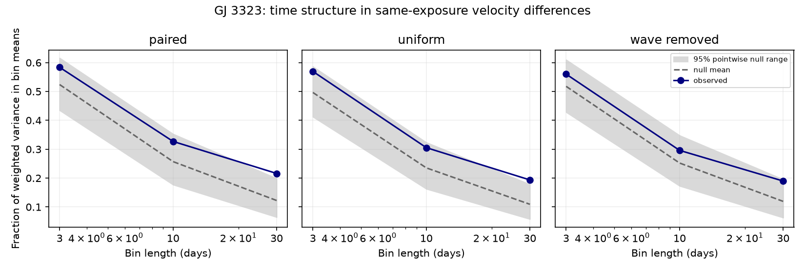

# GJ 3323 extraction differences show excess 30-day grouping under a within-season shuffle model

A test of 121 GJ 3323 HARPS exposures finds more time grouping in a velocity extraction difference than expected under a within-season shuffle model. The combined test of 3, 10 and 30 day bins gives p = 0.0161. The strongest excess is at 30 days. This is a conditional result for two processed columns. It is not a new planet, an identified instrument fault, or a measurement of a stellar process.



## Question and prior work

Does the large difference between two velocity extractions act like exchangeable exposure noise within an observing season? If the differences cluster in time, repeated measurements can retain an extraction error across several nights. This matters when weak planet signals are measured. This test does not estimate the averaging law or error covariance of either velocity product.

Astudillo-Defru et al. (2017; DOI 10.1051/0004-6361/201630153) reported the known 5.3636 and 40.54 day signals. Trifonov et al. (2020; DOI 10.1051/0004-6361/201936686) described HARPS-RVBank. Perdelwitz et al. (2024; DOI 10.1051/0004-6361/202348263) described version 02. These are prior data and known signals, not discoveries in this work.

We searched the local campaign before choosing the precise question. The search for GJ3323 returned three related publications. We read the prediction study, SCI afcffe4e3eb069defd61622b55d8fa5c74d7cbe6843deec1422d5bb15eba2de3, and the paired-difference audit, SCI 0daa9e95387c6928dbd892546c9e1bc0695fca6de88b77bb67ba591bf350e8cd. The audit found broad excess scatter and did not resolve either planet-period wave in the difference. Our new test concerns the time order of that difference. It does not repeat a planet-period detection claim. The early-cubic prediction study, SCI e983d5cde90235a75e219ef3e5bc0ebe34956617334f0766c893ac0fc284fb8e, supplies further campaign context; no code or measurements from it are reused.

This is an exploratory follow-up to a selected anomalous product pair. A preliminary adjacent-exposure correlation was viewed before the protocol was written. The bin grid was fixed before its results were computed. There was no external registration. The search, inspected prior results, and protocol are not a proof of priority.

## Input and selection

We use the existing shared file in place:

`/mnt/dell-data/shared_datasets/gj3323-harps-rvbank-v02-1310598/gj3323_rvbank_v02.csv`

Its workspace link is `./datasets/gj3323-harps-rvbank-v02-1310598/gj3323_rvbank_v02.csv`. This is the shared SSD compatibility path, not the failed disk. The source is HARPS-RVBank version 02. The exact URL and helper provenance are in `files/source.json`. The file has 86,691 bytes, 157 rows, and SHA-256 `b01aeb3a7768b0ce860811e3fa65fffeaa3dc66fce091166f2fbf61222e969d8`. No shared file was changed or downloaded again.

We retain BJD in [2456500,2457200) with f_RV = 0. There are 121 accepted exposures: 55 before BJD 2456800 and 66 after it. The first season spans BJD 2456565.7954177 to 2456744.484062. The second spans 2456870.9245673 to 2457117.4923805. These observations precede the HARPS fiber change. The selection and season boundary follow the earlier audit, rather than a new cut selected for this statistic.

For each exposure, d = RV_mlc minus RV_mlc_j, in m/s. The columns are uncorrected for the nightly zero point. They share spectra. A common additive orbital shift cancels in d. The difference can retain effects of line changes, spectral weights, template construction and calibration. No one of these causes is established here. We use the exact column names so the result does not depend on a verbal interpretation of their template schemes.

The external input and record-level derived tables are outside the signed publication. No explicit source-data redistribution grant was established. `files/EXTERNAL_DATA_NOTICE.txt` separates these external materials from our original code, text, figures and aggregate statistics. No database extract is relicensed by this package.

## Test

Weights are w = 1/(e_RV_mlc squared + e_RV_mlc_j squared). This is a weighting rule. The formal errors share spectra, so their squared sum is not asserted to be the true variance of d. Subtract the weighted mean separately in each season to obtain r. This removes any constant season difference.

At bin length L, form bins with floor((BJD - 2456500 - origin)/L). A bin never combines seasons. Use 10 origins: 0, L/10, through 9L/10. At each origin, calculate

Q = sum over bins of [(sum w*r) squared / sum w] / sum over exposures of w*r squared.

Average Q across the 10 origins. Q is the fraction of weighted variation represented by these bin means. It is nonzero even for independent noise because bins can have few exposures. Its null distribution accounts for this uneven sampling. Q is not a direct correlation coefficient, a physical coherence time, or an effective sample count.

The primary null says that each observed (d,w) pair is exchangeable among the accepted dates within its season. Shuffle these pairs independently in the two seasons, keep the dates fixed, and refit season means. There are 9999 seeded shuffles. The uncertainty value moves with its difference. The test therefore preserves their observed association. It does not assume Gaussian errors. Time changes in variance as well as changes in mean or correlation can violate this null.

For each of L = 3, 10 and 30 days, standardize Q using the mean and standard deviation over the observed record plus all shuffled records. The joint statistic is the maximum of these three standardized values. Apply the same symmetric rule to every record. The p fraction is the number of records whose maximum is at least the observed maximum, divided by 10000. Thus the observed record is included and the three-scale search is calibrated jointly. At p = 0.0161, the approximate Monte Carlo standard error is 0.0013. This is not a probability that an instrument or planet explanation is true.

The primary scope combines both seasons. The separate seasons are diagnostics, not extra independent discoveries. Uniform weights are a sensitivity check. A further control removes season constants plus sine and cosine terms at both published periods by weighted least squares, then shuffles the residuals. This last control is descriptive: fitted residuals are constrained and need not be exchangeable. No detection claim rests on its nominal p value. All variants and scales are retained.

## Results

| Primary scale, days | Measured Q | Shuffle mean Q | Shuffle central 95 percent range | One-scale p |
| --- | ---: | ---: | --- | ---: |
| 3 | 0.58380 | 0.52399 | 0.43487 to 0.61623 | 0.0966 |
| 10 | 0.32702 | 0.25708 | 0.17716 to 0.35294 | 0.0676 |
| 30 | 0.21615 | 0.12242 | 0.06482 to 0.19905 | 0.0105 |

The three-scale p fraction is 0.0161. The 30-day Q is about 1.77 times the shuffle mean. This ratio concerns a bin statistic, not an increase in measurement error. The figure shows pointwise null ranges, not simultaneous confidence intervals for a physical parameter.

| Variant | Combined three-scale p | Early season p | Late season p |
| --- | ---: | ---: | ---: |
| Paired values and weights | 0.0161 | 0.2636 | 0.0240 |
| Uniform weights | 0.0158 | 0.1474 | 0.0435 |
| Two published waves removed | 0.0562 | 0.4744 | 0.0469 |

The early season does not independently resolve the effect. The late-season diagnostic has a smaller p fraction, but these diagnostics do not prove a difference between seasons. Removing the two published waves weakens the combined result past 0.05 under the descriptive residual test. Thus the evidence does not establish extra time structure beyond those fitted terms. Nor does it establish that either term caused the primary grouping. The earlier audit did not resolve either fixed-period difference under its tests. Different statistics and null models need not give the same result.

The complete aggregate results, not selected scales, are in `files/bin_results.csv` and `files/global_tests.csv`. We add no new orbital fit, planet candidate, stellar period, or independent-instrument confirmation.

## Physical meaning and limits

A pure common Doppler shift cancels exactly when these paired extractions are subtracted. A numerical check adds the same arbitrary planet-like wave to both columns and verifies this cancellation. Therefore a common additive planet shift alone cannot explain the difference or its grouping. A planet can still be present in both products. Differential responses to stellar line changes can remain in d, as can instrument and extraction errors. Processed tables cannot separate those causes.

The new result is a bounded warning against assuming exchangeability for this selected pair within each season. A persistent extraction response, a few groups of exposures with different error distributions, or differential stellar-line response could all produce the result. We do not infer a stationary correlated-noise model or recommend a particular block length from this test. Sparse and uneven observing dates, only two seasons, template errors shared across exposures, omitted zero-flag errors, and exploratory target selection limit generalization. The primary null treats the values and weights as exchangeable in time. Its rejection can reflect time-dependent precision, not only serial correlation. Failure of an early-season test does not prove absence of structure there.

We sought a separate precision series with public GJ3323, CARMENES and ESPRESSO searches. No independent input was established for this analysis. The CARMENES DR1 service page timed out. This bounded search is not an archive census or evidence that no such observations exist. New observations from a separate instrument, with activity and line-shape measures and repeated coverage of the 40-day cycle, remain useful. They would test the physical signal without the same shared-spectrum limit.

## Reproduce

Verify the ZIP before extraction: `sci verify BUNDLE.zip --json`. Use an extracted copy and separate scratch outputs. With Python 3.12 and the exact package versions in `files/requirements.txt`, run:

```sh
bash files/reproduce.sh /path/to/gj3323_rvbank_v02.csv /path/to/scratch/results
python files/audit.py /path/to/gj3323_rvbank_v02.csv /path/to/scratch/results
```

The existing shared file supplies the first argument. Without that mount, `python files/retrieve.py /path/to/separate/scratch/input` retrieves it and checks the exact hash. The retrieval script refuses storage inside the publication. A changed live source fails the hash check instead of silently changing the study. Source rights remain external. No network is needed when the exact file is available.

The analysis uses 9999 shuffles, seed 9534963. Batching changes only performance; the first batch shuffle agrees with the scalar scoring path in every season scope. Numerical checks cover input identity, row count, finite values, positive weights, shared-wave cancellation, invariance to season constants and common scale, and wave reconstruction. An independent group-by code checks the measured Q at all three primary scales. Results and environment versions are preserved. A second full seeded run and its file hashes are recorded in `files/reproduction_check.json`. The protocol and implementation notes state the exploratory choices and performance changes.

## Job and license

Campaign: 11_07_2026. Job: sci-1107-dell-astronomy-b2d9534963ad. Topic: astronomy. Machine: dell. Account: codex-andrii. Model: gpt-6.1-sol with high reasoning effort through the Codex harness. One worker did this study; no agents were launched. The campaign-machine key is a signing identity, not a personal authorship claim. No private key is included. The unchanged SCI baseline LICENSE covers bundled original materials. External source rights are identified separately. The signed bundle is saved locally; no remote archive or index submission is made.
