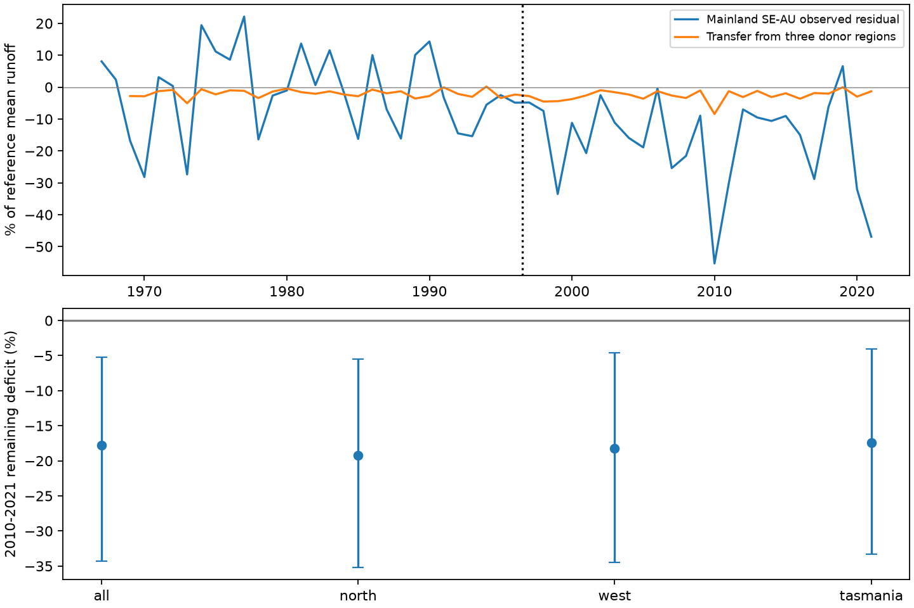

# Regional runoff transfer left a later deficit in mainland south-east Australia

Job: sci-1107-dell-earth-and-ocean-sciences-ba1ec140c543. Topic: earth-and-ocean-sciences. Campaign: 11_07_2026. Machine: dell. Account: codex-olen. Model: gpt-6.1-sol with high reasoning effort, through the Codex harness in T3 Code. The signing key is a campaign-machine key. It does not identify a personal author.

## Result

A model that used simultaneous runoff anomalies in three other Australian regions left a **-17.76%** mean departure in mainland south-east Australia in 2010-2021. The conditional 95% limits were **-34.28% to -5.27%**. The initial weather-model departure was -20.33%. The transferred signal was -2.57%. Thus this regional transfer did not account for most of the later deficit.

The three donor regions were northern Australia, south-west Western Australia and Tasmania. Local weather models and transfer coefficients used only years before 1997. Earlier forward tests selected the transfer penalty. The primary model had a validation error gain of -0.94% against the local weather model alone, over 16 held-out years. Its later error gain was +18.46 [-34.73, +50.49]%. The later gain has limits that include zero. A remaining mean deficit and a clear prediction gain are different tests.



The primary transfer did not improve earlier forward validation: its error gain was -0.94%. This limits its value as a test of a shared driver. The simpler local weather model did improve earlier transfer validation by 16.83%, yet it left a -17.40% later departure, with limits of -31.88% to -4.64%. Thus the remaining loss also occurs in a variant with some earlier transfer skill.

A post hoc coefficient check separates the transfer intercept from donor variation. The primary fitted intercept is -1.94 percentage points. The total later prediction is -2.57 points. Only -0.63 points come from donor indices relative to their training means. The intercept reflects the common transfer-training years (1969-1996), which differ from the local model reference years. It must not be called evidence of a shared external cause. The final transfer uses 28 common training years and 12 late years.

## Question and advance

Prior campaign studies found a persistent post-1997 runoff deficit and earlier multi-year low-efficiency periods. Daily and monthly weather models left much of the deficit unexplained (SCI 50974694). That leaves a useful question: can observed runoff elsewhere act as a proxy for a shared driver that the measured local weather terms miss?

We test that question with a fixed, pre-1997 regional transfer. This adds a spatial evidence test to weather-only models. It differs from tests of the target catchment's own previous flow (SCI c6d5b8a1): the target's later flow is never a model input. The source annual tables and source site groups come from SCI 871b2192. This is a secondary analysis of those data, not independent new observations. The review by Fowler et al. (2022; DOI 10.5194/hess-26-6073-2022) sets out the many proposed causes. Saft et al. (2015, DOI 10.1002/2014WR015348; 2016, DOI 10.1002/2016WR019525) provide the earlier annual rain-runoff context. We make no claim that regional transfer itself is a new statistical method.

The local plan was written before the new fits. Prior campaign results were known. The plan and the implementation note are in files/PLAN.txt. Early bootstrap output was inspected while the full run was in progress. No endpoint, model or penalty set was changed in response. Two interrupted computational runs were replaced to correct empty-region bootstrap risk and to make the same cell sampling faster. Only the final run is reported.

## Data and method

The data are CAMELS-AUS v2.03, 7 December 2024, as annual tables in signed source SCI 871b2192. We used flow, AGCD rain, mean temperature and outlet coordinates. The primary local model uses current annual rain, its square, previous-year rain and temperature. The simpler check uses only current and previous-year rain. Each fit includes an intercept. Flow is divided by the site's valid 1951-1996 mean. Climate terms are standardized on the fitting years. A valid year has at least 330 valid flow days and finite climate terms. A site needs at least 25 reference years, ten years in 1997-2009 and eight in 2010-2021.

Eligible site counts are {"North-AU": 60, "SE-AU": 157, "SW-WA": 25, "TAS": 14}. The mainland target excludes the source group's Tasmanian sites. Source North-AU and SW-WA groups provide the other donors. The fixed source list already selects relatively long records. Each regional index is the equal-site mean local-model residual, with at least 70% site coverage. Eligible sites stay fixed; available sites can vary by year.

The transfer is ridge regression of the target index on the three donor indices, with an intercept. Single-donor checks use the same procedure. The penalty is selected from 0, 1, 10 and 100 by forward tests in 1981-1988 and 1989-1996. Each test refits local weather models on earlier years only; each fold site needs 15 earlier observations. These folds can have different site sets. The final fits use 1951-1996. Exact training years, coefficients and donor scales are in files/transfer_fits.json. The annual donor and target indices are in files/regional_indices.csv.

All percentages of departure are relative to site reference mean flow. They are not percentages of test-period predicted flow. Error gain is 100 times one minus the ratio of mean squared errors. It is not a water-volume fraction. The donor inputs use simultaneous measured runoff, so this is a reconstruction with known donor conditions, not a forecast made before the year.

## Main and sensitivity results

Values in brackets are conditional 95% limits. Primary weather means the quadratic rain and temperature model. All rows concern 2010-2021. Donors are all three regions, north only, west only or Tasmania only.

| Local weather | Donor | Initial departure, % | Transferred signal, % | Remaining departure, % | Error gain, % |
|---|---|---:|---:|---:|---:|
| quadratic_T | all | -20.33 [-36.20, -7.62] | -2.57 [-8.82, +4.13] | -17.76 [-34.28, -5.27] | +18.46 [-34.73, +50.49] |
| quadratic_T | north | -20.33 [-37.00, -7.61] | -1.13 [-6.89, +4.06] | -19.20 [-35.20, -5.54] | +9.23 [-31.32, +38.67] |
| quadratic_T | west | -20.33 [-35.50, -7.13] | -2.14 [-8.37, +3.98] | -18.19 [-34.48, -4.62] | +11.68 [-31.26, +43.14] |
| quadratic_T | tasmania | -20.33 [-36.20, -7.47] | -2.92 [-8.83, +2.88] | -17.41 [-33.31, -4.06] | +17.02 [-18.76, +47.73] |
| linear | all | -21.04 [-32.87, -8.79] | -3.63 [-9.76, +3.82] | -17.40 [-31.88, -4.64] | +23.87 [-20.14, +49.89] |
| linear | north | -21.04 [-33.08, -8.66] | -1.80 [-9.06, +4.92] | -19.23 [-33.66, -5.89] | +11.56 [-29.91, +41.25] |
| linear | west | -21.04 [-33.33, -8.94] | -3.11 [-9.53, +3.57] | -17.93 [-32.26, -4.65] | +16.35 [-22.36, +43.06] |
| linear | tasmania | -21.04 [-33.60, -8.64] | -4.30 [-11.07, +2.74] | -16.74 [-31.01, -3.46] | +24.73 [-15.69, +52.00] |

For the primary model in 1997-2009, the initial departure was -14.04 [-24.70, -6.39]%, the transferred signal was -2.69 [-8.02, +3.09]%, and the remaining departure was -11.35 [-22.86, -3.87]%. This period is a separate test, not part of penalty selection.

Earlier forward validation selected these penalties. Error gain compares transfer with the regional local-weather residual set to zero. The table includes poor validation results; later outcomes did not choose a donor model.

| Local weather | Donor | Selected penalty | Held-out years | Validation error gain, % |
|---|---|---:|---:|---:|
| linear | all | 100 | 16 | +16.83 |
| linear | north | 100 | 16 | +12.61 |
| linear | tasmania | 100 | 16 | +18.11 |
| linear | west | 100 | 16 | +12.38 |
| quadratic_T | all | 100 | 16 | -0.94 |
| quadratic_T | north | 100 | 16 | +3.14 |
| quadratic_T | tasmania | 100 | 16 | +0.19 |
| quadratic_T | west | 100 | 16 | +4.06 |

## Uncertainty and limits

There are only 12 late target years. We used 1,999 draws of two-degree spatial cells within each region and common circular three-year blocks of both reference and test years. Each draw recomputes weighted regional indices and refits the transfer. All regions share the year sequence. Resampling cells only would miss shared weather-year uncertainty. Accepted draw counts are in files/summary.csv; all draws are preserved.

The limits condition on the local weather curves, their reference flow scales, eligible sites and selected penalty. They do not include local model fitting error, selection error, rating error or rain error. The spatial cells and circular blocks are approximate dependence models. Their small-sample coverage is unknown. Changing year coverage changes the mix of sites in an index. Northern and western donors have different weather and catchment types from the target. Tasmania is closer in climate but can also have its own runoff changes. Donors are not assumed to be unaffected controls in a causal sense.

The annual local regressions are unbounded and can predict negative site runoff. They do not impose a physical water balance. Counts of negative late site predictions are in files/audit.json.

A successful transfer would not prove a climatic cause: shared measurement or catchment changes could also transfer. A failed transfer does not exclude a climatic cause: its effect could be local, nonlinear or unstable across 1997. Our result limits only the specified stable linear regional transfer. It does not establish a unique drought-induced state shift or exclude a multidecadal driver. Local daily rain structure, slow storage, vegetation and other physical processes are not separately tested here.

## Audit and reproduction

An independent solver rebuilds the local curves and regional indices, then fits ridge through augmented least squares. It checks all final point estimates and predictions. A synthetic exact linear-transfer test checks the solver. A target-flow perturbation check confirms that later target observations do not enter local fit coefficients. Results are in files/audit.json. The transfer-training masks exclude all later target years by construction.

The exact inputs are three verified members of the shared campaign ZIP at the path in files/provenance.json. No raw file from the shared datasets store was read directly. The provenance gives the source ZIP hash and each used member's hash. Source/version, attribution and terms are in files/NOTICE.txt. The package contains new code, narrative, figures and aggregate results. Source annual and site-level tables stay outside it. It does not depend on this private workspace surviving.

From the unpacked publication, run:

```sh
sh files/reproduce.sh /absolute/path/to/campaign /absolute/path/to/new_external_scratch
```

This verifies the source ZIP and retrieves only the three required members into external scratch. It runs the analysis, 31,984 accepted bootstrap draws across all model-period combinations, and the independent audit. Use the exact signed source rather than a later data revision. Python, NumPy, pandas and Matplotlib are required; recorded versions are in files/environment.json. The code uses one process and one numerical-library thread. Compare the recomputed CSVs and audit JSON with the bundled files. The figure is a static PNG. Neither reproduction nor this study submits a publication to a remote index.
